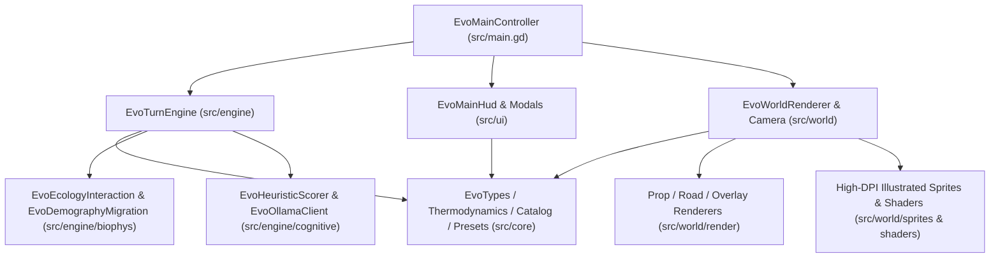

# Evolution Blueprint (`AGENTS.md`)

## System Overview
**Evolution** is an interactive bio-cultural and evolutionary population simulator built with **Godot 4.7** (GDScript) on a `169`-hex (`map_radius = 7`) 2.5D illustrated isometric hexagonal ecosystem. The player configures 1v1 Evolutionary Strategy Duels (`Strategy A` vs. `Strategy B`), authors custom strategies/traits/decisions, and applies selective environmental pressures (biome brushes, altitude, carrying capacity $K$, and sea level) while single-deme-per-hex subpopulations (*demes*) autonomously evaluate decisions via dual local Ollama System 1 models (`d3:4b` and `tev1:4b`), extract resources, cultivate adjacent rural hinterlands (`crops` and `pasture`), manage urban salubrity (`salubrity` and epidemics), form alliance pacts or vendettas, construct hex-edge perimeter fortifications, wage wars, migrate, absorb lower-tier neighbors or unite same-tier cities into continuous multi-hex walled unions (`walled_union_id`), and undergo Baldwin assimilation, cultural innovation, or allopatric speciation.

## Subdirectories & System Boundaries
- **Source Root & Main Controller**: [./src/README.md](./src/README.md) — Top-level scene controller (`EvoMainController`) orchestrating simulation playback, input handling, and subsystem wiring.
  - **Core Domain & Catalogs**: [./src/core/README.md](./src/core/README.md) — Domain data structures (`EvoTypes`), 6-axis thermodynamic conservation (`EvoThermodynamics`), axial hex math (`HexMath`, `HEX_SIZE = 240.0`), base catalogs (`EvoCatalog`), `169`-hex scenario presets (`EvoPresets`), bilingual localization (`EvoI18n`), and user disk settings/catalog persistence (`EvoUserSettings`).
  - **Simulation Turn Engine**: [./src/engine/README.md](./src/engine/README.md) — Generational turn pipeline (`EvoTurnEngine`, `EvoEnvPhase`, `EvoDecisionModel`, `EvoBiophysPhase`, `EvoMilestonePhase`) and player environmental intervention brushes.
    - **Biophysical & Demographic Engine**: [./src/engine/biophys/README.md](./src/engine/biophys/README.md) — Resource extraction, rural hinterland (`crops`/`pasture`) cultivation & pillaging (`has_ruins`), Hawk-Dove competition, cultural symbiosis, pacts/betrayals/raids/tribute/fortifications (`EvoEcologyInteraction`), and demographic growth, urban salubrity (`salubrity`) & epidemic outbreaks, warband invasions, colonist budding, extinctions, asymmetric category absorption, and same-category multi-hex walled unions (`EvoDemographyMigration`).
    - **Cognitive System 1 & Ollama Client**: [./src/engine/cognitive/README.md](./src/engine/cognitive/README.md) — Decision eligibility, geopolitical context inspection, environmental weight modulation, emergent trait synthesis (`EvoHeuristicScorer`), and threaded HTTP worker pool for local Ollama models (`EvoOllamaClient`).
  - **UI Subsystem**: [./src/ui/README.md](./src/ui/README.md) — Root HUD (`EvoMainHud`), shared pixel-art parchment/wood theme (`EvoUiStyle`), and interactive modals (`EvoLabModal`, `EvoNotebookModal`, `EvoTreeModal`).
    - **HUD Sub-Components**: [./src/ui/hud/README.md](./src/ui/hud/README.md) — Modular HUD builders for top bars and settings (`EvoHudTopBar`), 10-slot hotbar and legend (`EvoHudHotbarDock`), 3-tab scroll inspector (`EvoHudInspectorPanel`), and milestone banners/toasts/startup modals (`EvoHudBannersToasts`).
  - **2.5D World Presentation & Asset Subsystem**: [./src/world/README.md](./src/world/README.md) — Multi-layer 2.5D hex renderer (`EvoWorldRenderer`, `TEXTURE_FILTER_LINEAR_WITH_MIPMAPS`), locked-yaw (`0.0`) 2.5D camera (`EvoCameraController`), GPU shaders (`ocean_waves.gdshader`, `hex_terrain.gdshader`, `prop_sway_glow.gdshader`), and high-DPI procedural PNG asset cache (`EvoPixelArtGen`).
    - **World Render Pass Helpers**: [./src/world/render/README.md](./src/world/render/README.md) — Single-deme full-hex 4-tier (`I..IV`) settlement, rural hinterland (`crops`, `pasture`, `has_ruins`), and flora prop layout (`EvoPropFloraRenderer`), inter-hex road, rural farm track, hex-edge perimeter wall, and multi-hex walled union rendering (`EvoRoadNetworkRenderer`), and screen-space deme billboards with salubrity indicators (`EvoWorldOverlayRenderer`).
    - **Procedural Illustrated Sprites**: [./src/world/sprites/README.md](./src/world/sprites/README.md) — Base canvas (`EvoPixelCanvas`, `#23150c` ink outlines), `256x224` biome hex tile and `128x128`–`160x160` flora sprites (`EvoTerrainSprites`), and `128x128`–`160x160` village buildings, `48x48` villagers, and `64x64` UI icons (`EvoVillageUiSprites`).

## Global Invariants
- **Single-Deme-Per-Hex Exclusivity (`cell.deme_ids.size() <= 1`)**: Every habitable hex cell holds at most one deme (`cell.deme_ids.size() <= 1`). All cooperation, competition, trade, raids, wars, and synoecism occur across adjacent hex edges (`HexMath.get_neighbor_ids`), and `HexMath.compute_village_sector_offset` returns `Vector2.ZERO`.
- **4-Tier Urban Hierarchy & Dual Synoecism (`[src/core/types.gd:get_village_tier]`, `[src/engine/biophys/demography_migration.gd:run_synoecism_phase]`)**: Settlements progress across 4 categories (`I..IV`). Allied neighbors of different categories (`tier_a != tier_b`) undergo Asymmetric Category Absorption (vacated hex converts to `"crops"`/`"pasture"` owned by the host city); allied neighbors of identical category (`tier_a == tier_b >= 2`) form a Continuous Multi-Hex Walled Union (`walled_union_id`), remaining on their respective hexes while culling the shared internal wall edge and pooling defense.
- **Thermodynamic Conservation (`[src/core/thermodynamics.gd:evaluate_thermodynamics]`)**: Every biological trait, cultural tradition, and behavioral decision maps to a clamped 6-axis `BiophysicalVector` (`[-1.0, 1.0]` for metabolic, extraction, ecological, mobility, and social axes; `[0.0, 1.0]` for transmission threshold), where positive advantages beyond `BASE_BUDGET` (`0.60`) require commensurate metabolic or ecological cost (`current_cost >= 0.5 * (positive_advantages - 0.60)`) unless `free_sandbox_mode` is enabled.
- **Dual-Inheritance Cultural Capacity (`[src/core/catalog.gd:deme_has_cultural_capacity]`)**: Acquiring, retaining, or executing cultural traits (`cul-*`) and cultural decisions (`dec-exchange-symbiosis`, `dec-explore-innovate`) requires at least one biological trait with `enables_cultural_transmission == true` (`bio-encephalization` or `bio-social-instinct`).
- **Deterministic 4-Phase Turn Pipeline (`[src/engine/turn_engine.gd:advance_generation]`)**: Every generation executes in strict sequential order: `EvoEnvPhase.run_environmental_phase` -> `EvoDecisionModel.evaluate_all_demes` (blending `0.75` Ollama System 1 probabilities with `0.25` environmental weights) -> `EvoBiophysPhase.run_biophysical_phase` -> `EvoMilestonePhase.run_milestone_phase` -> `EvoDecisionModel.prefetch_for_state`.
- **Ollama Startup & Thread Safety Gate (`[src/ui/main_hud.gd:_set_startup_blocked]`, `[src/engine/cognitive/ollama_client.gd:_mutex]`)**: Simulation playback and manual turn stepping remain blocked if local Ollama (`127.0.0.1:11434`) is unreachable or required decision models are missing; all cross-thread worker caches in `EvoOllamaClient` are guarded by `_mutex` and validated against `_cache_epoch`.

## Global Side Effects
- **User Config & Custom Catalog Persistence (`[src/core/user_settings.gd:save_settings]`, `[src/core/user_settings.gd:save_user_catalog]`)**: Reads and writes user model/context preferences to `~/.config/Evolution/settings.json` and custom strategies/traits/decisions to `~/.config/Evolution/user_catalog.json`.
- **World Snapshot Import/Export (`[src/ui/main_hud.gd:_on_export_pressed]`, `[src/ui/main_hud.gd:_on_import_pressed]`)**: Serializes and deserializes full `EvoTypes.WorldState` JSON snapshots at `user://evolution_world_state.json`.
- **Procedural Sprite Disk Cache (`[src/world/pixel_art_gen.gd:ensure_all_assets]`)**: Generates and writes high-DPI procedural illustrated PNG textures and `schema_version.txt` (`v3_illustrated_hdpi`) under `res://assets/sprites/terrain/`, `res://assets/sprites/villages/`, and `res://assets/sprites/ui/`.
- **Local Ollama HTTP Worker Pool (`[src/engine/cognitive/ollama_client.gd:EvoOllamaClient]`)**: Spawns background `WorkerThreadPool` tasks that communicate over HTTP with `127.0.0.1:11434` (`/api/tags`, `/api/pull`, `/v1/systemone`).

## System Verification
- Run: `godot --headless --path . --script res://tests/test_runner.gd`
