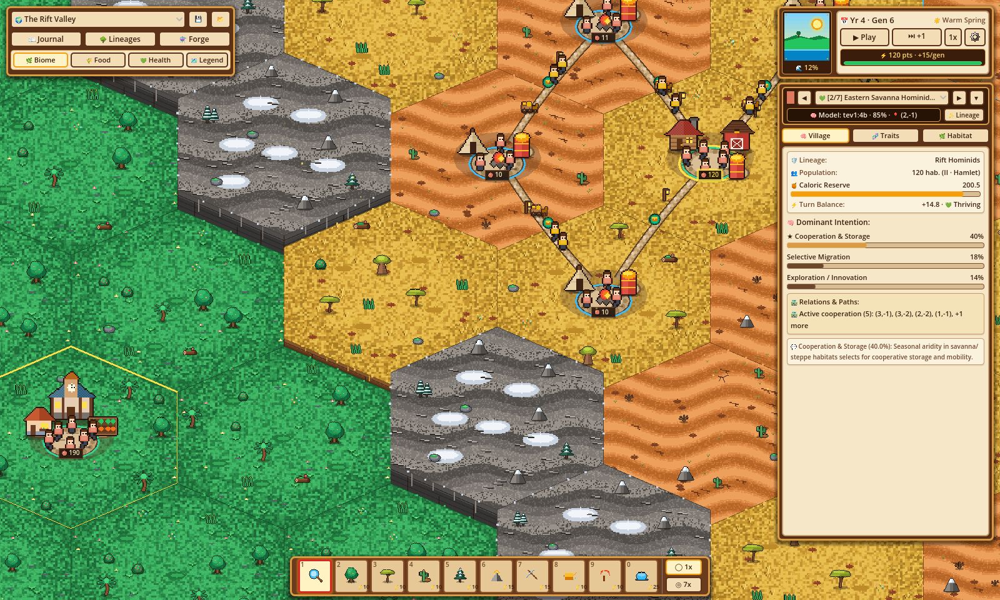
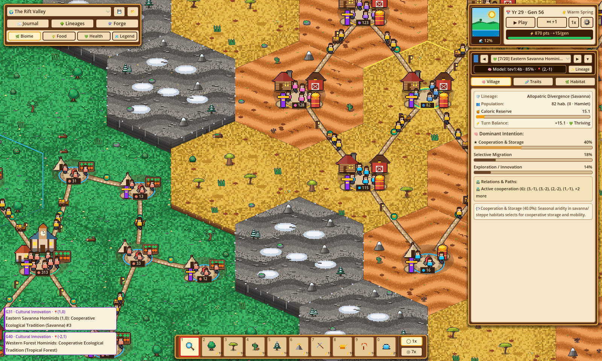
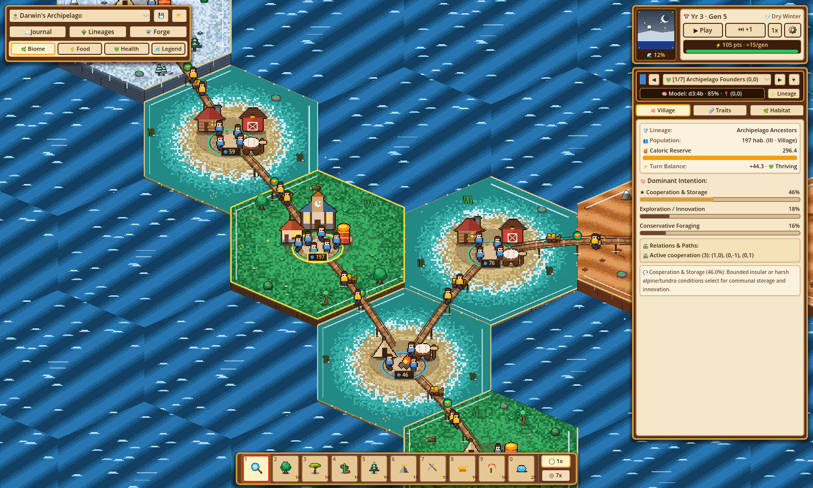
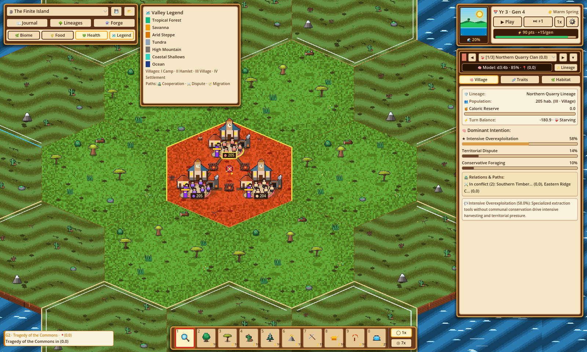
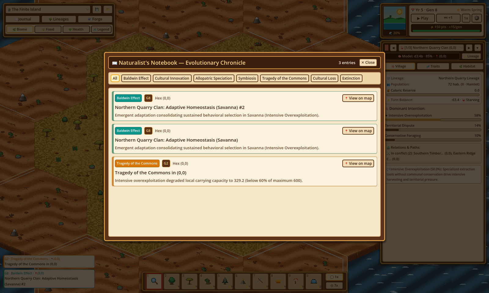
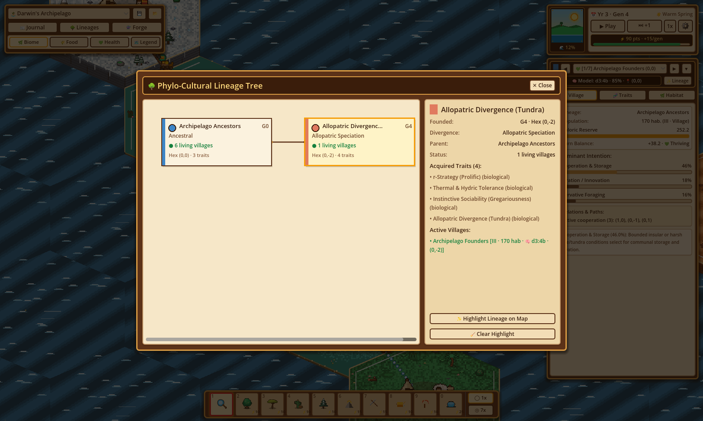
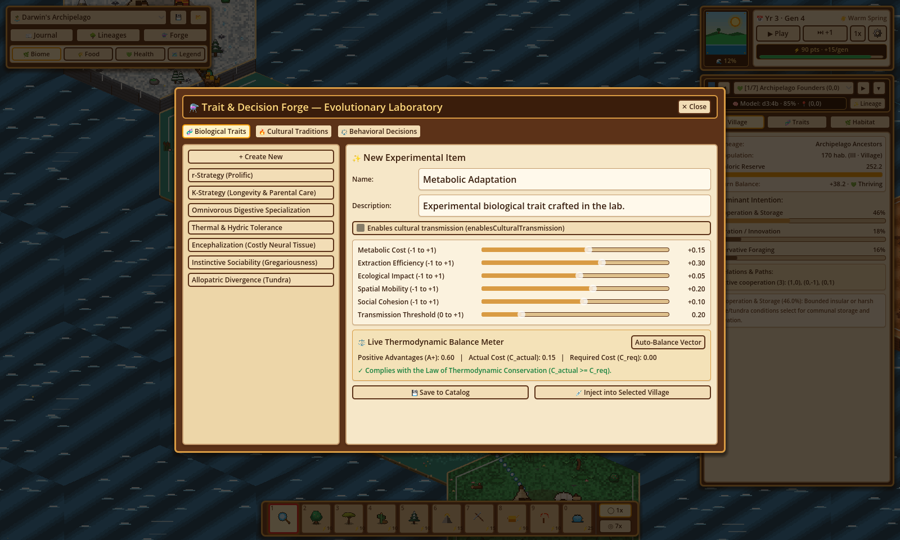

# Evolution

[](https://github.com/arrase/Evolution/actions/workflows/ci.yml)
[](https://github.com/arrase/Evolution/actions/workflows/codeql.yml)
[](https://github.com/arrase/Evolution/actions/workflows/security.yml)

**Evolution** is an interactive bio-cultural and evolutionary population simulator built with **Godot 4.7**, featuring a handcrafted cozy pixel-art aesthetic on an isometric hexagonal ecosystem.

Rather than commanding individual units directly, you act as the **Selective Pressure** and **Evolutionary Architect**—shaping climates, terrain altitude, sea levels, habitat carrying capacity ($K$), and genetic or cultural traits—while local subpopulations (*demes*) autonomously evaluate their surroundings, adapt, migrate, cooperate, innovate, or diverge into new species.



---

## Key Features

### 1. Authentic Evolutionary & Socio-Cultural Dynamics
The simulation separates **behavioral intent** (probabilistic decision-making per deme) from **biophysical consequence** (deterministic laws of energy conservation, carrying capacity $K$, metabolic cost, and demography):
- **$r/K$ Selection Trade-offs:** Prolific dispersal vs. high-longevity carrying-capacity buffering.
- **The Baldwin Effect (Genetic Assimilation):** Sustained behavioral plasticity under environmental stress consolidates into heritable biological adaptations.
- **Dual Inheritance Theory:** Populations with cognitive or social capacity (*Encephalization* or *Instinctive Sociability*) unlock cumulative cultural traditions, toolmaking, and horizontal cultural transmission across trade routes.
- **Evolutionary Game Theory:** Cohabiting and neighboring demes navigate *Hawk-Dove* territorial disputes, reciprocal symbiosis, or the *Tragedy of the Commons* when intensive overexploitation degrades $K$ below $60\%$ of $K_{\max}$.
- **Allopatric Speciation:** Geographic isolation across mountain ridges or flooded glacial land bridges triggers phylogenetic divergence into new lineages.

### 2. Dual-Frequency Multi-Model Cognitive Architecture (Ollama + Heuristic Engine)
- **System 1 (High-Frequency Turn Scoring — `d3:4b` & `tev1:4b`):** Evaluates each deme and its 6-hex neighborhood every generation, deterministically assigning subpopulations across the primary (`d3:4b`) and secondary (`tev1:4b`) decision models to compute normalized probability distributions over behavioral archetypes.
- **System 2 (Low-Frequency Milestone Synthesis — `gemma4:e2b`):** Synthesizes emergent traits, cultural innovations, and natural history chronicle entries within strict thermodynamic bounds.
- **Zero-Latency Deterministic Fallback:** Runs seamlessly offline or while background Ollama worker threads complete via a calibrated 6-axis biophysical heuristic scorer.

### 3. Standardized 6-Axis Biophysical Vector & Thermodynamic Conservation
Every biological trait, cultural tradition, and behavioral decision maps to a bounded 6-axis vector:
1. `metabolic_cost` ($[-1, +1]$)
2. `extraction_efficiency` ($[-1, +1]$)
3. `ecological_impact` ($[-1, +1]$)
4. `spatial_mobility` ($[-1, +1]$)
5. `social_cohesion` ($[-1, +1]$)
6. `transmission_threshold` ($[0, +1]$)

No trait or decision can violate thermodynamic conservation: high caloric extraction or neural complexity requires commensurate metabolic or ecological costs.

---

## Scientific Scenarios & World Presets

### The Rift Valley (`preset-rift-savanna`)
A tectonic mountain ridge divides a stable western tropical rainforest from a drying eastern savanna-steppe mosaic. Eastern demes under seasonal aridification elevate cooperation, storage, and migration, driving Baldwin assimilation and cultural innovation while western forest populations maintain conservative foraging.



### Darwin's Archipelago (`preset-darwin-archipelago`)
Volcanic islands linked by shallow coastal land bridges that periodically emerge and flood with glacial sea-level cycles. Founders disperse across temporary land bridges during low tides and undergo allopatric speciation when rising seas isolate island populations across tundra, forest, and arid steppe biomes.



### The Finite Island (`preset-finite-island`)
A fertile but geographically bounded island surrounded by deep ocean and inhabited by three competing clans equipped with specialized extraction tools. Without communal conservation norms, intensive overexploitation degrades local carrying capacity $K$ and triggers the *Tragedy of the Commons*.



---

## Interactive Modals & Analytical Tools

### Naturalist's Notebook — Evolutionary Chronicle
Tracks every evolutionary milestone (Baldwin Effect, Cultural Innovation, Allopatric Speciation, Symbiosis, Tragedy of the Commons, Cultural Loss, and Extinction) with category filters and one-click camera jumps to the exact hexagon where the event occurred.



### Phylo-Cultural Lineage Tree
Visualizes ancestral and diverged lineages, founding and extinction generations, acquired biological and cultural traits, and active villages, with interactive map lineage highlighting.



### Trait & Decision Forge — Evolutionary Laboratory
An open catalog editor to inspect, tweak, or craft new biological traits, cultural traditions, and behavioral decisions with a live **Thermodynamic Balance Meter** (`Auto-Balance Vector`) and direct trait injection into any active village.



---

## Controls & God-Mode Hotbar

| Input / Shortcut | Action |
| :--- | :--- |
| **Left Click** | Select village or hex (Observe mode) / Apply active terrain or climate brush |
| **Right Click + Drag** / **Middle Click + Drag** | Pan camera across the hexagonal valley |
| **Mouse Wheel** | Zoom camera in / out |
| **Space** | Toggle Play / Pause generational simulation |
| **Keys `1` – `0`** | Equip slot from the 10-slot bottom Hotbar (`1`: Observe, `2–6`: Biome Brushes, `7–8`: Raise/Lower Altitude, `9`: Enrich Food $K$, `0`: Sea Level) |
| **Escape** | Close active modal or return to the `Observe` tool |

---

## Getting Started

### Prerequisites
- **Godot Engine 4.7+** (`4.7.2-stable` recommended)
- *(Optional)* **[Ollama](https://ollama.com/)** running locally on `http://127.0.0.1:11434` for live LLM cognitive scoring (`d3:4b`, `tev1:4b`) and milestone synthesis (`gemma4:e2b`). If Ollama is not running, the simulator automatically uses its built-in deterministic biophysical heuristic engine.

### Running from Source
```bash
# Import project assets and launch the simulator
godot --path .
```

### Running the Automated Test Suite
The repository includes a headless unit, integration, and UI verification suite covering hexagonal math, thermodynamic conservation, demographic turn phases, i18n, and HUD interactions:
```bash
godot --headless --path . --script res://tests/test_runner.gd
```

### Regenerating Documentation Screenshots
To regenerate all English screenshots in `docs/images/`:
```bash
godot --path . --script res://tests/test_visual_capture.gd
```

---

## Project Structure

```text
├── assets/                 # Themes and sprite directories
├── docs/images/            # Application screenshots (ignored by Godot import via .gdignore)
├── scenes/main.tscn        # Root scene entry point
├── src/
│   ├── main.gd             # Main controller, turn loop timer, and signal orchestration
│   ├── core/               # Data structures (EvoTypes), 6-axis thermodynamics, hex math, catalog, presets, i18n
│   ├── engine/             # Generational turn engine, biophysical phases, and dual-model cognitive engine
│   ├── ui/                 # Pixel-art HUD, scroll inspector, hotbar dock, and modals (Journal, Lineages, Forge)
│   └── world/              # 2.5D isometric hexagonal renderer, procedural pixel-art sprites, road networks, camera
└── tests/                  # Headless simulation/UI test runner and visual capture script
```
