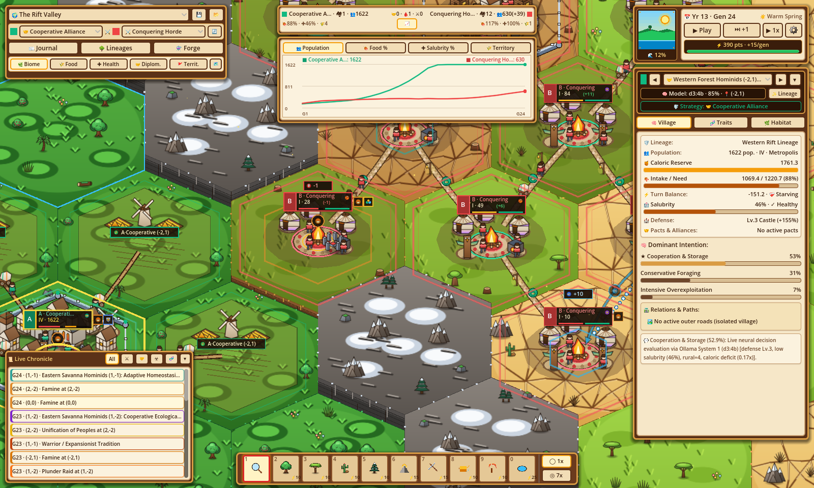
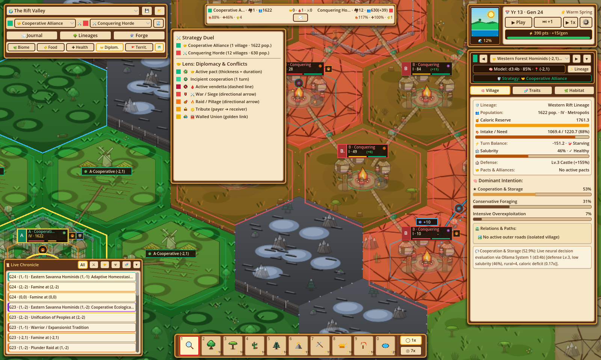
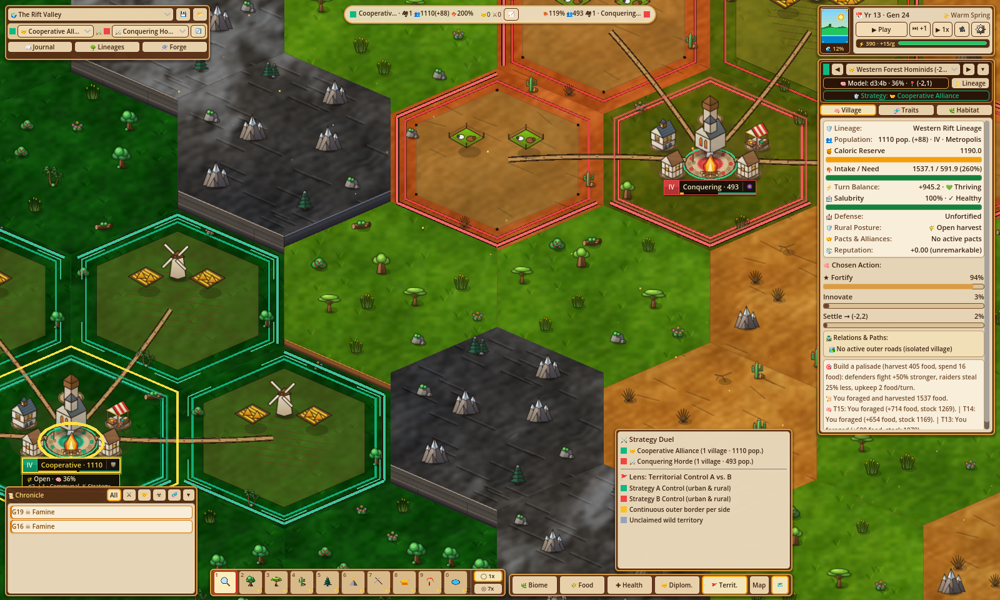

# Evolution

[](https://github.com/arrase/Evolution/actions/workflows/ci.yml)
[](https://github.com/arrase/Evolution/actions/workflows/codeql.yml)
[](https://github.com/arrase/Evolution/actions/workflows/security.yml)

**Evolution** is an interactive bio-cultural and evolutionary population simulator built with **Godot 4.7**, featuring a high-DPI 2.5D illustrated isometric hexagonal ecosystem (`169` hexes, `map_radius = 7`) powered by a GPU ocean wave shader (`ocean_waves.gdshader`) and procedural `#23150c` ink-outlined artwork (`v4_readability`).

Rather than commanding individual units directly, you act as the **Selective Pressure** and **Evolutionary Architect**—configuring **1v1 Evolutionary Strategy Duels (`Strategy A ⚔️ Strategy B`)** before pressing Play, forging custom strategies and traits, and shaping climates, terrain altitude, sea levels, and habitat carrying capacity ($K$)—while single-deme-per-hex subpopulations (*demes*) autonomously choose both a **rural defense posture** and a **concrete targeted action**, cultivate adjacent rural hinterlands (`crops` and `pasture`), manage urban salubrity (`salubrity`), erect hex-edge perimeter fortifications, unite into multi-hex walled conurbations (`urban_hex_ids`, up to `3` districts), innovate, or diverge into new species.


---

## Key Features

### 1. 1v1 Evolutionary Strategy Duels (`Strategy A ⚔️ Strategy B`)
Before launching a simulation at Generation 0, you choose which two **Evolutionary Strategies** (`EvoTypes.StrategyDef`) will face off across the `169`-hex valley—or forge your own in the **Evolutionary Laboratory** (persisted automatically to `~/.config/Evolution/user_catalog.json`). Each strategy bundles compatible biological adaptations, cultural traditions, and a natural-language **Doctrine**, imbuing its founding lineage and daughter settlements with a distinct emblem, color identity, faction slot (`A` / `B`), and combined 6-axis biophysical footprint:

| Strategy ID | Emblem & Name (EN / ES) | Color | Bundled Traits (`bio-*` + `cul-*`) | Evolutionary Philosophy |
| :--- | :--- | :---: | :--- | :--- |
| `strat-cooperation` | 🤝 **Cooperative Alliance**<br>*Alianza Cooperativa* | `#10B981` | `bio-k-strategy`, `bio-social-instinct` + `cul-communal-conservation` | Fosters social cohesion, communal habitat conservation, sanitation, and formal alliance pacts. |
| `strat-expansion` | 🧭 **Expansionist Pioneers**<br>*Pioneros Expansionistas* | `#3B82F6` | `bio-r-strategy`, `bio-thermal-tolerance`, `bio-social-instinct` + `cul-fire-processing` | Fast reproduction, high mobility, and thermal tolerance to colonize new corridors and territories. |
| `strat-trade` | ⚖️ **Merchant League**<br>*Liga Mercantil* | `#F59E0B` | `bio-k-strategy`, `bio-encephalization` + `cul-interdeme-barter` | Drives inter-village barter, commercial symbiosis, trust building, and horizontal cultural diffusion. |
| `strat-war` | ⚔️ **Conquering Horde**<br>*Horda Conquistadora* | `#EF4444` | `bio-r-strategy`, `bio-social-instinct` + `cul-warrior-expansion`, `cul-extraction-tools` | Aggressive martial expansion, border raids, tribute coercion, and intensive extraction to dominate rival territories. |
| `strat-innovation` | 🔬 **Innovator Technocrats**<br>*Tecnócratas Innovadores* | `#A855F7` | `bio-encephalization`, `bio-digestive-spec` + `cul-fire-processing`, `cul-extraction-tools` | High encephalization, thermal food processing, and specialized extraction toolkits to accelerate cultural innovation. |

### 2. Single-Deme-Per-Hex Ecology, 4-Tier Urbanism, Rural Postures & Salubrity
Every scenario operates on a **`169`-hex (`map_radius = 7`, `HEX_SIZE = 240.0`)** pointy-top axial grid where each inhabited hex belongs to a single settlement (`cell.deme_ids.size() <= 1`), while unified cities can span up to **`3` contiguous urban districts (`urban_hex_ids`)**. All trade, cooperation, raids, wars, and synoecism occur across perimeter hex edges:

- **4-Tier Urban Hierarchy (`I..IV` — `Deme.get_village_tier()`):**
  - **`I · Camp / Campamento` (`tier == 1`):** Nomadic frontier camp (`population < 120`, `defense_tier == 0`) with thatched huts (`hut_thatch`) and central campfires (`campfire`); relies entirely on local hex foraging (`URBAN_FORAGE_MULT = 1.0`).
  - **`II · Village / Aldea` (`tier == 2`):** Settled village (`population >= 120` or `defense_tier >= 1`) with clay houses (`house_clay`), granaries (`granary`), and watchtowers (`watchtower`); claims up to **`1` adjacent rural hinterland hex** (`URBAN_FORAGE_MULT = 0.90`).
  - **`III · Town / Villa` (`tier == 3`):** Urbanized town (`population >= 240`, or `>= 170` with fortifications or prior absorption) with stone houses (`house_stone`), temple totems (`temple_totem`), and windmills (`windmill`); local wild foraging drops (`URBAN_FORAGE_MULT = 0.65`) while rural capacity grows to **`2` adjacent hinterland hexes**.
  - **`IV · Metropolis / Metrópolis` (`tier == 4`):** Monumental walled city (`population >= 380`, or `>= 280` with `defense_tier >= 2`, `merged_count >= 1`, or multi-hex union `is_multi_hex()`) crowned by a citadel keep (`citadel_keep`) and cathedral (`cathedral`); local wild foraging drops to `0.40` while the city cultivates up to **`4` adjacent rural hinterland hexes** (plus `+1` bonus rural slot per extra urban district).
- **Rural Hinterlands (`crops` & `pasture`), Defense Postures & 3-Turn Ruins (`ruin_turns`):**
  - Tier II–IV settlements automatically claim adjacent uninhabited passable hexes, converting fertile biomes into wheat fields (`crops`, `crop_field`, `windmill`) and arid/tundra biomes into livestock pastures (`pasture`, `pasture_pen`) connected by rural farm tracks with animated `covered_wagon`s.
  - Every turn, each settlement selects a **Rural Defense Posture (`DEFENSE_POSTURES`)** alongside its main action: **`open_harvest`** (`100%` harvest, `25%` rural militia, `0%` crop shield), **`patrol_fields`** (`90%` harvest, `55%` rural militia, `65%` crop shield, places rural watchtowers), or **`mobilized_garrison`** (`78%` harvest, `80%` rural militia, `85%` crop shield).
  - Unprotected or overwhelmed rural fields pillaged during raids lose up to `26.0` biomass and are scorched into **3-turn persistent stone ruins (`ruin_turns = 3`, `has_ruins = true`)** before recovering for re-cultivation.
- **Urban Salubrity, Epidemic Contagion & Post-Epidemic Immunity (`EvoEpidemicSalubrity`):**
  - High urban crowding (`pop / eff_K + 0.12 * max(0, tier - 2)`) and warm humid climates degrade `salubrity` (`[0.05, 1.0]`), whereas `cul-communal-conservation` (`+0.20`) and `bio-k-strategy` (`+0.14`) bolster public health.
  - When **`salubrity < 0.38` with `population >= 130`**, an **Urban Epidemic Outbreak (`"epidemic"`)** can erupt (`15%` initial mortality, `infection_turns = 2`). Infected cities suffer `6%` mortality per turn and **spread contagion (`"epidemic_spread"`)** across active pacts and trade/raid/war contacts to susceptible neighbors (`salubrity < 0.70`, `pop >= 40`, `8%` mortality), before recovering with **6 turns of temporary immunity (`immunity_turns = 6`)** and `+0.25` salubrity (`"epidemic_recovered"`).


### 3. Authentic Evolutionary, Geopolitical & Dual Synoecism Dynamics
The simulation cleanly separates **neural agency** (each settlement chooses both a defense posture and a concrete targeted action evaluated by Ollama `/v1/systemone`) from **biophysical consequence** (deterministic laws of energy conservation, carrying capacity $K$, metabolic cost, combat odds, and demography):

- **$r/K$ Selection Trade-offs & The Baldwin Effect:** Prolific density-dependent growth and lower settling thresholds (`bio-r-strategy`, min pop `65`) vs. high-longevity carrying-capacity buffering, sanitation (`+0.14`), and `20%` fortification cost discounts (`bio-k-strategy`, min pop `145`; default `105`). Sustained non-foraging behavioral selection (`baldwin_counters >= 8`) consolidates into heritable biological adaptations.
- **Dual Inheritance & Complementary Trade (`trade`):** Populations with cognitive or social capacity (`bio-encephalization` or `bio-social-instinct`) unlock cumulative cultural innovation (`6` emergent archetypes: *Agrarian*, *Wayfinder*, *Masonry*, *Mercantile*, *Martial*, *Agroforestry*) and horizontal cultural diffusion across trade routes—earning `100%` mutual or `55%` (`75%` if allied) unreciprocated trade surplus (`0.18 * volume * complementarity * barter_mult`, boosted up to `1.6x` across distinct biomes/cultures and `1.45x` with `cul-interdeme-barter`) while building bilateral trust.
- **Hex-Edge Perimeter Fortifications (`fortify`, `defense_tier: 0..3`):** Settlements invest food reserves (`[20, 40, 65]`) and local hex biomass (`[12, 22, 32]`, with a `20%` discount for `bio-k-strategy` or `cul-communal-conservation`) to erect 2.5D hex-edge perimeter walls: Lv.1 Palisade (`+50%` defense / `25%` loot shield), Lv.2 Stone Wall (`+100%` defense / `50%` loot shield), and Lv.3 Castle (`+160%` defense / `75%` loot shield, immune to direct non-surprise city raids).
- **Emergent Geopolitics (`offer_pact`, `accept_pact`, `aid`, `demand_tribute`, `pay_tribute`, `raid`, `betray`, `conquer`):**
  - Neighboring demes forge **Alliance Pacts** (`+12%` harvest per active pact up to `1.36x` and flanking defense), send **Surplus Aid** (`+0.25` trust, `+0.05` reputation), and issue **Tribute Ultimatums** (`25%` reserves clamped `[8, 40]` for a **3-turn truce**, or trigger an immediate punitive raid upon refusal).
  - Rivals launch **Plunder Raids (`45%` troops)**—including **distance-2 border-field raids** against exposed rural parcels—break treaties via **Betrayal (`betray`, `8`-turn feud, `-0.50` global reputation, `-1.00` trust)**, repel **Fortified Sieges (`siege`)**, and wage **Wars of Conquest (`conquer`, `55%` troops, `COMBAT_EXPONENT = 2.5`)**. Defeated single-hex defenders retreat to an adjacent empty passable hex or are partially absorbed (`1/3` population), while multi-hex cities lose only the conquered district and revalidate contiguity.
- **Dual Synoecism Architecture (`unite` / `accept_union`):**
  1. **Continuous Multi-Hex Walled Unions (`urban_hex_ids`, up to `3` districts):** When two established pact allies (`pact_turns >= 3`) both at **Tier $\ge 2$** unite within the `3`-hex urban cap, they fuse into a **single multi-hex `Deme`**, upgrading perimeter defenses (`defense_tier >= 2`), **culling shared internal wall edges** along their adjoining border, linking plazas with a golden `"merge"` avenue, and combining their urban districts and rural quotas.
  2. **Asymmetric Category Absorption:** When one partner is Tier I (`max(tier) >= 2`) or combining would exceed `3` urban hexes, the lower-tier settlement is absorbed into the host city—merging population, traits, and up to `storage_cap` reserves, permanently enriching host $K$ by `+20.0`, and converting vacated adjacent hexes into cultivated `"crops"` or `"pasture"` hinterlands.
- **Colonization Corridors & Allopatric Speciation:** Settlements expand across **2–3 hop passable colonization corridors** (`-m<gen>`) and diverge via allopatric speciation after `>= 10` turns of geographic isolation from their lineage anchor, spawning child species in `lineage_tree` while retaining their founding `strategy_id`.


### 4. Dual-Question System 1 Engine, Live KPI Chart, 5 Map Lenses & 2.5D Illustrated World
- **Dual-Question System 1 Payoff-Forecast Agency (`d3:4b` & `tev1:4b` via Ollama `/v1/systemone`):** Every generation, each settlement builds a feasible menu of `6–14` concrete, target-bound actions (`EvoActionMenu.build`) across 16 action types (`forage`, `intensify`, `fortify`, `innovate`, `settle`, `trade`, `aid`, `offer_pact`, `accept_pact`, `demand_tribute`, `pay_tribute`, `raid`, `betray`, `conquer`, `unite`, `accept_union`). Each option's `criterion` is its quantified expected outcome (`EvoOutcomeForecast.describe`), paired with a structured **Situation Report** (`EvoSituationReport.build`: vital/salubrity alerts, active traits, tactical horizons, neighbor threats, colonization corridors, last outcome, and 12-event episodic memory). `/v1/systemone` evaluates both `questions.posture` (3 defense postures) and `questions.decision` (action menu) concurrently on a `WorkerThreadPool` (`MAX_CONCURRENT_JOBS = 4`), and `EvoActionPolicy` samples stochastically at `T = 0.45` with zero heuristic blending.
- **5 Analytical Map Lenses & Live Strategy KPI History Chart:** Cycle across **5 lenses (`Tab`)**: `🌿 Biome`, `🌾 Food`, `✚ Health`, `🤝 Diplom.` (Diplomacy & Conflicts), and `🚩 Territ.` (Territorial Control A vs. B). Track live **Strategy A vs. Strategy B** villages, population, food adequacy `%`, average salubrity `%`, and rural territory in the top-center **Stats Strip & Collapsible History Chart (`📈`)**, alongside the bottom-left **Live Chronicle Feed** and animated **Event Replay FX**.
- **2.5D High-DPI Illustrated Presentation:** Renders an animated GPU ocean backdrop (`ocean_waves.gdshader`), 10-tier 2.5D cliff extrusions, `256×224` illustrated biome hex tiles, `128×128`–`160×160` isometric buildings, flora, and fortifications with `#23150c` ink outlines and mipmapped linear filtering (`TEXTURE_FILTER_LINEAR_WITH_MIPMAPS`), and a locked-yaw (`0.0°`) 2.5D camera (`EvoCameraController`).

| Strategy KPI History Chart (`📈`) | Diplomacy & Conflicts Lens (`🤝 Diplom.`) | Territorial Control Lens (`🚩 Territ.`) |
| :---: | :---: | :---: |
|  |  |  |

### 5. Standardized 6-Axis Biophysical Vector & Thermodynamic Conservation
Every biological trait, cultural tradition, and action reference maps to a bounded 6-axis vector (`metabolic_cost`, `extraction_efficiency`, `ecological_impact`, `spatial_mobility`, `social_cohesion` in $[-1, +1]$, and `transmission_threshold` in $[0, +1]$). No trait can violate thermodynamic conservation: positive advantages beyond `BASE_BUDGET = 0.60` strictly require commensurate metabolic or ecological costs ($C_{\text{curr}} \ge 0.50 \cdot (A^+ - 0.60)$).

---

## Scientific Scenarios & 1v1 World Presets (`169` Hexes, `map_radius = 7`)

Every scenario initializes a balanced **1v1 Evolutionary Strategy Duel** (`Strategy A` vs. `Strategy B`, defaulting to `strat-cooperation` 🤝 vs. `strat-war` ⚔️) across a `169`-hex (`map_radius = 7`) world that can be customized at Generation 0 from the top HUD matchup bar:

### The Rift Valley (`preset-rift-savanna`)
A tectonic mountain ridge (`q = 0`, `altitude = 0.88`, pierced by three savanna mountain passes at `(0, -3)`, `(0, 0)`, and `(0, 3)`) divides a lush western tropical rainforest (`77` hexes) from a drying eastern savanna-steppe mosaic (`77` hexes). **Western Forest Hominids** (`deme-rift-west` at `(-2, 1)`, Strategy A, `pop = 140`) face off against **Eastern Savanna Hominids** (`deme-rift-east` at `(2, -1)`, Strategy B, `pop = 140`).

### Darwin's Archipelago (`preset-darwin-archipelago`)
Volcanic islands linked by 7 shallow intertidal land bridges (`0,-1`, `0,1`, `2,0`, `-2,1`, `0,-4`, `0,4`, `4,-1`) that periodically emerge and flood with 8-generation glacial sea-level cycles (`0.12` $\leftrightarrow$ `0.25`). Two rival island founders—**Western Island Founders** (`deme-darwin-founder` at `(-1, 0)`, Strategy A, `pop = 95`) and **Eastern Island Rivals** (`deme-darwin-rival` at `(1, 0)`, Strategy B, `pop = 95`)—race across temporary land bridges during low tides and undergo allopatric speciation when rising seas isolate colonies across northern tundra, southern rainforest, and eastern steppe islands.


### The Finite Island (`preset-finite-island`)
A fertile but geographically bounded island surrounded by deep ocean where two competing clans—**Northern Quarry Clan** (`deme-island-1` at `(-1, 0)`, Strategy A, `pop = 95`) and **Southern Timber Clan** (`deme-island-2` at `(1, 0)`, Strategy B, `pop = 95`)—share a fragile savanna core ($d \le 1$, $r_{\text{regen}} = 0.08$) encircled by arid steppe ($2 \le d \le 3$) and coastal shallows ($d = 4$). Without communal conservation norms and sustainable hinterland management, intensive overexploitation and conflict degrade carrying capacity $K$ below $60\%$ of $K_{\max}$ and trigger the *Tragedy of the Commons*.


---

## Interactive Modals & Analytical Tools

### Naturalist's Notebook — Evolutionary Chronicle
Tracks every evolutionary, demographic, health, and geopolitical milestone (**Wars**, **Sieges**, **Plunder Raids**, **Tributes**, **Alliance Pacts**, **Settlement Unifications**, **Fortifications**, **Betrayals**, **Baldwin Effect**, **Cultural Innovation**, **Allopatric Speciation**, **Symbiosis**, **Tragedy of the Commons**, **Cultural Loss**, **Extinction**, **Urban Epidemics**, **Evolutionary Hegemony**, and **Dynamic Equilibrium**) across **19 category filters** with one-click camera jumps to the exact hexagon where the event occurred.


### Phylo-Cultural Lineage Tree
Visualizes ancestral and diverged lineages, founding and extinction generations, inherited `strategy_id`, acquired biological and cultural traits, and active settlements (`I–IV`), with interactive map lineage highlighting.


### Strategy & Trait Forge — Evolutionary Laboratory
An open **3-tab catalog editor** (`🛡️ Strategies`, `🧬 Biological Traits`, and `🔥 Cultural Traditions`) to inspect, tweak, or craft new traits and custom evolutionary strategies—complete with an editable natural-language **Strategy Doctrine**, a live **Thermodynamic Balance Meter**, combined 6-axis footprint preview, one-click assignment to **Strategy A / Strategy B**, direct trait injection into any active settlement, and automatic persistence to `~/.config/Evolution/user_catalog.json`.


---

## Controls & God-Mode Hotbar

| Input / Shortcut | Action |
| :--- | :--- |
| **Left Click** | Select settlement or hex (`Inspect` mode) / Apply active terrain or climate brush (`1x` or `7x` radius) |
| **W / A / S / D**, **Arrows**, or **Middle Drag** | Pan camera across the `169`-hex 2.5D valley (`820 px/s`; left-drag also pans in `Inspect` mode) |
| **R** or **Right / Shift+Left / Alt+Left Drag** | Tilt camera pitch ($28^\circ\text{–}75^\circ$, `R` tilts $+8^\circ$, horizontal yaw locked at $0^\circ$) |
| **Mouse Wheel** or **+ / -** | Cursor-pivoted zoom (`0.12x` macro archipelago view to `3.00x` settlement close-up) |
| **F** / **Home** | **F** (or **0** in camera): fit full map; **Home**: reset camera to default angle and zoom |
| **Tab** | Cycle across all **5 Map Lenses** (`Biome` $\to$ `Food` $\to$ `Health` $\to$ `Diplomacy` $\to$ `Territory`) |
| **Space** | Toggle Play / Pause generational simulation (`0.5x` = `4.0s`, `1x` = `2.0s`, `3x` = `0.6s`) |
| **Keys `1` – `0`** | Equip slot from the 10-slot bottom Hotbar (`1`: Inspect, `2–5`: Biome Brushes, `6–7`: Raise/Lower Altitude, `8–9`: Enrich/Deplete $K$, `0`: Sea Level & Tidal Bar) |
| **Escape** | Close active popup/modal or return to the `Inspect` tool |

---

## Installation & Getting Started

### Prerequisites
- **[Ollama](https://ollama.com/)** *(Required)* running locally on `http://127.0.0.1:11434` with System 1 decision models (`d3:4b`, `tev1:4b` by default, or any model reporting the `"decision"` capability in `/api/tags`). Because Evolution exclusively studies neural decision-model behavior, if Ollama is offline at startup, a blocking warning modal prevents the simulation from starting and exits when dismissed (or offers automated model download when models are missing).

### Prebuilt Release Binaries

Download the latest release for your operating system from the [**GitHub Releases**](https://github.com/arrase/Evolution/releases/latest) page:

#### Linux (`x86_64`)
1. Download `evolution-linux-x86_64.tar.gz`.
2. Extract the archive and run the executable:
   ```bash
   tar -xzf evolution-linux-x86_64.tar.gz
   chmod +x evolution-linux-x86_64
   ./evolution-linux-x86_64
   ```

#### Windows (`x86_64`)
1. Download `evolution-windows-x86_64.zip`.
2. Extract the `.zip` archive to any folder.
3. Double-click `evolution-windows-x86_64.exe` to launch the simulator (if Windows SmartScreen appears, click **More info** → **Run anyway**).

#### macOS (`Universal` — Apple Silicon & Intel)
1. Download `evolution-macos-universal.zip`.
2. Double-click the `.zip` file to extract `Evolution.app`, and optionally move it to `/Applications`.
3. Because the bundle is unsigned, remove the macOS Gatekeeper quarantine attribute before launching for the first time (or Right-Click → **Open**):
   ```bash
   xattr -dr com.apple.quarantine Evolution.app
   open Evolution.app
   ```

### Running from Source
Requires **Godot Engine 4.7+** (`4.7.2-stable` recommended):
```bash
# Import project assets and launch the simulator
godot --path .
```

### Running the Automated Test Suite
The repository includes a headless unit, cognitive, biophysical, and UI verification suite (`4` test modules, `22` test cases, `614` assertions) covering `169`-hex axial geometry, 6-axis thermodynamic conservation, `/v1/systemone` dual-question payloads, rural defense postures, 3-turn ruins, epidemic contagion/immunity, multi-hex walled cities (`urban_hex_ids`), stats history, i18n, and HUD/renderer integration:
```bash
godot --headless --path . --script res://tests/test_runner.gd
```

### Regenerating Documentation Screenshots
To regenerate documentation screenshots in `gh-pages/assets/img/`:
```bash
godot --path . --script res://tests/test_visual_capture.gd
```

---

## Project Structure

```text
├── assets/                 # Themes and auto-cached high-DPI illustrated sprites (v4_readability)
├── gh-pages/               # MkDocs documentation & shared screenshots (ignored by Godot via .gdignore)
├── scenes/main.tscn        # Root scene entry point
├── src/
│   ├── main.gd             # EvoMainController: turn loop timer, async LLM polling, signal orchestration
│   ├── core/               # EvoTypes, 6-axis thermodynamics, 169-hex math, catalog, presets, i18n, settings
│   ├── engine/             # Turn engine, env/milestone phases, agency/ (action menu, forecast, report, policy), biophys/ (9 modules), cognitive/ (Ollama client)
│   ├── ui/                 # Field-journal HUD (hud/ top bar, stats strip, inspector, hotbar, live chronicle), and modals (Journal, Lineages, Forge)
│   └── world/              # 2.5D illustrated hex renderer, ocean_waves.gdshader, render/ (7 sub-renderers), sprites/ (4 generators), camera
└── tests/                  # Headless 4-suite test runner, standalone emergence probe, and visual capture script
```
