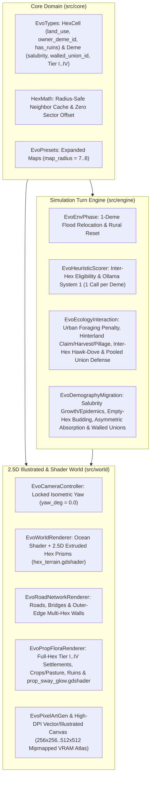

# Single-Deme-Per-Hex Urban/Rural Simulation & 2.5D Illustrated/Shader World Overhaul

*   **Author:** Juan Ezquerro LLanes
*   **Status:** Proposed
*   **Date:** 2026-11-08

--------------------------------------------------------------------------------

## Overview

**Evolution** is a bio-cultural population simulator built with Godot 4.7 on a 2.5D hexagonal map, where local population groups (*demes*) autonomously evaluate decisions through local Ollama System 1 language models (`d3:4b` and `tev1:4b`). Today, up to three demes can co-occupy a single hex cell, forcing the renderer to shrink buildings and props into cramped sub-sectors inside the hex, while all world graphics are drawn on the CPU at startup into low-resolution pixel-art buffers (`16x16` to `224x192` pixels).

This design overhauls both the spatial simulation rules and the 2.5D world presentation:

1. **Single-Deme-Per-Hex Urban & Rural Ecosystem**: Enforces a strict limit of at most one `Deme` per hex cell, giving each settlement the entire hex footprint. Settlements advance through four visual and functional categories (`I: Camp`, `II: Village`, `III: Town/City`, `IV: Citadel/Metropolis`) and leave persistent ruins on extinction. Peaceful migration requires an empty passable hex. Interactions between adjacent occupied hexes follow three paths: military conquest, absorption of a lower-category village into a higher-category city (converting the vacated hex into agricultural crops or livestock pasture owned by that city), or a multi-hex walled union between adjacent settlements of equal category (`walled_union_id`). Cities lose wild foraging yield inside their paved urban hex and depend on adjacent agricultural/pastoral hexes for calories, while urban crowding degrades health (`salubrity`), slowing demographic growth and triggering epidemics when density outstrips sanitation.
2. **2.5D High-Definition Illustrated & GPU Shader World**: Replaces the low-resolution pixel-art world renderer and 360-degree camera rotation with a fixed-yaw isometric 2.5D view (`yaw_deg = 0.0`) powered by GPU shaders (`ShaderMaterial` on `Polygon2D` and `Line2D` for animated ocean waves, shoreline foam, extruded hex prisms, biome ground textures, roads, and continuous multi-hex perimeter walls) and high-resolution illustrated isometric sprites (`256x256` to `512x512` textures cached in VRAM with mipmaps) for buildings, ruins, crops/pastures, mountains, flora, and villagers, matching the visual direction of [land.jpeg](file:///home/arrase/Develop/Evolution/land.jpeg), [land2.jpeg](file:///home/arrase/Develop/Evolution/land2.jpeg), and [land3.jpeg](file:///home/arrase/Develop/Evolution/land3.jpeg). The HUD (`src/ui/`) remains unchanged.

## The Problem

*   **State of the Art & Current Limits**:
    1. *Cramped Multi-Deme Hex Layout*: Allowing up to three demes per hex ([`src/engine/biophys/demography_migration.gd`](file:///home/arrase/Develop/Evolution/src/engine/biophys/demography_migration.gd#L23), [`src/world/render/prop_flora_renderer.gd`](file:///home/arrase/Develop/Evolution/src/world/render/prop_flora_renderer.gd#L18)) forces [`HexMath.compute_village_sector_offset`](file:///home/arrase/Develop/Evolution/src/core/hex_math.gd#L95-L106) to pack up to three separate settlements, palisades, and intra-hex roads inside one hex. Buildings must be scaled down (`0.86x` to `0.78x`), leaving no room for large architectural landmarks, agricultural fields, or readable fortifications.
    2. *Low-Resolution CPU Pixel Art*: [`EvoPixelCanvas`](file:///home/arrase/Develop/Evolution/src/world/sprites/pixel_canvas.gd) and [`EvoPixelArtGen`](file:///home/arrase/Develop/Evolution/src/world/pixel_art_gen.gd) draw tiny uncompressed `RGBA8` pixel buffers (`16x16` villagers, `32x32` buildings, `224x192` hex tiles) using nearest-neighbor filtering. On modern displays and when zooming in, the map appears blocky and lacks the crisp ink-outlined, hand-illustrated board-game clarity shown in [land.jpeg](file:///home/arrase/Develop/Evolution/land.jpeg), [land2.jpeg](file:///home/arrase/Develop/Evolution/land2.jpeg), and [land3.jpeg](file:///home/arrase/Develop/Evolution/land3.jpeg).
    3. *Perspective Distortion under 360-Degree Rotation*: [`EvoCameraController`](file:///home/arrase/Develop/Evolution/src/world/camera_controller.gd) allows arbitrary 360-degree yaw rotation (`yaw_deg`), which rotates the flat 2D hex polygon while isometric 2.5D building and mountain sprites remain locked to a single drawn viewing angle, breaking perspective alignment between buildings, bridges, and hex edges.
    4. *Missing Urban-Rural & Epidemiological Pressures*: Currently, cities do not require surrounding farmland to survive, and growing settlements face no sanitation or crowding health bottleneck. Furthermore, preset maps (`map_radius = 4` or `5`, `61–91` hexes) are too small to hold multi-hex cities surrounded by agricultural and pastoral hinterlands, and [`HexMath.get_neighbor_ids`](file:///home/arrase/Develop/Evolution/src/core/hex_math.gd#L30-L61) has an integer key collision bug (`(q + 8) * 16 + (r + 8)`) when `map_radius > 5`.
*   **Why the New Approach Succeeds**:
    *   Restricting each hex to at most one `Deme` frees 100% of the hex surface for a full-scale illustrated settlement, rural farmland/pasture, or biome landmark.
    *   Representing agricultural (`crops`) and pastoral (`pasture`) hexes as cell attributes owned by a city `Deme` (`owner_deme_id`, `land_use`) rather than independent `Deme` agents allows sprawling multi-hex cities and rural countrysides without adding a single extra HTTP call to local Ollama models.
    *   Linking adjacent same-category cities via `walled_union_id` while keeping one `Deme` per hex preserves compatibility with the existing HUD inspector and Ollama prompt pipeline while rendering a unified outer perimeter wall and pooling military defense.
    *   Offloading continuous surfaces (ocean waves, shoreline foam, hex cliff extrusion, biome ground patterns) to Godot 4.7 `canvas_item` GPU shaders and storing high-DPI (`256x256`–`512x512`) illustrated sprites in VRAM delivers crisp visuals at any zoom level with minimal CPU overhead.

## Goals

*   **Strict 1-Deme-Per-Hex Invariant**: Guarantee `cell.deme_ids.size() <= 1` across all presets, migrations, warband invasions, sea-level flood relocations, and synoecism merges.
*   **4-Tier Settlement Progression & Persistent Ruins**: Classify settlements into four deterministic tiers (`I: Camp`, `II: Village`, `III: Town/City`, `IV: Citadel/Metropolis`) in `EvoTypes.Deme.get_village_tier()`, and persist ruins (`cell.has_ruins = true`) when settlements go extinct or rural hexes are razed.
*   **Three Occupied-Hex Interaction Paths**:
    1. *Invasion*: Victorious warbands displace the defender to an empty passable neighbor hex, or extinguish/absorb the defender in place if no empty retreat hex exists.
    2. *Asymmetric Category Absorption*: Allied/kin demes of different categories merge into the higher-category city, converting the vacated hex into an owned rural `crops` or `pasture` hex.
    3. *Same-Category Multi-Hex Walled Union*: Allied/kin demes of equal category (`Tier >= 2`) remain on their own hexes, share `walled_union_id`, pool defensive combat forces, and render a single outer perimeter wall with internal walls removed.
*   **Urban Salubrity & Rural Hinterland Dependency**: Reduce wild foraging inside Tier 3 (`0.55x`) and Tier 4 (`0.30x`) urban hexes; allow cities to claim and harvest adjacent empty habitable hexes as `crops` or `pasture` (which rivals can raid or capture to starve the city); and compute per-deme `salubrity` (`[0.0, 1.0]`) from urban crowding and union size to modulate demographic growth and trigger epidemic mortality (`< 0.35`).
*   **Expanded Map Scale (`map_radius = 7..8`)**: Expand preset worlds in `EvoPresets` to radius `7` (`169` hexes) or `8` (`217` hexes) with larger landmasses and fix `HexMath.get_neighbor_ids` coordinate hashing for radii up to `15`.
*   **High-Definition 2.5D Illustrated & Shader World**: Lock `EvoCameraController` yaw rotation (`yaw_deg = 0.0`), implement GPU shaders for ocean waves/foam, 2.5D hex terrain prisms, and prop sway/glow, and generate/cache high-DPI (`256x256`–`512x512`) illustrated isometric sprites in VRAM.
*   **Zero Regression in Headless Verification**: Pass `godot --headless --path . --script res://tests/test_runner.gd` with updated and expanded tests covering all new biophysical, demographic, and rendering invariants.

## Non-Goals

*   **HUD Layout or UI Redesign**: `src/ui/` panels, modals, hotbars, and theme styles are out of scope and will not be redesigned.
*   **Backward Compatibility with Legacy Saves**: Old `user://evolution_world_state.json` snapshots or 3-deme-per-hex state files do not need migration support.
*   **Additional Ollama LLM Requests for Rural Hexes**: Agricultural (`crops`) and pastoral (`pasture`) hexes do not run autonomous System 1 decision evaluations.
*   **Full 3D Mesh Engine Rewrite**: The game remains a 2.5D `Node2D`/`CanvasItem` scene (`EvoWorldRenderer`) using GPU `canvas_item` shaders and high-resolution isometric sprites rather than migrating to `Node3D`.

## Open Questions

*   None. All scope, simulation, and visual architecture questions were resolved during the `/egm-brainstorm` phase.

## Critical User Journeys (CUJs)

### CUJ 1: Asymmetric Village Absorption into an Agricultural City

*   **Given**: A Tier 3 Town (`deme_city`, pop `250`) at hex `(0,0)` has an active alliance pact (`active_pacts >= 3`) or shared lineage with an adjacent Tier 2 Village (`deme_village`, pop `130`) at hex `(1,0)`.
*   **When**: The turn engine executes the demographic and synoecism phase (`EvoDemographyMigration`).
*   **Then**: `deme_village` vacates hex `(1,0)` and merges its population (`+130`), energy reserves, and traits into `deme_city` at `(0,0)`, promoting `deme_city` to Tier 4 (`Citadel/Metropolis`, `merged_count += 1`). Hex `(1,0)` has `deme_ids = []`, `owner_deme_id = deme_city.id`, and `land_use = "crops"` (or `"pasture"` on arid/tundra terrain), visually rendering illustrated farmland/pasture connected by a road to `(0,0)` and supplying calories to `deme_city` each turn.

### CUJ 2: Same-Category Multi-Hex Walled Union & Crowding Epidemic

*   **Given**: Two adjacent Tier 3 Towns (`deme_a` at `(0,0)` and `deme_b` at `(0,1)`) share an alliance pact (`active_pacts >= 3`, no vendetta).
*   **When**: The synoecism phase runs, and over subsequent generations both cities grow to high density without sufficient sanitation traits.
*   **Then**: `deme_a` and `deme_b` remain on their respective hexes (`cell.deme_ids.size() == 1` on each) and receive a shared `walled_union_id`. `EvoRoadNetworkRenderer` removes the interior wall segment along edge `(0,0)-(0,1)` and renders a single continuous stone perimeter wall around the two-hex footprint with an internal paved avenue. When combined crowding drives `salubrity < 0.35`, an epidemic event reduces population by `~22%`, logs a Chronicle entry, and partially restores `salubrity`.

### CUJ 3: Starving a Fortified City by Pillaging its Rural Hinterlands

*   **Given**: A fortified Tier 4 Metropolis (`deme_city`, `defense_tier = 3`) at `(0,0)` depends on two adjacent owned `crops` hexes at `(1,0)` and `(0,-1)` because its paved urban hex only yields `30%` wild foraging. A rival martial deme (`deme_raider`) occupies `(2,0)`.
*   **When**: `deme_raider` executes a raid or territorial assault against `deme_city` and cannot breach the Tier 4 walls directly.
*   **Then**: `deme_raider` pillages the adjacent rural hinterland hex `(1,0)`, looting its biomass, resetting `land_use = "wild"` and `owner_deme_id = ""`, and marking `has_ruins = true` on `(1,0)`. Deprived of agricultural calories on the next turn, `deme_city` enters caloric deficit (`last_energy_delta < 0`), depletes its reserves, and loses population and fortification upkeep.

### CUJ 4: Inspecting the High-Definition 2.5D Illustrated World

*   **Given**: The player launches a scenario on a `map_radius = 7` or `8` map and pans/zooms the camera with the mouse.
*   **When**: `EvoWorldRenderer` renders the map at zoomed-out (`0.5x`) and zoomed-in (`2.5x`) levels.
*   **Then**: `EvoCameraController` keeps `yaw_deg = 0.0` so isometric buildings and mountains stay aligned with hex edges; the ocean shader animates stylized wave crests and white shoreline foam around islands; land hexes display extruded 2.5D cliff walls, dark ink outlines, and biome surface details; and each occupied hex displays a large, sharp (`256x256`–`512x512` mipmapped) illustrated settlement matching its tier (`I..IV`), surrounded by swaying trees, windmills, or farmland.

--------------------------------------------------------------------------------

## Technical Plan (Architecture)

### 1. System Architecture & Data Flow

The architecture preserves the existing 4-phase generational pipeline (`EvoTurnEngine`) and HUD boundary (`src/ui/`) while restructuring the spatial domain rules and replacing the world rendering pipeline with a two-layer GPU Shader + High-DPI Illustrated Sprite architecture.

### 2. Core Domain & Spatial Model (`src/core/`)

*   **`EvoTypes.HexCell` Extensions ([`src/core/types.gd`](file:///home/arrase/Develop/Evolution/src/core/types.gd))**:
    *   `deme_ids: Array[String]`: Enforced invariant `deme_ids.size() <= 1` at all times.
    *   `land_use: String = "wild"`: Allowed values `"wild"`, `"crops"`, `"pasture"`. Automatically reset to `"wild"` if `biome == "ocean"` or when its owning city is extinguished or conquered.
    *   `owner_deme_id: String = ""`: ID of the adjacent city `Deme` that owns this rural hex when `land_use in ["crops", "pasture"]`. Empty (`""`) for wild or settlement hexes.
    *   `has_ruins: bool = false`: Set to `true` when a resident settlement goes extinct or when a rural hinterland hex is razed by raiders; cleared (`false`) when a new settlement colonizes or cultivates the hex, or when flooded by sea-level rise.
*   **`EvoTypes.Deme` Extensions & 4-Tier Hierarchy ([`src/core/types.gd`](file:///home/arrase/Develop/Evolution/src/core/types.gd))**:
    *   `salubrity: float = 1.0`: Normalized urban health and sanitation index clamped to `[0.05, 1.0]`.
    *   `walled_union_id: String = ""`: Shared identifier linking two or more adjacent same-category settlements (`Tier >= 2`) into a unified multi-hex walled city.
    *   `get_village_tier() -> int` and `get_village_roman() -> String`: Replaces the legacy 5-tier scale with a deterministic 4-tier scale (`1..4` / `"I".."IV"`):
        *   **Tier 1 (`I` — Camp)**: `population < 120` and `defense_tier == 0` and `merged_count == 0`.
        *   **Tier 2 (`II` — Village)**: `population >= 120` or `defense_tier == 1` (up to Tier 3 thresholds).
        *   **Tier 3 (`III` — Town/City)**: `population >= 240`, or (`population >= 170` and (`defense_tier >= 1` or `merged_count >= 1` or cultural capacity enabled)).
        *   **Tier 4 (`IV` — Citadel/Metropolis)**: `population >= 380`, or (`population >= 280` and (`defense_tier >= 2` or `merged_count >= 2` or `walled_union_id != ""`)).
*   **Axial Neighbor Cache & Offset Fix ([`src/core/hex_math.gd`](file:///home/arrase/Develop/Evolution/src/core/hex_math.gd))**:
    *   Replace the `(q + 8) * 16 + (r + 8)` hash in `HexMath.get_neighbor_ids` (which collides when `|q|` or `|r| >= 8`) with `(q + 16) * 32 + (r + 16)` supporting radii up to `15`, and cache neighbor lookup tables dynamically per `cells.size()`.
    *   Simplify `HexMath.compute_village_sector_offset` to return `Vector2.ZERO` because every settlement is centered on its hex.
*   **Expanded Scenario Maps ([`src/core/presets.gd`](file:///home/arrase/Develop/Evolution/src/core/presets.gd))**:
    *   Expand `preset-darwin-archipelago` and `preset-rift-savanna` to `map_radius = 7` (`169` hexes) and `preset-finite-island` to `map_radius = 7` (`169` hexes, up from `61`), scaling continent/island radii so cities have surrounding terrestrial hexes for `crops` and `pasture` while keeping initial founder demes (`Strategy A` and `Strategy B`) at axial distance `2..3` so early contact occurs within the first generations.

### 3. Biophysical, Ecological & Demographic Rules (`src/engine/`)

*   **Inter-Hex Competition & Cultural Symbiosis ([`src/engine/biophys/ecology_interaction.gd`](file:///home/arrase/Develop/Evolution/src/engine/biophys/ecology_interaction.gd))**:
    *   Because `cell.deme_ids.size() <= 1`, intra-hex Hawk-Dove competition is replaced by border resource competition across adjacent occupied hex pairs (`adjacent_pairs`) when at least one neighbor has `p_dispute >= 0.25` and no active pact exists.
    *   Horizontal cultural diffusion (`dec-exchange-symbiosis`) and eligibility in [`EvoHeuristicScorer.is_decision_eligible`](file:///home/arrase/Develop/Evolution/src/engine/cognitive/heuristic_scorer.gd) evaluate across adjacent occupied hexes.
*   **Urban Foraging Reduction & Rural Hinterland Cycle ([`src/engine/biophys/ecology_interaction.gd`](file:///home/arrase/Develop/Evolution/src/engine/biophys/ecology_interaction.gd))**:
    *   *Urban Paving Penalty*: A settlement extracts wild biomass from its own home hex multiplied by `urban_forage_mult`: `1.0` for Tier 1–2, `0.55` for Tier 3, and `0.30` for Tier 4.
    *   *Hinterland Claiming*: During `run_resource_and_symbiosis_phase`, each Deme of Tier $\ge 2$ claims unclaimed passable neighbor hexes (`n_cell.deme_ids.is_empty()` and `n_cell.owner_deme_id == ""`) up to a cap of `1` (Tier 2), `2` (Tier 3), or `4` (Tier 4) rural hexes. The assigned `land_use` is `"pasture"` for `arid_steppe` and `tundra` (or when the owner has pastoral/high-mobility traits) and `"crops"` for `tropical_forest`, `savanna`, and `coastal_shallows`. Claiming a hex clears `n_cell.has_ruins = false`.
    *   *Hinterland Caloric Transfer*: Each owned adjacent rural hex harvests `0.70 * min(n_cell.current_resources, float(owner.population) * 0.35)` and adds those calories directly to `extracted_energy_by_deme[owner.id]`, deducting the harvested amount from `n_cell.current_resources`.
    *   *Raiding & Sieging Rural Hinterlands*: In `_run_raids` and `_execute_territorial_invasion`, when an attacker raids a city or fails to breach a fortified (`defense_tier >= 1` or `walled_union_id != ""`) city's walls, the attacker pillages one rural hex owned by the defender (`n_cell.owner_deme_id == defender.id`): the attacker loots `25.0..45.0` energy from the rural hex, resets `n_cell.owner_deme_id = ""`, `n_cell.land_use = "wild"`, sets `n_cell.has_ruins = true`, and logs the devastation.
*   **Three Occupied-Hex Interaction Paths ([`src/engine/biophys/demography_migration.gd`](file:///home/arrase/Develop/Evolution/src/engine/biophys/demography_migration.gd))**:
    1. *Peaceful Migration (`-m*` colonist budding)*: Restricted strictly to adjacent passable terrestrial hexes with `n_cell.deme_ids.is_empty()`. Colonizing a rural hex owned by another deme is only allowed if it belongs to the same lineage or if the parent deme seizes it; colonizing any hex clears `n_cell.owner_deme_id = ""`, `n_cell.land_use = "wild"`, and `n_cell.has_ruins = false`.
    2. *Military Invasion (`_execute_territorial_invasion`)*: When `att_force >= def_force`, `defender` searches for an adjacent passable hex with `rcell.deme_ids.is_empty()`. If found, `defender` retreats there (clearing any rural ownership on `rcell`) and the victorious `warband` occupies `target_cell` (transferring `defender`'s owned rural hexes to `warband`). If no empty retreat hex exists, `defender` is extinguished/absorbed in place (`survivors` added to `warband.population`, `defender` erased from `state.demes` and `target_cell.deme_ids`) so `target_cell.deme_ids.size()` never exceeds `1`.
    3. *Asymmetric Category Absorption vs. Same-Category Walled Union*:
        * For adjacent allied (`active_pacts >= 3`) or low-divergence same-lineage (`divergence <= 0.25`, `active_pacts >= 0`) deme pairs `(d1, d2)`:
        * **Different Category (`d1.get_village_tier() != d2.get_village_tier()`)**: The higher-tier deme is `host` and the lower-tier deme is `joiner` residing on `joiner_cell`. `_merge_deme_into` merges `joiner` into `host` (`host.merged_count += 1`), erases `joiner`, and converts `joiner_cell` into a rural hinterland owned by `host` (`joiner_cell.owner_deme_id = host.id`, `joiner_cell.land_use = "pasture"` on `arid_steppe`/`tundra` else `"crops"`). Any rural hexes previously owned by `joiner` transfer to `host`.
        * **Same Category (`d1.get_village_tier() == d2.get_village_tier() >= 2`)**: Both demes remain on their hexes and form a **Multi-Hex Walled Union**. If neither has a `walled_union_id`, assign `union_id = "union-%s-%s" % [min_id, max_id]` to both; if one already belongs to a union (up to a cap of `3` united hexes), add the partner to that `walled_union_id`. Both upgrade `defense_tier = maxi(defense_tier, 1)`.
        * **Pooled Defense & Union Hygiene**: In `_compute_combat_forces`, a defender with `walled_union_id != ""` adds `0.55 * float(partner.population)` and `0.25 * DEFENSE_TIER_BONUS[partner.defense_tier]` from each adjacent alive union partner. At the end of each turn, any deme whose `walled_union_id` has no adjacent alive partner with the same `walled_union_id` (or has a negative vendetta pact `< 0` with its partner) clears `walled_union_id = ""`.
*   **Urban Salubrity & Epidemics ([`src/engine/biophys/demography_migration.gd`](file:///home/arrase/Develop/Evolution/src/engine/biophys/demography_migration.gd))**:
    *   Each turn, compute for each `Deme`:
        $$\text{crowding} = \frac{\text{population}}{\max(20.0, K_{\text{cell}})} + 0.16 \cdot \max(0, \text{tier} - 2) + 0.14 \cdot \text{union\_partners}$$
        $$\text{sanitation} = 0.20 \cdot \mathbb{I}(\text{cul-communal-conservation}) + 0.14 \cdot \mathbb{I}(\text{bio-k-strategy}) + 0.08 \cdot \max(0.0, \text{humidity})$$
        $$\text{target\_salubrity} = \text{clamp}\left(1.12 - 0.48 \cdot \max(0.0, \text{crowding} - 0.60) + \text{sanitation}, 0.05, 1.0\right)$$
        $$\text{deme.salubrity} = \text{snappedf}(\text{lerpf}(\text{deme.salubrity}, \text{target\_salubrity}, 0.45), 0.0001)$$
    *   Positive `raw_growth` is multiplied by `clampf(0.30 + 0.70 * deme.salubrity, 0.25, 1.0)`.
    *   If `deme.salubrity < 0.35` and `deme.population >= 130`, an **Epidemic Outbreak** reduces `deme.population` by `int(round(float(deme.population) * 0.22))`, raises `deme.salubrity = minf(1.0, deme.salubrity + 0.28)`, and appends an `"epidemic"` `ChronicleEntry`.

### 4. 2.5D High-Definition Illustrated & GPU Shader Renderer (`src/world/`)

*   **Fixed Isometric Camera ([`src/world/camera_controller.gd`](file:///home/arrase/Develop/Evolution/src/world/camera_controller.gd))**:
    *   Lock `yaw_deg = 0.0` and `_target_yaw_deg = 0.0`; make `rotate_by` a no-op so right-drag and `Q`/`E` do not rotate the hex board horizontally. Preserve WASD/drag panning, scroll zoom (`0.28..3.0`), and vertical pitch tilt (`32.0°..68.0°`).
*   **Layer 1 — GPU Shaders & Extruded Vector Geometry (`src/world/shaders/`, [`src/world/world_renderer.gd`](file:///home/arrase/Develop/Evolution/src/world/world_renderer.gd), [`src/world/render/road_network_renderer.gd`](file:///home/arrase/Develop/Evolution/src/world/render/road_network_renderer.gd))**:
    *   `src/world/shaders/ocean_waves.gdshader`: Applied to the water background / ocean hex surfaces; renders deep-to-shallow cerulean/turquoise color gradients, animated stylized wave crest bands, and white shoreline foam rings where ocean meets terrestrial hexes.
    *   `src/world/shaders/hex_terrain.gdshader`: Applied to terrestrial hex top polygons; renders anti-aliased beveled inner borders, dark sepia ink outlines (`#23150c`), procedural Voronoi mud cracks on `arid_steppe`, parallel golden furrow lines when `cell.land_use == "crops"`, soft lush pasture rings when `cell.land_use == "pasture"`, and dappled canopy/grass gradients on `tropical_forest` and `savanna`.
    *   *Extruded 2.5D Hex Cliff Skirts*: `EvoWorldRenderer` draws stratified rock/earth cliff side quads with crisp `#23150c` ink outlines and directional face shading (lit left face, mid center face, shadowed right face) matching [land.jpeg](file:///home/arrase/Develop/Evolution/land.jpeg) and [land2.jpeg](file:///home/arrase/Develop/Evolution/land2.jpeg).
    *   *Continuous Multi-Hex Perimeter Walls (`EvoRoadNetworkRenderer`)*: For any settlement hex with `defense_tier >= 1` or `get_village_tier() >= 2`, iterate the 6 hex edges `e in 0..5`. If the neighbor across edge `e` shares the same non-empty `walled_union_id`, skip drawing a wall on edge `e` and draw a wide paved stone boulevard connecting the two hex centers. On all exterior edges, draw a 2.5D isometric wooden palisade (`Tier 2` / `defense_tier == 1`) or crenellated stone curtain wall with corner bastion posts at hex vertices (`Tier 3–4` / `defense_tier >= 2`).
*   **Layer 2 — High-DPI Illustrated Sprite Atlas & Prop Shader (`src/world/sprites/`, [`src/world/pixel_art_gen.gd`](file:///home/arrase/Develop/Evolution/src/world/pixel_art_gen.gd), [`src/world/render/prop_flora_renderer.gd`](file:///home/arrase/Develop/Evolution/src/world/render/prop_flora_renderer.gd))**:
    *   Upgrade [`EvoPixelCanvas`](file:///home/arrase/Develop/Evolution/src/world/sprites/pixel_canvas.gd) with high-resolution anti-aliased vector/supersampled drawing primitives (smooth polygons, Bezier curves, multi-stop radial/linear painter gradients, drop shadows, and variable-width `#23150c` ink outlines) and bump world prop texture resolutions from `16x16..64x64` to `256x256..512x512` (and `512x448` for hex tile overlays), creating `ImageTexture` instances with mipmaps and `CanvasItem.TEXTURE_FILTER_LINEAR_WITH_MIPMAPS`.
    *   `EvoVillageUiSprites` and `EvoTerrainSprites` generate the full [land3.jpeg](file:///home/arrase/Develop/Evolution/land3.jpeg) catalog:
        *   **Tier 1 (`I`)**: Painted nomadic yurts, hide tents, and glowing log campfire.
        *   **Tier 2 (`II`)**: Timber log cabins, thatched-roof barn, and palisade gate.
        *   **Tier 3 (`III`)**: Half-timbered medieval houses, stone-base watchtower, timber windmill, and rural church.
        *   **Tier 4 (`IV`)**: Turreted stone castle keep, twin-spire gothic cathedral, and heavy stone gatehouse.
        *   **Rural (`crops` / `pasture`) & `has_ruins`**: Golden wheat field plots, haystacks, wooden fences, grazing sheep/cattle, covered wagons, and ivy-covered stone/timber ruins.
        *   **Biome Landmarks**: Sculpted faceted snow-capped mountain peaks (`high_mountain`), layered palm/canopy trees (`tropical_forest`), umbrella acacias (`savanna` / `arid_steppe`), coastal reeds, and pine clusters (`tundra`).
    *   `src/world/shaders/prop_sway_glow.gdshader`: Applied to flora and animated village props for gentle wind sway on tree canopies/wheat and warm pulsing illumination on campfires and windows.

--------------------------------------------------------------------------------

## Alternatives Considered

### Alternative A: Penalizing Large or Multi-Hex Cities with Higher Per-Individual Caloric Upkeep

*   **Pros**: Simple arithmetic change inside `_compute_caloric_need` in [`src/engine/biophys/ecology_interaction.gd`](file:///home/arrase/Develop/Evolution/src/engine/biophys/ecology_interaction.gd); requires no new `salubrity` field on `EvoTypes.Deme`.
*   **Cons**: Misrepresents the historical bottleneck of early cities (which was crowding, waste accumulation, and epidemic disease rather than individual human metabolism increasing) and fails to model why cities needed surrounding agricultural and pastoral territories.
*   **Reason for Rejection**: Rejected by author: Urban crowding in early cities primarily degraded sanitation and public health (`salubrity`), whereas food supply was addressed by cultivating adjacent agricultural (`crops`) and pastoral (`pasture`) hexes.

### Alternative B: Merging Multi-Hex Walled Cities into a Single `Deme` Object Owning Multiple `hex_ids`

*   **Pros**: Represents a multi-hex city as a single dictionary entry in `state.demes`.
*   **Cons**: Breaks the HUD inspector in `src/ui/` (which expects a single `deme.hex_id` and is out of scope for redesign), breaks the Ollama System 1 prompt builder in `EvoHeuristicScorer` (which evaluates the biome, temperature, altitude, and resources of a single hex cell), and complicates partial conquest when an invader captures only one hex of a multi-hex city.
*   **Reason for Rejection**: Rejected by author: Keeping one `Deme` per hex linked by a shared `walled_union_id` preserves all HUD and Ollama 1-deme-per-hex invariants while still allowing shared exterior perimeter walls and pooled defensive forces.

### Alternative C: Spawning Independent `Deme` Entities on Agricultural and Pastoral Hexes

*   **Pros**: Reuses existing `Deme` resource extraction without adding `land_use` or `owner_deme_id` to `EvoTypes.HexCell`.
*   **Cons**: Every Tier 3 or Tier 4 city claiming 2 to 4 rural hexes would spawn 2 to 4 additional `Deme` objects, multiplying local Ollama HTTP requests (`127.0.0.1:11434/v1/systemone`) by 3x–5x per city, slowing turn execution, and rendering autonomous village settlements on hexes meant to be open wheat fields or livestock pastures.
*   **Reason for Rejection**: Rejected by author: Representing `crops` and `pasture` hexes as rural cells owned by an adjacent city `Deme` (`owner_deme_id`, `land_use`) achieves the urban-rural caloric dependency and siege vulnerability with zero extra Ollama requests.

### Alternative D: Drawing Illustrated Isometric Buildings Purely via Fragment Shaders or Low-Res CPU Pixel Loops

*   **Pros**: Avoids generating or caching high-resolution (`256x256`–`512x512`) sprite textures in VRAM.
*   **Cons**: Fragment shaders are suited for continuous mathematical surfaces (waves, foam, Voronoi cracks, lighting, wind sway) but cannot practically author complex illustrated architectural silhouettes (half-timbered houses, gothic cathedrals, stone castles, wagons, windmills with ink outlines); conversely, low-res CPU pixel loops (`16x16`–`64x64`) produce blocky pixel art that fails the visual target of [land.jpeg](file:///home/arrase/Develop/Evolution/land.jpeg), [land2.jpeg](file:///home/arrase/Develop/Evolution/land2.jpeg), and [land3.jpeg](file:///home/arrase/Develop/Evolution/land3.jpeg).
*   **Reason for Rejection**: Rejected by author: A hybrid pipeline using GPU shaders for continuous terrain/water/walls and high-DPI illustrated sprite textures in VRAM for buildings, flora, and landmarks matches the target aesthetic and leverages available GPU memory efficiently.

--------------------------------------------------------------------------------

## Non-Functional Requirements

*   **Performance & VRAM Footprint**:
    *   All high-definition sprite textures (`~35` unique terrain, settlement, rural, and UI textures at `256x256` to `512x512` `RGBA8` with mipmaps) occupy `< 45 MB` of VRAM in total, well within desktop GPU budgets.
    *   `EvoPixelArtGen.ensure_all_assets()` caches generated PNG files under `res://assets/sprites/` on disk so subsequent startups load pre-built textures directly without regenerating them unless version/dimension checks trigger a rebuild.
*   **Ollama System 1 Latency**:
    *   Because rural `crops` and `pasture` hexes do not create `Deme` instances and Asymmetric Category Absorption merges lower-tier villages into cities, active `Deme` counts on `map_radius = 7` (`169` hexes) remain bounded (`~6–16` demes), keeping per-turn Ollama evaluation latency unchanged.
*   **Headless Test Compatibility**:
    *   All `canvas_item` `.gdshader` files and `ImageTexture` caches must initialize cleanly under `godot --headless --path . --script res://tests/test_runner.gd` without requiring a physical display server.

--------------------------------------------------------------------------------

## Detailed Implementation Plan

### Target Files to Create/Modify

#### Phase 1: Core Domain, Map Scale & Localization (`src/core/`)

##### 1. [`src/core/types.gd`](file:///home/arrase/Develop/Evolution/src/core/types.gd) (Modify)

*   **Type / Scope**: Core GDScript Domain Data Structures (`EvoTypes`).
*   **Proposed Changes**:
    *   On `EvoTypes.HexCell`, add properties `land_use: String = "wild"` (`"wild" | "crops" | "pasture"`), `owner_deme_id: String = ""`, and `has_ruins: bool = false`. Copy all three in `duplicate_cell()`, serialize them in `to_dict()` (`"landUse"`, `"ownerDemeId"`, `"hasRuins"`), and deserialize them in `from_dict()`.
    *   On `EvoTypes.Deme`, add properties `salubrity: float = 1.0` and `walled_union_id: String = ""`. Copy both in `duplicate_deme()`, serialize them in `to_dict()` (`"salubrity"`, `"walledUnionId"`), and deserialize them in `from_dict()`.
    *   Update `EvoTypes.Deme.get_village_tier() -> int` to return a strict 4-tier hierarchy (`1..4`):
        *   Return `4` when `population >= 380` or (`population >= 280` and (`defense_tier >= 2` or `merged_count >= 2` or `walled_union_id != ""`)).
        *   Return `3` when `population >= 240` or (`population >= 170` and (`defense_tier >= 1` or `merged_count >= 1`)).
        *   Return `2` when `population >= 120` or `defense_tier == 1`.
        *   Return `1` otherwise.
    *   Update `EvoTypes.Deme.get_village_roman() -> String` to map tiers `1..4` to `"I".."IV"`.

##### 2. [`src/core/hex_math.gd`](file:///home/arrase/Develop/Evolution/src/core/hex_math.gd) (Modify)

*   **Type / Scope**: Axial Hex Grid Math Utility (`HexMath`).
*   **Proposed Changes**:
    *   In `get_neighbor_ids(q: int, r: int, valid_cells: Dictionary) -> Array[String]`, replace the hardcoded `(q + 8) * 16 + (r + 8)` hash and `37`/`91` cell-count caches with a dynamic `_neighbor_caches_by_size: Dictionary` keyed by `valid_cells.size()` and packed coordinate key `(q + 16) * 32 + (r + 16)` so maps up to `map_radius = 15` have zero coordinate collisions.
    *   Update `compute_village_sector_offset(_index: int, _total_count: int, _hex_size: float = HEX_SIZE) -> Vector2` to return `Vector2.ZERO`.

##### 3. [`src/core/presets.gd`](file:///home/arrase/Develop/Evolution/src/core/presets.gd) (Modify)

*   **Type / Scope**: Scenario World Builders (`EvoPresets`).
*   **Proposed Changes**:
    *   Update `_build_darwin_archipelago`, `_build_finite_island`, and `_build_rift_savanna` to set `state.map_radius = 7` (`169` hex cells).
    *   Expand island and continental landmass bands in all three presets so each starting region has surrounding habitable terrestrial hexes (`savanna`, `tropical_forest`, `arid_steppe`, `tundra`, `coastal_shallows`) suitable for claiming `crops` and `pasture` hinterlands while keeping founder Demes (`Strategy A` at `(-1,0)` or `(-2,1)` and `Strategy B` at `(1,0)` or `(2,-1)`) within axial distance `2..3`.

##### 4. [`src/core/i18n.gd`](file:///home/arrase/Develop/Evolution/src/core/i18n.gd) (Modify)

*   **Type / Scope**: Bilingual Localization Catalog (`EvoI18n`).
*   **Proposed Changes**:
    *   Update `tier.1`..`tier.4` labels in `STRINGS["es"]` and `STRINGS["en"]` to match the 4-tier hierarchy (`Campamento`/`Camp`, `Aldea`/`Village`, `Ciudad`/`City`, `Metrópolis`/`Metropolis`) and clamp `village_tier_name(lang, tier)` to `1..4`.
    *   Add localized Chronicle keys `chronicle_epidemic_title`, `chronicle_epidemic_desc`, `chronicle_walled_union_title`, `chronicle_walled_union_desc`, and `chronicle.type.epidemic` in both Spanish and English.

#### Phase 2: Biophysical, Demographic & Cognitive Simulation Engine (`src/engine/`)

##### 5. [`src/engine/turn_engine.gd`](file:///home/arrase/Develop/Evolution/src/engine/turn_engine.gd) (Modify)

*   **Type / Scope**: Generational Turn Pipeline & Brush Interventions (`EvoTurnEngine`).
*   **Proposed Changes**:
    *   In `_evacuate_drowned_demes`, change the target cell occupancy filter from `ncell.deme_ids.size() < 3` to `ncell.deme_ids.is_empty()`.
    *   When a cell becomes `"ocean"` via brush or sea-level change, reset `cell.land_use = "wild"`, `cell.owner_deme_id = ""`, and `cell.has_ruins = false`. When a drowned deme evacuates to `target_cell`, clear `target_cell.owner_deme_id = ""`, `target_cell.land_use = "wild"`, and `target_cell.has_ruins = false`.

##### 6. [`src/engine/env_phase.gd`](file:///home/arrase/Develop/Evolution/src/engine/env_phase.gd) (Modify)

*   **Type / Scope**: Seasonal & Glacial Sea-Level Phase (`EvoEnvPhase`).
*   **Proposed Changes**:
    *   In `run_environmental_phase`, change the flood relocation candidate check from `ncell.deme_ids.size() < 3` to `ncell.deme_ids.is_empty()`.
    *   When a cell is submerged into `"ocean"`, clear `cell.land_use = "wild"`, `cell.owner_deme_id = ""`, and `cell.has_ruins = false`. If a flooded deme cannot find an empty passable neighbor hex, set `has_ruins = false` on the submerged hex and release any rural hexes where `owner_deme_id == deme.id`.

##### 7. [`src/engine/biophys/ecology_interaction.gd`](file:///home/arrase/Develop/Evolution/src/engine/biophys/ecology_interaction.gd) (Modify)

*   **Type / Scope**: Ecological Extraction, Hinterland Agriculture & Geopolitical Phase (`EvoEcologyInteraction`).
*   **Proposed Changes**:
    *   In `compute_pact_defense_bonus`, also include an allied union defense bonus when an adjacent deme shares `victim.walled_union_id != ""`.
    *   In `run_resource_and_symbiosis_phase`:
        *   Apply urban foraging multiplier `urban_forage_mult` (`1.0` for Tier 1–2, `0.55` for Tier 3, `0.30` for Tier 4) to a settlement's extraction demand on its own urban hex.
        *   Implement `_update_and_harvest_rural_hinterlands(state, effective_vec_by_deme, extracted_energy_by_deme)`:
            *   First, scrub orphaned rural cells whose `owner_deme_id` is no longer in `state.demes` or is no longer adjacent, resetting `land_use = "wild"` and `owner_deme_id = ""`.
            *   Second, for each Deme with `tier >= 2`, count its currently owned adjacent rural cells and claim additional adjacent empty passable terrestrial cells (`ncell.deme_ids.is_empty()` and `ncell.owner_deme_id == ""`) up to `max_rural` (`1` for Tier 2, `2` for Tier 3, `4` for Tier 4), setting `ncell.owner_deme_id = deme.id`, `ncell.has_ruins = false`, and `ncell.land_use = "pasture"` if `ncell.biome in ["arid_steppe", "tundra"]` else `"crops"`, and emitting a rural connection flow.
            *   Third, for each owned rural cell, harvest `min(ncell.current_resources, float(owner.population) * 0.35) * 0.70`, add it to `extracted_energy_by_deme[owner.id]`, and subtract it from `ncell.current_resources`.
        *   Evaluate Hawk-Dove resource disputes across `adjacent_pairs` of rival occupied hexes when at least one deme has `p_disp >= 0.25` and `active_pacts < 2`: Hawk vs. Hawk inflicts population and metabolic penalties (`hawk_penalty_by_deme = 1.25`) on both border rivals; Hawk vs. Dove transfers up to `20%` of the adjacent Dove's extracted energy to the Hawk and creates an inter-hex `"dispute"` flow.
    *   In `_execute_raid_if_successful`, when a raider attacks a city that owns adjacent rural hexes (`owner_deme_id == victim.id`), pillage one owned rural hex (`r_cell.owner_deme_id = ""`, `r_cell.land_use = "wild"`, `r_cell.has_ruins = true`), adding bonus plunder from `r_cell.current_resources` to the raider.

##### 8. [`src/engine/biophys/demography_migration.gd`](file:///home/arrase/Develop/Evolution/src/engine/biophys/demography_migration.gd) (Modify)

*   **Type / Scope**: Demographic Growth, Salubrity, Invasion, Budding & Union Phase (`EvoDemographyMigration`).
*   **Proposed Changes**:
    *   In `_compute_combat_forces`, if `defender.walled_union_id != ""` and `state.cells.has(defender.hex_id)`, iterate adjacent hexes; for each alive deme `partner` with `partner.walled_union_id == defender.walled_union_id`, add `0.55 * float(partner.population)` to effective defender population and `0.25 * EvoEcologyInteraction.DEFENSE_TIER_BONUS[clampi(partner.defense_tier, 0, 3)]` to `def_force`.
    *   In `_execute_territorial_invasion`:
        *   Restrict defender retreat candidates to empty passable neighbor hexes (`rcell.deme_ids.is_empty()`). When retreating to `rcell`, clear `rcell.owner_deme_id = ""`, `rcell.land_use = "wild"`, and `rcell.has_ruins = false`.
        *   If `defender` cannot retreat (`not retreated`), absorb `maxi(0, defender.population / 2)` into `surviving_warband`, set `defender.population = 0`, erase `defender.id` from `target_cell.deme_ids` and `state.demes`, and transfer any rural hexes owned by `defender` to `warband_id` so `target_cell.deme_ids.size()` is strictly `1`.
        *   When an invasion is repelled (`att_force < def_force`) against a defender that owns rural hinterlands (`ncell.owner_deme_id == defender.id`), pillage one rural hex (`ncell.owner_deme_id = ""`, `ncell.land_use = "wild"`, `ncell.has_ruins = true`) so besieged cities lose food supply.
    *   In `run_demography_and_migration_phase`:
        *   Compute and update `deme.salubrity` each turn from local crowding, settlement tier, and active union partner count, offset by conservation/K-strategy traits and cell humidity. Multiply positive `raw_growth` by `clampf(0.30 + 0.70 * deme.salubrity, 0.25, 1.0)`.
        *   When `deme.salubrity < 0.35` and `deme.population >= 130`, trigger an epidemic: reduce `deme.population` by `22%`, increase `deme.salubrity = minf(1.0, deme.salubrity + 0.28)`, and append an `"epidemic"` `ChronicleEntry`.
        *   Restrict colonist budding (`candidates`) strictly to passable neighbor hexes where `ncell.deme_ids.is_empty()` and (`ncell.owner_deme_id == ""` or `ncell.owner_deme_id == deme.id`). When a daughter deme colonizes `target_cell`, clear `target_cell.owner_deme_id = ""`, `target_cell.land_use = "wild"`, and `target_cell.has_ruins = false`.
        *   On deme extinction (`deme.population < 10`), set `cell.has_ruins = true` on its hex and release any rural hexes where `owner_deme_id == deme.id` (`land_use = "wild"`, `owner_deme_id = ""`, `has_ruins = true`).
        *   Replace the co-located merge loop and inter-hex synoecism loop with unified adjacent allied/kin unification:
            *   For adjacent pairs `(d1, d2)` that either share a strong pact (`active_pacts >= 3` with threat/fortification or `>= 4`) or share the same lineage with low divergence (`<= 0.25`) when neither can expand into empty hexes:
            *   **Asymmetric Category Absorption (`tier_1 != tier_2`)**: Merge the lower-tier `joiner_deme` (`joiner_cell`) into the higher-tier `host_deme` (`host_cell`) via `_merge_deme_into`, then set `joiner_cell.owner_deme_id = host_deme.id`, `joiner_cell.has_ruins = false`, and `joiner_cell.land_use = "pasture"` if `joiner_cell.biome in ["arid_steppe", "tundra"]` else `"crops"`, and transfer any rural hexes owned by `joiner_deme` to `host_deme.id`.
            *   **Same-Category Walled Union (`tier_1 == tier_2 >= 2`)**: Keep both demes on their own hexes, assign a shared `walled_union_id` (capped at `3` hexes per union), ensure `defense_tier = maxi(defense_tier, 1)`, emit a `"pact"`/`"merge"` flow between them, and log a Chronicle entry.
        *   Run union hygiene cleanup at turn end: clear `walled_union_id = ""` on any deme that has no adjacent alive partner sharing that `walled_union_id` or has a negative pact (`< 0`) with its union partner.

##### 9. [`src/engine/cognitive/heuristic_scorer.gd`](file:///home/arrase/Develop/Evolution/src/engine/cognitive/heuristic_scorer.gd) (Modify)

*   **Type / Scope**: Geopolitical Context Inspector & System 1 Heuristic Scorer (`EvoHeuristicScorer`).
*   **Proposed Changes**:
    *   In `inspect_geopolitical_context`, include rural hinterland deficiency (`tier >= 3` with `< 2` owned rural hexes) and low `salubrity` (`< 0.55`) in the context dictionary.
    *   In `compute_environmental_weights`, boost `dec-cooperate-store` and `dec-exchange-symbiosis` when `salubrity < 0.55` or when an adjacent same-tier ally can form a walled union, and boost `dec-selective-migration` / `dec-intensive-overexploit` when a Tier 3/4 city lacks sufficient rural hinterlands.

#### Phase 3: 2.5D High-Definition Illustrated & GPU Shader World (`src/world/`)

##### 10. [`src/world/camera_controller.gd`](file:///home/arrase/Develop/Evolution/src/world/camera_controller.gd) (Modify)

*   **Type / Scope**: 2.5D Isometric Camera Controller (`EvoCameraController`).
*   **Proposed Changes**:
    *   Keep `DEFAULT_YAW_DEG = 0.0`, `yaw_deg = 0.0`, and `_target_yaw_deg = 0.0`.
    *   Make `rotate_by(_delta_deg: float)` keep `yaw_deg = 0.0` and `_target_yaw_deg = 0.0`, and change right-mouse drag in `_unhandled_input` to pan (or tilt pitch vertically) without modifying `_target_yaw_deg`.

##### 11. `src/world/shaders/ocean_waves.gdshader` (Create)

*   **Type / Scope**: Godot 4 `canvas_item` GPU Fragment Shader.
*   **Proposed Changes**:
    *   Implement procedural stylized ocean rendering with deep-to-shallow cerulean/teal gradients, animated multi-band wave crests, and rhythmic white shoreline foam contours matching [land.jpeg](file:///home/arrase/Develop/Evolution/land.jpeg) and [land2.jpeg](file:///home/arrase/Develop/Evolution/land2.jpeg).

##### 12. `src/world/shaders/hex_terrain.gdshader` (Create)

*   **Type / Scope**: Godot 4 `canvas_item` GPU Fragment Shader.
*   **Proposed Changes**:
    *   Implement procedural biome surface detailing on hex top faces: beveled inner rim highlight, dark sepia ink border (`#23150c`), Voronoi mud cracks on `arid_steppe`, golden plowed furrow rows when `land_use == "crops"`, fenced meadow rings when `land_use == "pasture"`, lush canopy/grass shading on `tropical_forest` and `savanna`, and frost facets on `tundra`/`high_mountain`.

##### 13. `src/world/shaders/prop_sway_glow.gdshader` (Create)

*   **Type / Scope**: Godot 4 `canvas_item` GPU Vertex/Fragment Shader.
*   **Proposed Changes**:
    *   Implement gentle wind-driven top-vertex sway for trees and crops plus warm pulsing emissive glow for campfires, torches, and illuminated windows.

##### 14. [`src/world/sprites/pixel_canvas.gd`](file:///home/arrase/Develop/Evolution/src/world/sprites/pixel_canvas.gd) (Modify)

*   **Type / Scope**: High-Definition Illustrated Canvas Primitives (`EvoPixelCanvas`).
*   **Proposed Changes**:
    *   Add high-DPI anti-aliased vector/raster drawing helpers: `_aa_circle`, `_aa_ellipse`, `_aa_line`, `_poly_filled`, `_poly_shaded` (linear/vertical painter gradient fill with directional lighting), `_poly_outlined` (smooth anti-aliased fill + configurable dark ink outline `C_OUTLINE = Color("#23150c")`), and `_drop_shadow` so sprites at `256x256..512x512` render with smooth illustrated ink lines and rich shading rather than jagged pixel blocks.

##### 15. [`src/world/sprites/terrain_sprites.gd`](file:///home/arrase/Develop/Evolution/src/world/sprites/terrain_sprites.gd) (Modify)

*   **Type / Scope**: High-DPI Illustrated Biome & Terrain Sprite Generator (`EvoTerrainSprites`).
*   **Proposed Changes**:
    *   Upgrade `draw_hex_tile(biome: String) -> Image` to `448x384` with smooth painter gradients, Voronoi crack patterns, wetland pools, and ink-shaded bevels.
    *   Upgrade `draw_terrain_sprite(name: String) -> Image` to `256x256` high-definition illustrated isometric assets matching [land.jpeg](file:///home/arrase/Develop/Evolution/land.jpeg) and [land2.jpeg](file:///home/arrase/Develop/Evolution/land2.jpeg): sculpted multi-peak snow-capped mountains (`mountain_peak`), layered tropical palms/broadleaf trees (`tree_canopy`, `palm_cluster`), umbrella acacias (`savanna_tree`, `acacia_tree`), berry bushes (`bush_cluster`), coastal reeds (`marsh_reeds`), pine clusters (`pine_tree`), and degraded/rural props (`tree_stump`, `soil_crack`, `dry_scrub`).

##### 16. [`src/world/sprites/village_ui_sprites.gd`](file:///home/arrase/Develop/Evolution/src/world/sprites/village_ui_sprites.gd) (Modify)

*   **Type / Scope**: High-DPI Illustrated Architecture, Rural & Villager Sprite Generator (`EvoVillageUiSprites`).
*   **Proposed Changes**:
    *   Upgrade settlement, monument, rural, and ruin sprites to `256x256`–`384x384` illustrated isometric art matching [land3.jpeg](file:///home/arrase/Develop/Evolution/land3.jpeg):
        *   **Tier 1 (`I`)**: `hut_thatch` (ornate nomadic yurt / hide tent), `campfire` (stone-ringed blazing fire with logs).
        *   **Tier 2 (`II`)**: `house_clay` (timber log cabin), `granary` (thatched-roof wooden barn with barrels), `palisade_wall` (sharpened log palisade).
        *   **Tier 3 (`III`)**: `house_stone` (two-story medieval half-timbered house), `windmill` (timber/stone windmill with four sails), `watchtower` (timber/stone guard tower), `temple_totem` (bell-tower chapel/church & carved owl totem).
        *   **Tier 4 (`IV`)**: `citadel_keep` (multi-towered crenellated stone castle keep), `cathedral` (gothic twin-spire stone cathedral with stained glass), `stone_wall` (crenellated stone wall segment).
        *   **Rural & Ruins**: `crop_field` (golden wheat rows with haystacks), `pasture_pen` (wooden paddock with grazing sheep/cattle), `covered_wagon` (isometric canvas-topped trade wagon), `ruins_stone` (ivy-covered broken stone arches and rubble).
    *   Upgrade `draw_villager` to `64x64` illustrated character sprites with clear tunics, tools, and ink outlines.

##### 17. [`src/world/pixel_art_gen.gd`](file:///home/arrase/Develop/Evolution/src/world/pixel_art_gen.gd) (Modify)

*   **Type / Scope**: Sprite Asset Registry & Mipmapped VRAM Texture Cache (`EvoPixelArtGen`).
*   **Proposed Changes**:
    *   Register the new rural and Tier 3/4 building sprite keys (`windmill`, `cathedral`, `crop_field`, `pasture_pen`, `covered_wagon`, `ruins_stone`) in `VILLAGE_SPRITES`.
    *   Bump the disk cache version/resolution guard in `_generate_and_register` so cached legacy low-res PNGs (`width < 448` for hex tiles or `width < 256` for world props) are automatically regenerated at high resolution, mipmaps are generated (`img.generate_mipmaps()`), and `ImageTexture.create_from_image(img)` is stored in VRAM.

##### 18. [`src/world/world_renderer.gd`](file:///home/arrase/Develop/Evolution/src/world/world_renderer.gd) (Modify)

*   **Type / Scope**: Multi-Layer 2.5D World Renderer (`EvoWorldRenderer`).
*   **Proposed Changes**:
    *   Configure `_world_layer`, `_terrain_layer`, `_network_layer`, and `_anim_layer` with `CanvasItem.TEXTURE_FILTER_LINEAR_WITH_MIPMAPS`.
    *   Attach `ocean_waves.gdshader` to ocean rendering and `hex_terrain.gdshader` to land hex top surfaces (passing `biome`, `land_use`, and `k_ratio` parameters), and draw crisp `#23150c` ink-outlined 2.5D extruded earth/rock cliff skirts and coastal foam contours matching [land.jpeg](file:///home/arrase/Develop/Evolution/land.jpeg).

##### 19. [`src/world/render/prop_flora_renderer.gd`](file:///home/arrase/Develop/Evolution/src/world/render/prop_flora_renderer.gd) (Modify)

*   **Type / Scope**: Settlement, Rural Field, Ruins & Flora Layout Renderer (`EvoPropFloraRenderer`).
*   **Proposed Changes**:
    *   Remove multi-deme scaling (`0.86` / `0.78`); center the single settlement on the hex (`Vector2.ZERO`) and expand the building layout across the hex interior so Tier 1 (`I`) through Tier 4 (`IV`) settlements display large, uncrowded architectural ensembles matching [land.jpeg](file:///home/arrase/Develop/Evolution/land.jpeg), [land2.jpeg](file:///home/arrase/Develop/Evolution/land2.jpeg), and [land3.jpeg](file:///home/arrase/Develop/Evolution/land3.jpeg).
    *   For empty terrestrial hexes with `cell.land_use == "crops"`, place `crop_field`, `windmill`, and `granary` props; for `cell.land_use == "pasture"`, place `pasture_pen`, `granary`, and grazing livestock props; for `cell.has_ruins == true`, place `ruins_stone` in the hex center.
    *   Apply `prop_sway_glow.gdshader` to swaying flora, crops, and campfires.

##### 20. [`src/world/render/road_network_renderer.gd`](file:///home/arrase/Develop/Evolution/src/world/render/road_network_renderer.gd) (Modify)

*   **Type / Scope**: Inter-Hex Roads, Bridges & Continuous Multi-Hex Perimeter Wall Renderer (`EvoRoadNetworkRenderer`).
*   **Proposed Changes**:
    *   Remove intra-hex (`same_hex`) road segments (since `cell.deme_ids.size() <= 1`).
    *   Add rural farm road segments connecting each city hex to its owned adjacent `crops`/`pasture` hexes (`ncell.owner_deme_id == deme.id`), with `covered_wagon` traffic moving harvests into the city.
    *   Implement continuous perimeter wall rendering (`draw_settlement_perimeter_walls`): for each settlement with `defense_tier >= 1` or `get_village_tier() >= 2`, iterate its 6 hex edges `0..5`. If the neighbor across edge `e` has a deme sharing the same non-empty `walled_union_id`, cull the interior wall on edge `e` and draw a wide cobblestone union boulevard connecting the two city plazas; on all exterior edges, draw 2.5D wooden palisades (`Tier 2` / `defense_tier == 1`) or crenellated stone walls with corner bastion towers (`Tier 3–4` / `defense_tier >= 2`).

##### 21. [`src/world/render/world_overlay_renderer.gd`](file:///home/arrase/Develop/Evolution/src/world/render/world_overlay_renderer.gd) (Modify)

*   **Type / Scope**: Screen-Space Village Billboards & Overlay Renderer (`EvoWorldOverlayRenderer`).
*   **Proposed Changes**:
    *   Display a compact salubrity/health indicator and rural hinterland count on the village billboard badge, and render a subtle territory tint linking a city to its owned `crops`/`pasture` hexes and `walled_union_id` partners.

#### Phase 4: Subsystem Documentation & Headless Test Suite (`src/**/README.md`, `tests/`)

##### 22. Subsystem Blueprint Documentation (Modify)

*   **Files**:
    *   `./src/core/README.md` (and `../engine/README.md`, `../world/README.md` relative to `src/core/`)
    *   `./src/engine/biophys/README.md`
    *   `./src/world/render/README.md`
    *   `./src/world/sprites/README.md`
*   **Type / Scope**: Subsystem Architecture & Invariant Documentation.
*   **Proposed Changes**:
    *   Update interfaces, invariants, and side effects to document the strict 1-deme-per-hex invariant (`deme_ids.size() <= 1`), 4-tier settlement hierarchy (`I..IV`), `HexCell` rural/ruins fields (`land_use`, `owner_deme_id`, `has_ruins`), `Deme` urban fields (`salubrity`, `walled_union_id`), fixed camera yaw (`yaw_deg == 0.0`), and the GPU shader + high-DPI (`256x256`–`512x512`) sprite pipeline.

##### 23. [`tests/test_runner.gd`](file:///home/arrase/Develop/Evolution/tests/test_runner.gd) (Modify)

*   **Type / Scope**: Headless Automated Verification Suite.
*   **Proposed Changes**:
    *   Update preset cell count assertions for `map_radius = 7` (`169` cells) and verify `HexMath.get_neighbor_ids` has zero key collisions across all `169` cells.
    *   Update Hawk-Dove and cultural symbiosis tests to place demes on adjacent hexes (`"0,0"` and `"1,0"`) and assert that `cell.deme_ids.size() <= 1` holds after every turn, migration, flood evacuation, and military invasion.
    *   Add dedicated tests verifying:
        1. **4-Tier Settlement & Ruins**: Tier `I..IV` transitions (`get_village_tier()` in `1..4`, `get_village_roman()` in `"I".."IV"`) and `cell.has_ruins == true` upon extinction.
        2. **Asymmetric Category Absorption**: A Tier 2 village uniting with an adjacent Tier 3 city merges into the city (`merged_count += 1`) and converts the vacated hex into `land_use in ["crops", "pasture"]` with `owner_deme_id == city.id`.
        3. **Same-Category Multi-Hex Walled Union**: Two adjacent Tier 3 cities with `active_pacts >= 3` remain on their respective hexes, receive a shared non-empty `walled_union_id`, pool their combat defense in `_compute_combat_forces`, and clear `walled_union_id` if one partner is removed or betrays.
        4. **Urban Foraging Penalty, Hinterland Harvest & Siege Pillage**: A Tier 3/4 city claims adjacent empty hexes as `crops`/`pasture`, receives harvested calories from them, and loses its rural hinterland (`land_use = "wild"`, `has_ruins = true`) when raided or besieged.
        5. **Urban Salubrity & Epidemics**: High urban crowding reduces `deme.salubrity`, dampens demographic growth, and triggers an `"epidemic"` Chronicle entry and mortality when `salubrity < 0.35`.
        6. **Locked Isometric Camera & High-DPI Assets**: `camera.yaw_deg == 0.0` remains invariant under `rotate_by()`, and `EvoPixelArtGen.get_texture()` returns mipmapped high-DPI textures (`width >= 256` for world building/terrain props).

### Verification Plan

*   **Headless Automated Test Suite**:
    *   Run: `godot --headless --path . --script res://tests/test_runner.gd`
    *   Success Criteria: `0` GDScript compilation errors, `0` shader compilation errors, and `100%` of assertions in `test_runner.gd` passing with exit code `0`.

--------------------------------------------------------------------------------

<!-- Provenance: Indicates initial structural drafting via EGM. -->

*Drafted with EGM*
