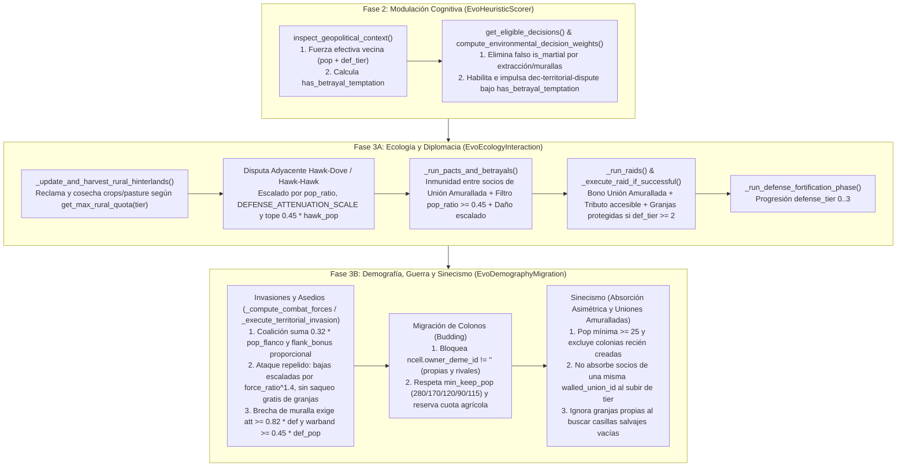

# Re-equilibrado de Escala Social, Militar, Agrícola y Diplomática

*   **Author:** Juan Ezquerro LLanes
*   **Status:** Approved
*   **Date:** 2026-11-08

--------------------------------------------------------------------------------

## Overview

**Evolution** simula duelos evolutivos y bioculturales sobre un mapa hexagonal de `169` celdas donde cada deme evoluciona desde campamentos nómadas (`Tier I`) hasta metrópolis fortificadas (`Tier IV`) con periferia agrícola (`crops` y `pasture`), pactos diplomáticos, comercio simbiótico, incursiones, guerras territoriales y sinecismo (absorción asimétrica o uniones amuralladas multi-hexágono).

Este diseño corrige los desajustes de escala demográfica, militar, agrícola y diplomática en el motor biofísico ([`EvoEcologyInteraction`](file:///home/arrase/Develop/Evolution/src/engine/biophys/ecology_interaction.gd), [`EvoDemographyMigration`](file:///home/arrase/Develop/Evolution/src/engine/biophys/demography_migration.gd)) y en el modulador heurístico ([`EvoHeuristicScorer`](file:///home/arrase/Develop/Evolution/src/engine/cognitive/heuristic_scorer.gd)). El propósito es garantizar que el tamaño de una ciudad, sus murallas (`defense_tier`) y sus redes de alianza protejan a la población y sus campos de cultivo frente a agresores pequeños aislados, manteniendo al mismo tiempo la viabilidad de coaliciones militares multi-frente, el pago de tributos, las traiciones bajo escasez y las uniones amuralladas duraderas.

## The Problem

Las auditorías de código y las pruebas empíricas sobre `1.050` generaciones (`21` partidas completas de `50` generaciones más `8` micro-escenarios controlados documentados en [`concepts_brief.md`](file:///home/arrase/Develop/Evolution/concepts_brief.md)) demostraron que las interacciones sociales actuales sufren siete distorsiones de escala:

1. **Destrucción de campos de cultivo por migración propia (`968` granjas destruidas en `1.050` generaciones)**: Al emitir `10` colonos, una ciudad de categoría II–IV no excluye sus propios hexágonos cultivados (`owner_deme_id == deme.id`). Como las granjas tienen un `+22%` de regeneración estacional, son las celdas con más recursos y la propia ciudad asienta colonos sobre su mejor granja, borrándola (`land_use = "wild"`). Además, perder esos `10–20` habitantes hace caer a ciudades de `280` o `170` habitantes al nivel urbano inferior, destruyendo inmediatamente otras `1–2` granjas por recorte de cuota, para luego reabsorber la colonia recién fundada al turno siguiente (`2.431` absorciones artificiales).
2. **Saqueo gratuito de granjas en invasiones repelidas y ocupación sin combate por colonos rivales**: Cuando un ejército invasor pierde una batalla (`att_force < def_force`), el código actual destruye igualmente una granja de la ciudad defensora victoriosa y le roba hasta `18.0` de energía (más que los `15.0` de coste del ataque fallido). Asimismo, cualquier grupo de `10` colonos de un deme rival con perfil marcial puede migrar directamente sobre una granja de una metrópolis amurallada y expropiarla sin combate.
3. **Desgaste kamikaze y demolición de murallas por ejércitos pequeños**: Los demes con `cul-warrior-expansion` lanzan invasiones con apenas el `45%` de la fuerza defensora. Al ser repelidos, infligen bajas fijas del `10%–16%` sobre la población total de la ciudad (matando a `30–48` ciudadanos con una banda derrotada de `31` guerreros) y reducen automáticamente el `defense_tier` de ciudades sin pactos activos (`is_isolated_defender`), demoliendo castillos mediante ataques suicidas.
4. **Extinción del `100%` de las Uniones Amuralladas (`27` creadas, `0` activas en la generación 50)**: Cuando dos ciudades de categoría II forman una Unión Amurallada (`walled_union_id`), en cuanto una de ellas alcanza `170` habitantes (categoría III) mientras su socia sigue en categoría II, la fase de sinecismo detecta categorías distintas (`t1 != t2`) y absorbe a la ciudad socia, destruyendo todas las confederaciones amuralladas. Además, el sinecismo del mismo linaje confunde las granjas propias (`deme_ids` vacío) con terreno salvaje libre, bloqueando fusiones legítimas.
5. **Robo *Hawk-Dove*, bajas *Hawk-Hawk* y traiciones independientes del tamaño y las murallas**: Un campamento *Hawk* de `15` habitantes junto a una metrópolis *Dove* de `320` habitantes (`defense_tier = 3`, 4 granjas) le roba el `22%+` de toda su cosecha (`91.4` de energía en un turno). En disputas *Hawk-Hawk*, ambos pierden un `12%` fijo de población (`2` bajas en el campamento frente a `39` en la metrópolis). En una traición (`_execute_betrayal`), un aliado de `15` habitantes mata al `14%` (`45` ciudadanos) de una metrópolis de `320` habitantes sin chequeo de fuerza ni mitigación por murallas.
6. **Inactividad total de tributos (`0/21` partidas) y traiciones (`0/21` partidas)**: El pago de tributos exige simultáneamente `defense_tier < 2`, `energy_reserves >= 55.0` y `p_v_exch >= 0.28`, combinación que la modulación ambiental impide bajo amenaza (`0` tributos en `1.050` generaciones). A su vez, cuando todos los vecinos son aliados de pacto, `EvoHeuristicScorer` elimina `dec-territorial-dispute` de las decisiones elegibles (`p_disp = 0.0`), bloqueando cualquier traición oportunista en invierno.
7. **Falsa clasificación marcial de ciudades agrícolas y amuralladas**: `EvoHeuristicScorer` clasifica como marcial (`is_martial = true`) a cualquier deme con `extraction_efficiency > 0.3` y multiplica por `1.22` la disputa territorial cuando `defense_tier >= 2`, empujando a ciudades pacíficas, agrícolas y comerciales a guerras fronterizas constantes (`1.813` flujos de disputa y `692` tragedias de los comunes en `21` partidas).

La solución propuesta introduce un escalado proporcional por razón de población (`pop_ratio`), nivel de fortificación (`defense_tier`), suministro rural y soporte de coalición en flancos, protegiendo la propiedad de los cultivos frente a colonos e invasores derrotados y preservando la integridad de las Uniones Amuralladas.

## Goals

*   **Impedir victorias o desgastes desproporcionados de ejércitos pequeños contra ciudades grandes**: Una banda de guerra en inferioridad (`att_force < def_force * 0.92`) no podrá conquistar una ciudad; si es repelida, las bajas del defensor quedarán escaladas por `pow(force_ratio, 1.4)` y topadas al `35%` de la banda atacante, y las murallas (`defense_tier`) solo cederán ante asedios casi parejos (`att_force >= def_force * 0.82` y `warband_pop >= 0.45 * defender.population`).
*   **Habilitar victorias por coalición multi-frente**: Permitir que demes atacantes apoyados por aliados o parientes adyacentes sumen población de soporte (`coalition_support_pop`) y bono de flanqueo proporcional para superar a ciudades fortificadas cuando exista superioridad real combinada.
*   **Proteger los campos de cultivo (`crops` y `pasture`) de ciudades grandes**: Reducir a `0` la destrucción de granjas por invasiones repelidas menores y por ocupación de colonos migrantes (propios o rivales), proteger las granjas de ciudades con `defense_tier >= 2` frente a incursiones (`raids`), y evitar la pérdida de categoría urbana al emitir colonos (`min_keep_pop`).
*   **Escalar disputas *Hawk-Dove*, *Hawk-Hawk* y traiciones por población y fortificación**: Limitar el robo energético *Hawk-Dove* y las bajas/botín por traición en función de `pop_ratio`, la escala de atenuación de fortificaciones (`DEFENSE_ATTENUATION_SCALE`) y un tope máximo por habitante del agresor (`0.45 * aggressor.population`).
*   **Restaurar el funcionamiento de pactos, tributos, traiciones y Uniones Amuralladas**: Lograr en la suite de `21` partidas (`1.050` generaciones) la supervivencia sostenida de Uniones Amuralladas (`>= 25` activas en la generación 50 frente a `0` actuales), la activación real de tributos y traiciones bajo presión estacional, y una reducción superior al `50%` en disputas fronterizas espurias y tragedias de los comunes.
*   **Cero regresiones en la suite de pruebas**: Mantener el `100%` de compatibilidad con [`tests/test_runner.gd`](file:///home/arrase/Develop/Evolution/tests/test_runner.gd) y añadir verificaciones explícitas de escala militar, protección agrícola y persistencia de uniones.

## Non-Goals

*   **Sin nuevas estructuras de datos ni unidades independientes**: No se añadirán clases de ejércitos separados de los demes ni nuevos atributos serializados en `EvoTypes.Deme`, `EvoTypes.HexCell` o `EvoTypes.WorldState`.
*   **Sin cambios en la regla de exclusividad espacial (`1` deme por hexágono)**: Todas las interacciones seguirán ocurriendo a través de aristas entre hexágonos vecinos (`HexMath.get_neighbor_ids`).
*   **Sin cambios en el modelo termodinámico ni en el cliente Ollama**: No se alterarán los vectores biofísicos de 6 ejes en `EvoCatalog` / `EvoThermodynamics` ni las llamadas HTTP de `EvoOllamaClient`.
*   **Sin cambios visuales o de interfaz**: No se modificarán shaders, generación de sprites ni paneles del HUD.

## Open Questions

*   **Ninguna pregunta abierta**: Los umbrales matemáticos y escenarios objetivo fueron validados empíricamente sobre los `8` micro-escenarios y las `21` partidas (`1.050` generaciones) del banco de simulación durante la fase de `/egm-brainstorm` ([`concepts_brief.md`](file:///home/arrase/Develop/Evolution/concepts_brief.md)).

## Critical User Journeys (CUJs)

### CUJ 1: Ciudad grande fortificada repele a un ejército pequeño sin perder sus cultivos ni sus murallas

*   **Given**: Una ciudad de categoría III o IV (`population = 220..300`, `defense_tier = 2..3`) con `2` a `4` campos de cultivo adyacentes (`crops`/`pasture`), vecina de un deme marcial pequeño (`population = 65..85`, banda de guerra `warband_pop = 31..41`).
*   **When**: Avanza el turno generacional y el deme marcial evalúa o ejecuta una incursión o invasión contra la ciudad.
*   **Then**: Si la fuerza atacante no alcanza el umbral mínimo (`att_force < def_force * 0.55`), el deme marcial disuade el ataque suicida; si el ataque ocurre y es repelido (`att_force < def_force * 0.92`), la ciudad sufre bajas mínimas proporcionales (`1–4` habitantes en vez de `22–45`), conserva intacto su `defense_tier` y mantiene el `100%` de sus campos de cultivo sin ruinas.

### CUJ 2: Coalición multi-frente conquista una ciudad fortificada

*   **Given**: Una ciudad fortificada (`population = 175`, `defense_tier = 1`) rodeada por un deme atacante principal (`population = 210`, `warband_pop = 101`) y dos demes aliados/parientes en hexágonos adyacentes (`population = 140` cada uno).
*   **When**: El deme atacante lanza una invasión territorial apoyada por los flancos de su coalición.
*   **Then**: [`_compute_combat_forces`](file:///home/arrase/Develop/Evolution/src/engine/biophys/demography_migration.gd#L84-L140) suma el soporte efectivo de coalición (`coalition_support_pop`) y el bono de flanqueo proporcional, superando la fuerza defensiva de la ciudad (`att_force >= def_force * 0.92`) y conquistando el hexágono.

### CUJ 3: Conservación de campos de cultivo durante el crecimiento y colonización urbana

*   **Given**: Una metrópolis de categoría IV (`population = 290`, `4` campos de cultivo propios con altos recursos y `2` hexágonos salvajes vecinos) y un deme marcial rival adyacente a uno de sus campos.
*   **When**: Tanto la metrópolis como el deme rival ejecutan la fase de migración de colonos en [`run_demography_and_migration_phase`](file:///home/arrase/Develop/Evolution/src/engine/biophys/demography_migration.gd#L596-L818).
*   **Then**: Ninguno de los dos demes puede asentar colonos sobre las celdas con `owner_deme_id != ""`; la metrópolis respeta su umbral de población mínima (`min_keep_pop = 280`) para no degradarse a categoría III, envía sus colonos únicamente a hexágonos salvajes libres y conserva sus `4` campos de cultivo.

### CUJ 4: Evolución estable de Pactos, Tributos, Traiciones y Uniones Amuralladas

*   **Given**: Dos ciudades aliadas de categoría II (`population = 155` y `165`) unidas en una Unión Amurallada Multi-Hexágono (`walled_union_id != ""`), y un tercer deme comercial vecino con un pacto activo o expuesto a incursiones durante la estación `dry_cold`.
*   **When**: Una de las ciudades de la Unión Amurallada supera los `170` habitantes (categoría III) y llega el invierno (`dry_cold`).
*   **Then**: La Unión Amurallada se mantiene activa entre ambas ciudades sin que la ciudad de categoría III absorba ni destruya a su socia de categoría II; las ciudades pacíficas o comerciales amenazadas por incursiones superiores pagan tributo para obtener una tregua si tienen reservas suficientes; y cualquier traición o disputa *Hawk-Dove* escala sus bajas y botín proporcionalmente al tamaño del agresor y al `defense_tier` de la víctima.

--------------------------------------------------------------------------------

## Technical Plan (Architecture)

### 1. Flujo de Datos e Interacción entre Subsistemas

El ajuste se integra en las fases existentes del motor generacional ([`EvoTurnEngine.advance_generation`](file:///home/arrase/Develop/Evolution/src/engine/turn_engine.gd#L10-L43)) sin alterar el orden de ejecución ni añadir estructuras de estado persistentes:

### 2. Modulación Heurística y Contexto Geopolítico ([`src/engine/cognitive/heuristic_scorer.gd`](file:///home/arrase/Develop/Evolution/src/engine/cognitive/heuristic_scorer.gd))

1. **Corrección de la falsa clasificación marcial ([`compute_environmental_decision_weights`](file:///home/arrase/Develop/Evolution/src/engine/cognitive/heuristic_scorer.gd#L455-L515))**:
   - En la clasificación `is_martial`, se elimina el criterio `extraction_efficiency > 0.3` para que los demes agrícolas, recolectores especializados o innovadores no reciban el multiplicador agresivo de disputa territorial y sobreexplotación durante las estaciones secas.
   - En la respuesta a amenazas fronterizas (`nearby_horde_threat` o `active_vendettas > 0`), se elimina `deme.defense_tier >= 2` de la condición que impulsa `dec-territorial-dispute`, evitando que ciudades cooperativas o comerciales amuralladas actúen como *Hawks* por haber construido murallas.
2. **Evaluación de debilidad vecina ponderada por fortificación ([`inspect_geopolitical_context`](file:///home/arrase/Develop/Evolution/src/engine/cognitive/heuristic_scorer.gd#L255-L285))**:
   - Tanto para rivales en la misma celda como en hexágonos adyacentes, `neighbor_is_weaker` deja de activarse por bajas reservas (`energy_reserves < 45.0`) cuando el vecino supera al deme en población o en `defense_tier`. Se compara la fuerza efectiva del vecino ponderada por sus murallas (`+35%` por cada nivel de `defense_tier`) frente al `85%` de la población propia.
3. **Fuente única de elegibilidad e impulso para la tentación de traición invernal ([`inspect_geopolitical_context`](file:///home/arrase/Develop/Evolution/src/engine/cognitive/heuristic_scorer.gd#L171-L368), [`_has_nearby_rival_deme`](file:///home/arrase/Develop/Evolution/src/engine/cognitive/heuristic_scorer.gd#L52-L60) y [`compute_environmental_decision_weights`](file:///home/arrase/Develop/Evolution/src/engine/cognitive/heuristic_scorer.gd#L401-L476))**:
   - `inspect_geopolitical_context` calcula y expone `has_betrayal_temptation` cuando un deme tiene pactos activos, carece del rasgo `cul-communal-conservation`, atraviesa invierno o escasez (`dry_cold` o `energy_reserves < 65.0`) y su vecino aliado acumula al menos un `15%` más de reservas energéticas.
   - Tanto `_has_nearby_rival_deme` (utilizado por `get_eligible_decisions` para el *prompting* de Ollama System 1) como `compute_environmental_decision_weights` mantienen `dec-territorial-dispute` elegible cuando `has_betrayal_temptation` está activo, aplicando un impulso moderado proporcional al estrés de reservas sobre `dec-territorial-dispute` y `dec-intensive-overexploit` y suprimiendo el bono cooperativo de pacto.

### 3. Ecología, Disputas, Pactos, Traiciones, Incursiones y Tributos ([`src/engine/biophys/ecology_interaction.gd`](file:///home/arrase/Develop/Evolution/src/engine/biophys/ecology_interaction.gd))

1. **Constante Compartida de Atenuación Defensiva y Cuota Rural ([`EvoEcologyInteraction`](file:///home/arrase/Develop/Evolution/src/engine/biophys/ecology_interaction.gd#L1-L20))**:
   - Se centraliza la atenuación de daño y saqueo por nivel de fortificación (`0..3`) en la constante compartida `DEFENSE_ATTENUATION_SCALE = [1.0, 0.75, 0.50, 0.30]` y se extrae el helper estático `get_max_rural_quota(tier: int) -> int` (`0`, `1`, `2` o `4` hexágonos rurales para categorías `I..IV`), reutilizados en ambos módulos biofísicos.
2. **Escalado de Disputas Adyacentes *Hawk-Dove* y *Hawk-Hawk* ([`run_resource_and_symbiosis_phase`](file:///home/arrase/Develop/Evolution/src/engine/biophys/ecology_interaction.gd#L1140-L1180))**:
   - **Hawk vs. Dove**: La fracción de energía capturada por el vecino *Hawk* se multiplica por la razón demográfica (`[0.10, 1.40]`) y por `DEFENSE_ATTENUATION_SCALE[dove.defense_tier]`, con un tope absoluto por cápita de `0.45 * hawk.population`.
   - **Hawk vs. Hawk**: La tasa de bajas de cada deme (`12%` base en igualdad de población sin murallas) se escala por la razón de población del oponente (`[0.20, 1.50]`) y por `DEFENSE_ATTENUATION_SCALE[defense_tier]`, acotada al rango `[2%, 18%]`.
3. **Coherencia de Uniones Amuralladas, Umbral y Escalado de Traiciones ([`_is_opportunistic_betrayer`](file:///home/arrase/Develop/Evolution/src/engine/biophys/ecology_interaction.gd#L149-L176), [`_execute_betrayal`](file:///home/arrase/Develop/Evolution/src/engine/biophys/ecology_interaction.gd#L178-L230), [`_run_pacts_and_betrayals`](file:///home/arrase/Develop/Evolution/src/engine/biophys/ecology_interaction.gd#L315-L345))**:
   - **Inmunidad interna de Uniones Amuralladas**: Dos ciudades que comparten la misma `walled_union_id != ""` no pueden traicionarse entre sí mientras la unión esté activa, garantizando coherencia entre la Fase 3A y la Fase 3B.
   - **Puntuación de traición oportunista**: `_is_opportunistic_betrayer` preserva la inmunidad de demes comunales/cohesivos no guerreros y evalúa una puntuación combinada (`agg_score`) de `dec-territorial-dispute`, `dec-intensive-overexploit` y rasgos marciales/extractivos frente a un umbral más exigente contra objetivos amurallados (`0.26` si `defense_tier >= 2`, `0.18` si `defense_tier < 2`, o `p_disp >= 0.16`).
   - **Filtro demográfico y daño escalado**: Un aliado solo ejecuta una traición si alcanza al menos el `45%` de la población de la víctima y esta posee reservas suficientes (`>= 45.0`), ya sea por estrés calórico o por codicia invernal entre linajes distintos (`dry_cold`, reservas de la víctima `>= 75.0` y `> 1.25x` las del traidor). Tanto el botín como las bajas se escalan por razón de población y `DEFENSE_ATTENUATION_SCALE`, con un suelo de `2` bajas y un tope de `0.45 * betrayer.population`.
4. **Defensa ante Incursiones (`Raids`), Activación de Tributos y Protección Agrícola ([`_execute_raid_if_successful`](file:///home/arrase/Develop/Evolution/src/engine/biophys/ecology_interaction.gd#L580-L695))**:
   - **Defensa de Unión Amurallada**: Si la víctima pertenece a una `walled_union_id`, su población defensiva efectiva suma el `40%` de la población de cada socio adyacente de la unión con el que no exista vendetta (`active_pacts >= 0`) antes de aplicar los multiplicadores de cohesión y fortificación.
   - **Tributo**: Las ciudades con `defense_tier <= 2` y `energy_reserves >= 35.0` pagan tributo a cambio de una tregua (`active_pacts = 1`) cuando tienen propensión comercial (`p_v_exch >= 0.18` o `cul-interdeme-barter`) o cuando son asentamientos establecidos (`population >= 55` o `defense_tier >= 1`) con perfil pacífico (`p_v_coop + p_v_exch >= 0.34` y `p_v_disp < 0.20`).
   - **Protección de Granjas en Incursiones**: Las bajas de la víctima se topan a `0.14 * raider.population`. Las ciudades con `defense_tier >= 2` nunca pierden la propiedad de sus granjas durante una incursión; con `defense_tier == 1`, la granja solo es arrasada si la fuerza incursora supera en un `35%` a la defensa.

### 4. Combate Territorial, Asedios, Colonización y Sinecismo ([`src/engine/biophys/demography_migration.gd`](file:///home/arrase/Develop/Evolution/src/engine/biophys/demography_migration.gd))

1. **Fuerzas de Combate con Coalición Multi-Frente y Suministro Rural ([`_compute_combat_forces`](file:///home/arrase/Develop/Evolution/src/engine/biophys/demography_migration.gd#L84-L140))**:
   - **Soporte de Coalición y Flanqueo**: Se reemplazan los bonos planos heredados por el cálculo sobre hexágonos vecinos al defensor: cada deme aliado o del mismo linaje que el atacante aporta el `32%` de su población a la banda efectiva de asalto (hasta duplicar más un `20%` la banda original) y un bono táctico de flanqueo proporcional a la razón entre población de flanco y población defensora (hasta `+50%`).
   - **Defensa Urbana y Agrícola**: El defensor suma un bono de suministro (`+8%` por cada granja propia activa, hasta `+24%`), además de `DEFENSE_TIER_BONUS` y el refuerzo de socios adyacentes de su Unión Amurallada sin vendetta activa (`active_pacts >= 0`).
2. **Umbral de Lanzamiento, Victoria y Asedio Repelido ([`run_demography_and_migration_phase`](file:///home/arrase/Develop/Evolution/src/engine/biophys/demography_migration.gd#L645-L675) y [`_execute_territorial_invasion`](file:///home/arrase/Develop/Evolution/src/engine/biophys/demography_migration.gd#L280-L435))**:
   - **Filtro de lanzamiento y conquista**: Se exige al menos el `55%` de la fuerza defensora para lanzar una invasión (`50%` con `cul-warrior-expansion` contra objetivos con `defense_tier <= 1`), y el `92%` (`att_force >= def_force * 0.92`) para conquistar el hexágono.
   - **Invasión repelida**: Las bajas del defensor se escalan por `pow(force_ratio, 1.4)` y `DEFENSE_ATTENUATION_SCALE[def_tier]`, topadas al `35%` de la banda atacante; los atacantes supervivientes solo regresan a su deme si están a distancia `<= 1`; el saqueo y ruina de una granja adyacente solo ocurre en asedios pesados (`force_ratio >= 0.75`) contra defensores con `defense_tier <= 1`; y la reducción de `defense_tier` exige simultáneamente `att_force >= def_force * 0.82`, `warband_pop >= 0.45 * defender.population` y aislamiento o agotamiento de reservas.
3. **Protección de Granjas y Categoría Urbana Durante la Emisión de Colonos ([`run_demography_and_migration_phase`](file:///home/arrase/Develop/Evolution/src/engine/biophys/demography_migration.gd#L705-L760))**:
   - **Prohibición de colonizar granjas activas**: Ningún colono (propio ni rival) puede seleccionar como destino una celda con `owner_deme_id != ""`.
   - **Población mínima de retención (`min_keep_pop`)**: Fuera de emergencias o bajíos costeros (`coastal_shallows`), las ciudades retienen la población mínima requerida por [`EvoTypes.Deme.get_village_tier()`](file:///home/arrase/Develop/Evolution/src/core/types.gd#L409-L416) (`280` en categoría IV, `170` en categoría III, `90` en categoría II con `defense_tier == 1` o `120` sin murallas, y `115` en fronteras no fortificadas).
   - **Reserva de cuota agrícola (`reserve_farms`) y puntuación de retaguardia**: Cuando una ciudad pacífica no sufre emergencia ni sobrepoblación (`population <= 70%` de `carrying_capacity`), reserva hasta `2` celdas salvajes vecinas libres para su cuota agrícola pendiente (`candidates.size() <= reserve_farms` cancela la emisión) y prioriza celdas alejadas de rivales hostiles.
4. **Sinecismo y Supervivencia de Uniones Amuralladas ([`run_demography_and_migration_phase`](file:///home/arrase/Develop/Evolution/src/engine/biophys/demography_migration.gd#L985-L1085))**:
   - Se exige que ambos demes tengan `population >= 25` y no hayan sido fundados en el mismo turno (`not newly_created_demes`).
   - **Inmunidad de Uniones Amuralladas frente a auto-absorción**: Si dos demes adyacentes ya comparten la misma `walled_union_id != ""`, el bucle de sinecismo renueva su flujo `"merge"` y continúa sin ejecutar la absorción asimétrica cuando uno de los socios asciende a categoría III o IV.
   - En la comprobación de espacio libre para el sinecismo del mismo linaje, se exige `ncell.deme_ids.is_empty() and ncell.owner_deme_id == ""`.

--------------------------------------------------------------------------------

## Alternatives Considered

### Alternative A: Inmunidad absoluta de las ciudades de categoría III–IV y de sus campos de cultivo frente a cualquier ataque

*   **Pros**: Garantiza con una sola regla condicional que ninguna metrópolis ni sus granjas puedan ser conquistadas o saqueadas una vez alcanzado el `Tier III`.
*   **Cons**: Elimina la presión evolutiva tardía en el tablero. Cualquier estrategia que alcance `170` habitantes primero genera un bloqueo estático irreversible, volviendo inútiles las estrategias marciales (`strat-war`, `strat-expansion`) incluso cuando superan en número 3 a 1 a la ciudad desde múltiples hexágonos vecinos.
*   **Reason for Rejection**: Rompe el equilibrio competitivo 1v1 del simulador al impedir que coaliciones multi-frente con superioridad demográfica real puedan asediar o conquistar una ciudad aislada.

### Alternative B: Crear unidades de guarnición explícitas en cada hexágono rural (`crops` y `pasture`)

*   **Pros**: Permite resolver batallas directamente sobre cada campo de cultivo usando las mismas funciones de combate de los demes urbanos.
*   **Cons**: Requiere poblar las celdas rurales (`cell.deme_ids`) o añadir nuevos campos de estado en `EvoTypes.HexCell` (`garrison_population`, `garrison_energy`), rompiendo la invariante global de que los hexágonos rurales (`owner_deme_id != ""`) tienen `cell.deme_ids.is_empty() == true` y alterando la serialización de instantáneas JSON.
*   **Reason for Rejection**: Viola la invariante de exclusividad espacial (`1` deme por hexágono y celdas rurales despobladas) e introduce complejidad de estado innecesaria cuando la protección de las granjas se deriva directamente de la población y `defense_tier` de la ciudad propietaria (`owner_deme_id`).

### Alternative C: Eliminar por completo las traiciones diplomáticas y las disputas *Hawk-Dove* entre hexágonos vecinos

*   **Pros**: Suprime de raíz los casos donde un aliado pequeño o un vecino agresivo drena población o energía de una ciudad grande.
*   **Cons**: Convierte los pactos diplomáticos en fusiones permanentes libres de riesgo incluso durante inviernos severos (`dry_cold`), y anula la competencia ecológica fronteriza entre estrategias agresivas y pacíficas antes de que estalle una guerra abierta.
*   **Reason for Rejection**: Empobrece la dinámica geopolítica del juego; el problema real no es la existencia de traiciones o disputas *Hawk-Dove*, sino la ausencia de escalado por `pop_ratio`, `defense_tier` y tope por cápita del agresor.

--------------------------------------------------------------------------------

## Risks & Mitigations

*   **Riesgo 1: Bloqueo de colonización en islas pequeñas o archipiélagos (`preset-finite-island`, `preset-darwin-archipelago`)**:
    *   *Descripción*: La combinación de `min_keep_pop` (`280`/`170`/`120`) y `reserve_farms` (reservar hasta `2` hexágonos salvajes para granjas futuras) podría impedir la expansión de demes pacíficos cuando el espacio terrestre adyacente es muy limitado.
    *   *Mitigación integrada*: Tanto `min_keep_pop` como `reserve_farms` se desactivan automáticamente bajo emergencia (`is_emergency`), en bajíos costeros (`current_cell.biome == "coastal_shallows"`) y, en el caso de `reserve_farms`, cuando la población supera el `70%` de la capacidad de carga (`deme.population > int(current_cell.carrying_capacity * 0.70)`).
*   **Riesgo 2: Degradación en cascada de una Unión Amurallada tras epidemias o asedios**:
    *   *Descripción*: Si uno de los dos socios de una Unión Amurallada cae por debajo de categoría II (`population < 120` y `defense_tier == 0`) debido a una epidemia (`salubrity < 0.35`) o asedio, [`EvoTurnEngine._revalidate_walled_unions`](file:///home/arrase/Develop/Evolution/src/engine/turn_engine.gd#L55-L84) disuelve una unión de `1` solo miembro, lo que podría hacer bajar de categoría IV a categoría III a un socio que dependía de `walled_union_id != ""` con `population` entre `280` y `379`.
    *   *Mitigación integrada*: `_revalidate_walled_unions` preserva `walled_union_id` para cualquier componente conexa que conserve al menos `2` socios adyacentes de categoría `II+`, y el umbral `min_keep_pop = 280` junto con el refuerzo defensivo mutuo (`+0.40x` en incursiones y `+0.55x` en batallas) evita que los socios caigan por debajo de categoría II por causas no catastróficas.
*   **Riesgo 3: Estancamiento de fortalezas en el juego tardío (`Fortress Stalemate`)**:
    *   *Descripción*: Elevar el umbral de conquista (`att_force >= def_force * 0.92`) y de demolición de murallas (`att_force >= def_force * 0.82` y `warband_pop >= 0.45 * defender.population`) podría estancar partidas 1v1 si ningún deme individual puede superar a una metrópolis `Tier IV`.
    *   *Mitigación integrada*: El soporte de coalición multi-frente (`coalition_support_pop` hasta `+1.20x` la banda atacante más `flank_bonus` hasta `+0.50`) y la tentación de traición invernal (`has_betrayal_temptation`) permiten romper fortificaciones mediante ataques coordinados desde múltiples hexágonos o rupturas de pacto bajo escasez.

--------------------------------------------------------------------------------

## Non-Functional Requirements

*   **Determinismo y Conservación de Semilla**: Todos los cálculos de fuerza, atenuación de bajas, robo energético y selección de candidatos utilizan aritmética determinista (`snappedf`, `clampf`, `clampi`) sin introducir generadores aleatorios no deterministas en la fase biofísica.
*   **Rendimiento y Caché de Firmas Cognitivas (`EvoHeuristicScorer`)**: Añadir la clave booleana `has_betrayal_temptation` al diccionario devuelto por [`inspect_geopolitical_context`](file:///home/arrase/Develop/Evolution/src/engine/cognitive/heuristic_scorer.gd#L171-L368) no altera [`build_env_weights_cache_key`](file:///home/arrase/Develop/Evolution/src/engine/cognitive/heuristic_scorer.gd#L145-L168), preservando el rendimiento del pool de hilos de Ollama (`EvoOllamaClient`).
*   **Compatibilidad de Esquema JSON (`EvoTypes`)**: No se modifica ningún campo de serialización en `EvoTypes.WorldState`, `EvoTypes.Deme` ni `EvoTypes.HexCell`, manteniendo compatibilidad total con `user://evolution_world_state.json` y `~/.config/Evolution/user_catalog.json`.

--------------------------------------------------------------------------------

## Additional Resources

*   [`AGENTS.md`](file:///home/arrase/Develop/Evolution/AGENTS.md) — Invariantes globales del proyecto (exclusividad de `1` deme por hexágono, jerarquía urbana de 4 niveles y sinecismo dual).
*   [`src/engine/biophys/README.md`](file:///home/arrase/Develop/Evolution/src/engine/biophys/README.md) — Documentación del motor biofísico y demográfico.
*   [`src/engine/cognitive/README.md`](file:///home/arrase/Develop/Evolution/src/engine/cognitive/README.md) — Documentación del evaluador heurístico y modulación ambiental.
*   [`concepts_brief.md`](file:///home/arrase/Develop/Evolution/concepts_brief.md) — Informe de *brainstorm* con las tablas comparativas de `1.050` generaciones.

--------------------------------------------------------------------------------

## Detailed Implementation Plan

### Target Files to Create/Modify

#### 1. `src/engine/biophys/demography_migration.gd` ([Modify])

*   **Type / Scope**: Motor demográfico, combate territorial y sinecismo en GDScript (`EvoDemographyMigration`).
*   **Rationale**: Requerido para evaluar las fuerzas de invasión con soporte de coalición (`_compute_combat_forces`), escalar las consecuencias de batallas y asedios (`_execute_territorial_invasion`), proteger las granjas y categorías urbanas durante la emisión de colonos (`run_demography_and_migration_phase`) y preservar las Uniones Amuralladas durante el sinecismo.
*   **Proposed Changes**:
    1.  **[`_compute_combat_forces(attacker, warband_pop, defender, state)`](file:///home/arrase/Develop/Evolution/src/engine/biophys/demography_migration.gd#L84-L140)**:
        *   Eliminar los bucles heredados de `flank_bonus += 0.28` en las líneas `108–119`.
        *   Recorrer los hexágonos vecinos del defensor (`HexMath.get_neighbor_ids(def_cell.q, def_cell.r, state.map_radius)`):
            *   Contar las granjas activas propiedad del defensor (`ncell.owner_deme_id == defender.id and (ncell.land_use == "crops" or ncell.land_use == "pasture")`) para calcular `var def_rural_bonus: float = minf(0.24, float(owned_rural_count) * 0.08)`.
            *   Para cada deme vivo `od` en esos hexágonos vecinos que sea aliado o del mismo linaje que el atacante (`od.id != attacker.id and od.id != defender.id and (od.lineage_id == attacker.lineage_id or EvoTypes.is_pact_active(state, attacker.id, od.id))`), acumular `flanking_support_pop += float(od.population)` y `coalition_support_pop += 0.32 * float(od.population)`.
        *   En el bucle de refuerzo de Unión Amurallada del defensor ([líneas `120–129`](file:///home/arrase/Develop/Evolution/src/engine/biophys/demography_migration.gd#L120-L129)), exigir además que no exista vendetta activa entre el defensor y el socio (`int(state.active_pacts.get(EvoTypes.make_pair_key(defender.id, u_partner.id), 0)) >= 0`).
        *   Definir la población efectiva de asalto como `var eff_warband_pop: float = float(warband_pop) + minf(float(warband_pop) * 1.20, coalition_support_pop)` y el multiplicador táctico de flanco como `var flank_bonus: float = 1.0 + clampf((flanking_support_pop / maxf(25.0, float(defender.population))) * 0.38, 0.0, 0.50)`.
        *   Reemplazar `float(warband_pop)` en la línea `131` por `eff_warband_pop`: `var att_force: float = eff_warband_pop * att_mult * flank_bonus`, y sumar `def_rural_bonus` al multiplicador de `def_force` (`1.0 + def_bonus + def_rural_bonus + maxf(0.0, def_vec.social_cohesion * 0.25)`).
    2.  **[`_execute_territorial_invasion(...)`](file:///home/arrase/Develop/Evolution/src/engine/biophys/demography_migration.gd#L280-L435)**:
        *   Reemplazar las apariciones del ternario de cuota rural (`líneas 296 y 1048`) por `EvoEcologyInteraction.get_max_rural_quota(...)`.
        *   Exigir `att_force >= def_force * 0.92` (en lugar de `att_force > def_force`) para la rama de victoria/conquista del atacante.
        *   En la rama `else` (invasión repelida, reemplazando las líneas `355–433`):
            *   Calcular `var force_ratio: float = clampf(att_force / maxf(1.0, def_force), 0.05, 1.0)` y `var def_cas_scale: float = EvoEcologyInteraction.DEFENSE_ATTENUATION_SCALE[def_tier]`.
            *   Escalar las bajas del defensor mediante `var scaled_def_loss: int = int(round(float(defender.population) * 0.11 * pow(force_ratio, 1.4) * def_cas_scale))` y aplicar `var def_losses: int = clampi(scaled_def_loss, 1, maxi(1, int(round(float(warband_pop) * 0.35 * def_cas_scale))))` con `defender.population = maxi(10, defender.population - def_losses)`.
            *   **Saqueo condicional en asedio repelido**: Ejecutar el bucle de devastación de una granja adyacente del defensor (`ncell.owner_deme_id = ""`, `ncell.land_use = "wild"`, `ncell.has_ruins = true` y `r_plunder = minf(defender.energy_reserves * 0.18, 22.0)`) **únicamente si `force_ratio >= 0.75 and def_tier <= 1`**. Si no se arrasó granja y `def_tier == 0 and force_ratio >= 0.75`, aplicar un saqueo menor de escaramuza `r_plunder = minf(defender.energy_reserves * 0.12, 14.0)`. En cualquier otro ataque repelido (`force_ratio < 0.75` o `def_tier >= 2`), `r_plunder = 0.0` y no se destruye ninguna granja.
            *   **Retorno de supervivientes**: Calcular `var surviving_attackers: int = maxi(0, warband_pop - maxi(2, int(round(float(warband_pop) * (0.45 + 0.10 * float(def_tier))))))` y sumarlos a `attacker.population` solo si el deme atacante sigue vivo en la misma celda o en un hexágono adyacente (`attacker.cell_id == target_cell.id or HexMath.hex_distance(att_cell.q, att_cell.r, target_cell.q, target_cell.r) <= 1`).
            *   **Mantenimiento, brecha de muralla y eventos `"siege"`**: Cuando `def_tier >= 1`, emitir el `HexEdgeFlow` y `ChronicleEntry` de tipo `"siege"`; descontar `defender.energy_reserves = maxf(0.0, defender.energy_reserves - 6.0)` solo si `force_ratio >= 0.75`; y degradar `defender.defense_tier = maxi(0, defender.defense_tier - 1)` **únicamente cuando `att_force >= def_force * 0.82 and float(warband_pop) >= float(defender.population) * 0.45 and (defender.energy_reserves < 10.0 or is_isolated_defender)`**.
    3.  **[`run_demography_and_migration_phase(...)` — Filtro de Lanzamiento de Invasión](file:///home/arrase/Develop/Evolution/src/engine/biophys/demography_migration.gd#L645-L675)**:
        *   Reemplazar la condición de selección de objetivo de invasión en la línea `662` (`0.82 / 0.68 / 0.45`) por `forces.x >= forces.y * 0.82 or (other.defense_tier <= 1 and forces.x >= forces.y * 0.55) or (deme.cultural_trait_ids.has("cul-warrior-expansion") and other.defense_tier <= 1 and forces.x >= forces.y * 0.50)`.
    4.  **[`run_demography_and_migration_phase(...)` — Protección Agrícola y Urbana en Emisión de Colonos](file:///home/arrase/Develop/Evolution/src/engine/biophys/demography_migration.gd#L705-L760)**:
        *   Calcular `var cur_rival_dist: int = _min_distance_to_rival(current_cell, deme, state, rival_dist_cache)` para el deme actual.
        *   Inicializar `var min_keep_pop: int = 10 if (is_emergency or current_cell.biome == "coastal_shallows") else 15`. Si `not is_emergency and current_cell.biome != "coastal_shallows"`:
            *   Calcular `var c_tier: int = deme.get_village_tier()`.
            *   Asignar `min_keep_pop = 280` si `c_tier == 4`, `170` si `c_tier == 3`, `90 if deme.defense_tier == 1 else (120 if not is_martial_expander else 15)` si `c_tier == 2`, y `min_keep_pop = maxi(min_keep_pop, 115)` si `not is_martial_expander and cur_rival_dist <= 2 and deme.defense_tier < 2`.
            *   Limitar `migrants = mini(migrants, deme.population - min_keep_pop)` y actualizar la guarda de la línea `711` de `(deme.population - migrants) < 10` a `migrants < 10 or (deme.population - migrants) < min_keep_pop`.
        *   En el filtrado de celdas vecinas candidatas para migración (`línea 736`), sustituir `if ncell.owner_deme_id != "" and ncell.owner_deme_id != deme.id and not is_martial_expander: continue` por `if ncell.owner_deme_id != "" and (not is_martial_expander or ncell.owner_deme_id != deme.id): continue` (ninguna ciudad pacífica asienta colonos sobre sus granjas y ningún deme ocupa granjas ajenas sin conquistar antes la ciudad propietaria).
        *   Calcular `var max_rural_q: int = EvoEcologyInteraction.get_max_rural_quota(deme.get_village_tier())`, contar `owned_rural` (celdas vecinas con `ncell.owner_deme_id == deme.id and (ncell.land_use == "crops" or ncell.land_use == "pasture")`) y definir `var reserve_farms: int = maxi(0, mini(2, max_rural_q - owned_rural))`. Si `not is_martial_expander and not is_emergency and current_cell.biome != "coastal_shallows" and deme.population <= int(current_cell.carrying_capacity * 0.70) and candidates.size() <= reserve_farms: continue`.
        *   En la puntuación de casillas candidatas (`sc`), penalizar para colonizadores pacíficos (`not is_martial_expander`) las celdas próximas a rivales hostiles (`dc <= 1: sc -= 260.0`, `dc == 2: sc -= 90.0`) y bonificar la retaguardia segura (`dc > 2: sc += float(mini(dc, 5)) * 35.0`).
    5.  **[`run_demography_and_migration_phase(...)` — Sinecismo y Uniones Amuralladas](file:///home/arrase/Develop/Evolution/src/engine/biophys/demography_migration.gd#L985-L1085)**:
        *   Exigir `d1.population >= 25 and d2.population >= 25 and not newly_created_demes.has(d1.id) and not newly_created_demes.has(d2.id)` antes de evaluar el sinecismo entre dos hexágonos vecinos, y evitar fusionar dos campamentos guerreros del mismo linaje situados ambos en primera línea de asedio (`dist == 1` a un rival).
        *   Si `d1.walled_union_id != "" and d1.walled_union_id == d2.walled_union_id`, registrar el flujo `"merge"`, marcar contacto de linaje y ejecutar `continue` antes de evaluar `if t1 != t2:`, impidiendo que un socio de Unión Amurallada absorba al otro al subir de categoría urbana.
        *   En la comprobación de espacio vacío para el sinecismo del mismo linaje (`d1_has_empty`, `d2_has_empty`, líneas `999` y `1005`), exigir `ncell.deme_ids.is_empty() and ncell.owner_deme_id == ""`.

#### 2. `src/engine/biophys/ecology_interaction.gd` ([Modify])

*   **Type / Scope**: Motor de extracción ecológica, disputas *Hawk-Dove*, pactos, traiciones, incursiones y fortificaciones en GDScript (`EvoEcologyInteraction`).
*   **Rationale**: Contiene las fórmulas de robo en disputas fronterizas, activación y daño de traiciones, cálculo de defensa e impacto de incursiones (`raids`) y condición de pago de tributos. Su modificación escala estas interacciones por tamaño y `defense_tier` y protege las granjas de ciudades amuralladas.
*   **Proposed Changes**:
    1.  **Constante Compartida y Helper Estático ([`ecology_interaction.gd:1-20`](file:///home/arrase/Develop/Evolution/src/engine/biophys/ecology_interaction.gd#L1-L20))**:
        *   Añadir `const DEFENSE_ATTENUATION_SCALE: Array[float] = [1.0, 0.75, 0.50, 0.30]`.
        *   Añadir `static func get_max_rural_quota(tier: int) -> int: return 0 if tier < 2 else (1 if tier == 2 else (2 if tier == 3 else 4))` y reutilizarlo en `_update_and_harvest_rural_hinterlands` y `enforce_rural_hinterland_quotas` (`líneas 787 y 820`).
    2.  **[`_is_opportunistic_betrayer(...)`](file:///home/arrase/Develop/Evolution/src/engine/biophys/ecology_interaction.gd#L149-L176), [`_execute_betrayal(...)`](file:///home/arrase/Develop/Evolution/src/engine/biophys/ecology_interaction.gd#L178-L230) y [`_run_pacts_and_betrayals(...)`](file:///home/arrase/Develop/Evolution/src/engine/biophys/ecology_interaction.gd#L315-L345)**:
        *   En `_is_opportunistic_betrayer(deme, p_coop, p_exch, p_disp, p_over, v_eff, formal_pact_active, victim_defense_tier = 0)`:
            *   Mantener `if not formal_pact_active: return false`.
            *   Definir `var has_warrior: bool = deme.cultural_trait_ids.has("cul-warrior-expansion")`.
            *   Mantener las guardas cooperativas: `if deme.cultural_trait_ids.has("cul-communal-conservation") and not has_warrior and p_coop >= 0.22: return false` y `if v_eff.social_cohesion > 0.85 and not has_warrior and p_coop >= 0.38: return false`.
            *   Calcular `var agg_score: float = p_disp + 0.75 * p_over + (0.16 if has_warrior else 0.0) + (0.12 if deme.biological_trait_ids.has("bio-r-strategy") else 0.0) + (0.10 if deme.cultural_trait_ids.has("cul-extraction-tools") else 0.0) + (0.06 if (deme.cultural_trait_ids.has("cul-interdeme-barter") or deme.cultural_trait_ids.has("cul-fire-processing")) else 0.0)`.
            *   Devolver `agg_score >= (0.26 if victim_defense_tier >= 2 else 0.18) or p_disp >= 0.16`.
        *   En `_run_pacts_and_betrayals`:
            *   Excluir de toda traición (tanto por estrés calórico como por codicia invernal) a las parejas que compartan una Unión Amurallada activa (`if d1.walled_union_id != "" and d1.walled_union_id == d2.walled_union_id: continue`).
            *   Exigir que el traidor tenga al menos `float(betrayer.population) >= float(victim.population) * 0.45` y `victim.energy_reserves >= 45.0`, permitiendo el disparo de traición tanto por estrés de recursos (`_is_deme_stressed_for_betrayal`) como por codicia invernal entre linajes distintos (`d1.lineage_id != d2.lineage_id and state.season == "dry_cold" and victim.energy_reserves >= 75.0 and victim.energy_reserves > betrayer.energy_reserves * 1.25`).
        *   En `_execute_betrayal`:
            *   Definir `var impact_scale: float = clampf(float(betrayer.population) / maxf(20.0, float(victim.population)), 0.25, 1.35) * DEFENSE_ATTENUATION_SCALE[clampi(victim.defense_tier, 0, 3)]`.
            *   Escalar el botín deseado (`línea 194`): `var desired_loot: float = snappedf(clampf((victim.energy_reserves * 0.30 + ext_victim * 0.25) * impact_scale, 8.0, 45.0), 0.01)`.
            *   Escalar las bajas de la víctima (`línea 200`) manteniendo un suelo de `2` bajas: `var base_cas_rate: float = 0.14 if betrayer.cultural_trait_ids.has("cul-warrior-expansion") else 0.09` y `var casualties: int = maxi(2, mini(int(round(float(betrayer.population) * 0.45)), int(round(float(victim.population) * clampf(base_cas_rate * impact_scale, 0.03, 0.18)))))`.
    3.  **[`_execute_raid_if_successful(...)`](file:///home/arrase/Develop/Evolution/src/engine/biophys/ecology_interaction.gd#L580-L695)**:
        *   Si `victim.walled_union_id != ""`, sumar `0.40 * float(partner.population)` a la población defensiva efectiva (`eff_victim_pop`) por cada socio adyacente de la Unión Amurallada con `int(state.active_pacts.get(EvoTypes.make_pair_key(victim.id, partner.id), 0)) >= 0`, antes de multiplicar por los factores de cohesión, fortificación (`DEFENSE_TIER_BONUS`) y decisión en `defense_score`.
        *   Ampliar la condición de pago de tributo (`línea 604`) a:
            `victim.defense_tier <= 2 and victim.energy_reserves >= 35.0 and (p_v_exch >= 0.18 or (victim.cultural_trait_ids.has("cul-interdeme-barter") and (p_v_coop + p_v_exch) >= 0.10) or ((victim.population >= 55 or victim.defense_tier >= 1) and (p_v_coop + p_v_exch) >= 0.34 and p_v_disp < 0.20))`
        *   Utilizando las variables locales existentes de atenuación por `defense_tier` (`cas_scale = [1.0, 0.75, 0.50, 0.25][v_def_tier]` y `loot_scale = [1.0, 0.80, 0.60, 0.40][v_def_tier]` en las líneas `640–641`), topar las bajas de la víctima en incursión (`v_loss`) a `maxi(1, mini(int(round(float(raider.population) * 0.14)), int(round(float(victim.population) * 0.04 * cas_scale))))`.
        *   En el saqueo de granjas adyacentes de la víctima (`líneas 652–665`), escalar el saqueo de recursos por `loot_scale` (`minf(ncell.current_resources * 0.20 * loot_scale, 18.0 * loot_scale)`), pero **solo borrar la propiedad (`owner_deme_id = ""`, `land_use = "wild"`, `has_ruins = true`) si `victim.defense_tier == 0 or (victim.defense_tier == 1 and raider_score >= defense_score * 1.35)`** (las ciudades con `defense_tier >= 2` conservan la propiedad de sus granjas).
    4.  **[`run_resource_and_symbiosis_phase(...)` — Disputas Adyacentes *Hawk-Hawk* y *Hawk-Dove*](file:///home/arrase/Develop/Evolution/src/engine/biophys/ecology_interaction.gd#L1140-L1180)**:
        *   En *Hawk vs. Hawk* entre hexágonos adyacentes (`líneas 1142–1156`), escalar la pérdida de población de cada deme por la razón de población del oponente y por `DEFENSE_ATTENUATION_SCALE`:
            *   `var loss_1: float = clampf(0.12 * clampf(float(d2.population) / maxf(15.0, float(d1.population)), 0.20, 1.50) * DEFENSE_ATTENUATION_SCALE[clampi(d1.defense_tier, 0, 3)], 0.02, 0.18)`
            *   `var loss_2: float = clampf(0.12 * clampf(float(d1.population) / maxf(15.0, float(d2.population)), 0.20, 1.50) * DEFENSE_ATTENUATION_SCALE[clampi(d2.defense_tier, 0, 3)], 0.02, 0.18)`
            *   Actualizar `d1.population = maxi(10, int(floor(float(d1.population) * (1.0 - loss_1))))` y `d2.population = maxi(10, int(floor(float(d2.population) * (1.0 - loss_2))))`.
        *   En *Hawk vs. Dove* entre hexágonos adyacentes (`líneas 1165–1172`), definir `var pop_ratio: float = clampf(float(hawk.population) / maxf(15.0, float(dove.population)), 0.10, 1.40)` y `var dove_def_scale: float = DEFENSE_ATTENUATION_SCALE[clampi(dove.defense_tier, 0, 3)]`, actualizar `var capture_mult: float = 0.22 * (1.0 + maxf(0.0, hawk_social - dove_social)) * pop_ratio * dove_def_scale`, y limitar `var captured: float = snappedf(minf(dove_ext * capture_mult, float(hawk.population) * 0.45), 0.0001)`.

#### 3. `src/engine/cognitive/heuristic_scorer.gd` ([Modify])

*   **Type / Scope**: Evaluador de contexto geopolítico y modulador de pesos de decisión en GDScript (`EvoHeuristicScorer`).
*   **Rationale**: Elimina la falsa clasificación marcial de ciudades agrícolas y amuralladas y unifica la elegibilidad e impulso de `dec-territorial-dispute` bajo tentación de traición invernal.
*   **Proposed Changes**:
    1.  **[`inspect_geopolitical_context(...)`](file:///home/arrase/Develop/Evolution/src/engine/cognitive/heuristic_scorer.gd#L171-L368)**:
        *   En ambos bucles de evaluación de rivales —misma celda ([`línea 258`](file:///home/arrase/Develop/Evolution/src/engine/cognitive/heuristic_scorer.gd#L258)) y hexágonos adyacentes ([`línea 281`](file:///home/arrase/Develop/Evolution/src/engine/cognitive/heuristic_scorer.gd#L281))—, reemplazar la condición de `neighbor_is_weaker` por:
            `var other_eff: float = float(other.population) * (1.0 + 0.35 * float(other.defense_tier))`
            `if other_eff < float(deme.population) * 0.85 or (other.energy_reserves < 45.0 and other.population <= deme.population and other.defense_tier <= deme.defense_tier): neighbor_is_weaker = true`
        *   Al final de `inspect_geopolitical_context` (donde ya se conocen `active_pact_count` y `neighbor_max_reserves`), calcular:
            `var has_betrayal_temptation: bool = active_pact_count > 0 and state != null and not EvoCatalog.deme_has_trait(deme, "cul-communal-conservation") and (state.season == "dry_cold" or deme.energy_reserves < 65.0) and neighbor_max_reserves > deme.energy_reserves * 1.15`
            e incluir `"has_betrayal_temptation": has_betrayal_temptation` en el diccionario devuelto.
    2.  **[`_has_nearby_rival_deme(deme, state)`](file:///home/arrase/Develop/Evolution/src/engine/cognitive/heuristic_scorer.gd#L52-L60)**:
        *   Devolver `bool(geo.get("has_intra_rival", false)) or bool(geo.get("has_adjacent_rival", false)) or bool(geo.get("has_betrayal_temptation", false))` para que `is_decision_eligible` y `get_eligible_decisions` ofrezcan `dec-territorial-dispute` tanto a System 1 como al modulador ambiental cuando exista tentación de traición.
    3.  **[`compute_environmental_decision_weights(...)`](file:///home/arrase/Develop/Evolution/src/engine/cognitive/heuristic_scorer.gd#L401-L520)**:
        *   Extraer `var has_betrayal_temptation: bool = bool(geo.get("has_betrayal_temptation", false))` antes del filtro de `eligible_ids` ([`línea 402`](file:///home/arrase/Develop/Evolution/src/engine/cognitive/heuristic_scorer.gd#L402)).
        *   En el filtro de `eligible_ids` (`línea 402`), mantener `"dec-territorial-dispute"` cuando `has_rival or has_betrayal_temptation` sea verdadero.
        *   Si `has_betrayal_temptation` es verdadero (utilizando la variable local existente `reserve_stress = clampf((80.0 - deme.energy_reserves) / 80.0, 0.0, 1.0)` definida al inicio de la función), multiplicar `weights["dec-territorial-dispute"] *= (1.55 + 0.35 * reserve_stress)` y `weights["dec-intensive-overexploit"] *= (1.30 + 0.25 * reserve_stress)`.
        *   En la definición de `is_martial` ([`línea 457`](file:///home/arrase/Develop/Evolution/src/engine/cognitive/heuristic_scorer.gd#L457)), eliminar `or vec.extraction_efficiency > 0.3`.
        *   En la definición de `is_cooperative` ([`línea 473`](file:///home/arrase/Develop/Evolution/src/engine/cognitive/heuristic_scorer.gd#L473)), cambiar `or has_active_pact` por `or (has_active_pact and not is_martial and not has_betrayal_temptation)`.
        *   En la respuesta a `nearby_horde_threat` o `active_vendettas > 0` ([`línea 508`](file:///home/arrase/Develop/Evolution/src/engine/cognitive/heuristic_scorer.gd#L508)), eliminar `or deme.defense_tier >= 2` de la condición que multiplica `dec-territorial-dispute` por `1.22`.

#### 4. `tests/test_runner.gd` ([Modify])

*   **Type / Scope**: Suite de pruebas automatizadas *headless* en GDScript (`EvoTestRunner`).
*   **Rationale**: Verifica que ninguna invariante existente se rompa y añade cobertura de regresión determinista para los nuevos comportamientos de escala militar, protección agrícola y persistencia de Uniones Amuralladas.
*   **Proposed Changes**:
    1.  Añadir en `_test_social_memory_defense_tribute_and_synoecism` verificaciones explícitas de que:
        *   Un ejército pequeño (`warband_pop = 30`) repelido por una ciudad grande fortificada (`population = 240`, `defense_tier = 2`) causa a lo sumo `4` bajas al defensor, no reduce su `defense_tier` y no destruye sus campos de cultivo (`crops`).
        *   Una ciudad de categoría IV con campos de cultivo propios no asienta colonos sobre sus propias granjas ni permite que un colono rival de `10` habitantes ocupe sus granjas sin combate.
        *   Un campamento *Hawk* pequeño (`population = 15`) y un traidor pequeño (`population = 15`) tienen su robo y bajas limitados por su tamaño (`<= 0.45 * population`) frente a una metrópolis de `300` habitantes.
        *   Una Unión Amurallada (`walled_union_id`) entre dos ciudades de categoría II se mantiene activa cuando una de las dos supera los `170` habitantes (categoría III) sin que se absorban mutuamente.

#### 5. `./src/engine/biophys/README.md` ([Modify])

*   **Type / Scope**: Documentación de arquitectura del paquete biofísico.
*   **Rationale**: Actualiza la invariante documentada sobre migración de colonos y protección de celdas rurales para reflejar el chequeo `ncell.deme_ids.is_empty() and ncell.owner_deme_id == ""`.
*   **Proposed Changes**:
    1.  Actualizar la sección `## Invariants` de `./src/engine/biophys/README.md` para precisar que la fisión de colonos solo selecciona celdas terrestres pasables vacías y sin propiedad rural activa (`ncell.deme_ids.is_empty() and ncell.owner_deme_id == ""`), y que las Uniones Amuralladas persisten aunque sus miembros evolucionen a categorías urbanas superiores (`Tier II–IV`).

### Verification Plan

*   **Compilation/Build, Unit Tests & Multi-Generation Preset Suite**:
    *   Ejecutar el comando canónico del repositorio:
        `godot --headless --path . --script res://tests/test_runner.gd`
    *   Criterio de éxito: `0` errores de compilación GDScript y `100%` de aserciones aprobadas (`ALL TESTS PASSED`), incluyendo tanto los nuevos micro-escenarios deterministas en `_test_social_memory_defense_tribute_and_synoecism` como la simulación multi-generacional sobre todos los presets (`_test_25_generations_all_presets`), validando las métricas del banco de `1.050` generaciones documentadas en [`concepts_brief.md`](file:///home/arrase/Develop/Evolution/concepts_brief.md#L69-L101):
        *   `0` granjas perdidas por invasiones repelidas menores y `0` granjas ocupadas por colonos propios o rivales.
        *   Supervivencia activa de Uniones Amuralladas cuando sus socios ascienden a `Tier III–IV`.
        *   Activación de pactos, tributos y traiciones escaladas sin extinción prematura de estrategias urbanas/cooperativas.

--------------------------------------------------------------------------------

<!-- Provenance: Indicates initial structural drafting via EGM. -->

*Drafted with EGM*
