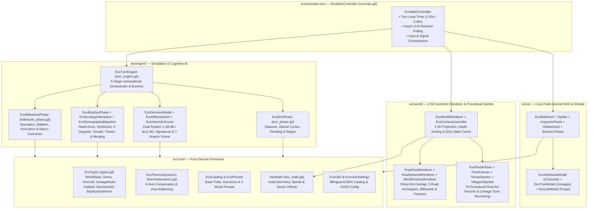

# System Architecture & Developer Guide

**Evolution** is built with **Godot Engine 4.7+** in strictly typed GDScript, following a modular architecture that cleanly separates **pure data models & thermodynamic rules (`src/core/`)**, **generational simulation & AI cognition (`src/engine/`)**, **2.5D isometric rendering & procedural pixel-art generation (`src/world/`)**, and **interactive field-journal UI (`src/ui/`)**.

---

## Architectural Overview & Module Map



### Annotated Source Directory Structure

```text
├── assets/
│   └── sprites/                # Auto-generated & cached procedural pixel-art PNGs (terrain/, villages/, ui/)
├── gh-pages/                   # MkDocs documentation & shared application screenshots (.gdignore)
├── scenes/
│   └── main.tscn               # Root scene entry point binding EvoMainController
├── src/
│   ├── main.gd                 # EvoMainController: turn loop, async LLM hot-swap, signal routing
│   ├── core/
│   │   ├── catalog.gd          # EvoCatalog: 6 bio traits, 5 cultural traits, 7 decisions, trait injection
│   │   ├── hex_math.gd         # HexMath: pointy-top axial math, distance, spirals, village sector offsets
│   │   ├── i18n.gd             # EvoI18n: 145-key bilingual (ES / EN) localization dictionary
│   │   ├── presets.gd          # EvoPresets: Rift Valley, Darwin's Archipelago, Finite Island builders
│   │   ├── thermodynamics.gd   # EvoThermodynamics: BASE_BUDGET = 0.60 validation & auto-balancing
│   │   ├── types.gd            # EvoTypes: serializable data models & BIOME_CLIMATE_DEFAULTS
│   │   └── user_settings.gd    # EvoUserSettings: ~/.config/Evolution/settings.json persistence
│   ├── engine/
│   │   ├── turn_engine.gd      # EvoTurnEngine: advance_generation() pipeline & God-mode brush actions
│   │   ├── env_phase.gd        # EvoEnvPhase: seasonal & glacial cycles, coastal flooding, K/R regen
│   │   ├── decision_model.gd   # EvoDecisionModel: signature bucketing, cache lookup, prefetch orchestration
│   │   ├── biophys_phase.gd    # EvoBiophysPhase: coordinates ecology & demography sub-phases
│   │   ├── milestone_phase.gd  # EvoMilestonePhase: Speciation, Baldwin, Innovation & Macro-Outcomes
│   │   ├── biophys/
│   │   │   ├── ecology_interaction.gd   # EvoEcologyInteraction: Hawk-Dove, extraction, symbiosis, K degrade
│   │   │   └── demography_migration.gd  # EvoDemographyMigration: metabolism, r/K growth, fission, merging
│   │   └── cognitive/
│   │       ├── heuristic_scorer.gd      # EvoHeuristicScorer: 10-part signatures, 7-branch scorer, trait synthesis
│   │       └── ollama_client.gd         # EvoOllamaClient: WorkerThreadPool HTTP batching & model pull
│   ├── ui/
│   │   ├── main_hud.gd         # EvoMainHud: top-level UI controller & Ollama startup check
│   │   ├── ui_style.gd         # EvoUiStyle: parchment/wood theme tokens, StyleBoxes & helpers
│   │   ├── notebook_modal.gd   # EvoNotebookModal: filterable Evolutionary Chronicle & hex jump
│   │   ├── tree_modal.gd       # EvoTreeModal: Bézier phylogenetic tree & map lineage highlighter
│   │   ├── lab_modal.gd        # EvoLabModal: 6-axis Trait & Decision Forge with live balance meter
│   │   └── hud/
│   │       ├── hud_top_bar.gd           # EvoHudTopBar: valley sign, lenses, season/tide portrait, settings
│   │       ├── hud_inspector_panel.gd   # EvoHudInspectorPanel: 3-tab village/traits/habitat scroll inspector
│   │       ├── hud_hotbar_dock.gd       # EvoHudHotbarDock: 10-slot hotbar, radius toggle, valley legend
│   │       └── hud_banners_toasts.gd    # EvoHudBannersToasts: macro banner, chronicle toasts, model pull modal
│   └── world/
│       ├── world_renderer.gd   # EvoWorldRenderer: 2.5D hex column extrusion, dirty-state cache, lenses
│       ├── camera_controller.gd# EvoCameraController: orbit yaw, tilt pitch, cursor-pivoted zoom & pan
│       ├── pixel_art_gen.gd    # EvoPixelArtGen: 75-sprite procedural registry & dynamic villager recoloring
│       ├── render/
│       │   ├── prop_flora_renderer.gd   # EvoPropFloraRenderer: plazas, 4 village tiers, flora anti-overlap
│       │   ├── road_network_renderer.gd # EvoRoadNetworkRenderer: 5 road archetypes, bridges & decay
│       │   └── world_overlay_renderer.gd# EvoWorldOverlayRenderer: screen-space billboards & seasonal particles
│       └── sprites/
│           ├── pixel_canvas.gd          # EvoPixelCanvas: RGBA8 raster primitives & soft 1px outlining
│           ├── terrain_sprites.gd       # EvoTerrainSprites: 7 hex biome tiles (224×192) & 17 flora sprites
│           └── village_ui_sprites.gd    # EvoVillageUiSprites: 28 village/action/cart sprites & 23 UI icons
└── tests/
    ├── test_runner.gd          # Headless unit, biophysical, integration & UI test suite (11 suites)
    └── test_visual_capture.gd  # Automated screenshot generator for gh-pages/assets/img/
```

---

## 2.5D Isometric Rendering & Procedural Pixel-Art Pipeline

### 1. 2.5D Projection & Painter's Algorithm Depth Sorting
`EvoWorldRenderer` and `EvoCameraController` project 2D pointy-top axial coordinates $(x, y)$ and vertical elevation $z_{\text{height}} \in [0, 96\text{ px}]$ into 2.5D screen space using camera yaw $\psi \in [0^\circ, 360^\circ)$ and pitch $\theta \in [28^\circ, 75^\circ]$:

$$\mathbf{p}_{\text{screen}} = \begin{bmatrix} \cos\psi & -\sin\psi \\ \sin\psi \sin\theta & \cos\psi \sin\theta \end{bmatrix} \begin{bmatrix} x \\ y \end{bmatrix} + \begin{bmatrix} 0 \\ -z_{\text{height}} \cdot 1.18 \cos\theta \end{bmatrix}$$

* **10-Tier Elevation Quantization**: Terrestrial hexes quantize `cell.altitude` into $10$ discrete vertical tiers ($\text{tier} = \text{clamp}(\lceil 10 \cdot \text{altitude} \rceil, 1, 10)$), extruding 3D cliff walls with geological strata lines, deterministic rock cracks, and hanging vines.
* **Depth Sorting (`get_depth`)**: Hex columns and Y-sorted props render back-to-front via:
  $$\text{depth}(x, y, z) = (x \sin\psi + y \cos\psi) + 0.02 \cdot z$$
* **12-Tuple Dirty-State Column Cache (`_column_state_cache`)**: Each hex column caches `[yaw, pitch, eff_biome, top_z, active_lens, k_band, r_band, is_selected, is_brushed, inspect_brush, coast_dirs, diff_biome_dirs]`. Camera panning and zooming transform the parent `_world_layer` directly on the GPU without rebuilding column geometry.

### 2. Procedural Pixel-Art Generator (`EvoPixelArtGen`)
At startup, `EvoPixelArtGen.ensure_all_assets()` procedurally rasterizes and caches **75 crisp pixel-art sprites** using `EvoPixelCanvas`:

* **7 Hex Biome Tiles (`224×192` px)**: Hand-dithered textures for `tropical_forest`, `savanna`, `arid_steppe`, `tundra`, `high_mountain`, `coastal_shallows`, and `ocean`.
* **17 Flora & Ecological Degradation Props**: Healthy swaying trees/bushes (`tree_tropical`, `tree_savanna`, `tree_tundra`, `bush_berry`, `wildflowers`, `coastal_reeds`) that automatically transition to `tree_stump`, `soil_crack`, and `dry_scrub` when hex ecological health $K / K_{\max}$ drops below $85\%$ and $60\%$.
* **28 Village, Action & Road Sprites**:
  * **4 Settlement Tiers**: `tier1_tent` + flickering `tier1_campfire`, `tier2_cottage` + `tier2_barn`, `tier3_townhall` + `tier3_house`, and `tier4_citadel` + `tier4_tower` + `tier4_windmill`.
  * **8 Dominant Decision Action Structures (`act_*`)**: Each village constructs a visible $32 \times 32$ structure reflecting its current `last_dominant_decision_id` (e.g., drying racks for `forage`, quarry smokestack for `overexploit`, supply cart for `migrate`, granary silo for `cooperate`, market stall for `exchange`, palisade & war banner for `dispute`, crystal workbench for `innovate`).
  * **Lineage-Colored Villagers**: `get_villager_texture(pose, tunic_color)` dynamically recolors villager tunics (`villager_idle`, `villager_walk1`, `villager_walk2`) to match each lineage's phylogenetic color.

### 3. Organic Road Network Lifecycle (`EvoRoadNetworkRenderer`)
Inter-village relationships are rendered on `_network_layer` and `_anim_layer` across **5 visual road archetypes**:

| Road Archetype | Trigger Source | Visual Representation & Animated Traffic |
| :--- | :--- | :--- |
| **Collaboration Route (`collab`)** | Active `"exchange"`, `"cooperate"`, or `"merge"` flow on flat terrain | 26-segment quadratic Bézier cobblestone road with border stones, glowing `road_lantern`, green `icon_coop_link` badge, and an animated `caravan_cart` + 2 walking travelers. |
| **Wooden Arch Bridge (`bridge`)** | Friendly route crossing `coastal_shallows`, submerged hexes, or cliff $\Delta\text{alt} \ge 0.20$ | 20-step arched timber deck over 3 support pilings with water ripples, handrails, and caravan traffic. |
| **Dispute Barricade Front (`dispute`)** | Active `"dispute"` flow or Hawk/Overexploit rivalry between adjacent lineages | Interrupted dirt road stubs meeting at a scorched-earth crater (`#dc2626`), `barricade_spikes`, 4 orbiting battle sparks, and a pulsing `icon_conflict_swords` badge. |
| **Severed / Disused Road (`broken`)** | Friendly connection in `state.disused_connections` severed within the last `1–2` turns | Faded rubble segments (`alpha = 0.90` at age 1, `0.52` at age 2) split by a `soil_crack`, moss patches, `road_block_sign`, and `icon_broken_link` badge (pruned from state after age 8). |
| **Migration Expedition (`expedition`)** | Active `"migration"` flow (population fission or coastal evacuation) | Curved sky-blue stepping-stone trail (`#0369a1` / `#bae6fd`) with an animated `settler_wagon`. |

---

## Automated Verification & Testing Suite (`tests/test_runner.gd`)

The repository includes a comprehensive headless test runner (`res://tests/test_runner.gd`) that executes **11 test suites** verifying every mathematical formula, turn phase, and UI interaction:

```bash
# Run the full automated test suite headlessly
godot --headless --path . --script res://tests/test_runner.gd

# Run static GDScript syntax and type verification across all scripts
for script in $(find src tests -name "*.gd"); do
  godot --headless --path . --check-only -s "res://${script}"
done
```

| Suite # | Test Method | Verification Scope |
| :---: | :--- | :--- |
| **1** | `_test_thermodynamics` | Verifies `BASE_BUDGET = 0.60`, `evaluate_thermodynamics`, required cost $0.5 \cdot (A^+ - 0.60)$, auto-balancing into `metabolic_cost` / `ecological_impact`, and `free_sandbox_mode` bypass. |
| **2** | `_test_catalog_and_presets` | Verifies cell counts (`91`, `91`, `61`), starting demes, base catalog sizes (`11` traits, `7` decisions), `deme_has_cultural_capacity`, and `inject_trait_into_deme` mutual exclusion (`r` vs `K`). |
| **3** | `_test_decision_model_and_normalization` | Verifies `normalize_decision_probabilities` ($\sum P(d) = 1.0$) and initial Rift Valley heuristic differentiation (`deme-rift-west` $\to$ `forage`, `deme-rift-east` $\to$ `cooperate`). |
| **4** | `_test_hawk_dove_and_symbiosis` | Verifies Hawk-Hawk $-15\%$ population loss and `"dispute"` flow generation, plus Symbiosis $+20\%$ bonus and horizontal cultural transmission of `cul-fire-processing`. |
| **5** | `_test_tragedy_of_the_commons` | Runs `preset-finite-island` and verifies center hex `0,0` degrades below $0.60 \cdot K_{\max}$ and logs `"tragedy_of_commons"`. |
| **6** | `_test_baldwin_innovation_and_speciation` | Verifies Baldwin assimilation at `counter >= 8`, Cultural Innovation at `innovation_counter >= 1.0`, and Allopatric Speciation at `isolation_turns >= 10` (new `lineage_id`, new color, 2 tree nodes). |
| **7** | `_test_interventions` | Verifies `apply_set_biome` (`⚡10`), `apply_adjust_altitude` (`⚡15`), `apply_adjust_carrying_capacity` (`⚡10`), and `apply_adjust_sea_level` (`⚡25`). |
| **8** | `_test_serialization_roundtrip` | Verifies `WorldState.to_dict()` $\to$ `JSON.stringify` $\to$ `WorldState.from_dict()` preserves generation, cells, and demes. |
| **9** | `_test_25_generations_all_presets` | Advances all 3 presets for 25 generations and asserts $\sum P(d) = 1.0$ for every surviving deme. |
| **10** | `_test_main_scene_and_ui_integration` | Instantiates `res://scenes/main.tscn`, verifies all 75 procedural sprites, dual System 1 model routing (`d3:4b` / `tev1:4b`), settings persistence (`num_ctx = 16384`), missing models modal, preset/language/lens switching, modals, road aging (`disused_connections`), and inspector village cycling. |
| **11** | `_test_nonblocking_async_decision_and_smooth_panning` | Asserts `check_ollama_status(true)` completes in $< 15\text{ ms}$ on the main thread and verifies late-game 16-deme async evaluation and camera panning. |

---

## Building Documentation & CI/CD Pipelines

### Previewing Documentation Locally
The documentation in `gh-pages/` is built with **Material for MkDocs** (`mkdocs.yml`) using the shared Arrase Ecosystem design system (`gh-pages/stylesheets/extra.css`, `gh-pages/javascripts/ecosystem.js`, and `gh-pages/javascripts/mathjax.js`):

```bash
# Install Material for MkDocs
pip install mkdocs-material

# Launch local live-reload server at http://127.0.0.1:8000/
mkdocs serve

# Run strict production build into ./site/
mkdocs build --strict
```

### GitHub Actions Workflows (`.github/workflows/`)
* **`ci.yml`**: Installs Godot `4.7.2-stable` on Ubuntu, imports project assets, runs `--check-only` static verification on every `.gd` script in `src/` and `tests/`, and executes `res://tests/test_runner.gd`.
* **`deploy.yml`**: Triggers on pushes to `main` touching `gh-pages/**` or `mkdocs.yml`, builds the static site with `mkdocs-material==9.7.7`, and deploys to GitHub Pages.
* **`release.yml`**: Exports multiplatform release binaries (`Linux x86_64`, `Windows x86_64`, `macOS Universal`, and `Web HTML5/WASM`) whenever a `v*` tag is pushed.
* **`codeql.yml` & `security.yml`**: Automated static security analysis and workflow auditing.
