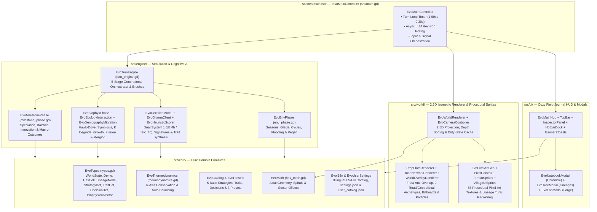

# System Architecture & Developer Guide

**Evolution** is built with **Godot Engine 4.7+** in strictly typed GDScript, following a modular architecture that cleanly separates **pure data models & thermodynamic rules (`src/core/`)**, **generational simulation & AI cognition (`src/engine/`)**, **2.5D isometric rendering & procedural pixel-art generation (`src/world/`)**, and **interactive field-journal UI (`src/ui/`)**.

---

## Architectural Overview & Module Map



### Annotated Source Directory Structure

```text
├── assets/
│   └── sprites/                # Auto-generated & cached procedural pixel-art PNGs (terrain/, villages/, ui/)
├── gh-pages/                   # MkDocs documentation & shared application screenshots (.gdignore)
├── scenes/
│   └── main.tscn               # Root scene entry point binding EvoMainController
├── src/
│   ├── main.gd                 # EvoMainController: turn loop, async LLM hot-swap, signal routing
│   ├── core/
│   │   ├── catalog.gd          # EvoCatalog: 5 base strategies, 6 bio traits, 5 cultural traits, 7 decisions
│   │   ├── hex_math.gd         # HexMath: pointy-top axial math, distance, spirals, village sector offsets
│   │   ├── i18n.gd             # EvoI18n: bilingual (ES / EN) localization dictionary & strategy helpers
│   │   ├── presets.gd          # EvoPresets: 1v1 strategy builders for Rift Valley, Darwin's Archipelago, Finite Island
│   │   ├── thermodynamics.gd   # EvoThermodynamics: BASE_BUDGET = 0.60 validation & auto-balancing
│   │   ├── types.gd            # EvoTypes: serializable data models (StrategyDef, Deme, LineageNode, WorldState)
│   │   └── user_settings.gd    # EvoUserSettings: ~/.config/Evolution/settings.json & user_catalog.json persistence
│   ├── engine/
│   │   ├── turn_engine.gd      # EvoTurnEngine: advance_generation() pipeline & God-mode brush actions
│   │   ├── env_phase.gd        # EvoEnvPhase: seasonal & glacial cycles, coastal flooding, K/R regen
│   │   ├── decision_model.gd   # EvoDecisionModel: signature bucketing, cache lookup, prefetch orchestration
│   │   ├── biophys_phase.gd    # EvoBiophysPhase: coordinates ecology & demography sub-phases
│   │   ├── milestone_phase.gd  # EvoMilestonePhase: Speciation, Baldwin, Innovation & Macro-Outcomes
│   │   ├── biophys/
│   │   │   ├── ecology_interaction.gd   # EvoEcologyInteraction: Hawk-Dove, extraction, symbiosis, K degrade
│   │   │   └── demography_migration.gd  # EvoDemographyMigration: metabolism, r/K growth, fission, merging
│   │   └── cognitive/
│   │       ├── heuristic_scorer.gd      # EvoHeuristicScorer: 10-part signatures, state briefings, trait synthesis
│   │       └── ollama_client.gd         # EvoOllamaClient: WorkerThreadPool HTTP batching & model pull
│   ├── ui/
│   │   ├── main_hud.gd         # EvoMainHud: top-level UI controller & Ollama startup check
│   │   ├── ui_style.gd         # EvoUiStyle: parchment/wood theme tokens, StyleBoxes & helpers
│   │   ├── notebook_modal.gd   # EvoNotebookModal: filterable Evolutionary Chronicle & hex jump
│   │   ├── tree_modal.gd       # EvoTreeModal: Bézier phylogenetic tree & map lineage highlighter
│   │   ├── lab_modal.gd        # EvoLabModal: 4-tab Strategy, Trait & Decision Forge with live balance meter
│   │   └── hud/
│   │       ├── hud_top_bar.gd           # EvoHudTopBar: valley sign, 1v1 matchup bar, lenses, season portrait, settings
│   │       ├── hud_inspector_panel.gd   # EvoHudInspectorPanel: 3-tab village/traits/habitat scroll inspector
│   │       ├── hud_hotbar_dock.gd       # EvoHudHotbarDock: 10-slot hotbar, radius toggle, valley legend duel counter
│   │       └── hud_banners_toasts.gd    # EvoHudBannersToasts: macro banner, chronicle toasts, model pull modal
│   └── world/
│       ├── world_renderer.gd   # EvoWorldRenderer: 2.5D hex column extrusion, dirty-state cache, lenses
│       ├── camera_controller.gd# EvoCameraController: orbit yaw, tilt pitch, cursor-pivoted zoom & pan
│       ├── pixel_art_gen.gd    # EvoPixelArtGen: 88-sprite procedural registry & dynamic villager recoloring
│       ├── render/
│       │   ├── prop_flora_renderer.gd   # EvoPropFloraRenderer: plazas, 4 village tiers, geopolitical props, flora anti-overlap
│       │   ├── road_network_renderer.gd # EvoRoadNetworkRenderer: 9 road & geopolitical flow archetypes, bridges & decay
│       │   └── world_overlay_renderer.gd# EvoWorldOverlayRenderer: hex strategy rings, billboards, geopolitical pills & particles
│       └── sprites/
│           ├── pixel_canvas.gd          # EvoPixelCanvas: RGBA8 raster primitives & soft 1px outlining
│           ├── terrain_sprites.gd       # EvoTerrainSprites: 7 hex biome tiles (224×192) & 17 flora sprites
│           └── village_ui_sprites.gd    # EvoVillageUiSprites: 37 village/action/geopolitical sprites & 27 UI icons
└── tests/
    ├── test_runner.gd          # Headless unit, biophysical, integration & UI test suite (15 suites)
    └── test_visual_capture.gd  # Automated screenshot generator for gh-pages/assets/img/
```

---

## Core Data Models, Strategy Inheritance & User Catalog Persistence

### 1. Evolutionary Strategy & Geopolitical Primitives (`EvoTypes`)
The 1v1 strategy duel and geopolitical systems are modeled directly in `src/core/types.gd`:

* **`EvoTypes.StrategyDef`**:
  * `id: String` — Unique identifier (e.g., `"strat-cooperation"`, `"strat-war"`, or `"strat-custom-*"`).
  * `name: String` & `description: String` — Localized name and philosophy for `"base"` strategies (`EvoI18n.strategy_text`) or user-defined strings for `"user"` strategies.
  * `icon: String` (`"🛡️"` default) & `color: String` (`"#10B981"` default) — Visual emblem and hex color swatch rendered on HUD selectors, hex strategy rings, village billboards, plaza rings, and villager tunics.
  * `origin: String` — `"base"` for the 5 built-in archetypes or `"user"` / `"custom"` for strategies crafted in `EvoLabModal`.
  * `biological_trait_ids: Array[String]` & `cultural_trait_ids: Array[String]` — Bundled traits applied to founding demes and lineages.
* **`EvoTypes.WorldState`**:
  * `strategies_catalog: Dictionary` (`String -> StrategyDef`) — Holds the 5 base strategies from `EvoCatalog.create_base_strategies_catalog` merged with user-created strategies from `~/.config/Evolution/user_catalog.json`.
  * `strategy_a_id: String` (default `"strat-cooperation"`) & `strategy_b_id: String` (default `"strat-war"`) — The two competing strategies assigned to Founder A and Founder B in the active 1v1 matchup.
  * `active_pacts: Dictionary` (`String -> int`) — Maps canonical pair keys (`EvoTypes.make_pair_key(deme_a_id, deme_b_id)` = `"idA__idB"`) to consecutive cooperative turns (`>= 2` indicates a formal active pact via `EvoTypes.is_pact_active`).
  * `recent_extinction_hexes: Array[String]` — Tracks hex coordinates where demes collapsed during the current generation.
* **`EvoTypes.Deme` & `EvoTypes.LineageNode`**:
  * Both `Deme` and `LineageNode` carry `strategy_id: String` (serialized in JSON as both `"strategyId"` and `"strategy_id"` for full schema compatibility).
  * `Deme.get_vital_status()` returns the unified 5-state classification (`"thriving"`, `"stable"`, `"declining"`, `"starving"`, `"extinct"`).
  * `LineageNode` also stores `biological_trait_ids: Array[String]` and `cultural_trait_ids: Array[String]` alongside `acquired_trait_ids`.

### 2. End-to-End `strategy_id` Inheritance Lifecycle
To guarantee that every village on the map always retains its founding strategy identity regardless of how far it migrates, conquers, or diverges phylogenetically:

1. **Preset Initialization & Generation 0 Matchup (`EvoCatalog.apply_strategy_to_deme`)**:
   Sets `deme.strategy_id = strategy.id`, `deme.color = strategy.color`, `deme.biological_trait_ids`, and (if `deme_has_cultural_capacity` is satisfied) `deme.cultural_trait_ids`, and mirrors `strategy_id`, `color`, and traits onto `state.lineage_tree[deme.lineage_id]`.
2. **Colonist Migration & Warband Conquest (`EvoDemographyMigration.run_demography_and_migration_phase`)**:
   When a parent deme undergoes population fission (`-m<gen>`) or conquers a rival hex (`-w<gen>`), the newly founded settlement explicitly inherits `daughter.strategy_id = deme.strategy_id`, `daughter.lineage_id = deme.lineage_id`, and `daughter.color = deme.color`.
3. **Allopatric Speciation (`EvoMilestonePhase.run_milestone_phase`)**:
   When an isolated colony (`isolation_turns >= 10`) speciates into a new child `LineageNode` (`new_node`), the new lineage node inherits **`new_node.strategy_id = deme.strategy_id`** while receiving a fresh species color from `SPECIATION_PALETTE`, and the speciated deme keeps its `deme.strategy_id`.

### 3. Persistent User Configuration & User Catalog (`EvoUserSettings`)
`src/core/user_settings.gd` persists user preferences and custom laboratory creations inside `~/.config/Evolution/`:

| File Path | Managed Methods | Stored JSON Payload |
| :--- | :--- | :--- |
| `~/.config/Evolution/settings.json` | `EvoUserSettings.load_settings()`<br>`EvoUserSettings.save_settings()` | `{ "primary_model": "d3:4b", "secondary_model": "tev1:4b", "context_length": 8192 }` |
| `~/.config/Evolution/user_catalog.json` | `EvoUserSettings.save_user_catalog(state)`<br>`EvoUserSettings.load_user_catalog_into(state)` | `{ "strategies": [...], "traits": [...], "decisions": [...] }` — Automatically serializes all entries in `state.strategies_catalog`, `state.traits_catalog`, and `state.decisions_catalog` where `origin in ["user", "custom"]`, and reloads them into every new or reset `WorldState`. |

---

## 2.5D Isometric Rendering & Procedural Pixel-Art Pipeline

### 1. 2.5D Projection & Painter's Algorithm Depth Sorting
`EvoWorldRenderer` and `EvoCameraController` project 2D pointy-top axial coordinates $(x, y)$ and vertical elevation $z_{\text{height}} \in [0, 96\text{ px}]$ into 2.5D screen space using camera yaw $\psi \in [0^\circ, 360^\circ)$ and pitch $\theta \in [28^\circ, 75^\circ]$:

$$\mathbf{p}_{\text{screen}} = \begin{bmatrix} \cos\psi & -\sin\psi \\ \sin\psi \sin\theta & \cos\psi \sin\theta \end{bmatrix} \begin{bmatrix} x \\ y \end{bmatrix} + \begin{bmatrix} 0 \\ -z_{\text{height}} \cdot 1.18 \cos\theta \end{bmatrix}$$

* **10-Tier Elevation Quantization**: Terrestrial hexes quantize `cell.altitude` into $10$ discrete vertical tiers ($\text{tier} = \text{clamp}(\lceil 10 \cdot \text{altitude} \rceil, 1, 10)$), extruding 3D cliff walls with geological strata lines, deterministic rock cracks, and hanging vines.
* **Depth Sorting (`get_depth`)**: Hex columns and Y-sorted props render back-to-front via:
  $$\text{depth}(x, y, z) = (x \sin\psi + y \cos\psi) + 0.02 \cdot z$$
* **12-Tuple Dirty-State Column Cache (`_column_state_cache`)**: Each hex column caches `[yaw, pitch, eff_biome, top_z, active_lens, k_band, r_band, is_selected, is_brushed, inspect_brush, coast_dirs, diff_biome_dirs]`. Camera panning and zooming transform the parent `_world_layer` directly on the GPU without rebuilding column geometry.

### 2. Procedural Pixel-Art Generator (`EvoPixelArtGen`)
At startup, `EvoPixelArtGen.ensure_all_assets()` procedurally rasterizes and caches **88 crisp pixel-art sprites** using `EvoPixelCanvas`:

* **7 Hex Biome Tiles (`224×192` px)**: Hand-dithered textures for `tropical_forest`, `savanna`, `arid_steppe`, `tundra`, `high_mountain`, `coastal_shallows`, and `ocean`.
* **17 Flora & Ecological Degradation Props**: Healthy swaying trees/bushes (`tree_tropical`, `tree_savanna`, `tree_tundra`, `bush_berry`, `wildflowers`, `coastal_reeds`) that automatically transition to `tree_stump`, `soil_crack`, and `dry_scrub` when hex ecological health $K / K_{\max}$ drops below $85\%$ and $60\%$.
* **37 Village, Action, Geopolitical & Road Sprites**:
  * **4 Settlement Tiers**: `tier1_tent` + flickering `tier1_campfire`, `tier2_cottage` + `tier2_barn`, `tier3_townhall` + `tier3_house`, and `tier4_citadel` + `tier4_tower` + `tier4_windmill`.
  * **Dominant Decision & Geopolitical Action Structures (`act_*` & `prop_*`)**: Each village constructs visible $32 \times 32$ structures reflecting its current `last_dominant_decision_id` (`act_forage`, `act_overexploit`, `act_migrate`, `act_cooperate`, `act_exchange`, `act_dispute`, `act_innovate`, `act_cultivate`) and active geopolitical events (`act_war`, `act_raid`, `act_pact`, `act_betrayal`, `prop_war_banner`, `prop_raid_loot`, `prop_pact_totem`, `prop_betrayal_ruin`, `effect_battle_sparks`).
  * **Lineage-Colored Villagers**: `get_villager_texture(pose, tunic_color)` dynamically recolors villager tunics (`villager_idle`, `villager_walk1`, `villager_walk2`) to match each lineage's phylogenetic color.
* **27 UI & Geopolitical Icons**: Includes hotbar tools, milestone emblems, and geopolitical icons (`icon_war`, `icon_raid`, `icon_pact`, `icon_betrayal`, `icon_coop_link`, `icon_conflict_swords`, `icon_broken_link`).

### 3. Organic Road & Geopolitical Flow Lifecycle (`EvoRoadNetworkRenderer`)
Inter-village relationships are rendered on `_network_layer` and `_anim_layer` across **9 visual road and geopolitical archetypes**:

| Road / Flow Archetype | Trigger Source | Visual Representation & Animated Traffic |
| :--- | :--- | :--- |
| **Alliance Pact Highway (`pact`)** | Formal active pact (`active_pacts >= 2`) or `"pact"` flow | Emerald-trimmed stone highway (`#10b981`) with `prop_pact_totem` pillars, glowing `road_lantern` posts, `icon_pact` badge, and twin bi-directional `caravan_cart` + allied travelers. |
| **War of Conquest Corridor (`war`)** | Active `"war"` flow (territorial invasion or repelled assault) | Scorched crimson invasion corridor (`#ef4444`) with `prop_war_banner` standards, `barricade_spikes`, `effect_battle_sparks`, pulsing `icon_war` badge, and 3 marching warriors charging toward the target hex. |
| **Plunder Raid Trail (`raid`)** | Active `"raid"` flow (cross-border caloric plunder) | Jagged orange raid trail (`#f97316`) with `prop_raid_loot` chests at the victim plaza, `effect_battle_sparks`, `icon_raid` badge, and 2 fast-moving raiders + loot cart returning to the attacker. |
| **Betrayal Severed Road (`betrayal`)** | Active `"betrayal"` flow (broken formal pact & ambush) | Shattered crimson-purple road (`#dc2626` / `#a855f7`) split by `prop_betrayal_ruin` and `soil_crack`, `effect_battle_sparks`, `icon_betrayal` badge, and a fleeing plunder cart. |
| **Collaboration Route (`collab`)** | Active `"exchange"`, `"cooperate"`, or `"merge"` flow on flat terrain | 26-segment quadratic Bézier cobblestone road with border stones, glowing `road_lantern`, green `icon_coop_link` badge, and an animated `caravan_cart` + 2 walking travelers. |
| **Wooden Arch Bridge (`bridge`)** | Friendly route crossing `coastal_shallows`, submerged hexes, or cliff $\Delta\text{alt} \ge 0.20$ | 20-step arched timber deck over 3 support pilings with water ripples, handrails, and caravan traffic. |
| **Dispute Barricade Front (`dispute`)** | Active `"dispute"` flow or Hawk/Overexploit rivalry between adjacent lineages | Interrupted dirt road stubs meeting at a scorched-earth crater (`#dc2626`), `barricade_spikes`, 4 orbiting battle sparks, and a pulsing `icon_conflict_swords` badge. |
| **Severed / Disused Road (`broken`)** | Friendly connection in `state.disused_connections` severed within the last `1–2` turns | Faded rubble segments (`alpha = 0.90` at age 1, `0.52` at age 2) split by a `soil_crack`, moss patches, `road_block_sign`, and `icon_broken_link` badge (pruned from state after age 8). |
| **Migration Expedition (`expedition`)** | Active `"migration"` flow (population fission or coastal evacuation) | Curved sky-blue stepping-stone trail (`#0369a1` / `#bae6fd`) with an animated `settler_wagon`. |

---

## Automated Verification & Testing Suite (`tests/test_runner.gd`)

The repository includes a comprehensive headless test runner (`res://tests/test_runner.gd`) that executes **15 test suites** verifying every mathematical formula, turn phase, geopolitical interaction, and UI component:

```bash
# Run the full automated test suite headlessly
godot --headless --path . --script res://tests/test_runner.gd

# Run static GDScript syntax and type verification across all scripts
for script in $(find src tests -name "*.gd"); do
  godot --headless --path . --check-only -s "res://${script}"
done
```

| Suite # | Test Method | Verification Scope |
| :---: | :--- | :--- |
| **1** | `_test_thermodynamics` | Verifies `BASE_BUDGET = 0.60`, `evaluate_thermodynamics`, required cost $0.5 \cdot (A^+ - 0.60)$, auto-balancing into `metabolic_cost` / `ecological_impact`, and `free_sandbox_mode` bypass. |
| **2** | `_test_catalog_and_presets` | Verifies cell counts (`91`, `91`, `61`), balanced 1v1 starting demes (`2` per preset), base catalog sizes (`5` strategies, `11` traits, `7` decisions), `deme_has_cultural_capacity`, and `inject_trait_into_deme` mutual exclusion (`r` vs `K`). |
| **3** | `_test_strategies_duel_and_persistence` | Verifies the 5 base strategies, `compute_strategy_vector`, `apply_strategy_to_deme`, `strategy_id` inheritance across migration and speciation, `EvoLabModal` Strategy Builder UI, and `user_catalog.json` persistence. |
| **4** | `_test_decision_model_and_normalization` | Verifies `normalize_decision_probabilities` ($\sum P(d) = 1.0$), environmental & geopolitical weight modulation, and cached Ollama System 1 model evaluation. |
| **5** | `_test_hawk_dove_and_symbiosis` | Verifies Hawk-Hawk $-15\%$ population loss (floor `10`) and `"dispute"` flow generation, plus Symbiosis $+20\%$ bonus and horizontal cultural transmission of `cul-fire-processing`. |
| **6** | `_test_tragedy_of_the_commons` | Runs `preset-finite-island` and verifies overexploitation degrades hex $K$ below $0.60 \cdot K_{\max}$ and logs `"tragedy_of_commons"`. |
| **7** | `_test_baldwin_innovation_and_speciation` | Verifies Baldwin assimilation at `counter >= 8` (with decision-proportional vector synthesis), Cultural Innovation at `innovation_counter >= 1.0`, and Allopatric Speciation at `isolation_turns >= 10`. |
| **8** | `_test_kin_merge_fission_and_macro_outcome` | Verifies compatible same-lineage kin merging (Jaccard $< 0.25$), population fission migration (`-m<gen>`), and macro-outcome detection (`total_extinction`, `single_survivor`, `ecological_equilibrium`). |
| **9** | `_test_interventions` | Verifies `apply_set_biome` (`⚡10`), `apply_adjust_altitude` (`⚡15`), `apply_adjust_carrying_capacity` (`⚡10`), and `apply_adjust_sea_level` (`⚡25`). |
| **10** | `_test_serialization_roundtrip` | Verifies `WorldState.to_dict()` $\to$ `JSON.stringify` $\to$ `WorldState.from_dict()` preserves generation, cells, demes, `strategies_catalog`, `strategy_a_id`, `strategy_b_id`, `active_pacts`, and `user_catalog.json` persistence. |
| **11** | `_test_25_generations_all_presets` | Advances all 3 presets for 25 generations and asserts $\sum P(d) = 1.0$ for every surviving deme. |
| **12** | `_test_main_scene_and_ui_integration` | Instantiates `res://scenes/main.tscn`, verifies all 88 procedural sprites, dual System 1 model routing (`d3:4b` / `tev1:4b`), settings persistence (`num_ctx = 16384`), missing models modal, preset/language/lens switching, modals, road aging (`disused_connections`), and inspector village cycling. |
| **13** | `_test_nonblocking_async_decision_and_smooth_panning` | Asserts `check_ollama_status(true)` completes in $< 15\text{ ms}$ on the main thread and verifies late-game 16-deme async evaluation and camera panning. |
| **14** | `_test_emergent_geopolitics_and_visual_artifacts` | Verifies Alliance Pacts (`>= 2` turns, $+15\%$ bonus, distress aid, shared defense), Opportunistic Betrayals, Plunder Raids, Territorial Wars of Conquest (`-w<gen>`), geopolitical sprites/roads/overlays, Inspector Pacts readout, and Notebook geopolitical filters. |
| **15** | `_test_bugfix_regressions` | Verifies conserved loot energy transfers in raids/betrayals, unified vital status (`declining`), `altitude <= 0.85` passability & 3-hop peer connectivity, root-lineage hegemony check, and `_cache_epoch` thread safety. |

---

## Building Documentation & CI/CD Pipelines

### Previewing Documentation Locally
The documentation in `gh-pages/` is built with **Material for MkDocs** (`mkdocs.yml`) using the shared Arrase Ecosystem design system (`gh-pages/stylesheets/extra.css`, `gh-pages/javascripts/ecosystem.js`, and `gh-pages/javascripts/mathjax.js`):

```bash
# Install Material for MkDocs
pip install mkdocs-material

# Launch local live-reload server at http://127.0.0.1:8000/
mkdocs serve

# Run strict production build into ./site/
mkdocs build --strict
```

### GitHub Actions Workflows (`.github/workflows/`)
* **`ci.yml`**: Installs Godot `4.7.2-stable` on Ubuntu, imports project assets, runs `--check-only` static verification on every `.gd` script in `src/` and `tests/`, and executes `res://tests/test_runner.gd`.
* **`deploy.yml`**: Triggers on pushes to `main` touching `gh-pages/**` or `mkdocs.yml`, builds the static site with `mkdocs-material==9.7.7`, and deploys to GitHub Pages.
* **`release.yml`**: Exports multiplatform release binaries (`Linux x86_64`, `Windows x86_64`, `macOS Universal`, and `Web HTML5/WASM`) whenever a `v*` tag is pushed.
* **`codeql.yml` & `security.yml`**: Automated static security analysis and workflow auditing.
