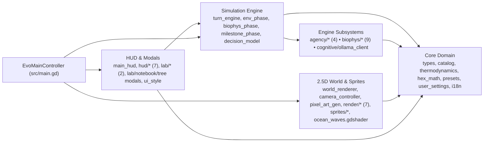

# Architecture & Developer Guide

**Evolution** is structured cleanly around strict separation of concerns in pure **GDScript 4** (`Godot 4.7.2-stable`, `Forward Plus` renderer): core domain schemas and math never depend on scene nodes, simulation subsystems remain headless-testable without a GPU, and the 2.5D renderer + HUD act purely as reactive views over `EvoTypes.WorldState`.

---

## 1. Layered Subsystem Topology



---

## 2. Repository Directory Structure

```text
Evolution/
├── project.godot                     # Godot 4.7 project config (Forward Plus, 1600x960 canvas_items/expand)
├── export_presets.cfg                # Desktop export targets (Linux, Windows, macOS)
├── mkdocs.yml                        # MkDocs Material documentation config (docs_dir: gh-pages)
├── .github/workflows/                # Automated verification, pages & release pipelines
│   ├── ci.yml                        # Godot 4.7.2 headless import, script check, test_runner.gd
│   ├── release.yml                   # Multiplatform desktop releases (Linux, Windows, macOS)
│   ├── deploy.yml                    # GitHub Pages MkDocs Material build & deployment
│   ├── codeql.yml                    # GitHub Actions security & quality scan
│   └── security.yml                  # PR dependency review + zizmor workflow linter
├── gh-pages/                         # Documentation markdown pages, CSS, JS, and PNG screenshots
├── src/
│   ├── main.gd                       # EvoMainController: playback loop (4.0s / 2.0s / 0.6s), tool routing, shortcuts
│   ├── core/                         # Headless domain data, constants, presets & persistence
│   │   ├── types.gd                  # EvoTypes: WorldState, Deme, HexCell, Relation, LineageNode, ChronicleEntry, constants
│   │   ├── catalog.gd                # EvoCatalog: 11 base traits, 16 decisions, 5 strategies, trait/strategy application
│   │   ├── thermodynamics.gd         # EvoThermodynamics: 6-axis clamping, BASE_BUDGET = 0.60 validation & balancing
│   │   ├── hex_math.gd               # HexMath: pointy-top axial math (HEX_SIZE = 240.0), spirals, brush rings, neighbors
│   │   ├── presets.gd                # EvoPresets: Rift Savanna, Darwin's Archipelago, Finite Island deterministic builders
│   │   ├── user_settings.gd          # EvoUserSettings: settings.json (models) & user_catalog.json (custom strategies/traits)
│   │   └── i18n.gd                   # EvoI18n: ES/EN localization dictionaries & Chronicle formatters
│   ├── engine/                       # Turn orchestration, environmental cycles, cognition & evolution
│   │   ├── turn_engine.gd            # EvoTurnEngine: 7-stage advance_generation & 4 god-mode brush mutations
│   │   ├── env_phase.gd              # EvoEnvPhase: seasons, 8-turn glacial cycles, flood evacuation, K recovery, ruins decay
│   │   ├── biophys_phase.gd          # EvoBiophysPhase: exact 14-step biophysical turn orchestrator
│   │   ├── milestone_phase.gd        # EvoMilestonePhase: 6 cultural archetypes, Baldwin, speciation & macro equilibrium
│   │   ├── decision_model.gd         # EvoDecisionModel: WorkerThreadPool scheduling (4 global / 2 per model), slot routing, epochs
│   │   ├── agency/                   # Prompt construction, menu generation, forecasts & softmax sampling
│   │   │   ├── action_menu.gd        # EvoActionMenu: 14-option menu, 2-3 hop colonization BFS, border field rivals
│   │   │   ├── action_policy.gd      # EvoActionPolicy: T=0.45 sharpening, argmax preview, RNG turn sampling, directives
│   │   │   ├── outcome_forecast.gd   # EvoOutcomeForecast: quantified counterfactual pay/odds criteria for postures & actions
│   │   │   └── situation_report.gd   # EvoSituationReport: quantitative state briefing, Horizons, 12-line episodic memory
│   │   ├── biophys/                  # Specialized biophysical subphases
│   │   │   ├── payoffs.gd            # EvoPayoffs: cached vector lookup, pure harvest/trade/fortify/combat/growth math
│   │   │   ├── economy_phase.gd      # EvoEconomyPhase: urban/rural harvest, trade, wall fortify, innovate, metabolize, famine
│   │   │   ├── diplomacy_phase.gd    # EvoDiplomacyPhase: aid, pacts, tribute demands/payments, unite/absorption
│   │   │   ├── conflict_phase.gd     # EvoConflictPhase: expired tributes, betrayals, border/urban raids, conquests
│   │   │   ├── settlement_phase.gd   # EvoSettlementPhase: extinction ruins, -m colonies, multi-hex unions, -w splits, isolation
│   │   │   ├── rural_hinterland.gd   # EvoRuralHinterland: tier+district quotas, crops/pasture claiming, posture yields
│   │   │   ├── epidemic_salubrity.gd # EvoEpidemicSalubrity: crowding salubrity, 15% outbreaks, pact/flow contagion, 6t immunity
│   │   │   ├── culture.gd            # EvoCulture: bilateral cultural trait diffusion on trade & proximity
│   │   │   └── relations_memory.gd   # EvoRelations: pair trust/feud/truce tracking, 0.95 trust decay, 12-item memory
│   │   └── cognitive/
│   │       └── ollama_client.gd      # EvoOllamaClient: persistent /v1/systemone & /api/tags HTTP client, /api/pull installer
│   ├── ui/                           # Tactile HUD modules, inspectors, styling & analytical modals
│   │   ├── main_hud.gd               # EvoMainHud: signal hub, keyboard routing, live LLM polling & inspector bindings
│   │   ├── ui_style.gd               # EvoUiStyle: parchment/wood StyleBoxes, event colors, bilingual helpers, sprite icons
│   │   ├── lab_modal.gd              # EvoLabModal: 3-tab Forge host, injection & catalog persistence
│   │   ├── notebook_modal.gd         # EvoNotebookModal: 19-filter Chronicle viewer with hex jump links
│   │   ├── tree_modal.gd             # EvoTreeModal: pannable phylogenetic LineageCanvas & clade highlighter
│   │   ├── hud/
│   │   │   ├── hud_top_bar.gd        # SeasonTidePortrait, preset/strategy selectors, 5-lens strip, playback & mana
│   │   │   ├── hud_stats_strip.gd    # Top-center A vs B scoreboard + 200-gen collapsible LineChartDrawer
│   │   │   ├── hud_inspector_panel.gd# Right-docked 3-tab Inspector panel scaffold (Village, Traits, Habitat)
│   │   │   ├── hud_inspector_formatters.gd # Posture badges, Intake/Need, Union districts, Top-3 bars, Relations, Memory
│   │   │   ├── hud_banners_toasts.gd # Macro milestone banner + bottom-left Live Chronicle Feed (5 filters, 30 cards)
│   │   │   ├── hud_settings_modals.gd# Model selectors/diagnostics, ES/EN, 3 mode toggles, camera presets & model puller
│   │   │   └── hud_hotbar_dock.gd    # 10-slot god-mode hotbar (1-0), 1x/7x brush toggle, floating sub-options & Legend
│   │   └── lab/
│   │       ├── lab_strategy_editor.gd# Strategy doctrine TextEdit, icon/color pickers, trait toggles, A/B assignment
│   │       └── lab_thermo_form.gd    # 6-axis trait sliders, live BASE_BUDGET = 0.60 bar & Auto-Balance logic
│   └── world/                        # 2.5D projection renderer, procedural sprites, camera & shaders
│       ├── camera_controller.gd      # EvoCameraController: pitch [28°-75°] (yaw=0°), zoom [0.12-3.00], 3800px pan bounds
│       ├── world_renderer.gd         # EvoWorldRenderer: 12-tuple column cache, depth-sorted sublayers & viewport culling
│       ├── pixel_art_gen.gd          # EvoPixelArtGen: v4_readability generator & 133-key sprite cache
│       ├── render/
│       │   ├── hex_column_renderer.gd# Extruded 2.5D textured hex tops, cliffs, coastal edges & ruin overlays
│       │   ├── prop_flora_renderer.gd# Tile vegetation, rocks & village/rural prop drawing
│       │   ├── flora_prop_layout.gd  # Deterministic prop placement, watchtowers on patrolled fields & crop plots
│       │   ├── road_network_renderer.gd # Bezier road splines, chord pruning & rural supply tracks
│       │   ├── road_wall_drawer.gd   # 13 road archetypes + multi-hex outer fortification wall perimeter culling
│       │   ├── world_overlay_renderer.gd # 4-LOD village billboards, 5 lens overlays & outer territory contours
│       │   └── event_fx_renderer.gd  # Staggered 13-type MAJOR_TYPES map VFX, ripples, arcs & floating counters
│       ├── shaders/
│       │   └── ocean_waves.gdshader  # Animated wave & foam fragment/vertex shader for submerged ocean tiles
│       └── sprites/
│           ├── pixel_canvas.gd       # EvoPixelCanvas rasterizer helpers
│           ├── terrain_sprites.gd    # EvoTerrainSprites procedural tile & prop generators
│           ├── ui_icon_sprites.gd    # EvoUiIconSprites 64x64 HUD/hotbar icons
│           ├── village_ui_sprites.gd # EvoVillageUiSprites Tier I-IV buildings, walls, watchtowers & 48x48 villagers
│           └── README.md             # Internal procedural sprite notes
└── tests/
    ├── test_runner.gd                # Headless master SceneTree suite (22 tests, 614 assertions)
    ├── test_core_domain.gd           # Core vector math, catalog, presets, persistence & i18n coverage
    ├── test_cognitive_ollama.gd      # /v1/systemone wire format, action menus, forecasts, sampling & epochs
    ├── test_engine_biophys.gd        # 14-step phase mechanics, unions, raids, salubrity, epidemics & milestones
    ├── test_ui_and_world.gd          # HUD panels, 5 lenses, Forge, Notebook filters, Tree & renderer integrity
    ├── sim_emergence.gd              # Standalone 100-turn comparative emergence stress harness
    └── test_visual_capture.gd        # Standalone GUI screenshot generator for gh-pages/assets/img/*.png
```

---

## 3. Core Domain Contracts & Persistence

### Key `EvoTypes` Structures (`src/core/types.gd`)

- **`HexCell`**: Tracks axial `(q, r, s)`, `biome` (`BIOMES`, 7 states), climate (`temperature`, `humidity`, `altitude`), capacity (`current_resources`, `carrying_capacity`, `carrying_capacity_max`, `seasonal_regen_rate`), `deme_ids` (`<= 1` urban occupant per tile), rural claims (`land_use` in `["wild", "crops", "pasture"]`, `owner_deme_id`), and `ruin_turns` / `has_ruins`.
- **`Deme`**: Tracks settlement identity (`id`, `name`, `lineage_id`, `strategy_id`, `faction_slot` `"A"|"B"`, `color`, `secondary_color`), urban footprint (`hex_id` and `urban_hex_ids` capped at `MAX_URBAN_HEXES = 3`), vitals (`population`, `energy_reserves`, `last_energy_delta`, `last_food_intake`, `last_food_need`, `last_population_delta`), health (`salubrity`, `infection_turns`, `immunity_turns`), defenses (`defense_tier` `0..3`, `merged_count`, `defense_posture` in `DEFENSE_POSTURES`, `posture_probabilities`, `posture_forecasts`), genetics/culture (`biological_trait_ids`, `cultural_trait_ids`, `baldwin_counters`, `innovation_counter`, `isolation_turns`), cognition (`decision_model_tag`, `chosen_action`, `action_probabilities`, `action_forecasts`, `last_confidence`, transient `pending_raw_eval`), and `memory` (up to `12` strings) + `reputation` `[-1, 1]`. *(Legacy `walled_union_id` no longer exists.)*
- **`Relation`**: Stored per unordered pair via `EvoTypes.make_pair_key(a, b)` inside `WorldState.relations`, capturing `pact_turns`, `trust` `[-1, 1]`, `feud_turns`, `truce_turns`, active proposals (`proposal_from`, `proposal_kind` in `["pact", "union", "tribute"]`, `proposal_amount`, `proposal_gen`), and `last_event`. *(Legacy `WorldState.active_pacts` and `WorldState.history` were replaced by `relations`, `chronicle`, `turn_events`, and `stats_history`.)*
- **`StrategyDef`**: Adds editable `doctrine` (`String`) alongside `id`, `name`, `description`, `icon`, `color`, `origin` (`"base"|"user"`), `biological_trait_ids`, and `cultural_trait_ids`.
- **`WorldState` Telemetry**: `record_turn_stats(state)` appends snapshots to `stats_history` (trimmed to `STATS_HISTORY_LIMIT = 200`); `push_event(...)` populates the transient per-turn `turn_events` feed consumed by `EvoEventFxRenderer`.

### User Configuration & Custom Catalog (`EvoUserSettings`)

Unless overridden via `EvoUserSettings.config_path_override` (used by tests to stay hermetic inside `/tmp`), configuration writes to `~/.config/Evolution/` (falling back to `OS.get_user_data_dir()` when `HOME` is unset):

- **`settings.json`**: Persists strictly `{"primary_model": "d3:4b", "secondary_model": "tev1:4b"}`—never storing `context_length` or `num_ctx`.
- **`user_catalog.json`**: Persists `{"strategies": [...], "traits": [...]}` authored in the 3-tab Forge. Custom decisions are no longer stored on disk.

---

## 4. 2.5D Rendering, Shaders & Sprite Architecture

### Angled-Topdown Geometry & Cache Key

`EvoCameraController` fixes `yaw_deg = 0.0°` and projects the hex plane vertically by `sin(pitch_deg)` (`pitch_deg` clamped `[28.0°, 75.0°]`, default `48.0°`), scaling vertical cliff extrusion by `cos(pitch_deg) * 1.18` (`MAX_COLUMN_HEIGHT_PX = 96.0 px`, `MAX_PAN_RADIUS = 3800.0 px`, `zoom_level` `[0.12, 3.00]`, default `0.82`). Because pan and zoom apply as root node transforms, panning or zooming never rebuilds tile geometry.

`EvoWorldRenderer` tracks every tile through a **12-tuple `_column_state_cache`** key:

```text
[yaw, pitch, eff_biome, top_z, active_lens, k_band, lens_band, coast_dirs, diff_biome_dirs, land_use, owner_deme_id, has_ruins]
```

And renders with `CanvasItem.TEXTURE_FILTER_LINEAR_WITH_MIPMAPS` across modular renderers under `src/world/render/`:

1. **Terrain & Single Ocean Shader**: `EvoHexColumnRenderer` builds textured 2.5D tops, cliff skirts, beaches, and ruins. **`src/world/shaders/ocean_waves.gdshader`** is the **only** shader in the project (legacy `hex_terrain.gdshader` and `prop_sway_glow.gdshader` were removed).
2. **Flora & Rural Military Props**: `EvoPropFloraRenderer` and `EvoFloraPropLayout` populate deterministic tile props—including animated crop/pasture fields and **defensive rural watchtowers** on owned agricultural/pastoral hexes whenever a deme adopts `patrol_fields` or `mobilized_garrison`.
3. **Roads & Multi-Hex Fort Walls**: `EvoRoadNetworkRenderer` and `EvoRoadWallDrawer` render `13` distinct connection archetypes (`pact`, `exchange`, `cooperate`, `tribute`, `raid`, `war`, `siege`, `betrayal`, `migration`, `absorption`, `walled_union`, plus `disused` dotted paths and rural supply tracks), apply chord pruning to reduce messy triangles, and cull interior perimeter wall segments between connected `urban_hex_ids` districts.
4. **4-LOD Billboards, 5 Lenses & Outer Territory Contours**: `EvoWorldOverlayRenderer` swaps village detail across 4 zoom LOD bands, tints the 5 analytical lenses, and draws outer perimeter borders around contiguous `urban_hex_ids` + rural hinterland estates cleanly.
5. **Staggered Event VFX**: `EvoEventFxRenderer` animates `13` prioritized `MAJOR_TYPES` in crisp spatial waves, bilateral trade/pact/war arcs, and floating population/food deltas.

### Procedural Sprite Atlas (`v4_readability`)

`EvoPixelArtGen` (`ASSET_SCHEMA_VERSION = "v4_readability"`) procedurally paints **133 registered sprite keys** (108 canonical sprites + 25 convenience aliases) in pure GDScript with zero external PNG dependencies:

- `48×48` villagers dynamically palette-shifted to each deme's **strategy/clade color** (`recolor_sprite()`)
- `128×128` / `144×144` / `160×160` settlement complexes across Village Tiers `I`–`IV` and wall tiers `0`–`3`
- `256×224` high-definition hex terrain tops
- `128×128` flora/stone props (`160×160` for `rock_mountain`) and `64×64` UI & hotbar icons

---

## 5. Headless Tests & Automated CI/CD

### Local Test & Simulation Commands

- **Core Deterministic Regression Suite (`22` test methods, `614` assertions)**:

```bash
godot --headless --path . --script res://tests/test_runner.gd
```

  Executes `EvoTestCoreDomain`, `EvoTestCognitiveOllama`, `EvoTestEngineBiophys`, and `EvoTestUiAndWorld` completely offline in an isolated temporary config directory (`/tmp/evolution_test_suite_*`).

- **Comparative Emergence Stress Benchmark**:

```bash
godot --headless --path . --script res://tests/sim_emergence.gd
```

  Runs multi-generation preset comparisons (uses local Ollama `/v1/systemone` when running).

- **Screenshot Capture Tool (`tests/test_visual_capture.gd`)**:

  Standalone SceneTree script designed to run in a windowed desktop session (with live Ollama running if capturing active non-forage emergent scenes, as its synchronous step helper invokes `EvoOllamaClient.clear_cache()` between captures).

### GitHub Actions Pipelines (`.github/workflows/`)

| Workflow File | Trigger | Exact Scope |
| :--- | :--- | :--- |
| **`ci.yml`** | Push to `main`, Pull Requests | Installs Godot `4.7.2-stable`, runs `--import`, executes `--check-only` syntax verification on every `.gd` file under `src/` and `tests/`, and requires `tests/test_runner.gd` to exit `0`. |
| **`release.yml`** | Tag push (`v*`) or GitHub Release | Exports release binaries with Godot `4.7.2-stable` templates for **Linux (`x86_64`)**, **Windows (`x86_64`)**, and **macOS (`Universal`)**. *(Web HTML5/WASM export steps are currently commented out.)* |
| **`deploy.yml`** | Push to `main` touching `gh-pages/**`, `mkdocs.yml`, or workflow | Builds documentation with `mkdocs-material==9.7.7` and deploys to GitHub Pages. |
| **`codeql.yml`** | Push to `main`, PRs, weekly cron | Runs CodeQL `security-and-quality` checks on GitHub Actions workflows. |
| **`security.yml`** | PRs, Push to `main`, daily cron | Runs `dependency-review-action` on pull requests and `zizmor` security auditing on workflow files. |
