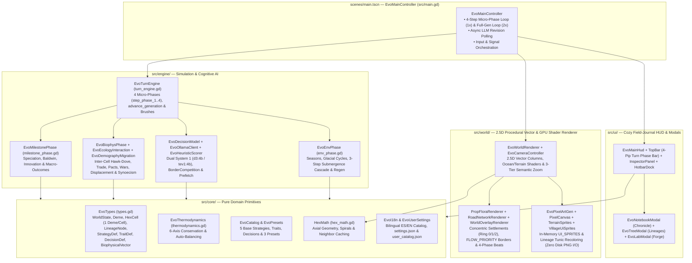

# System Architecture & Developer Guide

**Evolution** is built with **Godot Engine 4.7+** in strictly typed GDScript, following a modular architecture that cleanly separates **pure data models & thermodynamic rules (`src/core/`)**, **sequential 4-step micro-phase generational simulation & AI cognition (`src/engine/`)**, **high-definition 2D/2.5D procedural vector and GPU-shader hex rendering (`src/world/`)**, and **interactive field-journal UI (`src/ui/`)**.

---

## Architectural Overview & Module Map



### Annotated Source Directory Structure

```text
├── assets/                     # Themes and UI resources
├── gh-pages/                   # MkDocs documentation & shared application screenshots (.gdignore)
├── scenes/
│   └── main.tscn               # Root scene entry point binding EvoMainController
├── src/
│   ├── main.gd                 # EvoMainController: 4-step micro-phase playback, async LLM hot-swap, signal routing
│   ├── core/
│   │   ├── catalog.gd          # EvoCatalog: 5 base strategies, 6 bio traits, 5 cultural traits, 7 decisions
│   │   ├── hex_math.gd         # HexMath: pointy-top axial math, distance, spirals, neighbor caches
│   │   ├── i18n.gd             # EvoI18n: bilingual (ES / EN) localization dictionary & strategy helpers
│   │   ├── presets.gd          # EvoPresets: 1v1 strategy builders for Rift Valley, Darwin's Archipelago, Finite Island
│   │   ├── thermodynamics.gd   # EvoThermodynamics: BASE_BUDGET = 0.60 validation & auto-balancing
│   │   ├── types.gd            # EvoTypes: serializable data models (HexCell.get/set_resident_deme_id, Deme, WorldState)
│   │   └── user_settings.gd    # EvoUserSettings: ~/.config/Evolution/settings.json & user_catalog.json persistence
│   ├── engine/
│   │   ├── turn_engine.gd      # EvoTurnEngine: step_phase_1..4 micro-phases, advance_generation() & God-mode brushes
│   │   ├── env_phase.gd        # EvoEnvPhase: seasonal & glacial cycles, coastal submergence cascade, K/R regen
│   │   ├── decision_model.gd   # EvoDecisionModel: signature bucketing, 75/25 blending, Phase 1 & Phase 4 prefetch
│   │   ├── biophys_phase.gd    # EvoBiophysPhase: run_ecology_and_borders_step & run_demography_and_migration_step
│   │   ├── milestone_phase.gd  # EvoMilestonePhase: Speciation, Baldwin, Innovation & Macro-Outcomes
│   │   ├── biophys/
│   │   │   ├── ecology_interaction.gd   # EvoEcologyInteraction: inter-cell Hawk-Dove, trade, pacts, tribute, raids, walls
│   │   │   └── demography_migration.gd  # EvoDemographyMigration: metabolism, r/K growth, wars, 3-step displacement, synoecism
│   │   └── cognitive/
│   │       ├── heuristic_scorer.gd      # EvoHeuristicScorer: BorderCompetition prompt, 10-part signatures, 6-gen memory
│   │       └── ollama_client.gd         # EvoOllamaClient: WorkerThreadPool HTTP batching & model pull
│   ├── ui/
│   │   ├── main_hud.gd         # EvoMainHud: top-level UI controller, micro-phase sync & Ollama startup check
│   │   ├── ui_style.gd         # EvoUiStyle: parchment/wood theme tokens, StyleBoxes & helpers
│   │   ├── notebook_modal.gd   # EvoNotebookModal: 18-filter Evolutionary Chronicle & hex jump
│   │   ├── tree_modal.gd       # EvoTreeModal: Bézier phylogenetic tree & map lineage highlighter
│   │   ├── lab_modal.gd        # EvoLabModal: 4-tab Strategy, Trait & Decision Forge with live balance meter
│   │   └── hud/
│   │       ├── hud_top_bar.gd           # EvoHudTopBar: valley sign, 1v1 matchup bar, 4-pip Turn Phase Bar, settings
│   │       ├── hud_inspector_panel.gd   # EvoHudInspectorPanel: 3-tab village/traits/habitat scroll inspector
│   │       ├── hud_hotbar_dock.gd       # EvoHudHotbarDock: 10-slot hotbar, radius toggle, valley legend duel counter
│   │       └── hud_banners_toasts.gd    # EvoHudBannersToasts: macro banner, chronicle toasts, model pull modal
│   └── world/
│       ├── world_renderer.gd   # EvoWorldRenderer: 2.5D vector hex columns, Ocean/Terrain GPU shaders, 3-tier zoom
│       ├── camera_controller.gd# EvoCameraController: orbit yaw, tilt pitch, cursor-pivoted zoom & pan
│       ├── pixel_art_gen.gd    # EvoPixelArtGen: in-memory UI_SPRITES & villager tunic recoloring (zero disk I/O)
│       ├── render/
│       │   ├── prop_flora_renderer.gd   # EvoPropFloraRenderer: Concentric Settlements (Ring 0/1/2) & procedural vector flora
│       │   ├── road_network_renderer.gd # EvoRoadNetworkRenderer: FLOW_PRIORITY border networks & shared hex border fronts
│       │   └── world_overlay_renderer.gd# EvoWorldOverlayRenderer: Macro medallions, Meso billboards, Micro bars & 4-phase beats
│       └── sprites/
│           ├── pixel_canvas.gd          # EvoPixelCanvas: RGBA8 raster primitives & soft 1px outlining
│           ├── terrain_sprites.gd       # EvoTerrainSprites: on-demand biome/terrain sprite buffers
│           └── village_ui_sprites.gd    # EvoVillageUiSprites: in-memory UI icons & villager sprites
└── tests/
    ├── test_runner.gd          # Headless unit, biophysical, integration & UI test suite (16 suites)
    └── test_visual_capture.gd  # Automated screenshot generator for gh-pages/assets/img/
```

---

## Core Data Models, Sovereign Hex Invariant & User Catalog Persistence

### 1. Single Resident Deme Per HexCell, Fortifications, Synoecism & Geopolitical Primitives (`EvoTypes`)
The 1-deme-per-hex territorial invariant, 1v1 strategy duel, multi-tier defense system, vendetta memory, and city unification (synoecism) are modeled directly in `src/core/types.gd`:

* **`EvoTypes.HexCell` (Strictly 1 Deme Per Cell: `cell.deme_ids.size() <= 1`)**:
  * Every terrestrial `HexCell` hosts **at most 1 resident deme** (`get_resident_deme_id() -> String` returns `deme_ids[0]` or `""`; `set_resident_deme_id(deme_id: String)` clears `deme_ids` and assigns the single resident).
  * Because no two demes ever cohabit the same hex cell, all competitive, cooperative, commercial, diplomatic, and military interactions occur across **shared hex borders** between adjacent passable cells (`HexEdgeFlow`).
* **`EvoTypes.StrategyDef`**:
  * `id: String` — Unique identifier (e.g., `"strat-cooperation"`, `"strat-war"`, or `"strat-custom-*"`).
  * `name: String` & `description: String` — Localized name and philosophy for `"base"` strategies (`EvoI18n.strategy_text`) or user-defined strings for `"user"` strategies.
  * `icon: String` (`"🛡️"` default) & `color: String` (`"#10B981"` default) — Visual emblem and hex color swatch rendered on HUD selectors, Macro territory washes, Meso hex strategy rings, Ring 0 plaza mosaics, and villager tunics.
  * `origin: String` — `"base"` for the 5 built-in archetypes or `"user"` / `"custom"` for strategies crafted in `EvoLabModal`.
  * `biological_trait_ids: Array[String]` & `cultural_trait_ids: Array[String]` — Bundled traits applied to founding demes and lineages.
* **`EvoTypes.WorldState`**:
  * `strategies_catalog: Dictionary` (`String -> StrategyDef`) — Holds the 5 base strategies from `EvoCatalog.create_base_strategies_catalog` merged with user-created strategies from `~/.config/Evolution/user_catalog.json`.
  * `strategy_a_id: String` (default `"strat-cooperation"`) & `strategy_b_id: String` (default `"strat-war"`) — The two competing strategies assigned to Founder A and Founder B in the active 1v1 matchup.
  * `active_pacts: Dictionary` (`String -> int`) — Maps canonical pair keys (`EvoTypes.make_pair_key(deme_a_id, deme_b_id)` = `"idA__idB"`) to diplomatic state:
    * **`>= 2` (`EvoTypes.is_pact_active == true`)**: Formal active Alliance Pact (eligible for mutual caloric bonus, distress aid, shared defense, allied wall co-financing, and at `>= 3` / `>= 4` inter-cell City Unification / Synoecism).
    * **`1`**: Cooperative progress toward a pact, or a 1-turn temporary truce established via **Tribute Appeasement (`tribute`)**.
    * **`< 0` (`EvoTypes.is_vendetta_active == true`)**: Active multi-turn **Vendetta / Grudge** (`-4` turns after betrayal, `-3` after conquest, `-2` after raid or repelled war; `EvoTypes.get_vendetta_turns` returns `abs(turns)`). Increments by `+1` each turn toward `0` and blocks pact formation while active.
  * `recent_extinction_hexes: Array[String]` — Tracks hex coordinates where demes collapsed during the current generation.
* **`EvoTypes.Deme` & `EvoTypes.LineageNode`**:
  * Both `Deme` and `LineageNode` carry `strategy_id: String` (serialized in JSON as both `"strategyId"` and `"strategy_id"` for full schema compatibility).
  * `Deme.defense_tier: int` (`0..3`) — Multi-tier Ring 2 fortification level (`0`: Unfortified, `1`: Palisade & Watchtower `+45%`, `2`: Stone Wall & Fort `+95%`, `3`: Castle / Citadel `+155%` & raid-immune).
  * `Deme.merged_count: int` & `Deme.secondary_color: String` — Tracks how many allied or kin clans have united into this settlement and stores the partner's strategy emblem color for dual concentric Ring 0 mosaic rendering.
  * `Deme.get_village_tier()` returns architectural tier `1..5` (`5` = Unified Metropolis when `merged_count >= 1` and (`population >= 220` or `defense_tier >= 3`), `4` = Citadel when `population >= 400` or `defense_tier >= 3`, `3` = Village when `population >= 150` or `defense_tier == 2`, `2` = Hamlet when `population >= 50` or `defense_tier == 1`, `1` = Camp otherwise).
  * `Deme.get_vital_status()` returns the unified 5-state classification (`"thriving"`, `"stable"`, `"declining"`, `"starving"`, `"extinct"`).

### 2. End-to-End `strategy_id` Inheritance Lifecycle
To guarantee that every village on the map always retains its founding strategy identity regardless of how far it migrates, conquers, unites, or diverges phylogenetically:

1. **Preset Initialization & Generation 0 Matchup (`EvoCatalog.apply_strategy_to_deme`)**:
   Sets `deme.strategy_id = strategy.id`, `deme.color = strategy.color`, `deme.biological_trait_ids`, and (if `deme_has_cultural_capacity` is satisfied) `deme.cultural_trait_ids`, and mirrors `strategy_id`, `color`, and traits onto `state.lineage_tree[deme.lineage_id]`.
2. **Colonist Migration & Warband Conquest (`EvoDemographyMigration.run_demography_and_migration_phase`)**:
   When a parent deme undergoes population fission into an empty neighbor hex (`-m<gen>-<q>_<r>`) or conquers a rival neighbor hex (`-w<gen>-<q>_<r>`), the newly founded settlement explicitly inherits `daughter.strategy_id = deme.strategy_id`, `daughter.lineage_id = deme.lineage_id`, and `daughter.color = deme.color`.
3. **Inter-Cell Kin Merge, Refugee Merge & Synoecism (`EvoDemographyMigration._merge_deme_into`)**:
   When two adjacent settlements merge across a border (or when a displaced deme merges into an adjacent allied/kin refuge via `evacuate_or_merge_displaced_deme`), the host settlement preserves its primary `deme.strategy_id` and `deme.color` while recording the partner's color in `deme.secondary_color` and incrementing `deme.merged_count`.
4. **Allopatric Speciation (`EvoMilestonePhase.run_milestone_phase`)**:
   When an isolated colony (`isolation_turns >= 10`) speciates into a new child `LineageNode` (`new_node`), the new lineage node inherits **`new_node.strategy_id = deme.strategy_id`** while receiving a fresh species color from `SPECIATION_PALETTE`, and the speciated deme keeps its `deme.strategy_id`.

### 3. Persistent User Configuration & User Catalog (`EvoUserSettings`)
`src/core/user_settings.gd` persists user preferences and custom laboratory creations inside `~/.config/Evolution/`:

| File Path | Managed Methods | Stored JSON Payload |
| :--- | :--- | :--- |
| `~/.config/Evolution/settings.json` | `EvoUserSettings.load_settings()`<br>`EvoUserSettings.save_settings()` | `{ "primary_model": "d3:4b", "secondary_model": "tev1:4b", "context_length": 8192 }` |
| `~/.config/Evolution/user_catalog.json` | `EvoUserSettings.save_user_catalog(state)`<br>`EvoUserSettings.load_user_catalog_into(state)` | `{ "strategies": [...], "traits": [...], "decisions": [...] }` — Automatically serializes all entries in `state.strategies_catalog`, `state.traits_catalog`, and `state.decisions_catalog` where `origin in ["user", "custom"]`, and reloads them into every new or reset `WorldState`. |

---

## High-Definition 2D/2.5D Procedural Vector & GPU Shader World (`src/world`)

### 1. Procedural 2.5D Vector Hex Columns & GPU Shaders (`EvoWorldRenderer`)
`EvoWorldRenderer` and `EvoCameraController` project 2D pointy-top axial coordinates $(x, y)$ and vertical elevation $z_{\text{height}} \in [0, 96\text{ px}]$ into 2.5D screen space using camera yaw $\psi \in [0^\circ, 360^\circ)$ and pitch $\theta \in [28^\circ, 75^\circ]$:

$$\mathbf{p}_{\text{screen}} = \begin{bmatrix} \cos\psi & -\sin\psi \\ \sin\psi \sin\theta & \cos\psi \sin\theta \end{bmatrix} \begin{bmatrix} x \\ y \end{bmatrix} + \begin{bmatrix} 0 \\ -z_{\text{height}} \cdot 1.18 \cos\theta \end{bmatrix}$$

* **GPU `ShaderMaterial` Terrain & Ocean Columns (`OCEAN_SHADER_CODE` & `TERRAIN_SHADER_CODE`)**:
  * Rather than stamping disk-cached PNG hex tiles, `EvoWorldRenderer._draw_hex_column` renders multi-bevel vector hex polygons (`top_pts`, `mid_pts`, `inner_pts`) shaded on the GPU:
    * **`OCEAN_SHADER_CODE` (`_ocean_shader_mat`)**: Procedural animated wave caustic bands and coastal shoreline foam modulated by `season_warmth`.
    * **`TERRAIN_SHADER_CODE` (`_terrain_shader_mat`)**: Procedural FBM micro-relief, radial sun-rim bevel lighting, and seasonal warmth modulation (`season_warmth = 1.0` in `"wet_warm"`, `0.0` in `"dry_cold"`) with full UV coverage across outer (`_hex_uvs`), mid (`_hex_mid_uvs`), and inner (`_hex_inner_uvs`) bevel rings.
* **10-Tier Elevation Quantization**: Terrestrial hexes quantize `cell.altitude` into $10$ discrete vertical tiers ($\text{tier} = \text{clamp}(\lceil 10 \cdot \text{altitude} \rceil, 1, 10)$), extruding 3D cliff walls with geological strata lines, deterministic rock cracks, and hanging vines.
* **14-Tuple Dirty-State Column Cache (`_column_state_cache`)**: Each hex column caches `[yaw, pitch, eff_biome, top_z, active_lens, k_band, r_band, is_selected, is_brushed, inspect_brush, coast_dirs, diff_biome_dirs, occ_deme_id, macro_band]`.
* **In-Memory `UI_SPRITES` Only (`EvoPixelArtGen`)**: `EvoPixelArtGen.ensure_all_assets()` pre-generates only in-memory `UI_SPRITES` (`ImageTexture`s) with **zero disk PNG I/O** (no `res://assets/sprites/terrain` or `res://assets/sprites/villages` file writes).

### 2. Concentric Morphological Living Settlements (`EvoPropFloraRenderer`)
Every occupied hex cell renders a single sovereign settlement synthesized procedurally by `EvoPropFloraRenderer.build_settlement_morphology` (and inspected via `EvoWorldRenderer.get_settlement_morphology_summary`) across **three concentric architectural rings**:

| Ring | Architectural Layer | Key Methods & Constants | Visual & Structural Synthesis |
| :--- | :--- | :--- | :--- |
| **Ring 0** | **Core Plaza & Citadel**<br>(`ring_0_core`) | `draw_village_plaza`,<br>`_draw_ring_0_citadel`,<br>`ARCHETYPE_STYLE_MAP` | Earthen terrace pad, cobblestone plaza, strategy mosaic ring (plus inner secondary strategy ring when `is_merged`), and a central citadel scaled across Tiers 1..5 whose silhouette reflects the dominant behavioral archetype: `forage_lodge` (`forage`), `amphitheater_dome` (`cooperate`), `twin_canopy_market` (`exchange`), `horned_war_keep` (`dispute`), `furnace_rig` (`overexploit`), `nomad_pavilion` (`migrate`), or `astronomical_spire` (`innovate`). |
| **Ring 1** | **Trait Crown**<br>(`ring_1_traits`) | `_draw_ring_1_trait_module`,<br>`TRAIT_MODULE_MAP` (`TRAIT_RING_CATALOG`) | Up to **6 radial structures** positioned around Ring 0, mapped deterministically from the deme's `biological_trait_ids` and `cultural_trait_ids`: `brood_totem` (`bio-r-strategy`), `terraced_sanctuary` (`bio-k-strategy`), `granary_silo` (`bio-digestive-spec`), `hearth_circle` (`bio-thermal-tolerance`, `cul-fire-processing`), `crystal_obelisk` (`bio-encephalization`), `monolith` (`bio-social-instinct`), `lithic_workshop` (`cul-extraction-tools`), `grove_shrine` (`cul-communal-conservation`), `caravan_depot` (`cul-interdeme-barter`), and `war_brazier` (`cul-warrior-expansion`). |
| **Ring 2** | **Defense Perimeter & Flora**<br>(`ring_2_defense`) | `_draw_ring_2_defense`,<br>`draw_prop` | Tiered perimeter fortifications for `defense_tier 0..3` (`none`, `palisade` timber stakes, `stone_wall` crenellated rampart, `fortress_bastion` stone wall with 6 corner watchtowers) surrounded by biome-reactive procedural vector flora (`tree_tropical`, `tree_savanna`, `tree_tundra`, `bush_berry`, `wildflowers`, `coastal_reeds`, degrading to `tree_stump`, `soil_crack`, and `dry_scrub` when $K / K_{\max} < 0.75$). |

### 3. Priority-Ranked Inter-Cell Border Flows & Fronts (`EvoRoadNetworkRenderer`)
All inter-cell `HexEdgeFlow` interactions are deduplicated per canonical hex/deme pair using `EvoRoadNetworkRenderer.FLOW_PRIORITY`:

$$\texttt{"merge" (130)} > \texttt{"war" (120)} > \texttt{"siege" (110)} > \texttt{"betrayal" (100)} > \texttt{"raid" (90)} > \texttt{"tribute" (80)} > \texttt{"pact" (70)} > \texttt{"migration" (60)} > \texttt{"collab" (50)} > \texttt{"symbiosis" (40)} > \texttt{"exchange" (30)} > \texttt{"cooperate" (20)} > \texttt{"dispute" (10)}$$

In addition to animated directional border flows (`draw_animated_roads`), `EvoRoadNetworkRenderer` draws persistent **shared hex border fronts** (`_get_shared_hex_border_world`) along the exact hex edge separating two neighboring cells:
* **Diplomatic Pact Border Front (`draw_pact_border_front`)**: Golden-emerald diplomatic border line with glowing boundary beacons between allied neighbors.
* **Conflict / Vendetta Border Front (`draw_conflict_border_front`)**: Crimson-iron jagged frontier with crossed lances along hostile or contested hex borders.

### 4. 3-Tier Semantic Zoom (`Macro`, `Meso`, `Micro`)
`EvoWorldRenderer.get_semantic_zoom_tier()` and `get_zoom_tier_weights()` smoothly blend world detail across three semantic zoom levels:

| Semantic Tier | Camera Zoom Range | Rendered Visual Layers (`EvoWorldRenderer` & `EvoWorldOverlayRenderer`) |
| :--- | :---: | :--- |
| **`Macro`** | `zoom < 0.68` | Sovereign territory strategy color wash (`0.28 * macro_w`) and bold territory border contour on occupied hexes, high-contrast lineage medallions (`_draw_macro_medallion`: strategy icon + `pop` + vital arc), and inter-cell border fronts (micro props and moving villagers are culled). |
| **`Meso`** | `0.68 <= zoom < 1.35` | Concentric morphological settlements (Ring 0/1/2), Decision Intent Crests, compact village billboards (`draw_village_billboard`), and animated directional border flows. |
| **`Micro`** | `zoom >= 1.35` | Micro diagnostic overlays (`_draw_micro_diagnostics`: `pop / K_eff`, `energy_reserves` delta badge `%+0.1f E`, and `baldwin` / `innovation` / `isolation` progress bars), radial Ring 1 trait labels (`zoom >= 1.55` or selected/hovered), and orbiting villager activity. |

---

## Automated Verification & Testing Suite (`tests/test_runner.gd`)

The repository includes a comprehensive headless test runner (`res://tests/test_runner.gd`) that executes **16 test suites** verifying every mathematical formula, 1-deme-per-hex invariant (`_assert_single_deme_per_cell_invariant`), 4-step micro-phase playback, inter-cell border interaction, concentric settlement morphology, and UI component:

```bash
# Run the full automated test suite headlessly
godot --headless --path . --script res://tests/test_runner.gd

# Run static GDScript syntax and type verification across all scripts
for script in $(find src tests -name "*.gd"); do
  godot --headless --path . --check-only -s "res://${script}"
done
```

| Suite # | Test Method | Verification Scope |
| :---: | :--- | :--- |
| **1** | `_test_thermodynamics` | Verifies `BASE_BUDGET = 0.60`, `evaluate_thermodynamics`, required cost $0.5 \cdot (A^+ - 0.60)$, auto-balancing into `metabolic_cost` / `ecological_impact`, and `free_sandbox_mode` bypass. |
| **2** | `_test_catalog_and_presets` | Verifies cell counts (`91`, `91`, `61`), balanced 1v1 starting demes (`2` per preset, 1 per hex), base catalog sizes (`5` strategies, `11` traits, `7` decisions), `deme_has_cultural_capacity`, and `inject_trait_into_deme` mutual exclusion (`r` vs `K`). |
| **3** | `_test_strategies_duel_and_persistence` | Verifies the 5 base strategies, `compute_strategy_vector`, `apply_strategy_to_deme`, `strategy_id` inheritance across migration and speciation, `EvoLabModal` Strategy Builder UI, and `user_catalog.json` persistence. |
| **4** | `_test_decision_model_and_normalization` | Verifies `normalize_decision_probabilities` ($\sum P(d) = 1.0$), $75\%/25\%$ environmental & geopolitical weight blending, `BorderCompetition` state prompt, and cached Ollama System 1 model evaluation. |
| **5** | `_test_hawk_dove_and_symbiosis` | Verifies inter-cell Hawk-Hawk $-15\%$ population loss (floor `10`), Hawk-Dove border resource annexation, and `"dispute"` flow generation, plus inter-cell Symbiosis ($1.20\times$ to $1.35\times$ complementary trade) and horizontal cultural transmission of `cul-fire-processing`. |
| **6** | `_test_tragedy_of_the_commons` | Runs `preset-finite-island` and verifies overexploitation degrades hex $K$ below $0.60 \cdot K_{\max}$ and logs `"tragedy_of_commons"`. |
| **7** | `_test_baldwin_innovation_and_speciation` | Verifies Baldwin assimilation at `counter >= 8` (with decision-proportional vector synthesis), Cultural Innovation at `innovation_counter >= 1.0`, and Allopatric Speciation at `isolation_turns >= 10`. |
| **8** | `_test_kin_merge_fission_and_macro_outcome` | Verifies inter-cell compatible same-lineage kin merging (Jaccard $\le 0.25$), empty-hex population fission migration (`-m<gen>`), 3-step displacement cascade (`evacuate_or_merge_displaced_deme`), and macro-outcome detection (`total_extinction`, `single_survivor`, `ecological_equilibrium`). |
| **9** | `_test_interventions` | Verifies `apply_set_biome` (`⚡10`), `apply_adjust_altitude` (`⚡15`), `apply_adjust_carrying_capacity` (`⚡10`), and `apply_adjust_sea_level` (`⚡25`) with single-deme-per-hex displacement. |
| **10** | `_test_serialization_roundtrip` | Verifies `WorldState.to_dict()` $\to$ `JSON.stringify` $\to$ `WorldState.from_dict()` preserves generation, cells, demes (`defense_tier`, `merged_count`, `secondary_color`), `strategies_catalog`, `strategy_a_id`, `strategy_b_id`, `active_pacts`, and `user_catalog.json` persistence. |
| **11** | `_test_25_generations_all_presets` | Advances all 3 presets for 25 generations and asserts $\sum P(d) = 1.0$ and `cell.deme_ids.size() <= 1` for every cell and surviving deme. |
| **12** | `_test_main_scene_and_ui_integration` | Instantiates `res://scenes/main.tscn`, verifies in-memory `UI_SPRITES`, GPU terrain/ocean shaders, 3-tier semantic zoom (`Macro`, `Meso`, `Micro`), concentric settlement morphology (Ring 0/1/2), 4-step micro-phase playback & 4-pip Turn Phase Bar, dual System 1 model routing (`d3:4b` / `tev1:4b`), and modals. |
| **13** | `_test_nonblocking_async_decision_and_smooth_panning` | Asserts `check_ollama_status(true)` completes in $< 15\text{ ms}$ on the main thread and verifies late-game async evaluation and camera panning. |
| **14** | `_test_emergent_geopolitics_and_visual_artifacts` | Verifies inter-cell Alliance Pacts (`>= 2` turns, $+15\%$ bonus, distress aid, shared defense), Opportunistic Betrayals, Plunder Raids, Territorial Wars of Conquest (`-w<gen>`), `FLOW_PRIORITY` border flows, Inspector Pacts readout, and Notebook geopolitical filters. |
| **15** | `_test_social_memory_defense_tribute_and_synoecism` | Verifies 6-generation cognitive memory digest, rich neighbor relational tags (`vendetta`, `ally`, `rival:martial`), Multi-Tier Defense upgrades (`defense_tier: 1..3`) & Castle raid immunity, Tribute Appeasement (`18%` reserves, zero casualties, truce), Fortified Sieges (`siege` flow & wall repair), Complementary Inter-Biome/Cross-Cultural Trade (`1.35x`), and inter-cell City Unification / Synoecism (`merge`, Tier 5 Metropolis, LLM request reduction). |
| **16** | `_test_bugfix_regressions` | Verifies conserved loot energy transfers in raids/betrayals, unified vital status (`declining`), `altitude <= 0.85` passability & 3-hop peer connectivity, root-lineage hegemony check, and `_cache_epoch` thread safety. |

---

## Building Documentation & CI/CD Pipelines

### Previewing Documentation Locally
The documentation in `gh-pages/` is built with **Material for MkDocs** (`mkdocs.yml`) using the shared Arrase Ecosystem design system (`gh-pages/stylesheets/extra.css`, `gh-pages/javascripts/ecosystem.js`, and `gh-pages/javascripts/mathjax.js`):

```bash
# Install Material for MkDocs
pip install mkdocs-material

# Launch local live-reload server at http://127.0.0.1:8000/
mkdocs serve

# Run strict production build into ./site/
mkdocs build --strict
```

### GitHub Actions Workflows (`.github/workflows/`)
* **`ci.yml`**: Installs Godot `4.7.2-stable` on Ubuntu, imports project assets, runs `--check-only` static verification on every `.gd` script in `src/` and `tests/`, and executes `res://tests/test_runner.gd`.
* **`deploy.yml`**: Triggers on pushes to `main` touching `gh-pages/**` or `mkdocs.yml`, builds the static site with `mkdocs-material==9.7.7`, and deploys to GitHub Pages.
* **`release.yml`**: Exports multiplatform release binaries (`Linux x86_64`, `Windows x86_64`, `macOS Universal`, and `Web HTML5/WASM`) whenever a `v*` tag is pushed.
* **`codeql.yml` & `security.yml`**: Automated static security analysis and workflow auditing.
