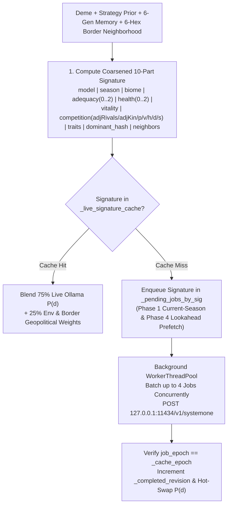

# Cognitive Engine & Multi-Model Ollama AI

**Evolution** features a non-blocking, dual-model **System 1 Cognitive Architecture** (`EvoDecisionModel`, `EvoOllamaClient`, `EvoHeuristicScorer`) that evaluates each sovereign subpopulation's ecological, energetic, historical, and inter-cell border neighborhood every generation.

Every subpopulation's behavioral decisions are evaluated by local **Ollama System 1 decision models** (`d3:4b` and `tev1:4b`) and blended (**$75\%$ neural model probability / $25\%$ environmental & geopolitical pressure** via `blend_with_environmental_weights`) so that inherited strategy traits, historical memory of wars/betrayals/pacts, multi-tier fortifications, and adjacent rival/kin borders (`BorderCompetition`) dynamically shape behavior while keeping LLM strategic choices dominant. To guarantee smooth 60 FPS rendering and high cache hit rates across the 4-step micro-phase loop, the cognitive engine combines **deterministic deme-to-model routing**, **coarsened 10-part ecological state signature caching**, **Phase 1 current-season & Phase 4 lookahead signature prefetching**, **6-generation historical memory & rich neighbor relational tags**, and **epoch-guarded thread safety (`_cache_epoch`)**.

---

## Architecture Overview



---

## Dual-Model System 1 Routing (`d3:4b` & `tev1:4b`)

Rather than evaluating every deme with a single monolithic prompt, **Evolution** distributes subpopulations deterministically across two specialized System 1 decision models configured in `EvoUserSettings` (`~/.config/Evolution/settings.json`):

* **Primary Decision Model (`DEFAULT_PRIMARY_MODEL = "d3:4b"`)**: Tactical & instinctive ecological evaluator (assigned to Strategy A founders and their descendants).
* **Secondary Decision Model (`DEFAULT_SECONDARY_MODEL = "tev1:4b"`)**: Strategic & rival socio-ecological evaluator (assigned to Strategy B founders and their descendants).
* **Default Context Window (`DEFAULT_CONTEXT_LENGTH = 8192`)**: Configurable directly from the in-game Settings popup (`num_ctx`).

### Deterministic Deme Assignment (`resolve_deme_decision_model_tag`)
1. **Lineage & Settlement Continuity**:
   * Any daughter settlement budded via migration (`-m<gen>`) or founded via territorial conquest (`-w<gen>`) first strips its suffix so it inherits the exact model tag of its parent founder deme.
2. **Initial Preset Subpopulations**:
   * Assigned to **Primary (`d3:4b`)**: `deme-rift-west`, `deme-darwin-founder`, `deme-island-1`, `deme-island-3`.
   * Assigned to **Secondary (`tev1:4b`)**: `deme-rift-east`, `deme-darwin-rival`, `deme-island-2`.
3. **Other / Custom Demes**:
   * Routed deterministically via a 31-bit polynomial rolling hash over `base_id`:
     $$h(\text{id}) = \left(\sum_{i=0}^{n-1} \text{id}[i] \cdot 31^{n-1-i}\right) \ \& \ \text{0x7FFFFFFF}$$
   * Even hash ($h \bmod 2 == 0$) maps to `primary_model` (`d3:4b`); odd hash ($h \bmod 2 == 1$) maps to `secondary_model` (`tev1:4b`).
4. **Graceful Single-Model Fallback**: If only one of the two configured decision models is installed in Ollama, `EvoOllamaClient._resolve_ollama_model_for_tag` automatically routes all live requests to the ready model.

---

## Coarsened 10-Part Ecological State Signature (`compute_deme_evaluation_signature`)

Subpopulations experiencing equivalent strategic, ecological, and border-geopolitical conditions share a canonical, **coarsened 10-part pipe-delimited signature** (`heuristic_scorer.gd`), maximizing cross-turn and cross-deme LLM cache hit rates while distinguishing genuine strategic regime shifts:

$$\text{sig} = \texttt{model} \mid \texttt{season} \mid \texttt{biome} \mid \texttt{adequacy} \mid \texttt{health} \mid \texttt{vitality} \mid \texttt{competition} \mid \texttt{traits} \mid \texttt{dominant} \mid \texttt{neighbors}$$

| Segment # | Component Key | Formula / Coarsened Bucket Definition | Purpose |
| :---: | :--- | :--- | :--- |
| **1** | `model_key` | `deme.decision_model_tag` (`d3:4b` or `tev1:4b`) | Separates cache entries by assigned cognitive model. |
| **2** | `season` | `"wet_warm"` or `"dry_cold"` | Captures seasonal regeneration multiplier ($\gamma = 1.20$ vs $0.75$). |
| **3** | `biome` | `current_cell.biome` | Captures local habitat class (`tropical_forest`, `savanna`, etc.). |
| **4** | `adequacy_bucket` | `0` if $< 0.85$ (scarcity), `1` if $\le 1.35$ (balanced), `2` if $> 1.35$ (surplus), where $\text{adequacy\_ratio} = \dfrac{R_{\text{cell}}}{\max(10.0,\ 0.48 \cdot P_{\text{deme}})}$ | Coarsens local caloric abundance into 3 strategic tiers (`0..2`) to avoid cache invalidation from minor resource fluctuations. |
| **5** | `health_bucket` | `0` if $< 0.35$ (degraded), `1` if $\le 0.80$ (moderate), `2` if $> 0.80$ (healthy), based on $K_{\text{cell}} / \max(1.0, K_{\max})$ | Coarsens carrying capacity health $K / K_{\max}$ into 3 tiers (`0..2`). |
| **6** | `vitality` | `"starving"`, `"declining"`, `"stable"`, `"thriving"`, or `"extinct"` | Unified vital status based on `energy_reserves` and `last_energy_delta`. |
| **7** | `competition_key` | `"%d:%d:%s:%d:p%d:v%d:h%d:d%d:s%d"` encoding `[adjacent_rivals, adjacent_kin, "viable" if pop >= 40 else "small", nearby_rival_flag, pact_count, vendetta_flag, horde_flag, defense_tier, surplus_flag]` | Captures inter-cell border competition (`adjacent_rivals`, `adjacent_kin`), fission viability, active Alliance Pacts (`p%d`), active Vendettas (`v%d`), nearby Conquering Horde threats (`h%d`), Multi-Tier Defense level (`d%d`), and rival wealth disparity (`s%d`). |
| **8** | `traits_key` | Sorted comma-joined `biological_trait_ids + cultural_trait_ids` with 5-axis biophysical vectors | Encodes exact genetic and cultural capabilities and custom Lab edits. |
| **9** | `dominant_key` | `"%x" % dec_hash` (rolling hash over eligible decisions and their 5-axis vectors) | Tracks catalog edits while omitting per-turn Baldwin/innovation counter increments so identical strategic states reuse cached LLM evaluations across turns. |
| **10** | `neighbor_key` | Top 3 passable neighbors ranked by $R / \max(10, P)$: `"%s:%s:%d" % [biome, occ_sig_tag, round(R / 150.0)]` where `occ_sig_tag` $\in \{\texttt{empty}, \texttt{kin}, \texttt{ally}, \texttt{vendetta}, \texttt{rival\_martial}, \texttt{rival}\}$ | Summarizes adjacent dispersal, alliance, vendetta, and martial threat topology across shared hex borders. |

---

## Live Ollama Inference Protocol, `BorderCompetition` Prompt & Blending (`EvoOllamaClient` & `EvoHeuristicScorer`)

### 1. Compact `BorderCompetition` State Prompt, 6-Gen Memory & Neighbor Context (`/v1/systemone`)
When querying Ollama (`POST http://127.0.0.1:11434/v1/systemone`), `EvoOllamaClient._build_system_one_payload` sends a structured JSON payload (`state: { briefing, strategy_traits_prior, geopolitics, memory }`, `decisions`, `model`) constructed by `EvoHeuristicScorer`:

* **Inter-Cell `BorderCompetition` Summary (`build_compact_system_one_state` & `build_geopolitics_summary`)**:
  * Because each hex cell hosts at most 1 resident deme (`cell.deme_ids.size() <= 1`), line 2 of the compact System 1 state briefing encodes inter-cell border topology directly as `BorderCompetition: adjRivals=%d, adjKin=%d, pacts=%d, vendettas=%d`.
* **Sliding 6-Generation Memory Digest (`inspect_geopolitical_context`)**:
  * Scans `state.chronicle` across the last **6 generations** (`entry.generation >= state.generation - 6`) for events involving the deme's `hex_id` or `deme.name`, extracting up to 3 recent chronological tokens (`raided@G<gen>`, `war@G<gen>`, `betrayal@G<gen>`, `pact@G<gen>`, `fortify@G<gen>`, `merge@G<gen>`, `tribute@G<gen>`, `siege@G<gen>`), plus `vendettas=<count>` and `horde_nearby`.
* **Rich Neighbor Relational Tags (`_format_neighbor_occupant_label`)**:
  * In the 4-line state briefing, each of the top 3 passable neighbor hexes formats its resident deme as `<rel_tag>:<posture_tag>:<strength_tag>:def<tier>` (`rel_tag` $\in \{\texttt{kin}, \texttt{ally}, \texttt{vendetta}, \texttt{rival}\}$, `posture_tag` $\in \{\texttt{martial}, \texttt{forage}, \texttt{cooperate}, \dots\}$, `strength_tag` $\in \{\texttt{stronger}, \texttt{weaker}, \texttt{equal}\}$, and `def<0..3>`).
* **Compact 4-Line Briefing (`build_compact_system_one_state`)**:
  ```text
  Gen 8 (wet_warm) | Hex 2,-1 (arid_steppe): resources=260/335 (health=88% of Kmax=380), caloricAdequacy=3.87x, temp=+0.60, hum=0.30, alt=0.42
  Deme "Eastern Savanna Hominids": pop=140 (thriving), reserves=180, delta=+8, def=Lv2, merged=1 | BorderCompetition: adjRivals=1, adjKin=0, pacts=1, vendettas=0
  Traits: K-Strategy[cost:+0.20,extract:+0.25,eco:+0.15,mobility:+0.05,cohesion:+0.40]; Instinctive Sociability[cost:+0.20,extract:+0.20,eco:+0.05,mobility:+0.10,cohesion:+0.60]
  lastDominant=dec-cooperate-store, baldwin=5/8, innovation=0.72/1.0, memory=fortify@G7,pact@G5;horde_nearby | Neighbors: 1,-1(savanna, res=260, pop=95, rival:martial:weaker:def1), 2,0(savanna, res=240, pop=110, ally:cooperate:equal:def2)
  ```
* **`strategy_traits_prior` (`build_top_strategy_prior`)**: Top 3 intrinsic baseline decision weights computed from the deme's biological and cultural traits (`EvoCatalog.compute_baseline_decision_weights`).
* **`geopolitics` (`build_geopolitics_summary`)**: Real-time diplomatic, military, and urban context (`active_pacts`, `active_vendettas`, `adjacent_rivals`, `adjacent_kin`, `defense_tier`, `merged_count`, `horde_threat`, `memory`, `neighbor_max_reserves`, `env_adequacy`).
* **`decisions`**: Eligible behavioral decisions and their 5-axis biophysical vectors.

### 2. Environmental & Geopolitical Weight Blending (`blend_with_environmental_weights`)
To keep neural evaluations grounded in biophysical reality while preserving high responsiveness to the LLM's strategic reasoning, `EvoDecisionModel.blend_with_environmental_weights` combines **$75\%$ of the live Ollama model probability (`0.75 * m_prob`) with $25\%$ of the deterministic environmental & geopolitical weight (`0.25 * e_weight`)** computed by `compute_environmental_decision_weights`:

$$\tilde{p}(d) = 0.75 \cdot P_{\text{Ollama}}(d) + 0.25 \cdot P_{\text{env}}(d)$$

### 3. Dual-Stage Prefetching (`prefetch_for_state`), Non-Blocking Worker Pool & Epoch Guard
* **Phase 1 Current-Season & Phase 4 Lookahead Prefetching (`prefetch_for_state(state, use_current_season)`)**:
  * **Phase 1 (`step_phase_1_environment`)**: Immediately after climate and biomass regeneration complete, `prefetch_for_state(state, true)` enqueues any uncached signatures for the **current season** so worker threads begin scoring while the Phase 1 visual beat plays.
  * **Phase 4 (`step_phase_4_demography_milestones`)**: At the end of the generation, `prefetch_for_state(state, false)` temporarily flips `state.season` to the upcoming turn's season and pre-warms up to **8 unique representative signatures** for the next generation.
* **Concurrent HTTP Batching**: `_run_ollama_worker` runs on Godot's `WorkerThreadPool`, popping up to **4 pending signatures per HTTP worker batch** and polling non-blocking `HTTPClient` connections concurrently (`EVAL_TIMEOUT_MS = 60000` ms, `keep_alive = "30m"`).
* **Epoch-Guarded Cache Invalidation (`_cache_epoch`)**: Calling `clear_caches()` increments `_cache_epoch` under `_mutex`; in-flight worker batches verify `job_epoch == _cache_epoch` before storing results in `_live_signature_cache`.
* **Live Intra-Turn Hot-Swap**: Whenever a background batch completes, `_completed_revision` increments and `EvoMainController` calls `EvoDecisionModel.apply_completed_live_results` on the next frame.

---

## Decision Eligibility & Probability Normalization

### Decision Eligibility Rule (`is_decision_eligible`)
A decision `dec` is eligible if `dec.required_trait_ids.is_empty()` or the deme possesses **at least one** trait in `dec.required_trait_ids`. Specifically:

* **5 Base Decisions** (`dec-conservative-forage`, `dec-intensive-overexploit`, `dec-selective-migration`, `dec-cooperate-store`, `dec-territorial-dispute`) require no special traits (with `dec-territorial-dispute` eligible only when an adjacent non-pact rival deme borders the cell).
* **`dec-exchange-symbiosis` and `dec-explore-innovate`** require cultural capacity (`bio-encephalization` OR `bio-social-instinct`).

### Probability Normalization (`normalize_decision_probabilities`)
Raw LLM probability scores returned by Ollama `/v1/systemone` are normalized via `EvoHeuristicScorer.normalize_decision_probabilities(raw_scores, eligible_ids)` so that all eligible probabilities are non-negative, snapped to `0.0001`, and sum to exactly `1.0000`.

---

## Startup Ollama Verification, Blocking Offline Notice & Model Download

When **Evolution** starts, `EvoDecisionModel.check_ollama_status(true)` asynchronously queries `GET http://127.0.0.1:11434/api/tags` to verify connectivity and inspect installed models advertising the `"decision"` capability (`EvoOllamaClient.filter_decision_models_from_tags`).

* **Ollama Offline Blocking Popup (`show_ollama_offline_popup`)**: If Ollama is offline or unreachable, **Evolution** displays a full-screen blocking warning popup (`_missing_models_modal`) that disables simulation playback and exits cleanly when dismissed.
* **Missing Models Popup (`show_missing_models_popup`)**: If Ollama is online but either `primary_model` (`d3:4b`) or `secondary_model` (`tev1:4b`) is missing locally, the modal offers automatic background model download (`POST /api/pull`) or application exit.
