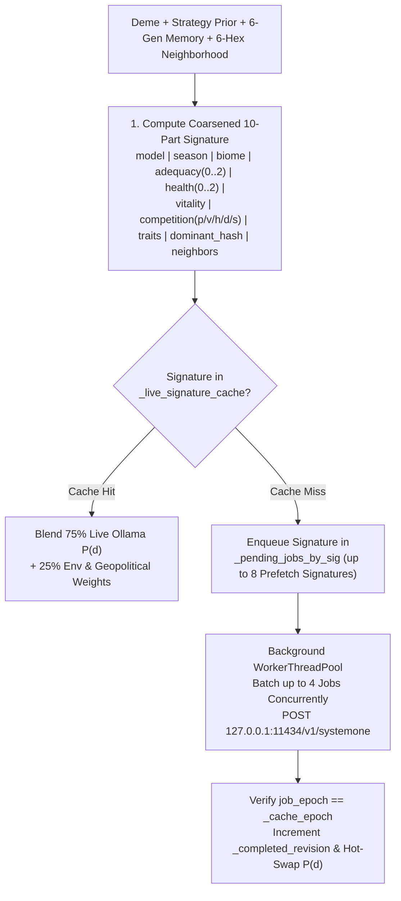

# Cognitive Engine & Multi-Model Ollama AI

**Evolution** features a non-blocking, dual-model **System 1 Cognitive Architecture** (`EvoDecisionModel`, `EvoOllamaClient`, `EvoHeuristicScorer`) that evaluates each subpopulation's ecological, energetic, historical, and geopolitical neighborhood every generation.

Every subpopulation's behavioral decisions are evaluated by local **Ollama System 1 decision models** (`d3:4b` and `tev1:4b`) and blended (**$75\%$ neural model probability / $25\%$ environmental & geopolitical pressure** via `blend_with_environmental_weights`) so that inherited strategy traits, historical memory of wars/betrayals/pacts, multi-tier fortifications, and rival borders dynamically shape behavior while keeping LLM strategic choices dominant. To guarantee smooth 60 FPS rendering and high cache hit rates, the cognitive engine combines **deterministic deme-to-model routing**, **coarsened 10-part ecological state signature caching**, **6-generation historical memory & rich neighbor relational tags**, **epoch-guarded thread safety (`_cache_epoch`)**, and **background worker thread batching with 8-signature prefetching**.

---

## Architecture Overview



---

## Dual-Model System 1 Routing (`d3:4b` & `tev1:4b`)

Rather than evaluating every deme with a single monolithic prompt, **Evolution** distributes subpopulations deterministically across two specialized System 1 decision models configured in `EvoUserSettings` (`~/.config/Evolution/settings.json`):

* **Primary Decision Model (`DEFAULT_PRIMARY_MODEL = "d3:4b"`)**: Tactical & instinctive ecological evaluator (assigned to Strategy A founders and their descendants).
* **Secondary Decision Model (`DEFAULT_SECONDARY_MODEL = "tev1:4b"`)**: Strategic & rival socio-ecological evaluator (assigned to Strategy B founders and their descendants).
* **Default Context Window (`DEFAULT_CONTEXT_LENGTH = 8192`)**: Configurable directly from the in-game Settings popup (`num_ctx`).

### Deterministic Deme Assignment (`resolve_deme_decision_model_tag`)
1. **Lineage & Settlement Continuity**:
   * Any daughter settlement budded via migration (`-m<gen>`) or founded via territorial conquest (`-w<gen>`) first strips its suffix so it inherits the exact model tag of its parent founder deme.
2. **Initial Preset Subpopulations**:
   * Assigned to **Primary (`d3:4b`)**: `deme-rift-west`, `deme-darwin-founder`, `deme-island-1`, `deme-island-3`.
   * Assigned to **Secondary (`tev1:4b`)**: `deme-rift-east`, `deme-darwin-rival`, `deme-island-2`.
3. **Other / Custom Demes**:
   * Routed deterministically via a 31-bit polynomial rolling hash over `base_id`:
     $$h(\text{id}) = \left(\sum_{i=0}^{n-1} \text{id}[i] \cdot 31^{n-1-i}\right) \ \& \ \text{0x7FFFFFFF}$$
   * Even hash ($h \bmod 2 == 0$) maps to `primary_model` (`d3:4b`); odd hash ($h \bmod 2 == 1$) maps to `secondary_model` (`tev1:4b`).
4. **Graceful Single-Model Fallback**: If only one of the two configured decision models is installed in Ollama, `EvoOllamaClient._resolve_ollama_model_for_tag` automatically routes all live requests to the ready model.

---

## Coarsened 10-Part Ecological State Signature (`compute_deme_evaluation_signature`)

Subpopulations experiencing equivalent strategic, ecological, and geopolitical conditions share a canonical, **coarsened 10-part pipe-delimited signature** (`heuristic_scorer.gd:565-672`), maximizing cross-turn and cross-deme LLM cache hit rates while still distinguishing genuine strategic regime shifts (such as new vendettas, nearby conquering hordes, or fortification upgrades):

$$\text{sig} = \texttt{model} \mid \texttt{season} \mid \texttt{biome} \mid \texttt{adequacy} \mid \texttt{health} \mid \texttt{vitality} \mid \texttt{competition} \mid \texttt{traits} \mid \texttt{dominant} \mid \texttt{neighbors}$$

| Segment # | Component Key | Formula / Coarsened Bucket Definition | Purpose |
| :---: | :--- | :--- | :--- |
| **1** | `model_key` | `deme.decision_model_tag` (`d3:4b` or `tev1:4b`) | Separates cache entries by assigned cognitive model. |
| **2** | `season` | `"wet_warm"` or `"dry_cold"` | Captures seasonal regeneration multiplier ($\gamma = 1.20$ vs $0.75$). |
| **3** | `biome` | `current_cell.biome` | Captures local habitat class (`tropical_forest`, `savanna`, etc.). |
| **4** | `adequacy_bucket` | `0` if $< 0.85$ (scarcity), `1` if $\le 1.35$ (balanced), `2` if $> 1.35$ (surplus), where $\text{adequacy\_ratio} = \dfrac{R_{\text{cell}}}{\max(10.0,\ 0.48 \cdot P_{\text{cell\_total}})}$ | Coarsens local caloric abundance into 3 strategic tiers (`0..2`) to avoid cache invalidation from minor resource fluctuations. |
| **5** | `health_bucket` | `0` if $< 0.35$ (degraded), `1` if $\le 0.80$ (moderate), `2` if $> 0.80$ (healthy), based on $K_{\text{cell}} / \max(1.0, K_{\max})$ | Coarsens carrying capacity health $K / K_{\max}$ into 3 tiers (`0..2`). |
| **6** | `vitality` | `"starving"`, `"declining"`, `"stable"`, `"thriving"`, or `"extinct"` | Unified vital status based on `energy_reserves` and `last_energy_delta`. |
| **7** | `competition_key` | `"%d:%d:%s:%d:p%d:v%d:h%d:d%d:s%d"` encoding `[rival_count, kin_count, "viable" if pop >= 40 else "small", nearby_rival_flag, pact_count, vendetta_flag, horde_flag, defense_tier, surplus_flag]` | Captures local competition, fission viability, active Alliance Pacts (`p%d`), active Vendettas (`v%d`), nearby Conquering Horde threats (`h%d`), Multi-Tier Defense level (`d%d`), and rival wealth disparity (`s%d`). |
| **8** | `traits_key` | Sorted comma-joined `biological_trait_ids + cultural_trait_ids` with 5-axis biophysical vectors | Encodes exact genetic and cultural capabilities and custom Lab edits. |
| **9** | `dominant_key` | `"%x" % dec_hash` (rolling hash over eligible decisions and their 5-axis vectors) | Tracks catalog edits while omitting per-turn Baldwin/innovation counter increments so identical strategic states reuse cached LLM evaluations across turns. |
| **10** | `neighbor_key` | Top 3 passable neighbors ranked by $R / \max(10, P)$: `"%s:%s:%d" % [biome, occ_sig_tag, round(R / 150.0)]` where `occ_sig_tag` $\in \{\texttt{empty}, \texttt{kin}, \texttt{ally}, \texttt{vendetta}, \texttt{rival\_martial}, \texttt{rival}\}$ | Summarizes adjacent dispersal, alliance, vendetta, and martial threat topology. |

---

## Live Ollama Inference Protocol, Historical Memory & Environmental Blending (`EvoOllamaClient` & `EvoHeuristicScorer`)

### 1. Sliding 6-Generation Historical Memory & Rich Neighbor Context (`/v1/systemone`)
When querying Ollama (`POST http://127.0.0.1:11434/v1/systemone`), `EvoOllamaClient._build_system_one_payload` sends a structured JSON payload (`state: { briefing, strategy_traits_prior, geopolitics, memory }`, `decisions`, `model`) constructed by `EvoHeuristicScorer`:

* **Sliding 6-Generation Memory Digest (`inspect_geopolitical_context`)**:
  * Scans `state.chronicle` across the last **6 generations** (`entry.generation >= state.generation - 6`) for events involving the deme's `hex_id` or `deme.name`, extracting up to 3 recent chronological tokens:
    * `raided@G<gen>` (plunder raid suffered or launched)
    * `war@G<gen>` (territorial war of conquest or repelled invasion)
    * `betrayal@G<gen>` (broken alliance pact ambush)
    * `pact@G<gen>` (formalized alliance pact)
    * `fortify@G<gen>` (Stone Wall or Castle upgrade)
    * `merge@G<gen>` (city unification / synoecism)
    * `tribute@G<gen>` (tribute appeasement paid or collected)
    * `siege@G<gen>` (fortified siege repelled at the walls)
  * Appends `vendettas=<count>` when the deme holds active multi-turn grudges (`active_pacts < 0` via `EvoTypes.is_vendetta_active`) and `horde_nearby` when a rival martial population (`pop >= 55` with `cul-warrior-expansion`, a `-w<gen>` warband ID, or dominant `dec-territorial-dispute`) is detected within a **1–2 passable hex radius**.
* **Rich Neighbor Relational Tags (`_format_neighbor_occupant_label`)**:
  * In the 4-line state briefing, each of the top 3 passable neighbor hexes formats its primary occupant as `<rel_tag>:<posture_tag>:<strength_tag>:def<tier>`:
    * **Relational Tag (`rel_tag`)**: `kin` (same lineage), `ally` (`is_pact_active`), `vendetta` (`is_vendetta_active`), or `rival`.
    * **Posture Tag (`posture_tag`)**: `martial` (if carrying `cul-warrior-expansion` or dominant `dec-territorial-dispute`) or the neighbor's dominant decision archetype (`forage`, `cooperate`, `exchange`, etc.).
    * **Relative Strength Tag (`strength_tag`)**: `stronger` ($P_{\text{neighbor}} > 1.2 \cdot P_{\text{deme}}$), `weaker` ($P_{\text{neighbor}} < 0.8 \cdot P_{\text{deme}}$), or `equal`.
    * **Defense Tier (`def<0..3>`)**: The neighbor settlement's current fortification tier (`def0` unfortified through `def3` Castle).
* **Compact 4-Line Briefing (`build_compact_system_one_state`)**:
  ```text
  Gen 8 (wet_warm) | Hex 2,-1 (arid_steppe): resources=260/335 (health=88% of Kmax=380), caloricAdequacy=3.87x, temp=+0.60, hum=0.30, alt=0.42
  Deme "Eastern Savanna Hominids": pop=140 (thriving), reserves=180, delta=+8, def=Lv2, merged=1 | CellCompetition: totalPop=140, cohabiting=0 (rivals=0, kin=0)
  Traits: K-Strategy[cost:+0.20,extract:+0.25,eco:+0.15,mobility:+0.05,cohesion:+0.40]; Instinctive Sociability[cost:+0.20,extract:+0.20,eco:+0.05,mobility:+0.10,cohesion:+0.60]
  lastDominant=dec-cooperate-store, baldwin=5/8, innovation=0.72/1.0, memory=fortify@G7,pact@G5;horde_nearby | Neighbors: 1,-1(savanna, res=260, pop=95, rival:martial:weaker:def1), 2,0(savanna, res=240, pop=110, ally:cooperate:equal:def2)
  ```
* **`strategy_traits_prior` (`build_top_strategy_prior`)**: Top 3 intrinsic baseline decision weights computed from the deme's biological and cultural traits (`EvoCatalog.compute_baseline_decision_weights`).
* **`geopolitics` (`build_geopolitics_summary`)**: Real-time diplomatic, military, and urban context (`active_pacts`, `active_vendettas`, `adjacent_rivals`, `defense_tier`, `merged_count`, `horde_threat`, `memory`, `neighbor_max_reserves`, `env_adequacy`).
* **`decisions`**: Eligible behavioral decisions and their 5-axis biophysical vectors.

### 2. Environmental & Geopolitical Weight Blending (`blend_with_environmental_weights`)
To keep neural evaluations grounded in biophysical reality while preserving high responsiveness to the LLM's strategic reasoning, `EvoDecisionModel.blend_with_environmental_weights` combines **$75\%$ of the live Ollama model probability (`0.75 * m_prob`) with $25\%$ of the deterministic environmental & geopolitical weight (`0.25 * e_weight`)** computed by `compute_environmental_decision_weights`:

$$\tilde{p}(d) = 0.75 \cdot P_{\text{Ollama}}(d) + 0.25 \cdot P_{\text{env}}(d)$$

where $P_{\text{env}}(d)$ modulates the deme's intrinsic `strategy_traits_prior` according to caloric adequacy ($R / 0.48 P_{\text{cell}}$), carrying-capacity health ($K / K_{\max}$), vital status (`starving`, `declining`, `stable`, `thriving`), active formal pacts (`pact_count`), active vendettas (`vendetta_count`), nearby conquering horde threats (`has_horde_threat`), and fortification status (`defense_tier`).

### 3. Non-Blocking Worker Pool, Epoch-Guarded Cache & 8-Signature Batch Prefetching
* **Concurrent HTTP Batching**: `_run_ollama_worker` runs on Godot's `WorkerThreadPool`, popping up to **4 pending signatures per HTTP worker batch** and polling non-blocking `HTTPClient` connections concurrently (`EVAL_TIMEOUT_MS = 60000` ms, `keep_alive = "30m"`).
* **8-Signature Queue & Post-Turn Prefetching (`prefetch_for_state` & `sync_and_enqueue_batch`)**: At Stage 5 of every generation (and during turn synchronization), the engine deduplicates uncached deme signatures across the valley and enqueues up to **8 unique representative signatures** (`reps_by_sig.size() >= 8`) into `_pending_jobs_by_sig`. Furthermore, when two allied settlements unite via **Synoecism (`merge`)**, their consolidation into a single `Deme` instance directly reduces the number of active subpopulations and LLM requests per turn.
* **Epoch-Guarded Cache Invalidation (`_cache_epoch`)**: Calling `clear_caches()` (e.g., when switching scenarios or resetting the world) increments `_cache_epoch` under `_mutex`; in-flight worker batches verify `job_epoch == _cache_epoch` before storing results in `_live_signature_cache`, preventing stale responses from earlier runs from polluting a new simulation.
* **Live Intra-Turn Hot-Swap**: Whenever a background batch completes, `_completed_revision` increments. On the very next frame (`_process`), `EvoMainController` calls `EvoDecisionModel.apply_completed_live_results`, immediately updating deme decision bars, justifications, and 2.5D village action structures without stalling UI rendering. While any batch remains pending, automatic generational progression waits for the models to complete their evaluation.

---

## Decision Eligibility & Probability Normalization

### Decision Eligibility Rule (`is_decision_eligible`)
A decision `dec` is eligible if `dec.required_trait_ids.is_empty()` or the deme possesses **at least one** trait in `dec.required_trait_ids`. Specifically:

* **5 Base Decisions** (`dec-conservative-forage`, `dec-intensive-overexploit`, `dec-selective-migration`, `dec-cooperate-store`, `dec-territorial-dispute`) require no special traits (with `dec-territorial-dispute` filtered out when no rival lineage is present in the current or adjacent hexes).
* **`dec-exchange-symbiosis` and `dec-explore-innovate`** require cultural capacity (`bio-encephalization` OR `bio-social-instinct`).

### Probability Normalization (`normalize_decision_probabilities`)
Raw LLM probability scores returned by Ollama `/v1/systemone` are normalized via `EvoHeuristicScorer.normalize_decision_probabilities(raw_scores, eligible_ids)`:

1. Any non-positive, `NaN`, or infinite score for an eligible decision is clamped to $0.0$ (if all eligible scores are $\le 0$, uniform weights $1 / |\text{eligible}|$ are assigned).
2. The highest-scoring eligible decision $d_{\max}$ is identified as `dominant_decision_id`.
3. Every other eligible decision $d_i \neq d_{\max}$ is rounded to $4$ decimal places:
   $$p_i = \text{snapped}\left(\frac{s_i}{\sum_{j \in \text{eligible}} s_j},\ 0.0001\right)$$
4. The dominant decision receives the exact complement $p_{\max} = \text{snapped}\big(\max(0.0,\ 1.0 - \sum_{i \neq \max} p_i),\ 0.0001\big)$ (swapping with the runner-up if rounding caused the complement to dip below the runner-up), guaranteeing that $\sum_{d} P(d) = 1.0000$ and the dominant decision always holds the maximum probability.

---

## Startup Ollama Verification, Blocking Offline Notice & Model Download

When **Evolution** starts, `EvoDecisionModel.check_ollama_status(true)` asynchronously queries `GET http://127.0.0.1:11434/api/tags` to verify connectivity and inspect installed models advertising the `"decision"` capability in their `capabilities` array (`EvoOllamaClient.filter_decision_models_from_tags`).

* **Ollama Offline Blocking Popup (`show_ollama_offline_popup`)**:
  * If Ollama is offline or unreachable (`http://127.0.0.1:11434`), **Evolution** displays a full-screen blocking warning popup (`_missing_models_modal`) notifying the user that Ollama is offline and required to run the simulation.
  * While this popup is active, the simulation **cannot be started** (`Play` and `Step +1` controls are disabled and keyboard/map interactions are blocked).
  * Closing the popup (`Close application` button or pressing <kbd>Escape</kbd>) cleanly shuts down worker threads and **closes the application** (`get_tree().quit()`).
* **Missing Models Popup (`show_missing_models_popup`)**:
  * If Ollama is online but either `primary_model` (`d3:4b`) or `secondary_model` (`tev1:4b`) is missing locally, the blocking modal offers:
    * **Automatic In-Game Download (`⬇️ Download automatically`)**: Streams `POST /api/pull` on a background thread with a real-time 0–100% progress bar and unlocks the simulation upon completion.
    * **Close Application (`Close application` / <kbd>Escape</kbd>)**: Cancels any pending download and exits the application.
* **Custom Model Selection**: Open the **Settings Gear (`⚙️`)** in the top-right clock panel at any time to switch Primary and Secondary models among any installed decision-capable Ollama models, adjust `num_ctx` (default `8192`), and persist your configuration to `~/.config/Evolution/settings.json`.
