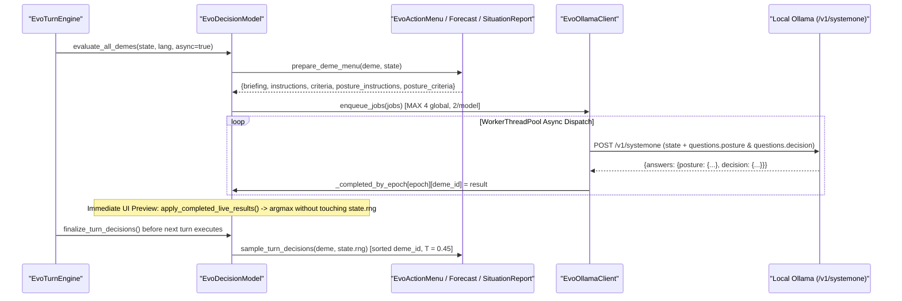

# Cognitive Agency & Ollama Engine

Rather than scripting settlement behavior through brittle rule trees or removed heuristic scorers, **Evolution** delegates strategic reasoning to local Ollama models equipped with the **`decision`** capability via `POST /v1/systemone`. Each living settlement receives an individualized, quantitative world briefing and answers two independent probability distributions simultaneously: its **rural defense posture** and its **generational action**.

---

## 1. End-to-End Agency Pipeline



### Zero Heuristic Blending

When a simulation turns over without a model response (or when waiting on async completion), `prepare_deme_menu()` leaves uniform prior distributions across feasible choices (`1 / N`), `defense_posture = "open_harvest"`, and `chosen_action = menu[0]` (`forage`)—there is **zero fallback heuristic scorer** and **zero artificial mathematical override**.

---

## 2. Feasible Action Menu & Corridors (`EvoActionMenu`)

For each living deme, `EvoActionMenu` (`src/engine/agency/action_menu.gd`) builds up to **`MAX_OPTIONS = 14`** discrete concrete choices sorted deterministically:

1. **Always available**:
   - `forage` (`+20%` harvest bonus)
   - `intensify` (`+55%` harvest yield, `-7%` urban carrying capacity)
   - `fortify` (when `defense_tier < 3` and `can_fortify` meets pop/food/hex resource gates)
   - `innovate` (when cultural transmission is enabled and `innovation_counter < 2.0`)
2. **Colonization Corridors (`settle`, up to `MAX_SETTLE_OPTIONS = 3`)**:
   - Runs BFS across friendly (`self`, active pacts, peaceful kin) passable hexes (`ocean` excluded; `high_mountain` and `altitude <= 0.88` gated by `spatial_mobility >= 0.45`, else `altitude <= 0.85`).
   - Corridor hop depth extends to **`3` hops** when `spatial_mobility >= 0.45`, else **`2` hops**.
   - Scored toward frontier resource richness and bridge extensions (`+120` frontier bridge bonus) once the deme meets `EvoPayoffs.settle_min_pop()` and `settle_min_reserves()`.
3. **Diplomatic & Neighbor Actions (up to `MAX_NEIGHBORS = 4` adjacent demes plus `border_field_rivals`)**:
   - **Active Allies (`pact_turns > 0`)**: `trade`, `aid` (when reserves `>= 40`), `unite` / `accept_union` (once `pact_turns >= 3` and combined `urban_hex_ids` stay within `MAX_URBAN_HEXES = 3` or absorption conditions hold), and `betray`.
   - **Non-Allied Foreign Neighbors**: `trade`, `offer_pact` / `accept_pact`, `demand_tribute` / `pay_tribute`, `raid` (including distance-2 border field raids against cultivated rural hexes), and `conquer` (when adjacent without truce and outside peaceful kin without feud).

---

## 3. Situation Report & Counterfactual Forecasts

### Objective Situation Briefing (`EvoSituationReport`)

`EvoSituationReport.build_with_corridors()` formats a structured natural-language telemetry snapshot (`briefing` $\to$ `payload["state"]`):

- **Deme identity & geography**: Settlement name, clade faction slot, primary hex biome/season/altitude, rural field count (`crops` / `pasture`), and population, reserves, net energy delta, storage cap, defense tier, salubrity score, and infection/immunity timers.
- **Active traits**: Plain-English physiological/cultural effects for each biological trait, cultural tradition, and emergent adaptation.
- **`Horizons` telemetry**: Distance to the next fortify tier, settler thresholds, `innovation_counter` toward emergent tradition (`1.0`), allied `pact_turns` progress toward **Walled Union** (`>= 3`), and glacial inundation countdown if `glacial_sea_level_cycle` is enabled.
- **Relational & Threat Context**: Reputation score (`[-1, +1]`), nearby allies/rivals with trust/feud/truce status, raid/border threats, colonization corridors, pending diplomatic proposals, `last_outcome`, and up to **`12` recent episodic memory lines**.

### Counterfactual Forecasts & Strategy Instructions

- **Strategy & Trait Directives (`EvoActionPolicy.build_instructions()`)**: Combines the strategy's editable `Doctrine` (`StrategyDef.doctrine`) and strategy description with per-trait behavioral imperatives (`TRAIT_DIRECTIVES`) and emergent trait summaries.
- **Posture Instructions (`build_posture_instructions()`)**: Instructs the settlement to balance `100%` harvest in `open_harvest` against `patrol_fields` (`90%` yield, `65%` crop shield) and `mobilized_garrison` (`78%` yield, `85%` crop shield) whenever border raiders or feuds are in range.
- **Quantified Criteria (`EvoOutcomeForecast`)**: Pre-computes exact `EvoPayoffs` food deltas, trade surpluses, raid win odds (`raid_odds`), conquest odds, field-burn risks, and union outcomes (`walled_union` vs. `absorption`) so Ollama scores concrete counterfactual payoffs instead of guessing blind mechanics.

---

## 4. Dual-Question `/v1/systemone` Wire Protocol

[`EvoOllamaClient`](https://github.com/arrase/Evolution/blob/main/src/engine/cognitive/ollama_client.gd) submits a single JSON payload per deme directly to `/v1/systemone` using `WorkerThreadPool`:

```json
{
  "model": "d3:4b",
  "keep_alive": "30m",
  "state": "<EvoSituationReport briefing string>",
  "questions": {
    "posture": {
      "type": "choice",
      "instructions": "<Doctrine + posture trade-off guidance>",
      "criteria": {
        "open_harvest": "Open harvest (100% harvest: ~128 food...)",
        "patrol_fields": "Patrol fields (90% harvest: ~115 food...)",
        "mobilized_garrison": "Mobilized garrison (78% harvest: ~100 food...)"
      }
    },
    "decision": {
      "type": "choice",
      "instructions": "<Doctrine + trait directives + biophysical summary>",
      "criteria": {
        "forage": "...",
        "trade:deme-east": "...",
        "fortify": "..."
      }
    }
  }
}
```

### Model Configuration & Key Implementation Details

- **No legacy `options` or `num_ctx` overrides**: Context size is managed cleanly by the loaded Ollama model and `/v1/systemone` endpoint defaults (`Settings` omits any `num_ctx` field, and `settings.json` stores strictly `primary_model` and `secondary_model`).
- **Two-Model Strategy Assignment (`EvoDecisionModel.resolve_model_for_slot()`)**:
  - **Faction Slot `"A"`** routes to **`primary_model`** (default **`d3:4b`**).
  - **Faction Slot `"B"`** routes to **`secondary_model`** (default **`tev1:4b`**).
  - `/api/tags` startup discovery filters for models declaring `"decision"` in `capabilities`, warning via an interactive modal (`POST /api/pull`) if required models are absent or falling back cleanly if only one `decision`-capable model is installed.
- **Thread-Pool Concurrency & Epoch Isolation**:
  - `WorkerThreadPool` runs up to **`MAX_CONCURRENT_JOBS = 4`** total HTTP workers with a per-model cap of **`MAX_CONCURRENT_PER_MODEL = 2`**.
  - Changing worlds, strategies, or resetting increments `EvoDecisionModel._state_epoch` and cancels stale in-flight work (`cancel_epoch()` / `clear_cache()`), ensuring discarded results from prior runs never contaminate the active `WorldState`.

---

## 5. Power-Temperature Sampling & Inspector Transparency

Once a `/v1/systemone` response returns, `EvoActionPolicy` applies deterministic probability sharpening with **`TEMPERATURE = 0.45`**:

$$P'(k) = \frac{P(k)^{1 / 0.45}}{\sum_j P(j)^{1 / 0.45}}$$

1. **Non-mutating UI Preview (`apply_live_result()`)**: Immediately computes `_argmax_key()` for both `defense_posture` and `chosen_action` so the Inspector's probability bars (`★`), top choice badge, and map labels update live as worker threads complete—without consuming any numbers from `state.rng`.
2. **Authoritative Turn Commit (`sample_turn_decisions()`)**: At the start of `advance_generation()`, `EvoDecisionModel.finalize_turn_decisions()` sorts living `deme_id` keys lexicographically and samples `defense_posture` followed by `chosen_action` from their sharpened distributions using `state.rng`.
