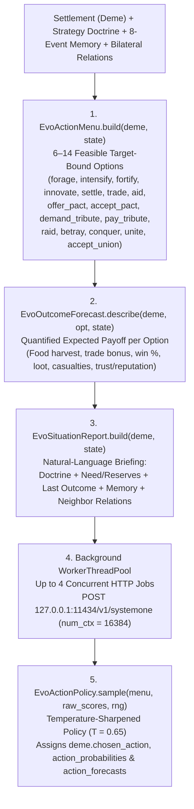

# Cognitive Engine & Payoff-Forecast Ollama Agency

**Evolution** features a non-blocking, dual-model **System 1 Payoff-Forecast Agency Architecture** (`EvoDecisionModel`, `EvoOllamaClient`, `EvoActionMenu`, `EvoOutcomeForecast`, `EvoSituationReport`, `EvoActionPolicy`) that evaluates each settlement's concrete, target-bound action options every generation via local **Ollama System 1 decision models** (`d3:4b` and `tev1:4b` at `POST http://127.0.0.1:11434/v1/systemone`).

Instead of scoring abstract archetypes or blending LLM outputs with heuristic weights, every settlement constructs a feasible menu of **`6–14` concrete actions** where each option's `criterion` is its **quantified expected biophysical and social payoff** (`EvoOutcomeForecast.describe`), paired with a natural-language **Situation Report** (`EvoSituationReport.build`). The model scores the menu directly, and `EvoActionPolicy.sample` samples the settlement's action stochastically (`T = 0.65`) with `WorldState.rng`—with **zero heuristic blending** and **zero signature caching**.

---

## Architecture Overview

---

## Dual-Model System 1 Routing (`d3:4b` & `tev1:4b`)

Subpopulations are distributed deterministically across two specialized System 1 decision models configured in `EvoUserSettings` (`~/.config/Evolution/settings.json`):

* **Primary Decision Model (`DEFAULT_PRIMARY_MODEL = "d3:4b"`)**: Assigned to Strategy A founders and their daughter settlements.
* **Secondary Decision Model (`DEFAULT_SECONDARY_MODEL = "tev1:4b"`)**: Assigned to Strategy B founders and their daughter settlements.
* **Default Context Window (`DEFAULT_CONTEXT_LENGTH = 16384`)**: Configurable directly from the in-game Settings popup (`num_ctx`).

### Deterministic Deme Assignment (`resolve_deme_decision_model_tag`)
1. **Lineage & Settlement Continuity**:
   * Any daughter settlement budded via `settle` (`-m<gen>`) or founded via `conquer` (`-w<gen>`) strips its suffix so it inherits the exact model tag of its parent founder deme.
2. **Initial Preset Subpopulations**:
   * Assigned to **Primary (`d3:4b`)**: `deme-rift-west`, `deme-darwin-founder`, `deme-island-1`, `deme-island-3`.
   * Assigned to **Secondary (`tev1:4b`)**: `deme-rift-east`, `deme-darwin-rival`, `deme-island-2`.
3. **Other / Custom Demes**:
   * Routed deterministically via a 31-bit polynomial rolling hash over `base_id`: even hash maps to `primary_model` (`d3:4b`); odd hash maps to `secondary_model` (`tev1:4b`).
4. **Graceful Single-Model Fallback**: If only one of the two configured decision models is installed in Ollama, `EvoOllamaClient._resolve_ollama_model_for_tag` automatically routes all live requests to the ready model.

---

## Concrete Targeted Action Menu (`EvoActionMenu`)

Every turn, `EvoActionMenu.build(deme, state)` generates a compact menu (`MAX_MENU_OPTIONS = 14`) of physically and socially valid options (`{ id, type, target }`):

| Category | Option ID Format | Action Type | Feasibility Conditions |
| :--- | :--- | :--- | :--- |
| **Domestic** | `forage` | `forage` | Always available. Sustainable wild and rural harvest (`+10%` conservation bonus). |
| **Domestic** | `intensify` | `intensify` | Available when `cell.current_resources > 10.0`. Overexploits land (`+35%` harvest) at the cost of `-7%` permanent carrying capacity $K$. |
| **Domestic** | `fortify` | `fortify` | Available when `defense_tier < 3` and `energy_reserves >= FORTIFY_COST_RESERVES[tier]`. Upgrades hex-edge walls (`Palisade` $\to$ `Stone Wall` $\to$ `Castle`). |
| **Domestic** | `innovate` | `innovate` | Available when the settlement possesses cultural capacity (`bio-encephalization` or `bio-social-instinct`) and `< 2` emergent cultural traits. |
| **Frontier** | `settle@<hex_id>` | `settle` | Up to 2 passable empty neighbor hexes when `population >= 80` and `energy_reserves >= 45.0`. Founds a daughter settlement (`-m<gen>`). |
| **Reactive Diplomacy** | `accept_pact@<id>` | `accept_pact` | Neighbor proposed an alliance pact (`proposal_kind == "pact"`). Seals the alliance immediately. |
| **Reactive Diplomacy** | `accept_union@<id>` | `accept_union` | Allied neighbor proposed unification (`proposal_kind == "union"`). Merges or forms a Walled Union immediately. |
| **Reactive Diplomacy** | `pay_tribute@<id>` | `pay_tribute` | Neighbor demanded tribute (`proposal_kind == "tribute"` and `energy_reserves >= amount`). Pays tribute for a 2-turn truce; choosing any other action refuses the ultimatum and triggers an immediate punitive raid. |
| **Proactive Social** | `trade@<id>` | `trade` | Available with non-feuding adjacent neighbors (`feud_turns == 0`). Unilateral trade earns `55%` of trade gain + `+0.12` trust + cultural diffusion; mutual trade earns `100%` of trade gain + `+0.20` trust. |
| **Proactive Social** | `aid@<id>` | `aid` | Available when `energy_reserves >= 50.0` and neighbor has no active feud. Transfers surplus food (`+0.25` trust, `+0.10` reputation, and seals any open pact offer). |
| **Proactive Social** | `offer_pact@<id>` | `offer_pact` | Available when `pact_turns == 0` and `feud_turns == 0`. Seals immediately with same-lineage kin or trusted neighbors (`trust >= 0.30`); otherwise opens a pact proposal. |
| **Proactive Social** | `unite@<id>` | `unite` | Available between established allied towns (`pact_turns >= 3`, both `village_tier >= 2`, and neither already in a `walled_union_id`). |
| **Coercion & Conflict** | `demand_tribute@<id>` | `demand_tribute` | Available against non-allied, non-kin neighbors with `energy_reserves >= 25.0` during peacetime (`truce_turns == 0`). |
| **Coercion & Conflict** | `raid@<id>` | `raid` | Available against non-allied neighbors when `population >= 25` and `truce_turns == 0`. |
| **Coercion & Conflict** | `betray@<id>` | `betray` | Available against an active pact ally (`pact_turns > 0`) when `population >= 30`. Launches a surprise attack (`+35%` combat bonus, halves wall defense) at the cost of `-0.50` global reputation and a 4-turn feud. |
| **Coercion & Conflict** | `conquer@<id>` | `conquer` | Available against non-allied, non-kin neighbors when `population >= 65`, `energy_reserves >= 35.0`, and `truce_turns == 0`. |

---

## Quantified Outcome Forecasts (`EvoOutcomeForecast`) & Situation Report (`EvoSituationReport`)

When querying Ollama (`POST http://127.0.0.1:11434/v1/systemone`), `EvoOllamaClient._build_system_one_payload` sends:

1. **`state` (`EvoSituationReport.build(deme, state)`)**:
   * **Settlement & Strategy Header**: Settlement name, urban tier (`Camp`, `Village`, `Town`, `Metropolis`), strategy name, and natural-language **Strategy Doctrine** (`strat.doctrine`).
   * **Vital & Ecological Status**: Population, stored food, per-turn food need (`EvoPayoffs.food_need`), expected base harvest (`EvoPayoffs.expected_income`), local hex biome, wild food ratio, land carrying capacity health (`K / Kmax`), owned rural farm/pasture count, fortification status, global reputation, and innovation progress.
   * **Causal Feedback (`Last turn`)**: Exact outcome of the settlement's previous action (`deme.last_outcome`) and net food delta (`last_energy_delta`).
   * **Personal Episodic Memory (`Recent history`)**: Up to 5 recent causal entries from the settlement's 8-event sliding memory (`deme.memory`).
   * **Frontier & Neighbor Relations**: Best open frontier hexes (`biome`, `food`, `capacity`) and each adjacent neighbor's population, stored food, walls, relation status (`kin`, `ally`, `feud`, `truce`, `neutral`), bilateral `trust` (`[-1, +1]`), last action toward this settlement, and any open proposal (`pact`, `union`, or `tribute` ultimatum).
2. **`decisions`**: Array of `{ id, criterion }` objects from `EvoActionMenu.build` and `EvoOutcomeForecast.describe`, where every `criterion` states the exact expected food harvest alongside action-specific payoffs, odds, casualties, and diplomatic consequences.

---

## Temperature-Sharpened Policy Sampling (`EvoActionPolicy`)

Raw option scores returned by `/v1/systemone` are converted into an action probability distribution and sampled via `EvoActionPolicy.sample(menu, raw_scores, rng)`:

1. Each menu option $i$'s raw score $s_i \ge 0$ is sharpened with temperature $T = 0.65$:
   $$w_i = \left(\max(s_i, 0.0001)\right)^{1 / T}$$
2. Normalized probabilities $p_i = w_i / \sum_j w_j$ are stored in `deme.action_probabilities` (with the highest-probability option recorded in `deme.last_dominant_decision_id` and `deme.last_confidence`).
3. A single concrete action (`deme.chosen_action = { id, type, target }`) is sampled from $p_i$ using `state.rng` (`RandomNumberGenerator`), enabling both decisive commitment to high-payoff options and genuine emergent variety across turns.
