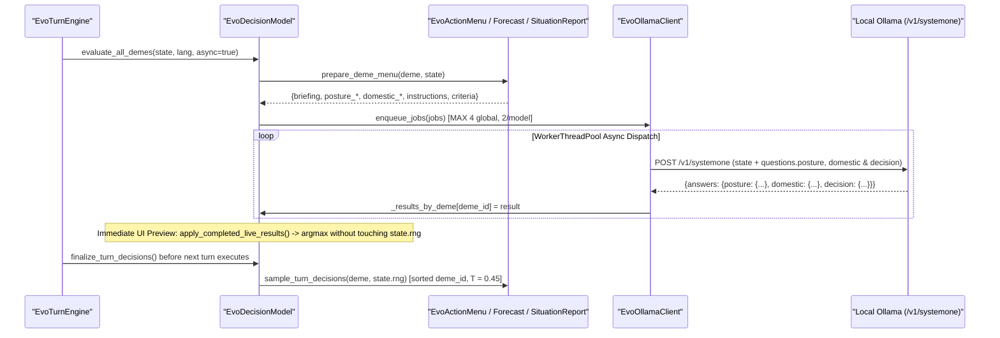

# Cognitive Agency & Ollama Engine

Rather than scripting settlement behavior through brittle rule trees or removed heuristic scorers, **Evolution** delegates strategic reasoning to local Ollama models equipped with the **`decision`** capability via `POST /v1/systemone`. Each living settlement receives an individualized, quantitative world briefing and answers **three** independent probability distributions simultaneously: its **rural defense posture**, its **domestic focus**, and its **external generational action**.

---

## 1. End-to-End Agency Pipeline



### Zero Heuristic Blending

When a simulation turns over without a model response (or while waiting on async completion), `prepare_deme_menu()` initializes uniform priors across feasible options (`1 / N`), `defense_posture = "open_harvest"`, `domestic_action = "forage"`, and `chosen_action = menu[0]` (open proposal response or `"none"`)—there is **zero fallback heuristic scorer** and **zero artificial mathematical override**.

---

## 2. Feasible Action Menus & Spatial Contact (`EvoActionMenu`)

For each living deme, `EvoActionMenu` (`src/engine/agency/action_menu.gd`) separates internal economy from external geopolitics:

### Domestic Menu (`build_domestic()`)

Returns `["forage", "intensify"]`, plus optional investments when eligible:
- `forage` (`+5%` urban harvest bonus, `+1%` urban $K$ recovery)
- `intensify` (`+45%` urban harvest yield, `-7%` urban carrying capacity)
- `fortify` (when `defense_tier < 3` and `EvoPayoffs.can_fortify()` clears pop/food/hex resource gates)
- `innovate` (when `EvoPayoffs.can_innovate()` verifies cultural capacity, `< 3` emergent cultural traits, and `energy_reserves >= 16.0`)

### External Menu (`build()`)

Generates up to **`MAX_OPTIONS = 18`** discrete choices in deterministic order:

1. **Open Proposal Responses**: `accept_pact`, `accept_union` (at `min_urban_distance == 1`), and `pay_tribute`.
2. **Baseline Local Autonomy**: `"none"` (keep to yourselves; always present).
3. **Colonization Corridors (`settle`, up to `MAX_SETTLE_OPTIONS = 3`)**:
   - Runs BFS across friendly (`self`, active pacts, peaceful kin) passable hexes (`ocean` excluded; `high_mountain` and `altitude <= 0.88` gated by `spatial_mobility >= 0.45`, else `altitude <= 0.85`).
   - Corridor depth extends to **`3` hops** when `spatial_mobility >= 0.45`, else **`2` hops**.
   - Targets wild unowned hexes (or own rural fields when `population >= 155`, plus overflow onto own perimeter fields when `population >= 260`), scored with `+120` frontier bridge bonus once `settle_min_pop()` and `settle_min_reserves()` are met.
4. **Social & Neighbor Actions (up to `MAX_NEIGHBORS = 5` contact demes, interleaved round-robin)**:
   - **Generation-0 Isolation**: All three presets (`preset-rift-savanna`, `preset-darwin-archipelago`, `preset-finite-island`) start **1v1 (`1` founding community per strategy on `91`-hex `map_radius = 5` maps)** spaced beyond urban adjacency and rural border contact, keeping Generation 0 free of premature Turn-0 diplomacy or raids (`contact_demes` is empty; communities start with `"none"` plus `"settle"` when an `r-strategy` founder meets `pop >= 65`) until they grow, claim fields, or colonize into contact.
   - **Social contact (`has_social_contact`)**: requires **urban adjacency** (`passable_hop_distance <= 1`) OR **shared territorial borders** (`has_territorial_contact`: a settlement's urban perimeter touches the other's owned rural field, or their cultivated rural fields touch). Unclaimed `<= 2`-hop wilderness does **not** establish social or military contact.
   - **Active Allies (`pact_turns > 0`)**: `trade`, `aid` (when `reserves >= 35.0` and partner reserves `< 85%` storage cap), `unite` (when `min_urban_distance == 1`, `pact_turns >= 3`, no pending proposal, and combined `urban_hex_ids <= MAX_URBAN_HEXES = 3` or absorption applies), and `betray` (`population >= 35`).
   - **Non-Allied Contacts**: `trade` & `aid` (when `feud_turns == 0`), `offer_pact` (allowed even during active feuds as a peace treaty offer when no proposal is pending), `raid` (`population >= 35` and `defense_tier < 3` or border field exists), `conquer` (`can_reach_for_conquest`: requires `has_social_contact` **and** `passable_hop_distance <= 2`, `population >= 65`, post-campaign home pop `>= 25`), and `demand_tribute` (`target.energy_reserves >= 18`, `raid_odds["p_win"] >= 0.28`, no truce/proposal).
   - Distance-3 territorial contact (`has_territorial_contact` with `min_urban_distance > 2`) unlocks diplomacy, `demand_tribute`, and border-only `raid` without unlocking urban `conquer` or `unite`.

---

## 3. Situation Report, Ethos Directives & Counterfactual Forecasts

### Objective Situation Briefing (`EvoSituationReport`)

`EvoSituationReport.build_with_corridors()` formats a structured natural-language telemetry snapshot (`briefing` $\to$ `payload["state"]`):

- **Deme identity & geography**: Settlement name, district coordinates, biome/season, population, reserves (plus surplus spoilage warning above `1.6 * food_need`), net energy delta, cultivated field count/quota, wall tier, current `domestic_action`, `defense_posture`, and salubrity/epidemic timers.
- **`Active traits` & `Horizons`**: Plain-English trait notes, fortify readiness/requirements, settle thresholds, pending union countdown, `innovation_counter` (`16` food cost), and glacial inundation countdown if `glacial_sea_level_cycle` is enabled.
- **`Neighbors & borders:` & `Regional radar (3-4 hexes):`**: Passable perimeter tiles (with `scorched ruins` countdowns and field ownership), up to `MAX_NEIGHBORS + 2` social contacts, plus a regional radar summary of non-contact settlements within `<= 4` hexes.
- **Episodic & Diplomatic Context**: `Colonization corridors`, `Pending proposals`, `Your last action`, and up to **`12` recent episodic memory lines** (`Recent history:`).

### Pure Ethos Directives & Quantified Criteria

- **Strategy & Trait Directives (`EvoActionPolicy.build_instructions()`)**: Combines `StrategyDef.doctrine`, `StrategyDef.description`, `_biophysical_profile()`, and pure ethos/identity `TRAIT_DIRECTIVES` (without brittle `if/then` numeric rules). `build_posture_instructions()` and `build_domestic_instructions()` frame posture and domestic choices cleanly.
- **Neutral Posture Criteria (`EvoOutcomeForecast.describe_postures_with_threats()`)**: Reports neutral quantitative harvest yields (`100% / 90% / 78%`), militia mobilization (`22% / 42% / 65%`), crop shields (`0% / 50% / 80%`), and unallied/feud counts.
- **Domestic & External Criteria (`describe_domestic_menu()`, `describe_menu()`)**: Pre-computes exact `EvoPayoffs` deltas—including the `16` food cost of `innovate`, mutual vs. unilateral trade and `25%` passive recipient tariff, `raid_odds`, `conquest_odds`, and `walled_union` vs. `absorption` outcomes.

---

## 4. Three-Question `/v1/systemone` Wire Protocol

[`EvoOllamaClient`](https://github.com/arrase/Evolution/blob/main/src/engine/cognitive/ollama_client.gd) submits a single JSON payload per deme directly to `/v1/systemone` using `WorkerThreadPool`:

```json
{
  "model": "d3:4b",
  "keep_alive": "30m",
  "state": "<EvoSituationReport briefing string>",
  "questions": {
    "posture": {
      "type": "choice",
      "instructions": "<Doctrine + posture trade-off guidance>",
      "criteria": {
        "open_harvest": "Open harvest (100% harvest: ~128 food...)",
        "patrol_fields": "Patrol fields (90% harvest: ~115 food...)",
        "mobilized_garrison": "Mobilized garrison (78% harvest: ~100 food...)"
      }
    },
    "domestic": {
      "type": "choice",
      "instructions": "<Doctrine + domestic priority guidance>",
      "criteria": {
        "forage": "Forage carefully...",
        "intensify": "Overexploit the land...",
        "fortify": "Build a palisade...",
        "innovate": "Experiment with new techniques..."
      }
    },
    "decision": {
      "type": "choice",
      "instructions": "<Doctrine + ethos trait directives + biophysical profile>",
      "criteria": {
        "none": "Keep to yourselves...",
        "settle:0,-1": "...",
        "trade:deme-east": "..."
      }
    }
  }
}
```

### Model Configuration & Key Implementation Details

- **No legacy `options` or `num_ctx` overrides**: Context size is managed cleanly by the loaded Ollama model and `/v1/systemone` defaults (`settings.json` stores strictly `primary_model` and `secondary_model`).
- **Two-Model Strategy Assignment (`EvoDecisionModel.resolve_model_for_slot()`)**:
  - **Faction Slot `"A"`** routes to **`primary_model`** (default **`d3:4b`**).
  - **Faction Slot `"B"`** routes to **`secondary_model`** (default **`tev1:4b`**).
  - `/api/tags` startup discovery filters for models declaring `"decision"` in `capabilities`, warning via an interactive modal (`POST /api/pull`) if required models are absent.
- **Thread-Pool Concurrency & Epoch Isolation**: `WorkerThreadPool` runs up to **`MAX_CONCURRENT_JOBS = 4`** total HTTP workers with **`MAX_CONCURRENT_PER_MODEL = 2`**, isolating stale runs via `_cache_epoch` (`clear_cache()`).

---

## 5. Category-Level Power-Temperature Sampling

Once `/v1/systemone` returns all three answer maps (`posture`, `domestic`, `decision`), `EvoActionPolicy._sharpen_and_normalize()` applies **category-level** power sharpening with **`TEMPERATURE = 0.45`**:

1. **Category Aggregation**: Groups option keys by action category $c = \text{parse\_key}(k)[\text{"type"}]$ and computes category mass $S_c = \sum_{k \in c} P(k)$.
2. **Category Sharpening & Intra-Category Split**:
   $$W_c = S_c^{1 / 0.45}, \qquad P'(k) = \frac{W_c}{\sum_{c'} W_{c'}} \cdot \frac{P(k)^{1 / 0.45}}{\sum_{j \in c} P(j)^{1 / 0.45}}$$
   Singleton options still sharpen cleanly upward (e.g., `0.55` vs. `0.45` sharpens `> 0.55`), while multi-target social actions (e.g., `trade:b`, `trade:c`, `trade:d` at `0.15` each vs. `none` at `0.25`) combine at the category level (`0.45` vs. `0.25`) instead of being diluted below `"none"`.
3. **Preview vs. Commit**:
   - **Non-mutating UI Preview (`apply_live_result()`)**: Immediately computes `_argmax_key()` across `chosen_action`, `domestic_action`, and `defense_posture` without touching `state.rng`.
   - **Authoritative Turn Commit (`sample_turn_decisions()`)**: At the start of `advance_generation()`, `EvoDecisionModel.finalize_turn_decisions()` sorts living `deme_id` keys lexicographically and samples `defense_posture`, `domestic_action`, and `chosen_action` using `state.rng`.
