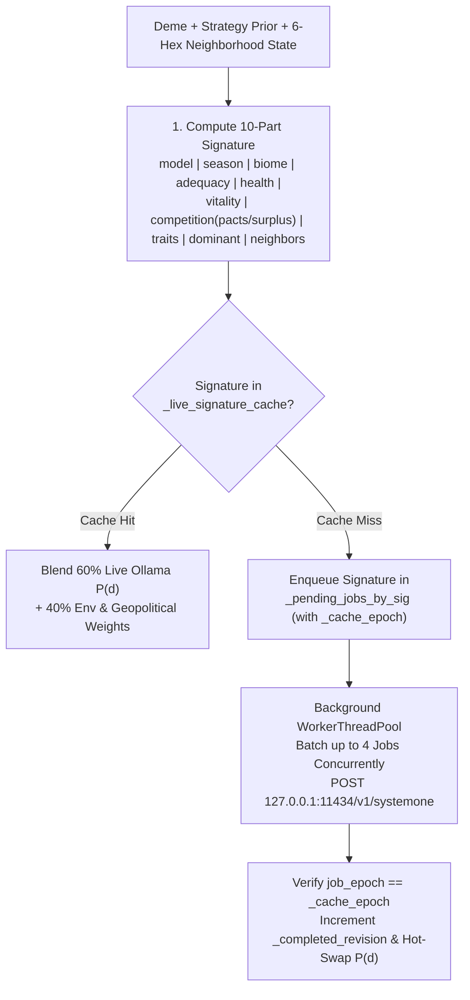

# Cognitive Engine & Multi-Model Ollama AI

**Evolution** features a non-blocking, dual-model **System 1 Cognitive Architecture** (`EvoDecisionModel`, `EvoOllamaClient`, `EvoHeuristicScorer`) that evaluates each subpopulation's ecological, energetic, and geopolitical neighborhood every generation.

Every subpopulation's behavioral decisions are evaluated by local **Ollama System 1 decision models** (`d3:4b` and `tev1:4b`) and blended ($60\%$ neural model probability / $40\%$ environmental & geopolitical pressure via `blend_with_environmental_weights`) so that inherited strategy traits, habitat scarcity, active alliances, and rival borders dynamically shape behavior. To guarantee smooth 60 FPS rendering and instant UI responsiveness, the cognitive engine combines **deterministic deme-to-model routing**, **10-part ecological state signature caching**, **epoch-guarded thread safety (`_cache_epoch`)**, and **background worker thread batching**.

---

## Architecture Overview



---

## Dual-Model System 1 Routing (`d3:4b` & `tev1:4b`)

Rather than evaluating every deme with a single monolithic prompt, **Evolution** distributes subpopulations deterministically across two specialized System 1 decision models configured in `EvoUserSettings` (`~/.config/Evolution/settings.json`):

* **Primary Decision Model (`DEFAULT_PRIMARY_MODEL = "d3:4b"`)**: Tactical & instinctive ecological evaluator (assigned to Strategy A founders and their descendants).
* **Secondary Decision Model (`DEFAULT_SECONDARY_MODEL = "tev1:4b"`)**: Strategic & rival socio-ecological evaluator (assigned to Strategy B founders and their descendants).
* **Default Context Window (`DEFAULT_CONTEXT_LENGTH = 8192`)**: Configurable directly from the in-game Settings popup (`num_ctx`).

### Deterministic Deme Assignment (`resolve_deme_decision_model_tag`)
1. **Lineage & Settlement Continuity**:
   * Any daughter settlement budded via migration (`-m<gen>`) or founded via territorial conquest (`-w<gen>`) first strips its suffix so it inherits the exact model tag of its parent founder deme.
2. **Initial Preset Subpopulations**:
   * Assigned to **Primary (`d3:4b`)**: `deme-rift-west`, `deme-darwin-founder`, `deme-island-1`, `deme-island-3`.
   * Assigned to **Secondary (`tev1:4b`)**: `deme-rift-east`, `deme-darwin-rival`, `deme-island-2`.
3. **Other / Custom Demes**:
   * Routed deterministically via a 31-bit polynomial rolling hash over `base_id`:
     $$h(\text{id}) = \left(\sum_{i=0}^{n-1} \text{id}[i] \cdot 31^{n-1-i}\right) \ \& \ \text{0x7FFFFFFF}$$
   * Even hash ($h \bmod 2 == 0$) maps to `primary_model` (`d3:4b`); odd hash ($h \bmod 2 == 1$) maps to `secondary_model` (`tev1:4b`).
4. **Graceful Single-Model Fallback**: If only one of the two configured decision models is installed in Ollama, `EvoOllamaClient._resolve_ollama_model_for_tag` automatically routes all live requests to the ready model.

---

## 10-Part Ecological State Signature (`compute_deme_evaluation_signature`)

Subpopulations experiencing identical ecological, demographic, and geopolitical conditions share a canonical **10-part pipe-delimited signature** (`heuristic_scorer.gd:437-554`), preventing redundant LLM evaluations across turns and across parallel demes:

$$\text{sig} = \texttt{model} \mid \texttt{season} \mid \texttt{biome} \mid \texttt{adequacy} \mid \texttt{health} \mid \texttt{vitality} \mid \texttt{competition} \mid \texttt{traits} \mid \texttt{dominant} \mid \texttt{neighbors}$$

| Segment # | Component Key | Formula / Bucket Definition | Purpose |
| :---: | :--- | :--- | :--- |
| **1** | `model_key` | `deme.decision_model_tag` (`d3:4b` or `tev1:4b`) | Separates cache entries by assigned cognitive model. |
| **2** | `season` | `"wet_warm"` or `"dry_cold"` | Captures seasonal regeneration multiplier ($\gamma = 1.20$ vs $0.75$). |
| **3** | `biome` | `current_cell.biome` | Captures local habitat class (`tropical_forest`, `savanna`, etc.). |
| **4** | `adequacy_bucket` | $\min\big(6,\ \lfloor \text{adequacy\_ratio} \times 2.0 \rfloor\big)$ where $\text{adequacy\_ratio} = \dfrac{R_{\text{cell}}}{\max(10.0,\ 0.48 \cdot P_{\text{cell\_total}})}$ | Quantizes local food abundance relative to total hex population into 7 tiers (`0..6`). |
| **5** | `health_bucket` | $\lfloor (K_{\text{cell}} / \max(1.0, K_{\max})) \times 4.0 \rfloor$ | Quantizes ecological carrying capacity health $K / K_{\max}$ into 5 tiers (`0..4`). |
| **6** | `vitality` | `"starving"`, `"declining"`, `"stable"`, `"thriving"`, or `"extinct"` | Unified vital status based on `energy_reserves` and `last_energy_delta`. |
| **7** | `competition_key` | `"%d:%d:%s:%d:p%d:s%d" % [rival_count, kin_count, "viable" if pop >= 40 else "small", 1 if has_nearby_rival else 0, pact_count, surplus_flag]` | Captures intra-hex/adjacent rivals, fission viability, active Alliance Pacts (`p%d`), and rival wealth disparity (`s%d`). |
| **8** | `traits_key` | Sorted comma-joined `biological_trait_ids + cultural_trait_ids` with 5-axis biophysical vectors | Encodes exact genetic and cultural capabilities and custom Lab edits. |
| **9** | `dominant_key` | `"%s:%d:%d:%x" % [last_dominant_decision_id, baldwin_bucket, innov_bucket, dec_hash]` | Preserves behavioral momentum, Baldwin/innovation progress, and decision catalog state. |
| **10** | `neighbor_key` | Top 2 passable neighbors ranked by $R / \max(10, P)$: `"%s:%s:%d" % [biome, "empty"\|"occupied", round(R/100)]` | Summarizes adjacent dispersal and trade opportunities. |

---

## Live Ollama Inference Protocol & Environmental Blending (`EvoOllamaClient` & `EvoHeuristicScorer`)

### 1. Compact System 1 State Briefing, Strategy Priors & Geopolitics
When querying Ollama (`POST http://127.0.0.1:11434/v1/systemone`), `EvoHeuristicScorer.build_compact_system_one_state` constructs a structured JSON payload containing:

* **`state`**: A dense 4-line biophysical and neighborhood summary:
  ```text
  Gen 6 (wet_warm) | Hex 2,-1 (arid_steppe): resources=260/335 (health=88% of Kmax=380), caloricAdequacy=3.87x, temp=+0.60, hum=0.30, alt=0.42
  Deme "Eastern Savanna Hominids": pop=140 (thriving), reserves=180, delta=+8 | CellCompetition: totalPop=140, cohabiting=0 (rivals=0, kin=0)
  Traits: K-Strategy[cost:+0.20,extract:+0.25,eco:+0.15,mobility:+0.05,cohesion:+0.40]; Instinctive Sociability[cost:+0.20,extract:+0.20,eco:+0.05,mobility:+0.10,cohesion:+0.60]
  lastDominant=dec-cooperate-store, baldwin=5/8, innovation=0.72/2.0 | Neighbors: 1,-1(savanna, res=260, pop=0, empty), 2,0(savanna, res=260, pop=0, empty)
  ```
* **`strategy_traits_prior`**: Normalized baseline decision probabilities computed from the deme's biological and cultural traits (`EvoCatalog.compute_baseline_decision_weights`).
* **`geopolitics`**: Real-time diplomatic and military context (`active_pacts`, `adjacent_rivals`, `neighbor_max_reserves`, `env_adequacy`).
* **`decisions`**: Eligible behavioral decisions and their 5-axis biophysical vectors.

### 2. Environmental & Geopolitical Weight Blending (`blend_with_environmental_weights`)
To ensure that live neural evaluations remain tightly grounded in biophysical reality, `EvoHeuristicScorer.blend_with_environmental_weights` combines **$60\%$ of the live Ollama model probability (`0.60 * m_prob`) with $40\%$ of the deterministic environmental & geopolitical weight (`0.40 * e_weight`)** computed by `compute_environmental_decision_weights`:

$$\tilde{p}(d) = 0.60 \cdot P_{\text{Ollama}}(d) + 0.40 \cdot P_{\text{env}}(d)$$

where $P_{\text{env}}(d)$ modulates the deme's trait-based prior according to caloric adequacy ($R / 0.48 P_{\text{cell}}$), carrying-capacity health ($K / K_{\max}$), vital status (`starving`, `declining`, `stable`, `thriving`), active formal pacts (`pact_count`), and adjacent rival wealth or threat.

### 3. Non-Blocking Worker Pool, Epoch-Guarded Cache & Prefetching
* **Concurrent HTTP Batching**: `_run_ollama_worker` runs on Godot's `WorkerThreadPool`, popping up to **4 pending signatures per batch** and polling non-blocking `HTTPClient` connections concurrently (`EVAL_TIMEOUT_MS = 60000` ms, `keep_alive = "30m"`).
* **Epoch-Guarded Cache Invalidation (`_cache_epoch`)**: Calling `clear_caches()` (e.g., when switching scenarios or resetting the world) increments `_cache_epoch` under `_mutex`; in-flight worker batches verify `job_epoch == _cache_epoch` before storing results in `_live_signature_cache`, preventing stale responses from earlier runs from polluting a new simulation.
* **Live Intra-Turn Hot-Swap**: Whenever a background batch completes, `_completed_revision` increments. On the very next frame (`_process`), `EvoMainController` calls `EvoDecisionModel.apply_completed_live_results`, immediately updating deme decision bars, justifications, and 2.5D village action structures without stalling UI rendering.
* **Post-Turn Prefetching (`prefetch_for_state`)**: At Stage 5 of every generation, the engine computes the next turn's signatures for all surviving demes and enqueues any uncached states ahead of time—so when playing at `1x` (`1.50s/gen`), live LLM scores are already cached before the next generation triggers. While any batch remains pending, automatic generational progression waits for the models to complete their evaluation.

---

## Decision Eligibility & Probability Normalization

### Decision Eligibility Rule (`is_decision_eligible`)
A decision `dec` is eligible if `dec.required_trait_ids.is_empty()` or the deme possesses **at least one** trait in `dec.required_trait_ids`. Specifically:

* **5 Base Decisions** (`dec-conservative-forage`, `dec-intensive-overexploit`, `dec-selective-migration`, `dec-cooperate-store`, `dec-territorial-dispute`) require no special traits (with `dec-territorial-dispute` filtered out when no rival lineage is present in the current or adjacent hexes).
* **`dec-exchange-symbiosis` and `dec-explore-innovate`** require cultural capacity (`bio-encephalization` OR `bio-social-instinct`).

### Probability Normalization (`normalize_decision_probabilities`)
Raw LLM probability scores returned by Ollama `/v1/systemone` are normalized via `EvoHeuristicScorer.normalize_decision_probabilities(raw_scores, eligible_ids)`:

1. Any non-positive, `NaN`, or infinite score for an eligible decision is clamped to $0.0$ (if all eligible scores are $\le 0$, uniform weights $1 / |\text{eligible}|$ are assigned).
2. The highest-scoring eligible decision $d_{\max}$ is identified as `dominant_decision_id`.
3. Every other eligible decision $d_i \neq d_{\max}$ is rounded to $4$ decimal places:
   $$p_i = \text{snapped}\left(\frac{s_i}{\sum_{j \in \text{eligible}} s_j},\ 0.0001\right)$$
4. The dominant decision receives the exact complement $p_{\max} = \text{snapped}\big(\max(0.0,\ 1.0 - \sum_{i \neq \max} p_i),\ 0.0001\big)$ (swapping with the runner-up if rounding caused the complement to dip below the runner-up), guaranteeing that $\sum_{d} P(d) = 1.0000$ and the dominant decision always holds the maximum probability.

---

## Startup Ollama Verification, Blocking Offline Notice & Model Download

When **Evolution** starts, `EvoDecisionModel.check_ollama_status(true)` asynchronously queries `GET http://127.0.0.1:11434/api/tags` to verify connectivity and inspect installed models advertising the `"decision"` capability in their `capabilities` array (`EvoOllamaClient.filter_decision_models_from_tags`).

* **Ollama Offline Blocking Popup (`show_ollama_offline_popup`)**:
  * If Ollama is offline or unreachable (`http://127.0.0.1:11434`), **Evolution** displays a full-screen blocking warning popup (`_missing_models_modal`) notifying the user that Ollama is offline and required to run the simulation.
  * While this popup is active, the simulation **cannot be started** (`Play` and `Step +1` controls are disabled and keyboard/map interactions are blocked).
  * Closing the popup (`Close application` button or pressing <kbd>Escape</kbd>) cleanly shuts down worker threads and **closes the application** (`get_tree().quit()`).
* **Missing Models Popup (`show_missing_models_popup`)**:
  * If Ollama is online but either `primary_model` (`d3:4b`) or `secondary_model` (`tev1:4b`) is missing locally, the blocking modal offers:
    * **Automatic In-Game Download (`⬇️ Download automatically`)**: Streams `POST /api/pull` on a background thread with a real-time 0–100% progress bar and unlocks the simulation upon completion.
    * **Close Application (`Close application` / <kbd>Escape</kbd>)**: Cancels any pending download and exits the application.
* **Custom Model Selection**: Open the **Settings Gear (`⚙️`)** in the top-right clock panel at any time to switch Primary and Secondary models among any installed decision-capable Ollama models, adjust `num_ctx` (default `8192`), and persist your configuration to `~/.config/Evolution/settings.json`.
