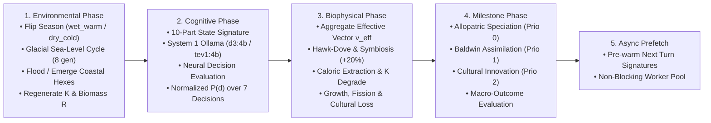

---
hide:
  - toc
---

<div class="hero-section">
  <div class="hero-eyebrow">
    <i class="fa-solid fa-dna" aria-hidden="true"></i>
    <span>Bio-Cultural &amp; Evolutionary Population Simulator</span>
  </div>
  <h1>Evolution</h1>
  <p class="hero-subtitle">
    An interactive bio-cultural and evolutionary population simulator built with Godot 4.7. Shape climates, terrain altitude, sea levels, carrying capacity ($K$), and genetic or cultural traits on a handcrafted 2.5D isometric hexagonal ecosystem—while local subpopulations (<em>demes</em>) autonomously adapt, migrate, cooperate, innovate, or diverge into new species.
  </p>
  <div class="hero-badges">
    <a href="https://github.com/arrase/Evolution/actions/workflows/ci.yml"></a>
    <a href="https://github.com/arrase/Evolution/actions/workflows/codeql.yml"></a>
    <a href="https://github.com/arrase/Evolution/actions/workflows/security.yml"></a>
    <a href="https://godotengine.org/"></a>
    <a href="https://ollama.com/"></a>
  </div>
</div>

<div class="section-header">
  <h2>Key Features</h2>
  <span>Authentic evolutionary biology meets local multi-model AI cognition</span>
</div>

<div class="projects-grid">
  <div class="feature-card">
    <div>
      <i class="fa-solid fa-scale-balanced feature-icon" aria-hidden="true"></i>
      <h3>6-Axis Thermodynamic Conservation</h3>
      <p>Every biological trait, cultural tradition, and behavioral decision maps to a bounded 6-axis biophysical vector where positive advantages above $A^+ = 0.60$ strictly require commensurate metabolic or ecological costs.</p>
    </div>
  </div>
  <div class="feature-card">
    <div>
      <i class="fa-solid fa-brain feature-icon" aria-hidden="true"></i>
      <h3>Dual-Model Cognitive Engine</h3>
      <p>Deterministically distributes subpopulations across primary (<code>d3:4b</code>) and secondary (<code>tev1:4b</code>) Ollama System 1 decision models via background worker threads.</p>
    </div>
  </div>
  <div class="feature-card">
    <div>
      <i class="fa-solid fa-frog feature-icon" aria-hidden="true"></i>
      <h3>Baldwin Effect &amp; Speciation</h3>
      <p>Sustained behavioral plasticity (8+ turns) assimilates into heritable biological traits, while geographic isolation across mountain ridges or flooded land bridges triggers allopatric speciation.</p>
    </div>
  </div>
  <div class="feature-card">
    <div>
      <i class="fa-solid fa-fire-flame-curved feature-icon" aria-hidden="true"></i>
      <h3>Dual Inheritance &amp; Culture</h3>
      <p>Lineages with <em>Encephalization</em> or <em>Instinctive Sociability</em> unlock cumulative cultural innovation, horizontal cultural transmission across trade routes, and demographic bottleneck loss.</p>
    </div>
  </div>
  <div class="feature-card">
    <div>
      <i class="fa-solid fa-chess-knight feature-icon" aria-hidden="true"></i>
      <h3>Evolutionary Game Theory</h3>
      <p>Cohabiting and neighboring demes navigate <em>Hawk-Dove</em> territorial disputes, reciprocal symbiosis ($+20\%$ caloric surplus), and the <em>Tragedy of the Commons</em> when $K &lt; 0.60 \cdot K_{\max}$.</p>
    </div>
  </div>
  <div class="feature-card">
    <div>
      <i class="fa-solid fa-wand-magic-sparkles feature-icon" aria-hidden="true"></i>
      <h3>God-Mode Selective Pressure</h3>
      <p>Wield a 10-slot brush dock to sculpt biomes, raise tectonic ridges, flood glacial archipelagos, enrich carrying capacity $K$, or forge and inject custom traits in the Evolutionary Laboratory.</p>
    </div>
  </div>
</div>

---

## Visual Tour & Screenshot Gallery


| Darwin's Archipelago (`preset-darwin-archipelago`) | The Finite Island (`preset-finite-island`) |
| :---: | :---: |
|  |  |
| *Volcanic islands linked by shallow coastal land bridges (`coastal_shallows`) that flood and emerge every 8 generations during glacial sea-level cycles* | *Three competing tool-wielding clans on a bounded island viewed through the Ecological Health Lens ($K / K_{\max}$) with the Valley Legend open* |

| Naturalist's Notebook (Chronicle) | Phylo-Cultural Lineage Tree | Trait & Decision Forge (Lab) |
| :---: | :---: | :---: |
|  |  |  |
| *Chronological log of speciation, Baldwin assimilation, cultural innovation, symbiosis, and extinctions with 1-click hex jump* | *Interactive phylogenetic hierarchy tracking ancestral and diverged lineages, traits, and active village counts* | *Live 6-axis catalog editor with a real-time Thermodynamic Balance Meter and direct village trait injection* |

---

## How the Generational Loop Works

Unlike traditional strategy games where players issue unit-level movement orders, **Evolution** strictly separates **behavioral intent** (probabilistic decision-making per deme) from **biophysical consequence** (deterministic laws of energy conservation, carrying capacity $K$, metabolic expenditure, and demography):



1. **Environmental Phase (`EvoEnvPhase`)**: Advances the generation counter, alternates seasonal climate between `wet_warm` ($\gamma = 1.20$) and `dry_cold` ($\gamma = 0.75$), oscillates sea level every 8 generations in glacial scenarios, relocates or drowns submerged demes, and regenerates hex carrying capacity $K$ and resources $R$.
2. **Cognitive Decision Phase (`EvoDecisionModel`)**: Evaluates each deme and its 6-hex neighborhood across the **7 behavioral decisions**, routing demes deterministically between primary (`d3:4b`) and secondary (`tev1:4b`) Ollama System 1 decision models.
3. **Biophysical Consequence Phase (`EvoBiophysPhase`)**: Computes each deme's effective 6-axis vector $\mathbf{v}_{\text{eff}}$, resolves *Hawk-Dove* territorial conflicts, reciprocal symbiosis ($+20\%$ caloric bonus and horizontal cultural transmission), habitat degradation (*Tragedy of the Commons* when $K < 0.60 \cdot K_{\max}$), metabolic expenditure, demographic growth/starvation, population fission (budding migration), compatible kin merging, and demographic bottleneck cultural loss.
4. **Milestone & Macro-Outcome Phase (`EvoMilestonePhase`)**: Synthesizes thermodynamically balanced emergent traits for *Allopatric Speciation*, *The Baldwin Effect*, or *Cumulative Cultural Innovation*, logs entries to the *Naturalist's Notebook*, and checks global macro-outcomes (*Total Extinction*, *Evolutionary Hegemony*, or *Ecological Equilibrium*).

---

## Quick Start & Installation

### Prerequisites

1. **Godot Engine 4.7+** (`4.7.2-stable` recommended).
2. **[Ollama](https://ollama.com/)** *(Required)* running locally at `http://127.0.0.1:11434` for System 1 cognitive decision scoring:
   ```bash
   # Pull the default primary and secondary System 1 decision models
   ollama pull d3:4b
   ollama pull tev1:4b
   ```
   *(Ollama is mandatory because Evolution focuses exclusively on studying neural decision-model behavior. If Ollama is offline at startup, a blocking warning modal prevents the simulation from starting and closes the application when dismissed. If Ollama is online but the configured models are missing, the modal offers automatic model download or exits on close).*

### Running & Testing

=== "Launch Interactive Simulator"

    ```bash
    # Clone the repository
    git clone https://github.com/arrase/Evolution.git
    cd Evolution

    # Import project assets and launch the simulator
    godot --path .
    ```

=== "Run Automated Test Suite"

    ```bash
    # Execute the headless unit, biophysical, and UI test runner
    godot --headless --path . --script res://tests/test_runner.gd
    ```

=== "Regenerate Screenshots"

    ```bash
    # Capture all 7 English documentation screenshots into gh-pages/assets/img/
    godot --path . --script res://tests/test_visual_capture.gd
    ```

---

## Controls & God-Mode Hotbar Reference

| Input / Shortcut | Slot / Control | Cost (⚡) | Effect in Simulation |
| :--- | :--- | :---: | :--- |
| <kbd>1</kbd> / **Left Click** | **Naturalist's Loupe (`inspect`)** | `0` | Select a village or hexagon to inspect its demography, relations, traits, and 6-axis profile in the Scroll Inspector. |
| <kbd>2</kbd> | **Jungle Seeds (`tropical_forest`)** | `10` | Transform target hexes into `tropical_forest` ($K_{\max} = 600$, `regen = 0.28`, $T = 0.45$, $H = 0.85$). |
| <kbd>3</kbd> | **Savanna Seeds (`savanna`)** | `10` | Transform target hexes into `savanna` ($K_{\max} = 420$, `regen = 0.18`, $T = 0.50$, $H = 0.40$). |
| <kbd>4</kbd> | **Desert Dust (`arid_steppe`)** | `10` | Transform target hexes into `arid_steppe` ($K_{\max} = 280$, `regen = 0.12`, $T = 0.65$, $H = 0.20$). |
| <kbd>5</kbd> | **Boreal Crystal (`tundra`)** | `10` | Transform target hexes into `tundra` ($K_{\max} = 240$, `regen = 0.10`, $T = -0.55$, $H = 0.35$). |
| <kbd>6</kbd> | **Peak Chisel (`raise`, `+0.18`)** | `15` | Elevate terrain altitude by $+0.18$; emerges ocean hexes into coastal land bridges or uplifts `high_mountain` ($\ge 0.78$). |
| <kbd>7</kbd> | **Valley Pickaxe (`lower`, `-0.18`)** | `15` | Depress terrain altitude by $-0.18$; submerges hexes below `sea_level` into `ocean` and displaces resident demes. |
| <kbd>8</kbd> | **Golden Watering Can (`enrich`)** | `10` | Boost hex carrying capacity $K$ by $+25\%$ (up to $K_{\max}$) and replenish available biomass $R$. |
| <kbd>9</kbd> | **Drought Sickle (`deplete`)** | `10` | Reduce hex carrying capacity $K$ and available biomass $R$ by $-25\%$ (inducing ecological stress). |
| <kbd>0</kbd> | **Tidal Conch (`sea_level`)** | `25` / `10` | Open the Tidal Sub-Options Bar: adjust global `sea_level` by $\pm 5\%$ (`⚡25`) or paint `coastal_shallows`, `ocean`, and `high_mountain` (`⚡10`). |
| <kbd>Space</kbd> | **Play / Pause** | — | Toggle automatic generational progression (`1x` = `1.50s/gen` or `2x` = `0.30s/gen`). |
| <kbd>W</kbd><kbd>A</kbd><kbd>S</kbd><kbd>D</kbd> / **Middle Drag** | **Pan Camera** | — | Smoothly pan across the 2.5D isometric hexagonal valley (`820 px/s`). |
| <kbd>Q</kbd><kbd>E</kbd> / <kbd>R</kbd><kbd>F</kbd> / **Right Drag** | **Orbit &amp; Tilt Camera** | — | Orbit yaw ($0^\circ\text{–}360^\circ$) and tilt pitch ($28^\circ\text{–}75^\circ$) around the valley. |
| <kbd>Mouse Wheel</kbd> / <kbd>+</kbd><kbd>-</kbd> | **Zoom Camera** | — | Cursor-pivoted zoom between `0.28x` macro overview and `3.00x` settlement close-up. |
| <kbd>Escape</kbd> | **Close / Reset** | — | Close active modal/popup window or return active brush to `Naturalist's Loupe` (<kbd>1</kbd>). |

---

<div class="section-header">
  <h2>Documentation</h2>
  <span>Deep-dive into worlds, 6-axis thermodynamics, turn mechanics, cognitive AI &amp; architecture</span>
</div>

<div class="projects-grid">
  <a href="worlds_biomes/" class="feature-card">
    <div>
      <div class="card-top">
        <i class="fa-solid fa-earth-africa feature-icon" aria-hidden="true"></i>
        <span class="card-badge">Read →</span>
      </div>
      <h3>Worlds, Biomes &amp; Presets</h3>
      <p>Complete breakdown of axial hex geometry, the 7 biomes, seasonal &amp; glacial cycles, and the 3 scientific scenarios (<em>Rift Valley</em>, <em>Darwin's Archipelago</em>, <em>Finite Island</em>).</p>
    </div>
  </a>
  <a href="thermodynamics_catalog/" class="feature-card">
    <div>
      <div class="card-top">
        <i class="fa-solid fa-scale-balanced feature-icon" aria-hidden="true"></i>
        <span class="card-badge">Read →</span>
      </div>
      <h3>6-Axis Thermodynamics &amp; Catalog</h3>
      <p>Mathematical laws of the 6-axis biophysical vector, auto-balancing equations, and complete reference tables for all biological traits, cultural traditions, and decisions.</p>
    </div>
  </a>
  <a href="turn_iterations_mechanics/" class="feature-card">
    <div>
      <div class="card-top">
        <i class="fa-solid fa-arrows-spin feature-icon" aria-hidden="true"></i>
        <span class="card-badge">Read →</span>
      </div>
      <h3>Generational Loop &amp; Dynamics</h3>
      <p>Step-by-step equations for every turn phase: Hawk-Dove game theory, symbiosis, $K$ degradation, demography, fission migration, Baldwin assimilation, and speciation.</p>
    </div>
  </a>
  <a href="cognitive_engine/" class="feature-card">
    <div>
      <div class="card-top">
        <i class="fa-solid fa-microchip feature-icon" aria-hidden="true"></i>
        <span class="card-badge">Read →</span>
      </div>
      <h3>Cognitive Engine &amp; Ollama AI</h3>
      <p>System 1 multi-model routing (<code>d3:4b</code> &amp; <code>tev1:4b</code>), 10-part state signatures, compact 4-line state briefings, worker pools, and startup verification.</p>
    </div>
  </a>
  <a href="ui_tools_controls/" class="feature-card">
    <div>
      <div class="card-top">
        <i class="fa-solid fa-compass-drafting feature-icon" aria-hidden="true"></i>
        <span class="card-badge">Read →</span>
      </div>
      <h3>HUD, Modals &amp; God-Mode Tools</h3>
      <p>Master the Scroll Inspector, Map Lenses, Valley Legend, Naturalist's Notebook, Phylo-Cultural Lineage Tree, Trait &amp; Decision Forge, and God-mode brushes.</p>
    </div>
  </a>
  <a href="architecture_developer/" class="feature-card">
    <div>
      <div class="card-top">
        <i class="fa-solid fa-code feature-icon" aria-hidden="true"></i>
        <span class="card-badge">Read →</span>
      </div>
      <h3>System Architecture &amp; Developer Guide</h3>
      <p>2.5D isometric hex rendering pipeline, procedural pixel-art generators, organic road network lifecycle, i18n, automated test suite, and CI/CD workflows.</p>
    </div>
  </a>
</div>
