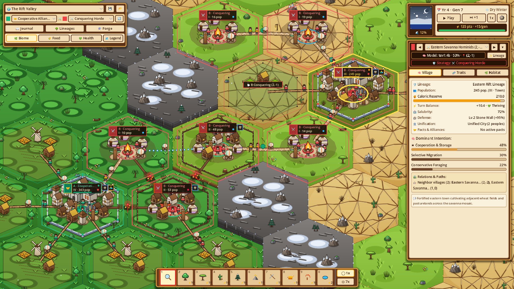
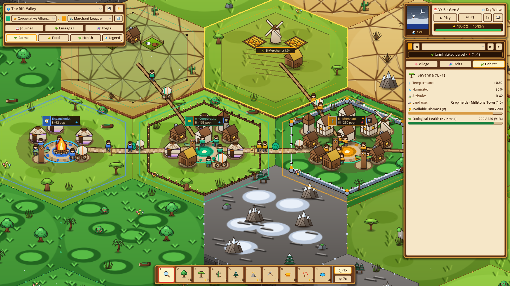
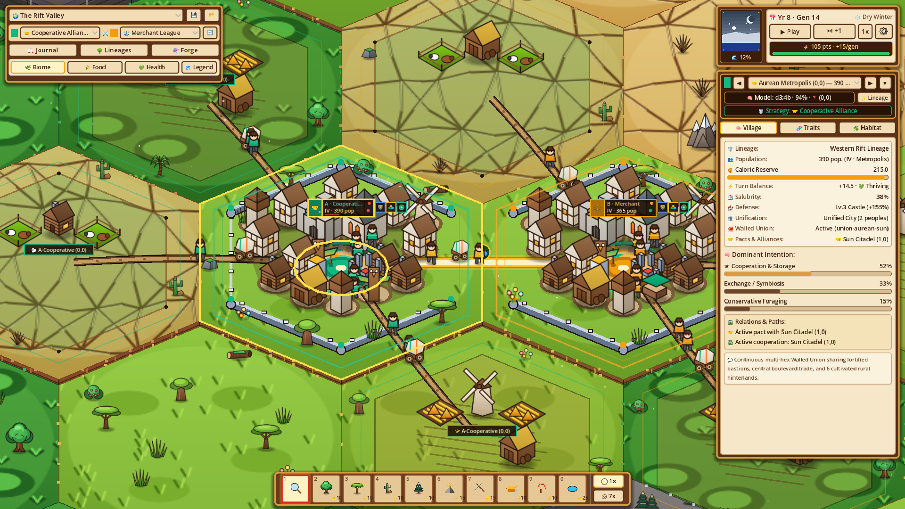
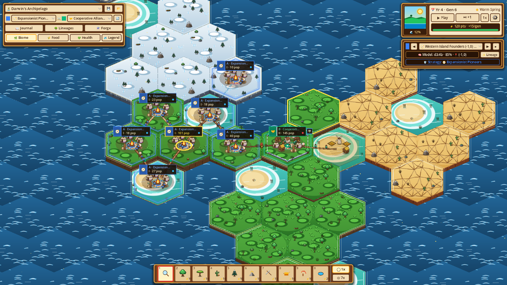
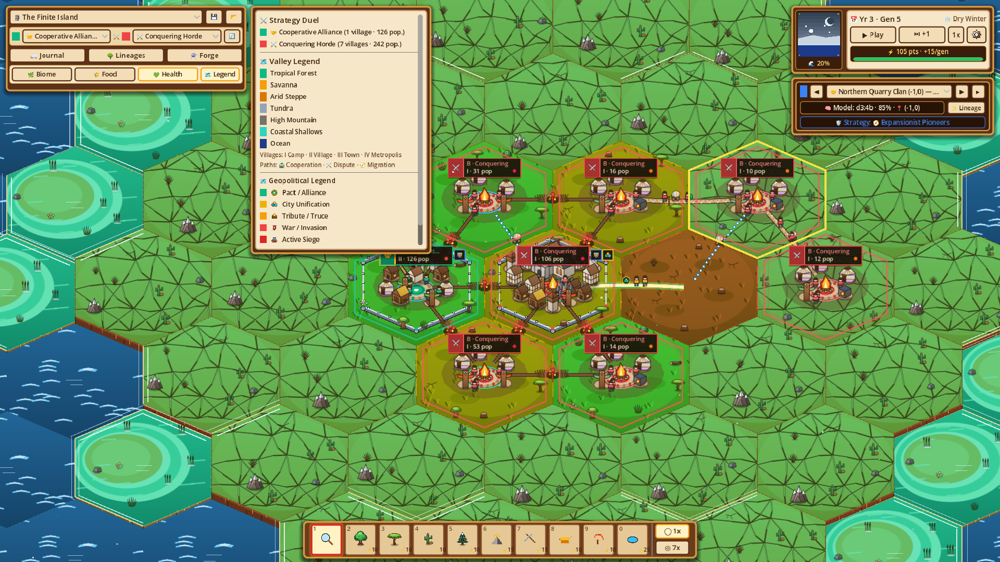
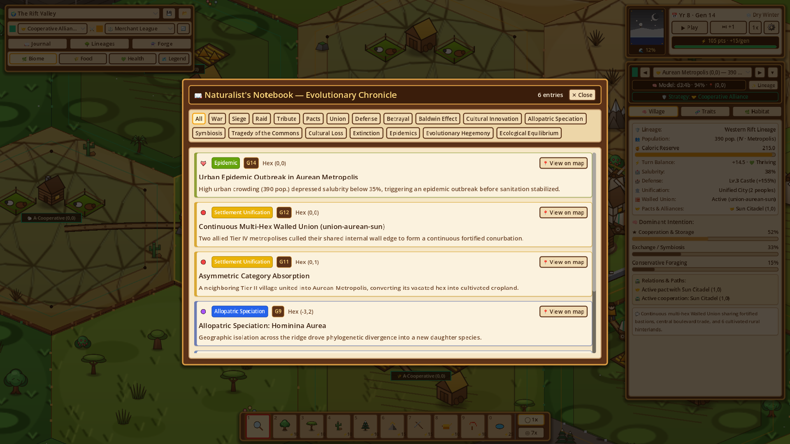
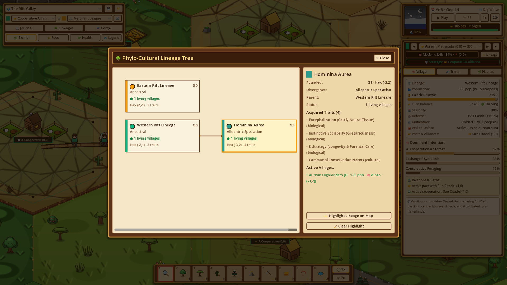
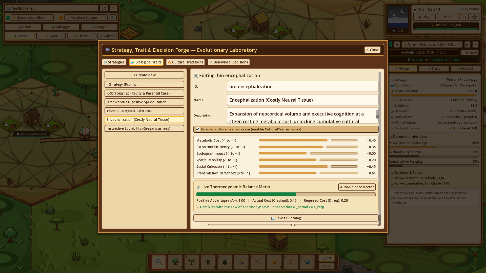
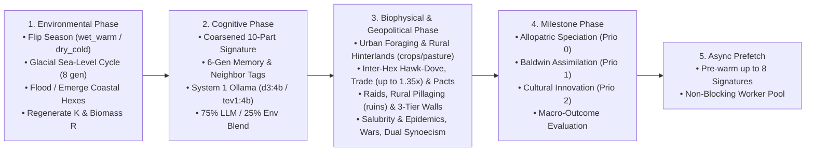

---
hide:
  - toc
---

<div class="hero-section">
  <div class="hero-eyebrow">
    <i class="fa-solid fa-dna" aria-hidden="true"></i>
    <span>Bio-Cultural &amp; Evolutionary Population Simulator</span>
  </div>
  <h1>Evolution</h1>
  <p class="hero-subtitle">
    An interactive bio-cultural and evolutionary population simulator built with Godot 4.7. Configure <strong>1v1 Evolutionary Strategy Duels (<code>Strategy A ⚔️ Strategy B</code>)</strong>, forge custom strategies and traits, and shape climates, terrain altitude, sea levels, and carrying capacity ($K$) across a <strong><code>169</code>-hex (<code>map_radius = 7</code>) high-DPI 2.5D illustrated hexagonal ecosystem</strong> powered by GPU shaders—while single-deme-per-hex subpopulations (<em>demes</em>) autonomously adapt, cultivate adjacent rural hinterlands (<code>crops</code> &amp; <code>pasture</code>), manage urban salubrity, erect hex-edge perimeter walls, unite into continuous multi-hex walled conurbations (<code>walled_union_id</code>), innovate, or diverge into new species.
  </p>
  <div class="hero-badges">
    <a href="https://github.com/arrase/Evolution/actions/workflows/ci.yml"></a>
    <a href="https://github.com/arrase/Evolution/actions/workflows/codeql.yml"></a>
    <a href="https://github.com/arrase/Evolution/actions/workflows/security.yml"></a>
    <a href="https://godotengine.org/"></a>
    <a href="https://ollama.com/"></a>
  </div>
</div>

<div class="section-header">
  <h2>Key Features</h2>
  <span>Authentic evolutionary biology meets local multi-model AI cognition &amp; 2.5D illustrated urban ecology</span>
</div>

<div class="projects-grid">
  <div class="feature-card">
    <div>
      <i class="fa-solid fa-shield-halved feature-icon" aria-hidden="true"></i>
      <h3>1v1 Evolutionary Strategy Duels</h3>
      <p>Before pressing Play at Generation 0, pit any two evolutionary strategies (<code>Strategy A ⚔️ Strategy B</code>) against each other across a <code>169</code>-hex world—or craft custom strategies in the Forge and persist them to <code>~/.config/Evolution/user_catalog.json</code>.</p>
    </div>
  </div>
  <div class="feature-card">
    <div>
      <i class="fa-solid fa-scale-balanced feature-icon" aria-hidden="true"></i>
      <h3>6-Axis Thermodynamic Conservation</h3>
      <p>Every biological trait, cultural tradition, and behavioral decision maps to a bounded 6-axis biophysical vector where positive advantages above $A^+ = 0.60$ strictly require commensurate metabolic or ecological costs.</p>
    </div>
  </div>
  <div class="feature-card">
    <div>
      <i class="fa-solid fa-brain feature-icon" aria-hidden="true"></i>
      <h3>Dual-Model Cognitive Engine &amp; Memory</h3>
      <p>Deterministically distributes rival factions across primary (<code>d3:4b</code>) and secondary (<code>tev1:4b</code>) Ollama System 1 models with a 6-generation historical memory digest, rich neighbor relational tags, and $75\%/25\%$ environmental blending.</p>
    </div>
  </div>
  <div class="feature-card">
    <div>
      <i class="fa-solid fa-wheat-awn feature-icon" aria-hidden="true"></i>
      <h3>4-Tier Urbanism, Hinterlands &amp; Salubrity</h3>
      <p>Single-deme-per-hex settlements progress across 4 urban tiers (<code>I · Camp</code> to <code>IV · Metropolis</code>), cultivating up to 1, 2, or 4 adjacent rural hexes as <code>crops</code> or <code>pasture</code> while balancing urban crowding, <code>salubrity</code>, and epidemics.</p>
    </div>
  </div>
  <div class="feature-card">
    <div>
      <i class="fa-solid fa-chess-rook feature-icon" aria-hidden="true"></i>
      <h3>Perimeter Walls &amp; Dual Synoecism</h3>
      <p>Settlements erect 3-tier hex-edge fortifications, absorb lower-tier allies into rural hinterlands (<em>Asymmetric Category Absorption</em>), or unite same-tier cities into <strong>Continuous Multi-Hex Walled Unions (<code>walled_union_id</code>)</strong> with culled internal walls.</p>
    </div>
  </div>
  <div class="feature-card">
    <div>
      <i class="fa-solid fa-wand-magic-sparkles feature-icon" aria-hidden="true"></i>
      <h3>2.5D Illustrated Shaders &amp; God-Mode Tools</h3>
      <p>High-DPI <code>256x224</code> tiles and <code>128x128</code>–<code>160x160</code> sprites with <code>#23150c</code> ink outlines, GPU ocean &amp; foliage shaders, and a 10-slot brush dock to sculpt biomes, altitude, sea levels, and carrying capacity $K$.</p>
    </div>
  </div>
</div>

---

## 1v1 Evolutionary Strategy Duels (`Strategy A ⚔️ Strategy B`)

At Generation 0, every scenario sets up a head-to-head evolutionary experiment between **Strategy A** (Founding Lineage A) and **Strategy B** (Founding Lineage B). Use the top HUD matchup bar (`[Strategy A] ⚔️ [Strategy B] [🔄]`) to select from the **5 Default Archetypal Strategies**—or design custom strategies in the `🛡️ Strategies` tab of the **Evolutionary Laboratory** (saved automatically to `~/.config/Evolution/user_catalog.json` alongside custom traits and decisions):

| Strategy ID | Emblem & Name (EN / ES) | Hex Color | Included Traits (`biological_trait_ids` + `cultural_trait_ids`) | Evolutionary Philosophy |
| :--- | :--- | :---: | :--- | :--- |
| `strat-cooperation` | 🤝 **Cooperative Alliance**<br>*Alianza Cooperativa* | `#10B981` | `bio-k-strategy`, `bio-social-instinct` + `cul-communal-conservation` | Fosters social cohesion, communal habitat conservation, urban sanitation, and resource buffering. |
| `strat-expansion` | 🧭 **Expansionist Pioneers**<br>*Pioneros Expansionistas* | `#3B82F6` | `bio-r-strategy`, `bio-thermal-tolerance`, `bio-social-instinct` + `cul-fire-processing` | Fast reproduction, high mobility, and thermal tolerance to colonize new territories. |
| `strat-trade` | ⚖️ **Merchant League**<br>*Liga Mercantil* | `#F59E0B` | `bio-k-strategy`, `bio-encephalization` + `cul-interdeme-barter` | Drives inter-village barter, commercial symbiosis, and horizontal cultural diffusion. |
| `strat-war` | ⚔️ **Conquering Horde**<br>*Horda Conquistadora* | `#EF4444` | `bio-r-strategy`, `bio-social-instinct` + `cul-warrior-expansion`, `cul-extraction-tools` | Aggressive martial expansion, rural hinterland pillaging, and intensive extraction to dominate rival territories. |
| `strat-innovation` | 🔬 **Innovator Technocrats**<br>*Tecnócratas Innovadores* | `#A855F7` | `bio-encephalization`, `bio-digestive-spec` + `cul-fire-processing`, `cul-extraction-tools` | High encephalization, thermal food processing, and specialized extraction toolkits. |

---

## Visual Tour & 1v1 Scenario Gallery


*The Rift Valley (`preset-rift-savanna`, `169` hexes, `map_radius = 7`): Western Forest Hominids (`(-2, 1)`, Strategy A) vs. Eastern Savanna Hominids (`(2, -1)`, Strategy B) separated by a high-mountain tectonic ridge (`q = 0`), with the Scroll Inspector displaying urban salubrity, stone wall fortifications, and rural hinterlands.*

| Settlement Tiers I–III & Rural Hinterlands | Continuous Multi-Hex Walled Union (`Tier IV`) |
| :---: | :---: |
|  |  |
| *Close-up of 1-deme-per-hex progression: Tier I `Camp` (`-1,0`), Tier II `Village` (`0,0`, Lv.1 Palisade + pasture at `0,-1`), and Tier III `Town` (`1,0`, Lv.2 Stone Wall + golden wheat `crops` at `1,-1` & `pasture` at `2,0` linked by `covered_wagon` farm tracks)* | *Two allied Tier IV Metropolises (`(0,0)` & `(1,0)`) united in a Continuous Multi-Hex Walled Union (`walled_union_id`) with their shared internal wall edge culled, a central union boulevard, and 6 surrounding rural hinterlands* |

| Darwin's Archipelago (`preset-darwin-archipelago`) | The Finite Island (`preset-finite-island`) |
| :---: | :---: |
|  |  |
| *169-hex volcanic archipelago with GPU ocean waves (`ocean_waves.gdshader`), multi-ring coastal foam, 2.5D island cliffs, and 7 tidal `coastal_shallows` land bridges that flood and emerge every 8 generations* | *169-hex bounded island duel between Northern Quarry Clan (`(-1, 0)`, Strategy A) and Southern Timber Clan (`(1, 0)`, Strategy B) viewed through the Ecological Health Lens ($K / K_{\max}$) with the Valley Legend open* |

| Naturalist's Notebook (Chronicle) | Phylo-Cultural Lineage Tree | Strategy, Trait & Decision Forge (Lab) |
| :---: | :---: | :---: |
|  |  |  |
| *19-filter chronological log of urban epidemics, multi-hex walled unions, category absorptions, speciation, Baldwin assimilation, and wars with 1-click hex jump* | *Interactive phylogenetic hierarchy tracking ancestral and diverged lineages, strategy emblems, traits, and active settlement counts (`I–IV`)* | *4-tab catalog editor (`🛡️`, `🧬`, `🔥`, `⚖️`) with live Thermodynamic Balance Meter, strategy builder, and `~/.config/Evolution/user_catalog.json` persistence* |

---

## How the Generational Loop Works

Unlike traditional strategy games where players issue unit-level movement orders, **Evolution** strictly separates **behavioral intent** (probabilistic decision-making per deme) from **biophysical consequence** (deterministic laws of energy conservation, carrying capacity $K$, rural hinterland cultivation, urban salubrity, and demography):



1. **Environmental Phase (`EvoEnvPhase`)**: Advances the generation counter, alternates seasonal climate between `wet_warm` ($\gamma = 1.20$) and `dry_cold` ($\gamma = 0.75$), oscillates sea level every 8 generations in glacial scenarios, relocates submerged demes to empty passable neighbor hexes (or drowns them into `has_ruins = true`), and regenerates hex carrying capacity $K$ and resources $R$.
2. **Cognitive Decision Phase (`EvoDecisionModel`)**: Evaluates each deme via `/v1/systemone` with its intrinsic strategy traits prior (`strategy_traits_prior`), a **6-generation historical memory digest** (`war`, `raided`, `betrayal`, `pact`, `fortify`, `merge`, `tribute`, `siege`), active vendetta count, nearby martial horde detection (1–2 hexes), and **rich neighbor relational labels** (`kin`, `ally`, `rival`, `vendetta` + posture + strength + defense tier)—routing rival factions deterministically between primary (`d3:4b`) and secondary (`tev1:4b`) Ollama System 1 models and blending neural predictions (**$75\%$**) with environmental and geopolitical weights (**$25\%$**).
3. **Biophysical, Urban & Geopolitical Consequence Phase (`EvoBiophysPhase`)**: Computes each deme's effective 6-axis vector $\mathbf{v}_{\text{eff}}$, applies urban wild-foraging multipliers (`0.55` at Tier III, `0.30` at Tier IV), claims and harvests **adjacent rural hinterlands (`crops` and `pasture`, up to `1`/`2`/`4` hexes for Tier II/III/IV)**, resolves inter-hex *Hawk-Dove* conflicts, reciprocal symbiosis and **complementary inter-biome/cross-cultural trade** (up to $1.35\times$), **Alliance Pacts & Defensive Coalitions**, **Opportunistic Betrayals & Multi-Turn Vendettas**, **Plunder Raids (with rural hinterland pillaging into `has_ruins = true`) & Tribute Appeasement**, **Hex-Edge Perimeter Fortifications** (`defense_tier: 0..3`), habitat degradation (*Tragedy of the Commons*), metabolic expenditure & wall upkeep, **Urban Salubrity (`salubrity`) & Epidemic Outbreaks (`"epidemic"`)**, demographic growth, **Territorial Wars (with 1-deme-per-hex retreat/absorption & pooled union defense) & Fortified Sieges**, empty-hex colonist budding, and **Dual Synoecism** (*Asymmetric Category Absorption* converting vacated hexes to rural hinterlands, and *Continuous Multi-Hex Walled Unions* `walled_union_id` culling shared internal walls).
4. **Milestone & Macro-Outcome Phase (`EvoMilestonePhase`)**: Synthesizes thermodynamically balanced emergent traits for *Allopatric Speciation*, *The Baldwin Effect*, or *Cumulative Cultural Innovation*, logs entries to the *Naturalist's Notebook*, and checks global macro-outcomes (*Total Extinction*, *Evolutionary Hegemony*, or *Ecological Equilibrium*).

---

## Quick Start & Installation

### Prerequisites

1. **Godot Engine 4.7+** (`4.7.2-stable` recommended).
2. **[Ollama](https://ollama.com/)** *(Required)* running locally at `http://127.0.0.1:11434` for System 1 cognitive decision scoring:
   ```bash
   # Pull the default primary and secondary System 1 decision models
   ollama pull d3:4b
   ollama pull tev1:4b
   ```
   *(Ollama is mandatory because Evolution focuses exclusively on studying neural decision-model behavior. If Ollama is offline at startup, a blocking warning modal prevents the simulation from starting and closes the application when dismissed. If Ollama is online but the configured models are missing, the modal offers automatic model download or exits on close).*

### Running & Testing

=== "Launch Interactive Simulator"

    ```bash
    # Clone the repository
    git clone https://github.com/arrase/Evolution.git
    cd Evolution

    # Import project assets and launch the simulator
    godot --path .
    ```

=== "Run Automated Test Suite"

    ```bash
    # Execute the headless unit, biophysical, and UI test runner
    godot --headless --path . --script res://tests/test_runner.gd
    ```

=== "Regenerate Screenshots"

    ```bash
    # Capture all documentation screenshots into gh-pages/assets/img/
    godot --path . --script res://tests/test_visual_capture.gd
    ```

---

## Controls & God-Mode Hotbar Reference

| Input / Shortcut | Slot / Control | Cost (⚡) | Effect in Simulation |
| :--- | :--- | :---: | :--- |
| <kbd>1</kbd> / **Left Click** | **Naturalist's Loupe (`inspect`)** | `0` | Select a settlement or hexagon to inspect its demography, salubrity, rural hinterlands, walled union, relations, traits, and 6-axis profile in the Scroll Inspector. |
| <kbd>2</kbd> | **Jungle Seeds (`tropical_forest`)** | `10` | Transform target hexes into `tropical_forest` ($K_{\max} = 600$, `regen = 0.28`, $T = 0.45$, $H = 0.85$). |
| <kbd>3</kbd> | **Savanna Seeds (`savanna`)** | `10` | Transform target hexes into `savanna` ($K_{\max} = 420$, `regen = 0.18`, $T = 0.50$, $H = 0.40$). |
| <kbd>4</kbd> | **Desert Dust (`arid_steppe`)** | `10` | Transform target hexes into `arid_steppe` ($K_{\max} = 280$, `regen = 0.12`, $T = 0.65$, $H = 0.20$). |
| <kbd>5</kbd> | **Boreal Crystal (`tundra`)** | `10` | Transform target hexes into `tundra` ($K_{\max} = 240$, `regen = 0.10`, $T = -0.55$, $H = 0.35$). |
| <kbd>6</kbd> | **Peak Chisel (`raise`, `+0.18`)** | `15` | Elevate terrain altitude by $+0.18$; emerges ocean hexes into coastal land bridges or uplifts `high_mountain` ($\ge 0.78$). |
| <kbd>7</kbd> | **Valley Pickaxe (`lower`, `-0.18`)** | `15` | Depress terrain altitude by $-0.18$; submerges hexes below `sea_level` into `ocean` and displaces resident demes. |
| <kbd>8</kbd> | **Golden Watering Can (`enrich`)** | `10` | Boost hex carrying capacity $K$ by $+25\%$ (up to $K_{\max}$) and replenish available biomass $R$. |
| <kbd>9</kbd> | **Drought Sickle (`deplete`)** | `10` | Reduce hex carrying capacity $K$ and available biomass $R$ by $-25\%$ (inducing ecological stress). |
| <kbd>0</kbd> | **Tidal Conch (`sea_level`)** | `25` / `10` | Open the Tidal Sub-Options Bar: adjust global `sea_level` by $\pm 5\%$ (`⚡25`) or paint `coastal_shallows`, `ocean`, and `high_mountain` (`⚡10`). |
| <kbd>Space</kbd> | **Play / Pause** | — | Toggle automatic generational progression (`1x` = `1.50s/gen` or `2x` = `0.30s/gen`). |
| <kbd>W</kbd><kbd>A</kbd><kbd>S</kbd><kbd>D</kbd> / **Middle Drag** | **Pan Camera** | — | Smoothly pan across the `169`-hex 2.5D isometric hexagonal valley (`820 px/s`, `MAX_PAN_RADIUS = 2800.0`). |
| <kbd>R</kbd><kbd>F</kbd> / **Right Drag** | **Tilt Camera Pitch** | — | Tilt vertical pitch ($32^\circ\text{–}68^\circ$, default $48^\circ$) with horizontal yaw locked to $0^\circ$ so 2.5D illustrated facades remain oriented toward the viewer. |
| <kbd>Mouse Wheel</kbd> / <kbd>+</kbd><kbd>-</kbd> | **Zoom Camera** | — | Cursor-pivoted zoom between `0.18x` macro archipelago overview and `2.80x` settlement close-up. |
| <kbd>Escape</kbd> | **Close / Reset** | — | Close active modal/popup window or return active brush to `Naturalist's Loupe` (<kbd>1</kbd>). |

---

<div class="section-header">
  <h2>Documentation</h2>
  <span>Deep-dive into 169-hex worlds, 6-axis thermodynamics, urban hinterlands, dual synoecism, cognitive AI &amp; 2.5D shader architecture</span>
</div>

<div class="projects-grid">
  <a href="worlds_biomes/" class="feature-card">
    <div>
      <div class="card-top">
        <i class="fa-solid fa-earth-africa feature-icon" aria-hidden="true"></i>
        <span class="card-badge">Read →</span>
      </div>
      <h3>Worlds, Biomes &amp; Presets</h3>
      <p>Complete breakdown of <code>169</code>-hex axial geometry (<code>map_radius = 7</code>), 1-deme-per-hex exclusivity, the 7 biomes, glacial cycles, and the 3 scientific scenarios.</p>
    </div>
  </a>
  <a href="thermodynamics_catalog/" class="feature-card">
    <div>
      <div class="card-top">
        <i class="fa-solid fa-scale-balanced feature-icon" aria-hidden="true"></i>
        <span class="card-badge">Read →</span>
      </div>
      <h3>6-Axis Thermodynamics &amp; Catalog</h3>
      <p>Mathematical laws of the 6-axis biophysical vector, auto-balancing equations, and complete reference tables for all strategies, biological traits, cultural traditions, and decisions.</p>
    </div>
  </a>
  <a href="turn_iterations_mechanics/" class="feature-card">
    <div>
      <div class="card-top">
        <i class="fa-solid fa-arrows-spin feature-icon" aria-hidden="true"></i>
        <span class="card-badge">Read →</span>
      </div>
      <h3>Generational Loop &amp; Dynamics</h3>
      <p>Step-by-step equations for rural hinterlands (<code>crops</code>/<code>pasture</code>), pillaging (<code>has_ruins</code>), urban <code>salubrity</code> &amp; epidemics, 3-tier hex walls, and dual synoecism (<code>walled_union_id</code>).</p>
    </div>
  </a>
  <a href="cognitive_engine/" class="feature-card">
    <div>
      <div class="card-top">
        <i class="fa-solid fa-microchip feature-icon" aria-hidden="true"></i>
        <span class="card-badge">Read →</span>
      </div>
      <h3>Cognitive Engine &amp; Ollama AI</h3>
      <p>System 1 multi-model routing (<code>d3:4b</code> &amp; <code>tev1:4b</code>), 10-part state signatures, 6-generation historical memory, compact 4-line state briefings, and worker pools.</p>
    </div>
  </a>
  <a href="ui_tools_controls/" class="feature-card">
    <div>
      <div class="card-top">
        <i class="fa-solid fa-compass-drafting feature-icon" aria-hidden="true"></i>
        <span class="card-badge">Read →</span>
      </div>
      <h3>HUD, Modals &amp; God-Mode Tools</h3>
      <p>Master the Scroll Inspector (salubrity, walled unions &amp; rural land-use), Map Lenses, Valley Legend, 19-filter Naturalist's Notebook, Lineage Tree, and Forge.</p>
    </div>
  </a>
  <a href="architecture_developer/" class="feature-card">
    <div>
      <div class="card-top">
        <i class="fa-solid fa-code feature-icon" aria-hidden="true"></i>
        <span class="card-badge">Read →</span>
      </div>
      <h3>System Architecture &amp; Developer Guide</h3>
      <p>2.5D high-DPI illustrated rendering pipeline, GPU shaders, procedural <code>256x224</code> / <code>128x128</code>–<code>160x160</code> sprite cache, hex-edge perimeter walls, and automated test suite.</p>
    </div>
  </a>
</div>
