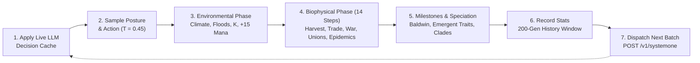

---
hide:
  - toc
---

<div class="hero-section">
  <div class="hero-eyebrow"><i class="fa-solid fa-dna"></i> Bio-Cultural Evolution Sandbox</div>
  <h1>Evolution</h1>
  <p class="hero-subtitle">A stochastic 2.5D hex-grid evolutionary sandbox built in Godot 4.7, uniting 6-axis thermodynamic constraints, multi-hex urban settlements, rural hinterlands, salubrity &amp; contagion dynamics, and dual-question Ollama <code>/v1/systemone</code> cognition.</p>
  <div class="hero-badges">
    
    
    
    
  </div>
</div>


*Initial **Rift Savanna** world rendered in the 2.5D angled-topdown projection with the top-center Strategy A vs. B KPI strip, 5 map-lens bar, bottom-left Live Chronicle Feed, and 10-slot god-mode hotbar.*

---

<div class="section-header">
  <h2>Core Simulation Pillars</h2>
  <span>Zero heuristic scoring &bull; Pure thermodynamic &amp; LLM agency</span>
</div>

<div class="projects-grid">

  <div class="feature-card">
    <i class="fa-solid fa-scale-balanced feature-icon"></i>
    <h3>Bio-Cultural Thermodynamics</h3>
    <p>Every biological and cultural trait projects onto a 6-axis behavioral-metabolic vector. <code>EvoPayoffs.vector()</code> sums active traits strictly clamped to <code>[-1.0, +1.0]</code> across five behavioral axes and <code>[0.0, 1.0]</code> metabolic cost, forcing structural trade-offs without artificial decision weights.</p>
    <div class="card-tags">
      <span class="card-tag">EvoThermodynamics</span>
      <span class="card-tag">6-Axis Vector</span>
      <span class="card-tag">BASE_BUDGET 0.60</span>
    </div>
  </div>

  <div class="feature-card">
    <i class="fa-solid fa-brain feature-icon"></i>
    <h3>Dual-Question Ollama Agency</h3>
    <p>Each living deme evaluates a quantitative <code>EvoSituationReport</code> via <code>POST /v1/systemone</code> in one simultaneous request covering both its rural defense <code>posture</code> and its generational <code>decision</code>, sampled at temperature <code>T = 0.45</code> with zero hardcoded fallback heuristics.</p>
    <div class="card-tags">
      <span class="card-tag">/v1/systemone</span>
      <span class="card-tag">d3:4b / tev1:4b</span>
      <span class="card-tag">WorkerThreadPool</span>
    </div>
  </div>

  <div class="feature-card">
    <i class="fa-solid fa-city feature-icon"></i>
    <h3>Districts, Tiers &amp; Hinterlands</h3>
    <p>Settlements evolve from Tier <code>I</code> bands into Tier <code>IV</code> fortresses, claim up to quota-scaled <code>crops</code> and <code>pasture</code> rural hinterlands, toggle rural defense postures, and fuse peacefully into connected multi-hex <strong>Walled Unions</strong> (up to <code>3</code> urban districts).</p>
    <div class="card-tags">
      <span class="card-tag">urban_hex_ids</span>
      <span class="card-tag">Tier I&ndash;IV</span>
      <span class="card-tag">Defense Postures</span>
    </div>
  </div>

  <div class="feature-card">
    <i class="fa-solid fa-handshake feature-icon"></i>
    <h3>Diplomacy, Conflict &amp; Epidemics</h3>
    <p>Demes forge pacts, diffuse cultural traits through trade, extract or pay tribute with 3-turn truces, conduct distance-2 border field raids, betray allies for vendettas, and suffer salubrity-driven outbreaks with contagious flow spread and 6-turn immunity.</p>
    <div class="card-tags">
      <span class="card-tag">EvoDiplomacyPhase</span>
      <span class="card-tag">EvoConflictPhase</span>
      <span class="card-tag">EvoEpidemicSalubrity</span>
    </div>
  </div>

  <div class="feature-card">
    <i class="fa-solid fa-layer-group feature-icon"></i>
    <h3>2.5D Hex World &amp; 5 Map Lenses</h3>
    <p>Procedural pixel-art sprites (<code>v4_readability</code>, 133 keys) populate tilted <code>HEX_SIZE = 240.0</code> columns with shader oceans (<code>ocean_waves.gdshader</code>), staggered 13-type event FX, outer territory contours, and 5 analytical lenses (<code>biome</code>, <code>food</code>, <code>health</code>, <code>diplomacy</code>, <code>territory</code>).</p>
    <div class="card-tags">
      <span class="card-tag">5 Map Lenses</span>
      <span class="card-tag">133 Sprites</span>
      <span class="card-tag">EvoEventFxRenderer</span>
    </div>
  </div>

  <div class="feature-card">
    <i class="fa-solid fa-flask feature-icon"></i>
    <h3>Milestones, Clades &amp; 3-Tab Forge</h3>
    <p>Sustained behaviors accumulate Baldwin counters and cultural innovation to synthesize emergent traits (up to 3 biological + 3 cultural). Geographic separation triggers allopatric speciation across an 8-color clade palette, customizable live in the 3-tab Forge.</p>
    <div class="card-tags">
      <span class="card-tag">Baldwin Effect</span>
      <span class="card-tag">Speciation</span>
      <span class="card-tag">Strategy Doctrine</span>
    </div>
  </div>

</div>

---

## Live Lenses & Macro Telemetry Showcase

<div class="projects-grid">

  <div class="feature-card">
    <h3>Diplomacy Lens</h3>
    
    <p>Highlights mutual trust, active pacts, tribute truces, vendetta feuds, and trade/war corridors directly across settled territory.</p>
  </div>

  <div class="feature-card">
    <h3>Territory Lens</h3>
    
    <p>Exposes urban district borders, rural hinterland ownership contours, walled unions, and peripheral frontier claims.</p>
  </div>

  <div class="feature-card">
    <h3>Stats History Chart</h3>
    
    <p>Tracks Strategy A vs. B over up to 200 generations across Population, Food Ratio, Avg Salubrity, and Rural Hexes.</p>
  </div>

</div>

---

## Generational Execution Pipeline

Each call to `EvoTurnEngine.advance_generation()` settles live LLM results, evaluates the environment, resolves 14 ordered biophysical steps, logs milestones and statistics, and dispatches the next turn's inference batch:



---

## Five Base Competing Strategies

Strategies assemble starting biological traits, cultural traditions, and a natural-language `Doctrine` injected into Ollama prompts. Opposite vectors emerge organically under environmental pressure:

| Strategy | Emblem & Color | Base Bio Traits | Base Cultural Traditions | Resulting 6-Axis Vector `(F, E, C, M, I, Cost)` |
| :--- | :--- | :--- | :--- | :--- |
| **Cooperation** | `🤝` `#10B981` | K-Strategy, Social Instinct | Communal Conservation | `(+0.55, +0.70, +0.75, +0.15, +1.00, 1.00)` |
| **Expansion** | `🧭` `#3B82F6` | r-Strategy, Thermal Tolerance, Social Instinct | Fire Processing | `(+0.10, +0.95, -0.35, +0.90, +0.70, 1.00)` |
| **Trade** | `⚖️` `#F59E0B` | K-Strategy, Encephalization | Inter-Deme Barter | `(+1.00, +1.00, +0.30, +0.55, +1.00, 1.00)` |
| **War** | `⚔️` `#EF4444` | r-Strategy, Social Instinct | Warrior Expansion, Extraction Tools | `(+0.65, +1.00, -0.65, +0.90, +1.00, 1.00)` |
| **Innovation** | `🔬` `#A855F7` | Encephalization, Digestive Spec. | Fire Processing, Extraction Tools | `(+0.70, +1.00, -0.45, +0.55, +0.80, 1.00)` |

---

## Quick Start & Headless Testing

=== "Runtime Prerequisites"

    1. **Godot Engine 4.7+** (`Forward Plus` desktop renderer, `1600×960` default window with `canvas_items` stretch).
    2. **Local Ollama** listening on `http://127.0.0.1:11434` (or `EVO_OLLAMA_HOST`).
    3. At least one installed model exposing the **`decision`** capability in `/api/tags`. By default, `EvoUserSettings` configures **`d3:4b`** (Primary / Slot A) and **`tev1:4b`** (Secondary / Slot B):

    ```bash
    ollama list
    ```

    > If the configured models are missing at launch, the startup modal offers one-click installation via `POST /api/pull` or allows reassigning models in Settings.

=== "Run & Explore"

    ```bash
    git clone https://github.com/arrase/Evolution.git
    cd Evolution
    godot --path .
    ```

    - Select a **Preset World** (`Rift Savanna`, `Darwin's Archipelago`, or `Finite Island`), pair **Strategy A** vs. **Strategy B** from the top-left medallions, and toggle playback with **Space** (`0.5x` / `1x` / `3x`).
    - Open **🔬 Bio-Cultural Forge**, **🌿 Phylogeny**, or **📖 Chronicle** from the top bar at any generation to inspect lineages or inject custom mutations.

=== "Headless Verification"

    Run the complete deterministic test runner (`22` test functions, `614` assertions across `test_core_domain.gd`, `test_cognitive_ollama.gd`, `test_engine_biophys.gd`, and `test_ui_and_world.gd`):

    ```bash
    godot --headless --path . --script res://tests/test_runner.gd
    ```

    Run multi-generation comparative emergence stress simulations (`100` turns across presets; uses live Ollama when available):

    ```bash
    godot --headless --path . --script res://tests/sim_emergence.gd
    ```

---

## Interactive Camera & Controls

| Input | Action |
| :--- | :--- |
| **W / A / S / D** or **Arrow Keys** | Pan across the hexagonal valley (clamped within `MAX_PAN_RADIUS = 3800.0 px`) |
| **Left-Drag** (`Inspect` tool) / **Middle-Drag** | Smooth 2D panning across columns |
| **Right-Drag** or **Shift / Alt + Left-Drag** | Adjust camera pitch angle smoothly between `28°` and `75°` (default `48°`, yaw locked at `0°`) |
| **Mouse Wheel** or **`+` / `-`** | Cursor-anchored zoom from full-valley overview (`0.12×`) to village close-up (`3.00×`, default `0.82×`) |
| **F** / **Home** | Fit full map in viewport (`F`) or reset to default view (`Home`) |
| **R** | Tilt camera pitch by `+8°` |
| **Space** | Play / Pause generational simulation |
| **Tab** | Cycle the 5 Map Lenses (`Biome` → `Food` → `Health` → `Diplomacy` → `Territory`) |
| **1 – 9** / **0** | Select Hotbar Tool (`1` Inspect, `2–5` Biome paint, `6–7` Altitude, `8–9` Carrying capacity, `0` Sea level) |
| **Escape** | Close open modals or reset the active brush back to **Inspect** |

---

<div class="section-header">
  <h2>Documentation Index</h2>
  <span>Deep-dive technical manuals</span>
</div>

<div class="projects-grid">

  <a href="worlds_biomes/" class="feature-card">
    <div>
      <div class="card-top">
        <i class="fa-solid fa-earth-americas feature-icon"></i>
        <span class="card-badge">Read &rarr;</span>
      </div>
      <h3>Worlds &amp; Biomes</h3>
      <p>Axial coordinate topology, 7 biome regimes, mobility-gated mountain passes, glacial &amp; sea-level cycles, partial district flooding, and all 3 world presets.</p>
    </div>
    <div class="card-tags">
      <span class="card-tag">7 Biomes</span>
      <span class="card-tag">Axial Math</span>
      <span class="card-tag">3 Presets</span>
    </div>
  </a>

  <a href="thermodynamics_catalog/" class="feature-card">
    <div>
      <div class="card-top">
        <i class="fa-solid fa-atom feature-icon"></i>
        <span class="card-badge">Read &rarr;</span>
      </div>
      <h3>Thermodynamics &amp; Catalog</h3>
      <p>Exact 6-axis trait vectors, biological mutual exclusions, cultural traditions, strategy doctrines, 16-item decision catalog, emergent archetypes, and vital states.</p>
    </div>
    <div class="card-tags">
      <span class="card-tag">Traits &amp; Payoffs</span>
      <span class="card-tag">Strategies</span>
      <span class="card-tag">Balance Budget</span>
    </div>
  </a>

  <a href="turn_iterations_mechanics/" class="feature-card">
    <div>
      <div class="card-top">
        <i class="fa-solid fa-gears feature-icon"></i>
        <span class="card-badge">Read &rarr;</span>
      </div>
      <h3>Turn Mechanics</h3>
      <p>The exact 7-stage turn loop and 14 biophysical steps: urban harvest decay, rural postures, walls, trade, walled unions, border raids, and epidemic contagion.</p>
    </div>
    <div class="card-tags">
      <span class="card-tag">14-Step Biophys</span>
      <span class="card-tag">Walled Unions</span>
      <span class="card-tag">Salubrity</span>
    </div>
  </a>

  <a href="cognitive_engine/" class="feature-card">
    <div>
      <div class="card-top">
        <i class="fa-solid fa-microchip feature-icon"></i>
        <span class="card-badge">Read &rarr;</span>
      </div>
      <h3>Cognitive Engine</h3>
      <p>Dual-question Ollama <code>/v1/systemone</code> architecture, feasible 14-slot action menu construction, quantitative counterfactual forecasts, and epoch caching.</p>
    </div>
    <div class="card-tags">
      <span class="card-tag">EvoSituationReport</span>
      <span class="card-tag">EvoActionPolicy</span>
      <span class="card-tag">OllamaClient</span>
    </div>
  </a>

  <a href="ui_tools_controls/" class="feature-card">
    <div>
      <div class="card-top">
        <i class="fa-solid fa-gamepad feature-icon"></i>
        <span class="card-badge">Read &rarr;</span>
      </div>
      <h3>UI, Tools &amp; Controls</h3>
      <p>KPI stats strip &amp; 200-generation chart drawer, 5 map lenses, bottom-left live chronicle, 3-tab Inspector, Lineage Tree, 3-tab Forge, and god-mode brushes.</p>
    </div>
    <div class="card-tags">
      <span class="card-tag">Stats Strip</span>
      <span class="card-tag">Live Chronicle</span>
      <span class="card-tag">10-Slot Hotbar</span>
    </div>
  </a>

  <a href="architecture_developer/" class="feature-card">
    <div>
      <div class="card-top">
        <i class="fa-solid fa-code feature-icon"></i>
        <span class="card-badge">Read &rarr;</span>
      </div>
      <h3>Architecture &amp; Dev</h3>
      <p>Modular class tree across <code>core</code>, <code>engine</code>, <code>world</code>, and <code>ui</code>, <code>ocean_waves.gdshader</code> pipeline, 133-key sprite atlas, 614-assertion suite, and CI/CD.</p>
    </div>
    <div class="card-tags">
      <span class="card-tag">GDScript</span>
      <span class="card-tag">2.5D Pipeline</span>
      <span class="card-tag">CI / Releases</span>
    </div>
  </a>

</div>
