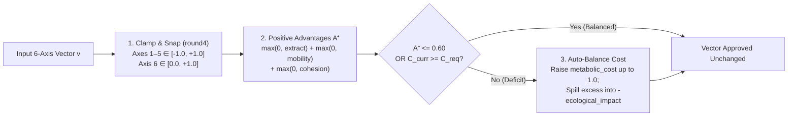

# 6-Axis Thermodynamics & Trait Catalog

Every biological adaptation, cultural tradition, and behavioral decision in **Evolution** is represented by a standardized **6-Axis Biophysical Vector** (`EvoTypes.BiophysicalVector`). Rather than hardcoding ad-hoc special cases for individual traits, the simulation enforces a universal **Law of Thermodynamic Conservation** (`EvoThermodynamics`): no organism or society can evolve "free" advantages in caloric extraction, mobility, or social cohesion without paying commensurate energetic or ecological costs.

---

## The 6-Axis Biophysical Vector (`BiophysicalVector`)

Each vector consists of six floating-point axes rounded to $4$ decimal places (`snappedf(x, 0.0001)`):

| Axis # | Field (`types.gd`) | JSON Key | Bounds | Biophysical Meaning & Simulation Impact |
| :---: | :--- | :--- | :---: | :--- |
| **1** | `metabolic_cost` | `metabolicCost` | $[-1.0, +1.0]$ | **Caloric Expenditure**: Scales per-capita resting and active metabolic consumption $C_{\text{metabolic}}$. Negative values represent metabolic savings (e.g., `cul-fire-processing` externalizing digestion). |
| **2** | `extraction_efficiency` | `extractionEfficiency` | $[-1.0, +1.0]$ | **Biomass Harvesting Yield**: Scales a deme's caloric demand $D_i = P_i \cdot 0.50 \cdot (1.0 + 0.60 \cdot v_{\text{eff}}.\text{extraction\_efficiency})$ when harvesting hex resources $R$. |
| **3** | `ecological_impact` | `ecologicalImpact` | $[-1.0, +1.0]$ | **Habitat $K$ Footprint**: Negative values degrade local carrying capacity $K$ (`K * (1 + 0.18 * sum_eco_impact)`), whereas positive values (`> +0.10`, e.g., `cul-communal-conservation`) actively regenerate $K$ (`+5% * sum_eco_impact`). |
| **4** | `spatial_mobility` | `spatialMobility` | $[-1.0, +1.0]$ | **Dispersal & Barrier Traversal**: Determines maximum traversable elevation ($\text{altitude} - 0.50 \le v_{\text{eff}}.\text{spatial\_mobility}$) and buffers extreme thermal metabolic penalties ($|T_{\text{cell}}|$). |
| **5** | `social_cohesion` | `socialCohesion` | $[-1.0, +1.0]$ | **Coordination & Altruism**: Governs Dove resistance against Hawk resource capture, and unlocks horizontal cultural absorption when $v_{\text{eff}}.\text{social\_cohesion} \ge \text{trait.transmission\_threshold}$. |
| **6** | `transmission_threshold` | `transmissionThreshold` | $[0.0, +1.0]$ | **Cognitive & Social Complexity**: Minimum receiver `social_cohesion` required to absorb a cultural trait via Symbiosis, and determines which complex cultural trait is lost first during a demographic bottleneck ($P < 50$ or $-50\%$ pop loss). |

---

## Thermodynamic Conservation Law (`EvoThermodynamics`)

To prevent overpowered "super-traits" (whether synthesized during evolutionary milestones or crafted by players in the **Trait & Decision Forge**), `EvoThermodynamics` enforces a strict energetic budget with constant `BASE_BUDGET = 0.60`.

### 1. Positive Advantages ($A^+$)
The sum of positive functional capabilities across extraction, mobility, and social cohesion:

$$A^+ = \text{round4}\Big(\max(0,\ \text{extraction\_efficiency}) + \max(0,\ \text{spatial\_mobility}) + \max(0,\ \text{social\_cohesion})\Big)$$

### 2. Current Cost ($C_{\text{curr}}$) & Required Cost ($C_{\text{req}}$)
Any positive advantage exceeding `BASE_BUDGET = 0.60` requires $50\%$ of the excess to be paid in combined **metabolic cost** and/or **negative ecological impact**:

$$C_{\text{curr}} = \text{round4}\Big(\text{metabolic\_cost} - \min(0,\ \text{ecological\_impact})\Big)$$

$$C_{\text{req}} = \begin{cases} \text{round4}\big(0.50 \times (A^+ - 0.60)\big) & \text{if } A^+ > 0.60 \\ 0.0 & \text{otherwise} \end{cases}$$

$$\text{is\_balanced} \iff (A^+ \le 0.60) \;\lor\; (C_{\text{curr}} \ge C_{\text{req}} - 10^{-6})$$

### 3. Automatic Vector Balancing (`validate_and_balance_thermodynamics`)
When `is_balanced` is `false` (and `free_sandbox_mode` is disabled), the engine automatically adjusts the vector by raising `metabolic_cost` first and spilling any remainder above `1.0` into negative `ecological_impact`:

$$\text{target\_metabolic} = C_{\text{req}} + \min(0,\ \text{ecological\_impact})$$

$$\text{metabolic\_cost}' = \min\big(1.0,\ \text{round4}(\text{target\_metabolic})\big)$$

$$\text{ecological\_impact}' = \begin{cases} \max\big(-1.0,\ \text{round4}\big(\min(0, \text{ecological\_impact}) - (\text{target\_metabolic} - 1.0)\big)\big) & \text{if } \text{target\_metabolic} > 1.0 \\ \text{ecological\_impact} & \text{otherwise} \end{cases}$$

---

## Effective Deme Vector Aggregation

During Phase 3 (`EvoEcologyInteraction.compute_effective_vector`), a deme's effective 6-axis profile $\mathbf{v}_{\text{eff}}$ is computed by summing all active biological traits, all active cultural traditions, and the expectation over its behavioral decision probability distribution $P(d)$, then clamping to $[-1.5, +1.5]$ ($[0.0, +1.5]$ for `transmission_threshold`):

$$\mathbf{v}_{\text{eff}}(\text{deme}) = \text{clamp}_{[-1.5, 1.5]}\left(\sum_{b \in T_{\text{bio}}} \mathbf{v}_b + \sum_{c \in T_{\text{cul}}} \mathbf{v}_c + \sum_{d \in D} P(d) \cdot \mathbf{v}_d\right)$$

---

## Complete Biological Traits Catalog (`bio-*`)

Biological traits represent genetically heritable life-history strategies, physiological adaptations, and neuroanatomical structures defined in `EvoCatalog.create_base_traits_catalog`:

| Trait ID | Name (EN / ES) | Cost | Extract | Eco | Mobility | Cohesion | Threshold | Exclusive With | Enables Culture | Biophysical & Evolutionary Role |
| :--- | :--- | :---: | :---: | :---: | :---: | :---: | :---: | :---: | :---: | :--- |
| `bio-r-strategy` | **r-Strategy (Prolific)** *Estrategia r (Prolífica)* | `-0.15` | `+0.20` | `-0.20` | `+0.25` | `-0.15` | `0.05` | `bio-k-strategy` | No | Boosts demographic growth rate by **$\times 1.35$** and lowers metabolic cost, accelerating island colonization at the expense of habitat impact. |
| `bio-k-strategy` | **K-Strategy (Longevity & Parental Care)** *Estrategia K (Longevidad y Cuidado Parental)* | `+0.20` | `+0.25` | `+0.15` | `+0.05` | `+0.40` | `0.30` | `bio-r-strategy` | No | Moderates demographic swings ($\times 0.75$ growth/decline multiplier), improves ecological stewardship (`+0.15`), and strengthens social cohesion (`+0.40`). |
| `bio-digestive-spec` | **Omnivorous Digestive Specialization** *Especialización Digestiva Omnívora* | `+0.10` | `+0.45` | `+0.05` | `+0.15` | `0.00` | `0.10` | *None* | No | Enzymatic plasticity that substantially increases caloric extraction (`+0.45`) across diverse flora and fauna with minimal metabolic overhead (`+0.10`). |
| `bio-thermal-tolerance` | **Thermal & Hydric Tolerance** *Tolerancia Térmica e Hídrica* | `+0.15` | `+0.20` | `+0.05` | `+0.45` | `+0.10` | `0.10` | *None* | No | High spatial mobility (`+0.45`) that unlocks high-altitude mountain passes and mitigates thermal metabolic penalties in Tundra and Arid Steppe biomes. |
| `bio-encephalization` | **Encephalization (Costly Neural Tissue)** *Encefalización (Tejido Neural Costoso)* | `+0.45` | `+0.35` | `0.00` | `+0.20` | `+0.45` | `0.60` | *None* | **Yes** | Steep resting metabolic cost (`+0.45`) for neocortical expansion; unlocks cumulative cultural traditions, `dec-exchange-symbiosis`, and tool innovation. |
| `bio-social-instinct` | **Instinctive Sociability (Gregariousness)** *Sociabilidad Instintiva (Gregarismo)* | `+0.20` | `+0.20` | `+0.05` | `+0.10` | `+0.60` | `0.45` | *None* | **Yes** | Neuroendocrine predisposition toward kin altruism (`+0.60` social cohesion) at moderate energetic cost (`+0.20`); unlocks cultural transmission and symbiosis. |

!!! warning "Bidirectional Mutual Exclusion (`r` vs. `K` Strategy)"
    `bio-r-strategy` and `bio-k-strategy` are mutually exclusive life-history poles. Injecting `bio-r-strategy` into a village via `EvoCatalog.inject_trait_into_deme` automatically strips `bio-k-strategy` (and vice versa). Furthermore, if removing a biological trait leaves a deme with neither `bio-encephalization` nor `bio-social-instinct`, all active cultural traditions are cleared because the population loses its cognitive/social substrate (`enables_cultural_transmission`).

---

## Complete Cultural Traditions Catalog (`cul-*`)

Cultural traditions require at least one biological trait with `enables_cultural_transmission = true` (`bio-encephalization` or `bio-social-instinct`). Unlike genetic traits, cultural traditions can diffuse **horizontally** between cohabiting or neighboring demes during Symbiosis and can be **lost** during demographic bottlenecks:

| Trait ID | Name (EN / ES) | Cost | Extract | Eco | Mobility | Cohesion | Threshold | Biophysical & Socio-Ecological Role |
| :--- | :--- | :---: | :---: | :---: | :---: | :---: | :---: | :--- |
| `cul-fire-processing` | **Fire & Thermal Food Processing** *Fuego y Procesado Térmico de Alimentos* | `-0.10` | `+0.35` | `-0.25` | `+0.10` | `+0.15` | `0.40` | Externalizes digestion through cooking, lowering `metabolic_cost` (`-0.10`) and raising caloric extraction (`+0.35`) at the cost of fuelwood depletion (`-0.25` eco). |
| `cul-extraction-tools` | **Specialized Extraction Tools** *Herramientas de Extracción Especializadas* | `+0.25` | `+0.65` | `-0.25` | `+0.10` | `+0.20` | `0.50` | Cumulative lithic/organic toolkit that massively amplifies extraction (`+0.65`) and triggers the `tech_overexploit` behavioral branch unless paired with conservation norms. |
| `cul-communal-conservation` | **Communal Conservation Norms** *Normas de Conservación Comunal* | `+0.15` | `+0.25` | `+0.55` | `0.00` | `+0.50` | `0.55` | Institutionalized harvesting quotas and taboos (`+0.55` `ecological_impact`, `+0.50` `social_cohesion`) that prevent the *Tragedy of the Commons* and actively rebuild $K$. |
| `cul-interdeme-barter` | **Inter-Deme Barter Networks** *Redes de Trueque Inter-Deme* | `+0.35` | `+0.40` | `+0.15` | `+0.30` | `+0.50` | `0.60` | Diplomatic and trade protocols that raise extraction (`+0.40`), mobility (`+0.30`), and social cohesion (`+0.50`), accelerating horizontal cultural diffusion. |
| `cul-warrior-expansion` | **Warrior / Expansionist Tradition** *Tradición Guerrera / Expansionista* | `+0.45` | `+0.30` | `-0.35` | `+0.45` | `+0.60` | `0.45` | High-cohesion (`+0.60`), high-mobility (`+0.45`) militarized organization that dominates Hawk-Dove disputes at severe metabolic (`+0.45`) and ecological (`-0.35`) cost. |

---

## Complete Behavioral Decisions Catalog (`dec-*`)

Every generation, the cognitive engine assigns a normalized probability distribution $P(d)$ ($\sum_{d} P(d) = 1.0$) over the eligible decisions in `EvoCatalog.create_base_decisions_catalog`:

| Decision ID | Archetype | Name (EN / ES) | Cost | Extract | Eco | Mobility | Cohesion | Threshold | Required Traits (Any) | Behavioral Profile & Simulation Effect |
| :--- | :---: | :--- | :---: | :---: | :---: | :---: | :---: | :---: | :--- | :--- |
| `dec-conservative-forage` | `forage` | **Conservative Foraging** *Forrajeo Conservador* | `+0.10` | `+0.35` | `+0.10` | `0.00` | `+0.05` | `0.05` | *None* | Default low-risk gathering within local regeneration limits; does not increment Baldwin counters. |
| `dec-intensive-overexploit` | `overexploit` | **Intensive Overexploitation** *Sobreexplotación Intensiva* | `+0.25` | `+0.85` | `-0.65` | `0.00` | `-0.10` | `0.10` | *None* | Maximizes immediate caloric intake (`+0.85`) while severely degrading habitat carrying capacity $K$ (`-0.65`). |
| `dec-selective-migration` | `migrate` | **Selective Migration** *Migración Selectiva* | `+0.30` | `+0.15` | `+0.15` | `+0.75` | `+0.05` | `0.10` | *None* | High spatial mobility (`+0.75`) that drives population fission (budding migration) into higher-adequacy neighboring hexes. |
| `dec-cooperate-store` | `cooperate` | **Cooperation & Storage** *Cooperación y Almacenamiento* | `+0.25` | `+0.45` | `+0.15` | `-0.10` | `+0.65` | `0.35` | *None* | Collective resource pooling and food preservation; contributes $0.35 \cdot P(\text{"cooperate"})$ to cultural innovation and builds cooperative road networks. |
| `dec-exchange-symbiosis` | `exchange` | **Exchange / Symbiosis** *Intercambio / Simbiosis* | `+0.35` | `+0.50` | `+0.20` | `+0.20` | `+0.60` | `0.45` | `bio-encephalization` OR `bio-social-instinct` | Unlocks **$+20\%$ caloric surplus** and horizontal cultural trait transmission with cohabiting or neighboring exchangers ($P(\text{"exchange"}) \ge 0.20$). |
| `dec-territorial-dispute` | `dispute` | **Territorial Dispute** *Disputa Territorial* | `+0.55` | `+0.40` | `-0.30` | `+0.25` | `+0.55` | `0.20` | *None* | Agonistic **Hawk** strategy ($P(\text{"dispute"}) \ge 0.25$); seizes Dove biomass shares or triggers destructive Hawk-Hawk clashes ($-15\%$ pop, $\times 1.25$ metabolic cost). |
| `dec-explore-innovate` | `innovate` | **Exploration / Innovation** *Exploración / Innovación* | `+0.50` | `+0.15` | `0.00` | `+0.40` | `+0.35` | `0.65` | *None* | High-cost (`+0.50`) experimentation that sacrifices immediate foraging yield (`+0.15`) to rapidly advance `innovation_counter`. |

---

## Emergent Milestone Traits (`origin = "emergent"`)

When a deme achieves an evolutionary milestone during Phase 4 (`EvoMilestonePhase.run_milestone_phase`), `EvoHeuristicScorer.synthesize_milestone_trait` dynamically generates a new biome-contextualized trait, validates it through `EvoThermodynamics.validate_and_balance_thermodynamics`, and registers it into `state.traits_catalog`:

| Milestone Trigger | Synthesized Category | Generated Name Pattern (EN / ES) | Cost | Extract | Eco | Mobility | Cohesion | Threshold | Thermodynamic Verification |
| :--- | :---: | :--- | :---: | :---: | :---: | :---: | :---: | :---: | :--- |
| `allopatric_speciation` | `biological` | **Allopatric Divergence (\<Biome\>)** *Divergencia Alopátrica (\<Bioma\>)* | `+0.18` | `+0.35` | `+0.10` | `+0.30` | `+0.20` | `0.20` | $A^+ = 0.85 \Rightarrow C_{\text{req}} = 0.125 \le 0.18$ (Balanced) |
| `baldwin_assimilation` | `biological` | **Adaptive Homeostasis (\<Biome\>)** *Homeostasis Adaptativa (\<Bioma\>)* | `+0.18` | `+0.35` | `+0.10` | `+0.30` | `+0.20` | `0.20` | $A^+ = 0.85 \Rightarrow C_{\text{req}} = 0.125 \le 0.18$ (Balanced) |
| `cultural_innovation` | `cultural` | **Cooperative Ecological Tradition (\<Biome\>)** *Tradición Ecológica Cooperativa (\<Bioma\>)* | `+0.20` | `+0.35` | `+0.20` | `+0.15` | `+0.40` | `0.45` | $A^+ = 0.90 \Rightarrow C_{\text{req}} = 0.150 \le 0.20$ (Balanced) |
