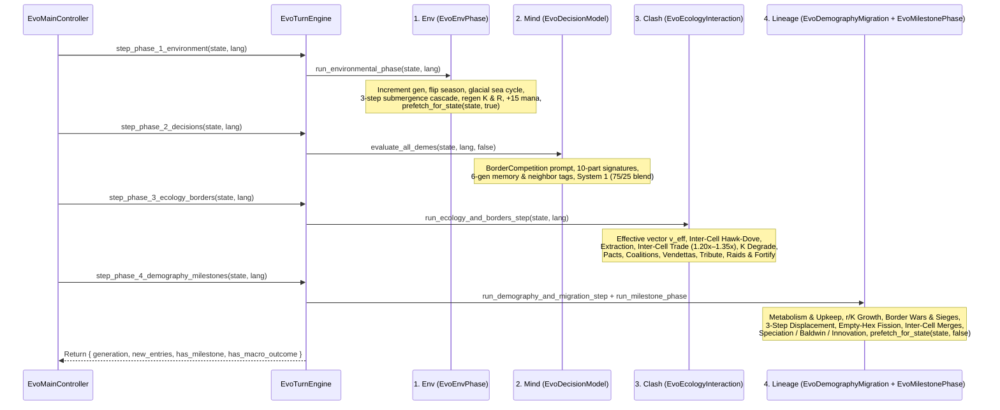
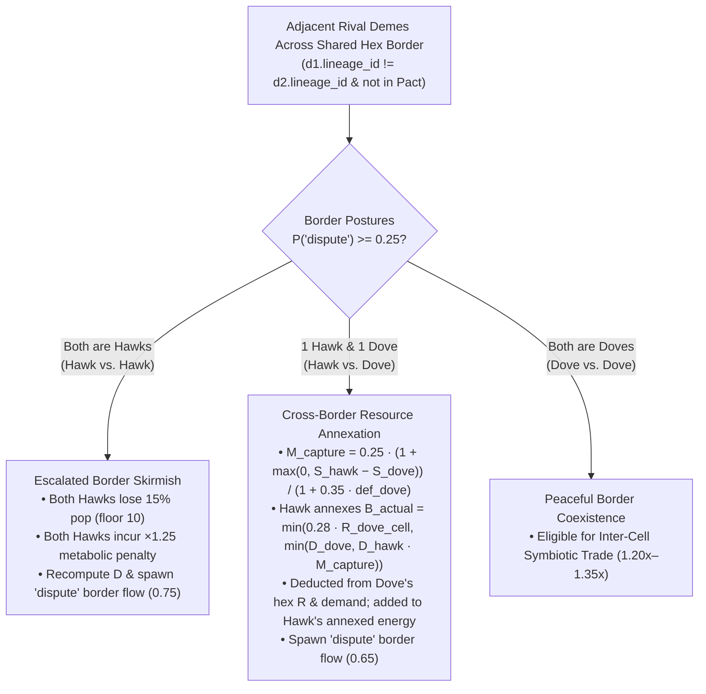

# Generational Loop, 4-Step Micro-Phases & Biophysical Mechanics

At the heart of **Evolution** is `EvoTurnEngine`, which advances the simulation by one discrete generation (half-year seasonal step: `year = generation / 2 + 1`). Each generation executes a strictly ordered **4-phase pipeline**—supporting both **sequential 4-step micro-phase playback** (`step_phase_1_environment` $\to$ `step_phase_2_decisions` $\to$ `step_phase_3_ecology_borders` $\to$ `step_phase_4_demography_milestones` at `1x` speed) and **single-call full-generation execution** (`advance_generation` at `2x` speed or headless mode)—translating probabilistic deme intentions into deterministic ecological, border-geopolitical, demographic, and phylogenetic outcomes on a **strictly 1-deme-per-hex** (`cell.deme_ids.size() <= 1`) grid.

---

## High-Level Execution Pipeline & Micro-Phase Playback

### In-Flight Micro-Phase Flushing (`complete_in_flight_turn` & `flush_pending_micro_phases`)
When playing at `1x` speed (`0.375s` per micro-phase), the top-right **4-pip Turn Phase Bar** (`1. Env`, `2. Mind`, `3. Clash`, `4. Lineage`) and `EvoWorldOverlayRenderer._draw_micro_phase_highlights` visualize each micro-phase in real time. If the player clicks `+1 Step`, switches to `2x` speed, applies a God-mode brush, or exports JSON while a turn is mid-flight (`_active_micro_phase in 1..3`), `EvoTurnEngine.flush_pending_micro_phases` / `complete_in_flight_turn` deterministically completes the remaining micro-phases of the current generation before proceeding.

---

## Micro-Phase 1 & 2: Environment (`1. Env`) & Cognitive Scoring (`2. Mind`)

1. **Micro-Phase 1 — Environmental Phase (`step_phase_1_environment` / `EvoEnvPhase.run_environmental_phase`)**:
   * Increments `state.generation += 1`, clears `state.recent_extinction_hexes`, and toggles `state.season` between `"wet_warm"` ($\gamma_{\text{season}} = 1.20$) and `"dry_cold"` ($\gamma_{\text{season}} = 0.75$).
   * Archives active `"exchange"`, `"cooperate"`, and `"pact"` flows from the previous turn into `state.disused_connections` (incrementing `age += 1` on older severed links) before clearing `state.active_flows`.
   * Applies glacial sea-level cycles (every 8 generations), coastal flooding/emergence, and resolves any deme on a newly submerged ocean hex via the **3-Step Displacement Cascade** (`EvoDemographyMigration.evacuate_or_merge_displaced_deme`: empty passable neighbor evacuation with $-20\%$ reserves $\to$ allied/kin neighbor refugee merge $\to$ drowning extinction).
   * Applies passive $K$ recovery ($+5\%$ normal or $+0.5\%$ after a Tragedy of the Commons), seasonal biomass $R$ regeneration (highlighted on the map by expanding emerald/amber resource pulse rings), and `+15` player Selective Pressure ("Mana") points.
   * Invalidates state caches and triggers **Phase 1 current-season Ollama signature prefetching** (`EvoDecisionModel.prefetch_for_state(state, true)`).
2. **Micro-Phase 2 — Cognitive Phase (`step_phase_2_decisions` / `EvoDecisionModel.evaluate_all_demes`)**:
   * Evaluates every surviving deme via the Dual-Model System 1 Ollama engine (`/v1/systemone`) with its `BorderCompetition: adjRivals, adjKin, pacts, vendettas` prompt, 6-generation historical memory digest, and rich neighbor relational labels, blended (**$75\%$ live LLM / $25\%$ environmental & geopolitical pressures**).
   * Assigns a normalized probability distribution $P(d)$ across all eligible behavioral decisions (`last_decision_probabilities`) along with `last_dominant_decision_id`, `last_confidence`, and `last_justification` (highlighted on the map by Decision Intent Crests and dashed golden intent tethers to occupied neighbor hexes).

---

## Micro-Phase 3 (`3. Clash`): Ecology, Inter-Cell Border Disputes, Trade, Diplomacy & Fortifications (`EvoEcologyInteraction`)

Once every deme has its probability distribution $P(d)$ and effective 6-axis vector $\mathbf{v}_{\text{eff}}$, `EvoBiophysPhase.run_ecology_and_borders_step` invokes `EvoEcologyInteraction.run_resource_and_symbiosis_phase` across the 1-deme-per-hex grid in nine sequential steps:

### Step 1: Initial Caloric Demand ($D_i$)
Each hexagon's single resident deme $i$ (`cell.get_resident_deme_id()`) requests biomass proportional to its population $P_i$ and effective `extraction_efficiency`:

$$D_i = \max\Big(0.0,\ P_i \times 0.50 \times \big(1.0 + 0.60 \cdot v_{\text{eff}, i}.\text{extraction\_efficiency}\big)\Big)$$

### Step 2: Archetype Classification
Each resident deme is classified by summing its decision probabilities per archetype (`get_archetype_prob`):

* **Hawk**: $P(\text{"dispute"}) \ge 0.25$
* **Dove**: $P(\text{"dispute"}) < 0.25$
* **Exchanger**: $P(\text{"exchange"}) \ge 0.20$

### Step 3: Inter-Cell Hawk-Dove Border Conflict
Because each hex cell hosts at most 1 resident deme (`cell.deme_ids.size() <= 1`), Hawk-Dove resource competition occurs **across shared hex borders between adjacent rival demes** (`d1.lineage_id != d2.lineage_id` and not in an active Alliance Pact):

* **Case A — Inter-Cell Hawk vs. Hawk (`d1_hawk` and `d2_hawk`)**:
  * Both bordering Hawks suffer an immediate **$15\%$ demographic casualty loss** (with a minimum floor of $10$ individuals):
    $$P_{\text{hawk}} \leftarrow \max\big(10,\ \lfloor 0.85 \cdot P_{\text{hawk}} \rfloor\big)$$
  * Both Hawks are penalized with a **$\times 1.25$ metabolic expenditure multiplier** (`hawk_penalty_by_deme[hawk.id] = 1.25`) for the remainder of the turn, recompute their caloric demand $D_{\text{hawk}}$, and spawn a `"dispute"` `HexEdgeFlow` (`intensity = 0.75`) across their shared border.
* **Case B — Inter-Cell Hawk vs. Dove (`1` Hawk, `1` Dove across a shared border)**:
  * The Hawk intimidates the neighboring Dove across the border and annexes a share of the Dove's border resources, mitigated by the Dove's Ring 2 `defense_tier`:
    $$M_{\text{capture}} = \frac{0.25 \times \Big(1.0 + \max\big(0.0,\ v_{\text{eff, hawk}}.\text{social\_cohesion} - v_{\text{eff, dove}}.\text{social\_cohesion}\big)\Big)}{1.0 + 0.35 \cdot \text{dove.defense\_tier}}$$
    $$B_{\text{actual}} = \min\Big(0.28 \cdot R_{\text{dove\_cell}},\ \min(D_{\text{dove}},\ D_{\text{hawk}} \times M_{\text{capture}})\Big)$$
  * $B_{\text{actual}}$ is deducted directly from the Dove's hex `current_resources` ($R_{\text{dove\_cell}}$) and demand $D_{\text{dove}}$, added to the Hawk's `annexed_energy_by_deme`, and spawns a `"dispute"` `HexEdgeFlow` (`intensity = 0.65`).

### Step 4: Biomass Extraction ($E_i$)
Each resident deme harvests its demand $D_i$ from its own cell's available resources $R_{\text{cell}}$ (plus any cross-border energy annexed from adjacent Doves):

$$E_{\text{local}, i} = \min(R_{\text{cell}},\ D_i), \qquad E_i = E_{\text{local}, i} + E_{\text{annexed}, i}$$

$$R_{\text{cell}} \leftarrow \max\big(0.0,\ \text{snapped}(R_{\text{cell}} - E_{\text{local}, i},\ 0.01)\big)$$

### Step 5: Inter-Cell Symbiotic Trade & Horizontal Cultural Diffusion
Symbiotic trade operates across shared hex borders between adjacent passable cells (`altitude <= 0.85`) occupied by non-vendetta demes where both are Exchangers ($P(\text{"exchange"}) \ge 0.20$, or hybrid cooperative trade where one has $P(\text{"exchange"}) \ge 0.20$ and both have $P(\text{"cooperate"}) + P(\text{"exchange"}) \ge 0.32$):

1. **Inter-Cell Caloric Trade Surplus (`1.20x` to `1.35x`)**:
   * Border symbiosis boosts extracted energy by a base **$1.20\times$ (`+20%`)**, and rewards ecological and cultural complementarity up to **$1.35\times$ (`+35%`)**:
     $$M_{\text{trade}} = 1.15 + \begin{cases} 0.12 & \text{if } \text{biome}_A \neq \text{biome}_B \\ 0.00 & \text{otherwise} \end{cases} + \begin{cases} 0.08 & \text{if } \text{cultural\_trait\_ids}_A \neq \text{cultural\_trait\_ids}_B \\ 0.00 & \text{otherwise} \end{cases}$$
2. **Active Trade Road Flow**: Spawns an `"exchange"` `HexEdgeFlow` (`intensity = 0.60`) across the shared hex border, rendered as a cobblestone trade road or wooden bridge with caravan carts.
3. **Horizontal Cultural Diffusion Across Borders**: For every ordered pair `(donor, receiver)` of trading neighbors:
   * If `receiver` has biological cultural capacity (`enables_cultural_transmission == true`, i.e., `bio-encephalization` or `bio-social-instinct`),
   * And for any cultural tradition `tid` in `donor.cultural_trait_ids` not yet known by `receiver`:
     $$v_{\text{eff, receiver}}.\text{social\_cohesion} \ge \text{trait.vector.transmission\_threshold}$$
   * Then `receiver` immediately adopts `tid` into `receiver.cultural_trait_ids`, recomputes its effective vector $\mathbf{v}_{\text{eff}}$, and records a `"symbiosis"` entry in the Chronicle.

### Step 6: Carrying Capacity ($K$) Degradation, Tragedy of the Commons & Niche Construction
After extraction, the resident deme's ecological impact $\Sigma_{\text{eco}} = v_{\text{eff}, i}.\text{ecological\_impact}$ modifies the hexagon's structural carrying capacity $K$:

* **Overexploitation & Habitat Degradation**:
  Triggered when extraction exceeds natural seasonal regeneration ($E_{\text{local}} > K_{\text{cell}} \cdot r_{\text{regen}}$ or $R_{\text{cell}} \le 0$ with $D_i > K_{\text{cell}} \cdot r_{\text{regen}}$) **AND** either $\Sigma_{\text{eco}} < -0.15$ or ($P_i(\text{"overexploit"}) \ge 0.30 \land \Sigma_{\text{eco}} < -0.10$):
  $$K_{\text{degraded}} = \max\Big(10.0,\ \text{snapped}\big(K_{\text{cell}} \times (1.0 + 0.18 \cdot \Sigma_{\text{eco}}),\ 0.01\big)\Big)$$
  * **Tragedy of the Commons Milestone**: The first time a hexagon's degraded carrying capacity drops below **$60\%$ of $K_{\max}$** ($K_{\text{degraded}} < 0.60 \times K_{\max}$), a `"tragedy_of_commons"` Chronicle entry is logged, and the hex's recovery rate on the following turn drops tenfold (from $5.0\%$ to $0.5\%$).
* **Positive Ecological Niche Construction**:
  Conversely, if degradation did not trigger, the resident deme is not overexploiting ($P(\text{"overexploit"}) < 0.30$), and $\Sigma_{\text{eco}} > +0.10$ (e.g., practicing `cul-communal-conservation`), the population actively enriches its habitat:
  $$K_{\text{cell}} \leftarrow \text{clamp}\Big(\text{snapped}\big(K_{\text{cell}} \times (1.0 + 0.05 \cdot \Sigma_{\text{eco}}),\ 0.01\big),\ 10.0,\ K_{\max}\Big)$$

### Step 7: Inter-Cell Alliance Pacts, Defensive Coalitions, Opportunistic Betrayals & Vendettas (`_run_pacts_and_betrayals`)
Next, `EvoEcologyInteraction` evaluates all adjacent passable (`altitude <= 0.85`, non-ocean) deme pairs `pair_key = "idA__idB"` tracked in `state.active_pacts`:

* **Multi-Turn Vendettas / Grudges (`active_pacts < 0`, `EvoTypes.is_vendetta_active`)**:
  * Negative values in `state.active_pacts[pair_key]` represent active hostility memory (set to `-4` turns after a betrayal, `-3` after a territorial conquest, and `-2` after a raid or repelled war).
  * Each turn, a negative vendetta counter increments by `+1` toward `0`. While `prev_turns < 0`, the pair cannot form an Alliance Pact and renders a conflict border front along their shared hex edge.
* **Opportunistic Betrayal (`_execute_betrayal`)**:
  If a formal pact already exists (`prev_turns >= 2`) and one partner is under severe demographic or ecological stress **AND** exhibits opportunistic or aggressive tendencies—and is not deterred by a heavily fortified partner (`victim.defense_tier >= 2`)—the stressed partner breaks the pact in a surprise cross-border ambush:
  1. **Conserved Caloric Plunder**: Plunders $\text{loot}_{\text{desired}} = \text{clamp}(0.30 \cdot E_{\text{reserves, victim}} + 0.25 \cdot E_{\text{victim}},\ 10.0,\ 45.0)$ directly from the victim's `energy_reserves` and current-turn extracted energy $E_{\text{victim}}$, adding the exact stolen sum to the betrayer's reserves (capped at `220.0`).
  2. **Ambush Casualties**: Inflicts $\max(3,\ \text{round}(0.14 \cdot P_{\text{victim}}))$ casualties on the victim (floor `5`).
  3. **Deep Vendetta & Chronicle**: Sets `state.active_pacts[pair_key] = -4` (a 4-turn blood vendetta), records a severed link in `state.disused_connections`, spawns a crimson `"betrayal"` flow (`intensity = 1.0`), and logs a `"betrayal"` Chronicle entry.
* **Alliance Pact Formation, Defensive Coalitions & Mutual Aid**:
  * **Defensive Coalition Threshold**: Normally, pact formation requires $P(\text{"cooperate"}) + P(\text{"exchange"}) \ge 0.30$, $P(\text{"dispute"}) < 0.22$, and no `cul-warrior-expansion`. When either partner faces an adjacent non-allied warrior threat (`_has_adjacent_warrior_threat`), the required cooperation threshold drops to **`0.22`**, incrementing `state.active_pacts[pair_key]` by $+1$.
  * **Formalization (`next_turns == 2`)**: When a pair reaches `2` consecutive cooperative turns (`EvoTypes.is_pact_active == true`), a `"pact"` Chronicle entry is recorded.
  * **$+15\%$ Mutual Caloric Bonus, Distress Aid & Shared Defense (`next_turns >= 2`)**: Each ally that did not already receive the symbiosis bonus receives a **$+15\%$ boost** to its extracted energy ($E_i \leftarrow E_i \times 1.15$). Surplus allies ($E_{\text{reserves}} > 60.0$) transfer up to `14.0` energy to distressed partners, spawn an emerald `"pact"` highway flow (`intensity = 0.80`) with a diplomatic border front, and provide up to **$+1.10$ shared military defense** (`compute_pact_defense_bonus`) against raids and invasions.

### Step 8: Cross-Border Plunder Raids & Tribute Appeasement (`_run_raids`)
Non-allied, non-close-kin adjacent demes (`altitude <= 0.85`) with raiding capability attempt **Cross-Border Plunder Raids** (`_execute_raid_if_successful`) against neighbors with `defense_tier < 3` (**Tier 3 Castles are completely immune to minor plunder raids**):

* **Force Comparison**: The attacker's `raider_score` is compared against the target's `defense_score`, which adds `DEFENSE_TIER_BONUS[defense_tier]` (`+0.45` at Lv.1, `+0.95` at Lv.2, `+1.55` at Lv.3) and `compute_pact_defense_bonus` (up to `+1.10`).
* **Tribute / Appeasement (`tribute`)**:
  If an under-fortified cooperative or mercantile settlement (`defense_tier < 2`, `energy_reserves >= 55.0`) faces a superior raider (`raider_score > defense_score * 0.92`), it deters the raid by transferring $\text{tribute} = \text{clamp}(0.18 \cdot E_{\text{reserves, target}},\ 10.0,\ 28.0)$ with **zero casualties**, setting `state.active_pacts[pair_key] = 1` (temporary truce), spawning a golden `"tribute"` caravan flow (`intensity = 0.75`), and logging a `"tribute"` Chronicle entry.
* **Successful Plunder Raid (`raider_score > defense_score * 0.75`)**:
  Perimeter defenses scale down both plundered calories (`0.75x` at Lv.1 Palisade, `0.40x` at Lv.2 Stone Wall) and defender casualties (`0.75x` at Lv.1, `0.50x` at Lv.2), sets a `-2` vendetta, spawns an orange `"raid"` flow, and logs a `"raid"` Chronicle entry.

### Step 9: Ring 2 Multi-Tier Defense Fortification (`_run_defense_fortification_phase`)
Settlements with `defense_tier < 3` experiencing border security pressure can upgrade their concentric **Ring 2 Defense Perimeter** by one tier per turn:

| Tier | Ring 2 Fortification | Defense Bonus | Raid Protection | Requirements (`pop` / `reserves` / `hex R`) | Base Cost (`reserves` + `hex R`) | Upkeep / Turn |
| :---: | :--- | :---: | :--- | :---: | :---: | :---: |
| **Lv. 1** | **Palisade & Watchtower** | **`+0.45` (`+45%`)** | `-25%` raid loot & casualties (`0.75x`) | `pop >= 38`, `res >= 58`, `R >= 35` | `25.0` reserves + `15.0` hex $R$ | `1.5` energy |
| **Lv. 2** | **Stone Wall & Fort** | **`+0.95` (`+95%`)** | `-60%` raid loot (`0.40x`), `-50%` casualties (`0.50x`), betrayal deterrence | `pop >= 65`, `res >= 92`, `R >= 55` | `45.0` reserves + `25.0` hex $R$ | `3.0` energy |
| **Lv. 3** | **Castle / Fortified Citadel** | **`+1.55` (`+155%`)** | **Immune to minor plunder raids**, heavy siege attrition to attackers | `pop >= 100`, `res >= 130`, `R >= 75` | `65.0` reserves + `35.0` hex $R$ | `5.0` energy |

* **15% Conservation & Storage Discount (`* 0.85`)**: Demes carrying `cul-communal-conservation`, `cul-symbolic-storage`, or `bio-k-strategy` receive a **$15\%$ reduction** on required reserves, reserve cost, and hex biomass cost.
* **Allied Co-Financing**: Adjacent Pact allies holding `energy_reserves >= 80.0` automatically co-finance up to `30.0` energy toward a partner's wall upgrade.

---

## Micro-Phase 4 (`4. Lineage`): Demography, 3-Step Displacement, Wars, Fission, Mergers & Milestones (`EvoDemographyMigration` & `EvoMilestonePhase`)

### Step 1: Metabolic Expenditure, Fortification Upkeep & Food Storage Buffering
Each deme expends energy $C_{\text{metabolic}}$ based on its population $P_i$, effective `metabolic_cost`, ambient thermal extremity $|T_{\text{cell}}|$, and any Hawk-Hawk combat penalty ($\text{hawk\_mult} \in \{1.0, 1.25\}$), plus per-turn **fortification maintenance upkeep** $C_{\text{upkeep}} \in \{0.0, 1.5, 3.0, 5.0\}$ for `defense_tier` `0..3`:

$$C_{\text{metabolic}} = P_i \times 0.42 \times \Big(1.0 + 0.55 \cdot v_{\text{eff}}.\text{metabolic\_cost} + 0.20 \cdot |T_{\text{cell}}| \cdot \max\big(0.0,\ 1.0 - \max(0.0, v_{\text{eff}}.\text{spatial\_mobility})\big)\Big) \times \text{hawk\_mult}$$

### Step 2: Demographic Growth & $r/K$ Selection Modifiers
The base per-turn demographic growth rate $g_0$ is bounded between $-45\%$ and $+35\%$, scaled by `bio-r-strategy` ($\times 1.28$ at low crowding $< 0.55$, $\times 1.16$ at $< 0.65$, $\times 1.05$ at $\ge 0.65$) or `bio-k-strategy` ($\times 0.88$), and visualized during Micro-Phase 4 as floating `+Pop / -Pop` delta badges above each settlement.

### Step 3: Baldwin & Cultural Innovation Counter Accumulation
* **Baldwin Counters (`baldwin_counters[dec_id]`)**: Every non-foraging decision (`archetype != "forage"`) with probability $P(\text{dec\_id}) \ge 0.35$ increments its integer counter by $+1$.
* **Cultural Innovation Counter (`innovation_counter`)**: Advances by $\Delta I = \big(P(\text{"innovate"}) + 0.35 \cdot P(\text{"cooperate"})\big) \times 0.45$ (capped at `2.0`).

### Step 4: Territorial Wars of Conquest, 3-Step Displacement Cascade & Empty-Hex Population Fission
1. **Territorial Wars of Conquest & Fortified Sieges (`_execute_territorial_invasion`)**:
   * **Attacker Victory (`att_force >= def_force`)**: The attacking warband seizes $38\%$ of the defender's `energy_reserves`, inflicts combat casualties on both sides, displaces the surviving defender via the **3-Step Displacement Cascade (`evacuate_or_merge_displaced_deme`)**, and establishes a conquered settlement (`<base_id>-w<gen>-<q>_<r>`) as the sole resident of the target hex (`target_cell.set_resident_deme_id(conqueror.id)`), inheriting `strategy_id`, `lineage_id`, and **captured fortifications (`max(0, defender.defense_tier - 1)`)**.
   * **Fortified Siege / Invasion Repelled (`att_force < def_force`)**: The attacking warband suffers $(42\% + 6\% \cdot \text{def\_tier})$ siege attrition and retreats, spawning a crimson `"siege"` flow (`intensity = 0.90`).
2. **The 3-Step Displacement Cascade (`evacuate_or_merge_displaced_deme`)**:
   Whenever a deme is displaced from its hex by warband conquest (`"invasion"`) or coastal submergence (`"submerge"`, `"submerge_brush"`), it resolves through three deterministic steps that strictly preserve the **1-deme-per-hex invariant**:
   * **Step A — Evacuate to Empty Passable Neighbor**: If any adjacent passable hex (`biome != "ocean"`, `altitude <= 0.85`) is uninhabited (`ncell.deme_ids.is_empty()`), the displaced deme relocates into the empty neighbor with the highest `current_resources` (`defense_tier = 0`, $-20\%$ reserves on submergence, spawning a `"migration"` flow).
   * **Step B — Refugee Merge into Allied or Kin Neighbor**: If no empty passable neighbor exists, the engine searches adjacent passable occupied hexes for an active Pact ally (`is_pact_active`) or compatible kin (`lineage_id == victim.lineage_id` or `compute_deme_divergence <= 0.35`). The displaced population merges into the largest refuge partner (`ally.population += victim.population`, `ally.energy_reserves = min(280.0, ally.energy_reserves + victim.energy_reserves * 0.80)`, `ally.merged_count += 1`), spawning a `"merge"` flow.
   * **Step C — Extinction**: If neither an empty neighbor nor an allied/kin refuge exists, the displaced deme is eliminated (`_log_deme_extinction`).
3. **Peaceful Population Fission into Empty Neighbor Hexes (or Kin Reinforcement)**:
   * When a deme undergoes budding migration ($\text{migrants} \ge 10$, leaving $P_i - \text{migrants} \ge 10$), it prioritizes **empty passable neighbor hexes** (`ncell.deme_ids.is_empty()`, scored by `current_resources`), founding a single-resident daughter settlement (`<root_id>-m<gen>-<q>_<r>`).
   * If all passable neighbor hexes are occupied, the migrant cohort can reinforce an adjacent compatible same-lineage kin settlement (`compute_deme_divergence <= 0.25` and `other.population < 75`) without violating the 1-deme-per-hex invariant.

### Step 5: Extinction & Demographic Bottleneck Cultural Loss
* **Minimum Viable Population Extinction**: Any deme whose population falls below **$10$ individuals** (`deme.population < 10`) goes extinct.
* **Cultural Loss (Tasmanian Effect / Demographic Bottleneck)**: Evaluated against `pre_fission_pop` so healthy parent demes do not lose cultural traits solely from colonist fission; if a deme loses $\ge 50\%$ of its turn-start population or drops below $50$ individuals after net decline, it loses its highest-threshold cultural tradition (`"cultural_loss"`).

### Step 6: Inter-Cell Kin Merging, City Unification (Synoecism) & Isolation Tracking
* **Inter-Cell Compatible Kin Merging (`_run_adjacent_kin_mergers`)**: Two adjacent passable settlements of the **same `lineage_id`** (founded at least 3 generations ago) whose Jaccard trait divergence is $\le 0.25$ and combined population is $\le 1.15 \times \max(K_{\max, 1}, K_{\max, 2})$ merge across their shared hex border into the larger/better-fortified settlement, vacating the donor hex (`donor_cell.deme_ids.clear()`) and spawning a `"merge"` flow.
* **Inter-Cell City Unification / Synoecism (`_run_adjacent_synoecism`, Tier 5 Unified Metropolis)**:
  Two passable neighboring settlements (`distance == 1`) with `active_pacts >= 4` (or **`active_pacts >= 3` when either settlement is fortified `defense_tier >= 1` or faces an adjacent rival threat**), both having $P(\text{"cooperate"}) + P(\text{"exchange"}) \ge 0.30$ and combined population $\le 1.25 \times \max(K_{\max, 1}, K_{\max, 2})$, unite across their shared border into a single **Tier 5 Unified Metropolis (`Deme`)**—combining population and reserves (up to `280.0`), merging traits, elevating shared fortifications, expanding host hex $K$ (`+35.0` up to $1.35 \times K_{\max}$), and **directly reducing the number of active LLM inference evaluations per generation**.
* **Geographic Isolation Counter (`isolation_turns`)**: Reset to `0` if the deme is on its lineage's `founder_hex_id`, merged this turn, or is connected within **3 passable hex hops** to `founder_hex_id` or to any hex occupied by a living peer deme of the same `lineage_id`. Otherwise, `deme.isolation_turns += 1`.

---

## Evolutionary Milestones, Lookahead Prefetch & Macro-Outcomes (`EvoMilestonePhase`)

At the end of Micro-Phase 4, `EvoMilestonePhase.run_milestone_phase` synthesizes at most **one emergent trait per turn globally** in strict priority order (`0: allopatric_speciation` $\to$ `1: baldwin_assimilation` $\to$ `2: cultural_innovation`), evaluates global macro-outcomes (`total_extinction`, `single_survivor`, `ecological_equilibrium`), and triggers **Phase 4 next-turn lookahead Ollama signature prefetching** (`EvoDecisionModel.prefetch_for_state(state, false)`).
