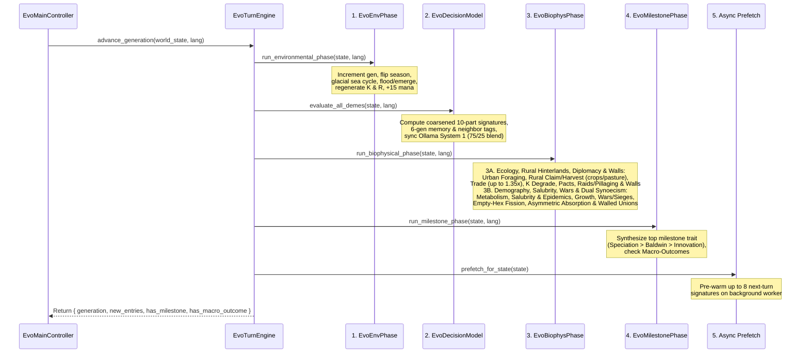
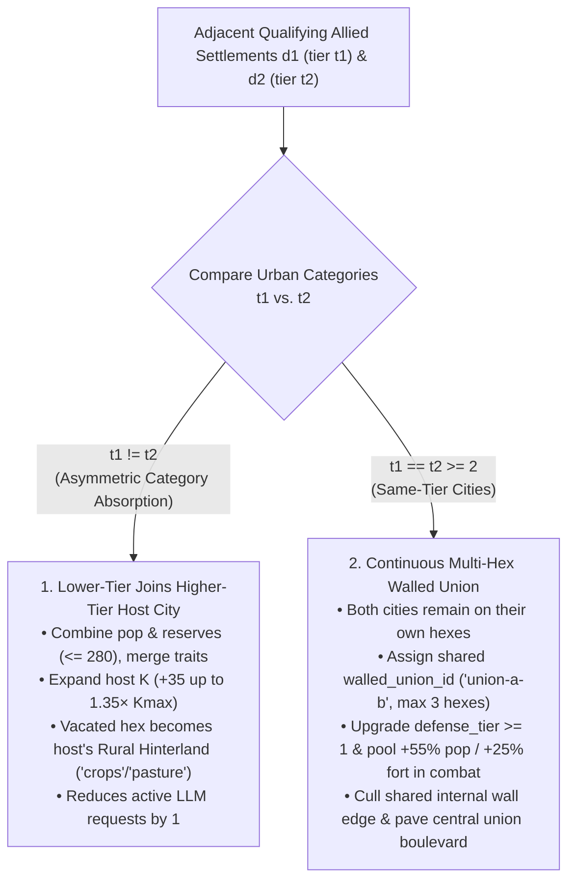

# Generational Loop & Biophysical Mechanics

At the heart of **Evolution** is `EvoTurnEngine.advance_generation(state, lang)`, which advances the simulation by one discrete generation (half-year seasonal step: `year = generation / 2 + 1`). Every generation executes a strictly ordered **5-stage pipeline** under the **1-Deme-Per-Hex Exclusivity invariant (`cell.deme_ids.size() <= 1`)**, translating probabilistic deme intentions into deterministic ecological, urban-rural, demographic, geopolitical, and phylogenetic outcomes.

---

## High-Level Execution Pipeline

---

## Stage 1 & 2: Environment & Cognitive Scoring

1. **Environmental Phase (`EvoEnvPhase.run_environmental_phase`)**:
   * Increments `state.generation += 1`, clears `state.recent_extinction_hexes`, and toggles `state.season` between `"wet_warm"` ($\gamma_{\text{season}} = 1.20$) and `"dry_cold"` ($\gamma_{\text{season}} = 0.75$).
   * Archives active `"exchange"`, `"cooperate"`, and `"pact"` flows from the previous turn into `state.disused_connections` (incrementing `age += 1` on older severed links) before clearing `state.active_flows`.
   * Applies glacial sea-level cycles (every 8 generations), coastal flooding/emergence, submerged deme relocation to empty passable neighbor hexes (`altitude <= 0.85` and `altitude - 0.50 <= v_eff.spatial_mobility`, with a $10\%$ transit population loss, $20\%$ reserve penalty, and `"migration"` flow) or drowning (`"extinction"` if no empty passable non-ocean refuge neighbor exists), passive $K$ recovery ($+5\%$ normal or $+0.5\%$ after a Tragedy of the Commons), and seasonal biomass $R$ regeneration.
   * Regenerates player Selective Pressure ("Mana") points: `state.selective_pressure_points += state.selective_pressure_regen_per_turn` (`+15` per generation).
2. **Cognitive Phase (`EvoDecisionModel.evaluate_all_demes`)**:
   * Evaluates every surviving deme via the Dual-Model System 1 Ollama engine (`/v1/systemone`) with its 6-generation historical memory digest and rich neighbor relational labels, blended (**$75\%$ live LLM / $25\%$ environmental & geopolitical pressures**), and assigns a normalized probability distribution $P(d)$ across all eligible behavioral decisions (`last_decision_probabilities`) along with `last_dominant_decision_id`, `last_confidence`, and `last_justification`.

---

## Stage 3A: Ecology, Rural Hinterlands, Diplomacy, Raids & Fortifications (`EvoEcologyInteraction`)

Once every deme has its probability distribution $P(d)$ and effective 6-axis vector $\mathbf{v}_{\text{eff}}$, `EvoEcologyInteraction.run_resource_and_symbiosis_phase` resolves local extraction, rural hinterland cultivation, inter-hex trade, diplomacy, raids, and perimeter fortifications:

### Step 1: Initial Caloric Demand ($D_i$) & Urban Wild-Foraging Multiplier
Each resident deme $i$ requests wild biomass from its host hexagon proportional to its population $P_i$, effective `extraction_efficiency`, and an **urban wild-foraging multiplier** $m_{\text{urban}}(\text{tier}_i)$ that reflects how Tier III–IV urbanization replaces wild gathering on the city hex with cultivated rural hinterlands:

$$m_{\text{urban}}(\text{tier}) = \begin{cases} 1.00 & \text{if } \text{tier} \in \{1, 2\} \ (\text{I · Camp / II · Village}) \\ 0.55 & \text{if } \text{tier} = 3 \ (\text{III · Town}) \\ 0.30 & \text{if } \text{tier} = 4 \ (\text{IV · Metropolis}) \end{cases}$$

$$D_i = \max\Big(0.0,\ P_i \times 0.50 \times \big(1.0 + 0.60 \cdot v_{\text{eff}, i}.\text{extraction\_efficiency}\big) \times m_{\text{urban}}(\text{tier}_i)\Big)$$

Total cell demand $D_{\text{total}} = \sum_i D_i$ is harvested against available host-hex resources $R_{\text{cell}}$ ($E_i = \min(R_{\text{cell}}, D_{\text{total}}) \cdot (D_i / D_{\text{total}})$), and $R_{\text{cell}}$ is decremented accordingly.

### Step 2: Rural Hinterland Claiming & Harvesting (`_update_and_harvest_rural_hinterlands`)
To sustain growing urban populations when local wild foraging declines (`0.55x` at Tier III, `0.30x` at Tier IV), settlements automatically claim and cultivate adjacent uninhabited terrestrial hexes (`EvoEcologyInteraction.enforce_rural_hinterland_quotas` & `_update_and_harvest_rural_hinterlands`):

1. **Tier Hinterland Quotas (`max_rural`)**:
   $$\text{max\_rural}(\text{tier}) = \begin{cases} 0 & \text{if } \text{tier} = 1 \ (\text{I · Camp}) \\ 1 & \text{if } \text{tier} = 2 \ (\text{II · Village}) \\ 2 & \text{if } \text{tier} = 3 \ (\text{III · Town}) \\ 4 & \text{if } \text{tier} = 4 \ (\text{IV · Metropolis}) \end{cases}$$
2. **Automatic Claiming & Biome Land-Use Conversion**:
   If a settlement owns fewer than `max_rural` adjacent hexes, it claims the highest-resource unclaimed passable neighbor hexes (`ncell.deme_ids.is_empty()`, `ncell.owner_deme_id == ""`, `ncell.biome not in ["ocean", "high_mountain"]`, `ncell.altitude <= 0.85`), setting `ncell.owner_deme_id = deme.id`, clearing any ruins (`ncell.has_ruins = false`), and assigning `ncell.land_use`:
   * **`"pasture"`** (`pasture_pen` fenced livestock corrals & `granary` barns) if `ncell.biome in ["arid_steppe", "tundra"]`.
   * **`"crops"`** (`crop_field` golden wheat plots & `windmill` towers) if `ncell.biome in ["tropical_forest", "savanna", "coastal_shallows"]`.
3. **Per-Turn Hinterland Caloric Harvest**:
   Every owned rural hinterland hex `ncell` is harvested each turn via rural farm tracks (`covered_wagon`), adding directly to the owner settlement's extracted energy:
   $$E_{\text{rural}}(i, \text{ncell}) = \text{snapped}\Big(\min\big(R_{\text{ncell}},\ 0.35 \cdot P_i\big) \times 0.70,\ 0.01\Big)$$
   $$R_{\text{ncell}} \leftarrow \max(0.0,\ R_{\text{ncell}} - E_{\text{rural}}), \qquad E_i \leftarrow E_i + E_{\text{rural}}$$

### Step 3: Carrying Capacity ($K$) Degradation, Tragedy of the Commons & Niche Construction
After extraction, the resident deme's ecological impact $\Sigma_{\text{eco}} = v_{\text{eff}, i}.\text{ecological\_impact}$ modifies the hexagon's structural carrying capacity $K$:

* **Overexploitation & Habitat Degradation**:
  Triggered when extraction exceeds natural seasonal regeneration ($E_{\text{total}} > K_{\text{cell}} \cdot r_{\text{regen}}$ or $R_{\text{cell}} \le 0$ with $D_{\text{total}} > K_{\text{cell}} \cdot r_{\text{regen}}$) **AND** either $\Sigma_{\text{eco}} < -0.15$ or ($P_i(\text{"overexploit"}) \ge 0.30 \land \Sigma_{\text{eco}} < -0.10$):
  $$K_{\text{degraded}} = \max\Big(10.0,\ \text{snapped}\big(K_{\text{cell}} \times (1.0 + 0.18 \cdot \Sigma_{\text{eco}}),\ 0.01\big)\Big)$$
  * **Tragedy of the Commons Milestone**: The first time a hexagon's degraded carrying capacity drops below **$60\%$ of $K_{\max}$** ($K_{\text{degraded}} < 0.60 \times K_{\max}$), a `"tragedy_of_commons"` Chronicle entry is logged, and the hex's recovery rate drops tenfold (from $5.0\%$ to $0.5\%$).
* **Positive Ecological Niche Construction**:
  Conversely, if degradation did not trigger, $P(\text{"overexploit"}) < 0.30$, and $\Sigma_{\text{eco}} > +0.10$ (e.g., `cul-communal-conservation`), the population actively enriches its habitat:
  $$K_{\text{cell}} \leftarrow \text{clamp}\Big(\text{snapped}\big(K_{\text{cell}} \times (1.0 + 0.05 \cdot \Sigma_{\text{eco}}),\ 0.01\big),\ 10.0,\ K_{\max}\Big)$$

### Step 4: Complementary Inter-Hex Trade (`1.15x–1.35x`) & Horizontal Cultural Transmission
Between adjacent passable settlements (`altitude <= 0.85`) practicing `dec-exchange-symbiosis` ($P(\text{"exchange"}) \ge 0.20$):

1. **Complementary Caloric Trade Surplus (`1.15x` to `1.35x`)**:
   $$M_{\text{trade}} = 1.15 + \begin{cases} 0.12 & \text{if } \text{biome}_A \neq \text{biome}_B \\ 0.00 & \text{otherwise} \end{cases} + \begin{cases} 0.08 & \text{if } \text{cultural\_trait\_ids}_A \neq \text{cultural\_trait\_ids}_B \\ 0.00 & \text{otherwise} \end{cases}$$
   scaling extracted energy up to **$1.35\times$ (`+35%`)** when exchanging across distinct biomes ($+12\%$) and distinct cultural repertoires ($+8\%$), and spawning an `"exchange"` cobblestone trade road flow (`intensity = 0.55`).
2. **Horizontal Cultural Diffusion**: If `receiver` has biological cultural capacity (`bio-encephalization` or `bio-social-instinct`) and $v_{\text{eff, receiver}}.\text{social\_cohesion} \ge \text{trait.vector.transmission\_threshold}$ for a cultural tradition `tid` in `donor.cultural_trait_ids`, `receiver` adopts `tid` and logs a `"symbiosis"` Chronicle entry.

### Step 5: Alliance Pacts, Defensive Coalitions, Walled Union Bonus, Betrayals & Vendettas (`_run_pacts_and_betrayals`)
* **Multi-Turn Vendettas (`active_pacts < 0`, `EvoTypes.is_vendetta_active`)**: Negative values in `state.active_pacts[pair_key]` represent active hostility memory (`-4` turns after betrayal, `-3` after conquest, `-2` after a raid or repelled war), incrementing by `+1` each turn toward `0` and blocking pact formation while negative.
* **Opportunistic Betrayal (`_execute_betrayal`)**: If a formal pact exists (`prev_turns >= 2`) and one partner is under caloric stress (`adequacy < 0.98`, `energy_reserves < 45.0`, or degraded $K < 0.72 \cdot K_{\max}$ in winter) and exhibits opportunistic aggression ($P(\text{"dispute"}) + P(\text{"overexploit"}) > P(\text{"cooperate"}) + P(\text{"exchange"}) + 0.08$), it ambushes its partner—plundering $\text{clamp}(0.30 \cdot E_{\text{reserves, victim}} + 0.25 \cdot E_{\text{victim}}, 10.0, 45.0)$, inflicting $14\%$ casualties, setting a `-4` vendetta, and spawning a `"betrayal"` flow.
* **Alliance Pact Formation, $+15\%$ Bonus, Distress Aid & Shared Defense (`compute_pact_defense_bonus`)**:
  * Reaching `2` consecutive cooperative turns formalizes an **Alliance Pact**, granting a **$+15\%$ extracted energy bonus**, automatic caloric distress aid transfers (up to `14.0` energy), and up to **$+1.10$ shared military defense** (`compute_pact_defense_bonus`), where each adjacent pact ally contributes $0.25 \cdot \text{clamp}(P_{\text{ally}} / \max(20, P_{\text{victim}}), 0.4, 1.5) + 0.08 \cdot \text{ally.defense\_tier}$ — plus an extra **`+0.20` union defense bonus** if the two cities belong to the same **Continuous Multi-Hex Walled Union (`walled_union_id`)**.

### Step 6: Cross-Border Plunder Raids, Rural Hinterland Pillaging (`has_ruins`) & Tribute Appeasement (`_run_raids`)
Non-allied adjacent demes with raiding capability (`cul-warrior-expansion`, `strat-war`, $P(\text{"dispute"}) \ge 0.20$, or $P(\text{"overexploit"}) \ge 0.30$) attempt **Plunder Raids** against targets with `defense_tier < 3` (**Tier 3 Castles are completely immune to minor plunder raids**):

* **Tribute / Appeasement (`tribute`)**: Under-fortified cooperative or mercantile settlements (`defense_tier < 2`, `energy_reserves >= 55.0`) facing a superior raider (`raider_score > defense_score * 0.92`) deter the raid by transferring $\text{clamp}(0.18 \cdot E_{\text{reserves, target}}, 10.0, 28.0)$ reserves with **zero casualties** and establishing a 1-turn truce (`active_pacts = 1`).
* **Successful Plunder Raid & Rural Hinterland Pillaging (`has_ruins = true`)**:
  1. **Conserved Urban Loot & Casualties**: Perimeter walls scale down loot (`1.0x`, `0.75x`, `0.40x`) and casualties (`1.0x`, `0.75x`, `0.50x`).
  2. **Rural Hinterland Pillaging**: If the victim owns any adjacent cultivated rural hinterland (`r_cell.owner_deme_id == victim.id`), the raiding party **pillages and torches one rural hinterland hex**—plundering up to $18.0$ additional biomass ($R_{\text{rural}} \leftarrow \max(0, R_{\text{rural}} - 18.0)$), stripping ownership (`owner_deme_id = ""`, `land_use = "wild"`), and leaving scorched stone ruins (**`r_cell.has_ruins = true`**, rendered as `ruins_stone`) to starve the fortified settlement.

### Step 7: Hex-Edge Perimeter Fortifications (`_run_defense_fortification_phase`)
Settlements with `defense_tier < 3` under security pressure can upgrade their 2.5D hex-edge perimeter fortifications by one tier per turn (with a **$15\%$ cost discount** for `cul-communal-conservation` or `bio-k-strategy` and **allied co-financing** of up to `30.0` energy from wealthy pact partners):

| Tier | Fortification Name & 2.5D Hex-Edge Wall | Defense Bonus | Raid Protection | Requirements (`pop` / `reserves` / `hex R`) | Base Cost (`reserves` + `hex R`) | Upkeep / Turn |
| :---: | :--- | :---: | :--- | :---: | :---: | :---: |
| **Lv. 1** | **Palisade & Watchtower** (`palisade_wall`) | **`+0.45` (`+45%`)** | `-25%` raid loot & casualties (`0.75x`) | `pop >= 38`, `res >= 58`, `R >= 35` | `25.0` reserves + `15.0` hex $R$ | `1.5` energy |
| **Lv. 2** | **Stone Wall & Fort** (`stone_wall`) | **`+0.95` (`+95%`)** | `-60%` raid loot (`0.40x`), `-50%` casualties (`0.50x`), betrayal deterrence | `pop >= 65`, `res >= 92`, `R >= 55` | `45.0` reserves + `25.0` hex $R$ | `3.0` energy |
| **Lv. 3** | **Castle / Fortified Citadel** (Crenellated Curtain Wall & Corner Bastions) | **`+1.55` (`+155%`)** | **Immune to minor plunder raids**, heavy siege attrition to attackers | `pop >= 100`, `res >= 130`, `R >= 75` | `65.0` reserves + `35.0` hex $R$ | `5.0` energy |

---

## Stage 3B: Demography, Urban Salubrity, Wars, Sieges & Dual Synoecism (`EvoDemographyMigration`)

### Step 1: Metabolic Expenditure, Fortification Upkeep & Food Storage Buffering
Each deme expends energy $C_{\text{metabolic}}$ based on its population $P_i$, effective `metabolic_cost`, ambient thermal extremity $|T_{\text{cell}}|$ (mitigated by positive `spatial_mobility`), and any Hawk-Hawk combat penalty ($\text{hawk\_mult} \in \{1.0, 1.25\}$), plus per-turn **fortification maintenance upkeep** $C_{\text{upkeep}} \in \{0.0, 1.5, 3.0, 5.0\}$ for `defense_tier` `0..3`:

$$C_{\text{metabolic}} = P_i \times 0.42 \times \Big(1.0 + 0.55 \cdot v_{\text{eff}}.\text{metabolic\_cost} + 0.20 \cdot |T_{\text{cell}}| \cdot \max\big(0.0,\ 1.0 - \max(0.0, v_{\text{eff}}.\text{spatial\_mobility})\big)\Big) \times \text{hawk\_mult}$$

The raw net energy balance is $\Delta E = E_i - C_{\text{metabolic}} - C_{\text{upkeep}}$. If a fortified settlement exhausts its reserves ($E_{\text{reserves}, t+1} \le 0.0$) under severe starvation ($\Delta E < -8.0$), its unmaintained walls degrade by `defense_tier -= 1`. When $\Delta E < 0.0$ and $E_{\text{reserves}, t} > 0.30 \cdot P_i$, up to **$50\%$ of prior reserves** buffers the deficit for demographic calculations ($\Delta E_{\text{eff}} = \Delta E + \min(-\Delta E, 0.50 \cdot E_{\text{reserves}, t})$).

### Step 2: Urban Salubrity (`salubrity`), Demographic Growth & Epidemics (`"epidemic"`)
Before computing population growth, `EvoDemographyMigration` updates each settlement's **urban salubrity (`deme.salubrity` $\in [0.05, 1.0]$)**:

1. **Urban Crowding & Sanitation Equations**:
   $$\text{sal\_crowding} = \frac{P_i}{\max(20.0,\ K_{\text{cell}})} + 0.16 \cdot \max\big(0,\ \text{tier}_i - 2\big) + 0.14 \cdot N_{\text{union\_partners}}$$
   $$\text{sanitation} = 0.20 \cdot \mathbb{I}(\texttt{cul-communal-conservation}) + 0.14 \cdot \mathbb{I}(\texttt{bio-k-strategy}) + 0.08 \cdot \max(0.0,\ H_{\text{cell}})$$
   $$S_{\text{target}} = \text{clamp}\Big(1.12 - 0.48 \cdot \max\big(0.0,\ \text{sal\_crowding} - 0.60\big) + \text{sanitation},\ 0.05,\ 1.0\Big)$$
   $$\text{salubrity}_{t+1} = \text{snapped}\big(\text{lerp}(\text{salubrity}_t,\ S_{\text{target}},\ 0.45),\ 0.0001\big)$$
2. **Salubrity-Modulated Demographic Growth & $r/K$ Modifiers**:
   The raw growth rate $g_0 = \big(\Delta E_{\text{eff}} / \max(10.0, P_i)\big) \times 0.45$ is dampened by poor urban salubrity whenever $g_0 > 0$:
   $$g_{\text{sal}} = \begin{cases} g_0 \times \text{clamp}\big(0.30 + 0.70 \cdot \text{salubrity}_{t+1},\ 0.25,\ 1.0\big) & \text{if } g_0 > 0.0 \\ g_0 & \text{otherwise} \end{cases}$$
   Life-history traits (`bio-r-strategy` $\times 1.28 / 1.16 / 1.05$ by crowding; `bio-k-strategy` $\times 0.88$) then scale $g_{\text{sal}}$, clamped to $[-0.45, +0.35]$.
3. **Urban Epidemic Outbreaks (`"epidemic"`)**:
   If **`deme.salubrity < 0.35` and `deme.population >= 130`**, unsanitary urban overcrowding triggers an acute epidemic:
   * **Epidemic Mortality (`22%`)**: Inflicts $\text{epi\_loss} = \max\big(10,\ \text{round}(0.22 \cdot P_{t+1})\big)$ casualties ($P_{t+1} \leftarrow \max(10,\ P_{t+1} - \text{epi\_loss})$).
   * **Post-Epidemic Rebound & Chronicle**: Rebounds `deme.salubrity = min(1.0, salubrity + 0.28)` as density drops, and records an `"epidemic"` entry in the *Naturalist's Notebook*.

### Step 3: Baldwin & Cultural Innovation Counter Accumulation
* **Baldwin Counters (`baldwin_counters[dec_id]`)**: Every non-foraging decision (`archetype != "forage"`) with probability $P(\text{dec\_id}) \ge 0.35$ increments its integer counter by $+1$.
* **Cultural Innovation Counter (`innovation_counter`)**: If the deme has cultural capacity (`bio-encephalization` or `bio-social-instinct`), its innovation counter advances by $\Delta I = \big(P(\text{"innovate"}) + 0.35 \cdot P(\text{"cooperate"})\big) \times 0.45$ (capped at `2.0`).

### Step 4: Territorial Wars of Conquest (1-Deme-Per-Hex Retreat/Absorption & Pooled Union Defense), Sieges & Empty-Hex Fission
1. **Territorial Wars of Conquest & Fortified Sieges (`_execute_territorial_invasion`)**:
   * **Trigger**: A martial expander (`cul-warrior-expansion`, or $P(\text{"dispute"}) \ge 0.24$ with high extraction) with $P_i \ge 55$, `energy_reserves >= 40.0`, and $P(\text{"migrate"}) + P(\text{"dispute"}) \ge 0.30$ launches a warband of $\text{warband\_pop} = \text{round}(0.48 \cdot P_i)$ warriors against an adjacent rival hex.
   * **Pooled Walled Union Defense (`_compute_combat_forces`)**: If the defending city belongs to a **Continuous Multi-Hex Walled Union (`defender.walled_union_id != ""`)**, every adjacent union partner automatically reinforces the defense with **`+55%` of its population** (`eff_def_pop += 0.55 * partner.population`) and **`+25%` of its fortification tier bonus** (`union_fort_bonus += 0.25 * DEFENSE_TIER_BONUS[partner.defense_tier]`), in addition to `compute_pact_defense_bonus`.
   * **Attacker Victory & 1-Deme-Per-Hex Resolution (`att_force >= def_force`)**:
     * The warband seizes $38\%$ of the defender's `energy_reserves` and inflicts combat casualties on both sides.
     * **Retreat vs. In-Place Absorption**: If surviving `defender.population >= 10` and at least one adjacent **empty passable hex** exists (`rcell.deme_ids.is_empty()`), the defeated defender retreats to the highest-resource empty neighbor (clearing any rural land use there and resetting `defense_tier = 0`, `walled_union_id = ""`). If no empty retreat hex exists, the defender is **absorbed in place** (`surviving_warband += defender.population / 3`, `defender.population = 0`), strictly preserving `cell.deme_ids.size() <= 1`.
     * **Hinterland Capture**: The victorious warband (`<base_id>-w<gen>`) occupies the conquered hex with captured fortifications (`max(0, defender.defense_tier - 1)`) and inherits any adjacent rural hinterlands previously owned by the defender (up to the warband's tier quota `0/1/2/4`).
   * **Fortified Siege / Invasion Repelled (`att_force < def_force`)**: The attacking warband suffers heavy attrition and retreats (`-15.0` reserves), spawns a crimson `"siege"` flow (`intensity = 0.90`) when `defender.defense_tier >= 1`, and logs a `"siege"` Chronicle entry.
2. **Peaceful Population Fission into Empty Hexes (`-m<gen>`)**:
   * **Strict Empty-Hex Target**: Colonist budding targets **only empty passable neighbor hexes (`ncell.deme_ids.is_empty()`)**. When a daughter settlement (`<base_id>-m<gen>`) colonizes an empty hex (including one previously used as a rural hinterland), `target_cell.owner_deme_id = ""`, `target_cell.land_use = "wild"`, and `target_cell.has_ruins = false` are cleared before the new Tier I `Camp` settles at the center of the hex.

### Step 5: Extinction (Persistent Ruins `has_ruins = true`) & Cultural Loss
* **Minimum Viable Population Extinction (`population < 10`)**: Any deme falling below $10$ individuals goes extinct. Its host hex (if non-ocean) and any adjacent rural hinterlands it owned are marked with **persistent stone ruins (`has_ruins = true`)** and reset to `land_use = "wild"`, `owner_deme_id = ""`, and an `"extinction"` Chronicle entry is logged.
* **Cultural Loss (Demographic Bottleneck)**:Checked against `pre_fission_pop_by_deme` (so healthy parent demes are never penalized for colonist budding). Losing $\ge 50\%$ of turn-start population or dropping below $50$ individuals strips the deme's highest-`transmission_threshold` cultural tradition (`"cultural_loss"`).

### Step 6: Dual Synoecism Architecture — Asymmetric Category Absorption vs. Continuous Multi-Hex Walled Unions
When two adjacent passable settlements (`distance == 1`) qualify for unification (either via a formal alliance `active_pacts >= 4`, or `active_pacts >= 3` when fortified or facing an adjacent rival threat with $P(\text{"cooperate"}) + P(\text{"exchange"}) \ge 0.30$, or same-lineage kin with Jaccard trait divergence $\le 0.25$ and no empty expansion hexes), the engine compares their urban categories $t_1 = \text{d1.get\_village\_tier}()$ and $t_2 = \text{d2.get\_village\_tier}()$:

1. **Asymmetric Category Absorption (`t1 != t2`)**:
   * Provided $P_1 + P_2 \le 1.45 \times \max(K_{\max, 1}, K_{\max, 2})$, the lower-tier settlement (`joiner_deme`) merges into the higher-tier settlement (`host_deme`) via `_merge_deme_into(..., is_synoecism = true)`.
   * Combines `population` and `energy_reserves` (capped at `280.0`), merges compatible biological and cultural traits, increments `host_deme.merged_count += 1 + joiner_deme.merged_count`, records `joiner_deme.color` in `host_deme.secondary_color` (flying twin strategy pennants), upgrades `defense_tier`, and expands host $K$ by $+35.0$ (up to $1.35 \times K_{\max}$).
   * **Automatic Rural Hinterland Conversion**: The vacated `joiner_cell` is immediately claimed by `host_deme` (`joiner_cell.owner_deme_id = host_deme.id`, `joiner_cell.has_ruins = false`) and converted into **`"pasture"`** (if `arid_steppe`/`tundra`) or **`"crops"`** (otherwise), while any rural hexes previously owned by `joiner_deme` that are adjacent to `host_cell` transfer to `host_deme` up to its new tier quota (`1/2/4`).
   * **Direct LLM Request Reduction**: Consolidating two demes into one directly reduces the number of active LLM inference evaluations per generation.
2. **Continuous Multi-Hex Walled Unions (`t1 == t2 >= 2`, `walled_union_id`)**:
   * When two allied neighboring settlements share the **same urban category (`tier >= 2`: Village, Town, or Metropolis)**, neither city abandons its hex. Instead, they unite into a **Continuous Multi-Hex Walled Union** (`d1.walled_union_id = d2.walled_union_id = "union-<min>-<max>"`, supporting up to **3 contiguous hexes** per union):
     * **Perimeter Wall Upgrade & Shared Edge Culling**: Both settlements ensure `defense_tier >= 1`. In `EvoRoadNetworkRenderer.draw_settlement_perimeter_walls`, the 2.5D perimeter wall along the shared hex edge between union partners is **automatically culled**, creating a single continuous multi-hex fortified enclosure.
     * **Central Union Boulevard (`"merge"` Flow)**: Spawns a paved golden union avenue (`flow_type = "merge"`, `intensity = 0.85`) linking the partners' central plazas.
     * **Pooled Military Defense**: During any raid (`compute_pact_defense_bonus`) or warband invasion (`_compute_combat_forces`), union partners provide an extra `+0.20` pact defense bonus, pool **`+55%` of their population** into the defender's effective headcount, and contribute **`+25%` of their fortification tier bonus**.
     * **Dynamic Union Revalidation (`EvoTurnEngine._revalidate_walled_unions`)**: At the end of every turn (and after God-mode brush interventions), the engine verifies that union members remain adjacent (`distance == 1`), terrestrial (`biome != "ocean"`, `altitude <= 0.85`), and non-hostile (`active_pacts >= 0`); if a hex is flooded or a vendetta breaks out, the severed union cleanly dissolves (`walled_union_id = ""`).

---

## Stage 4: Evolutionary Milestones, Speciation Strategy Inheritance & Macro-Outcomes (`EvoMilestonePhase`)

At the end of each generation, `EvoMilestonePhase.run_milestone_phase` collects all eligible evolutionary milestone candidates across all demes, sorts them by strict priority (`0` $\to$ `1` $\to$ `2`), and synthesizes at most **one emergent trait per turn globally**:

| Priority | Milestone Type | Chronicle `event_type` | Exact Trigger Conditions | Evolutionary Consequence & Strategy Inheritance |
| :---: | :--- | :--- | :--- | :--- |
| **0 (Highest)** | **Allopatric Speciation** | `allopatric_speciation` | 1. `isolation_turns >= 10` 2. `< 3` emergent biological traits 3. Separated from `founder_hex_id` 4. Distinct biome (`cell.biome != founder_cell.biome`), novel bio trait, or Jaccard trait divergence $\ge 0.30$ | Synthesizes `Allopatric Divergence (<Biome>)` (`bio`), resets `isolation_turns = 0`, creates a new child `LineageNode` in `lineage_tree` with **`new_node.strategy_id = deme.strategy_id`** (plus `biological_trait_ids`, `cultural_trait_ids`, and `acquired_trait_ids`), assigns a new species color from `SPECIATION_PALETTE`, and updates `deme.lineage_id`. |
| **1** | **The Baldwin Effect** *(Genetic Assimilation)* | `baldwin_trait` | 1. `< 3` emergent biological traits 2. Any non-foraging decision `dec_id` has `baldwin_counters[dec_id] >= 8` AND ($P(\text{dec\_id}) \ge 0.35$ or is dominant) | Records `baldwin_decision_id = dec_id`, synthesizes `Adaptive Homeostasis (<Biome>)` (`bio`) with a 6-axis vector derived proportionally from the assimilated decision `dec_id`'s vector, appends it to `biological_trait_ids`, and resets `baldwin_counters[dec_id] = 0`. |
| **2** | **Cumulative Cultural Innovation** | `cultural_innovation` | 1. `innovation_counter >= 1.0` 2. Has cultural capacity (`enables_cultural_transmission`) 3. `< 2` existing emergent cultural traits 4. Non-negative energy balance ($\Delta E \ge 0.0$) | Synthesizes `Cooperative Ecological Tradition (<Biome>)` (`cul`), appends it to `cultural_trait_ids`, and decrements `innovation_counter -= 1.0`. |

### Global Macro-Outcomes
Finally, `EvoMilestonePhase` evaluates whether the ecosystem has reached one of three overarching macro-outcomes:

1. **Total Extinction (`total_extinction`)**: `state.demes.is_empty()` — all subpopulations have perished across the valley.
2. **Evolutionary Hegemony (`single_survivor`)**: After prior competitive or environmental extinctions eliminated rival root lineages (`_get_root_lineage_id`), a single founding root lineage (including its speciated daughter lineages, or a single non-migrant deme at `generation >= 15`) remains as the sole survivor of the ecosystem.
3. **Ecological & Demographic Equilibrium (`ecological_equilibrium`)**: Reached when `state.generation >= 30` and the ecosystem completes **8 consecutive quiet generations** (`state.quiet_turns >= 8` — 4 full seasonal cycles) with zero migrations, zero chronicle crises/milestones, an unchanged set of living demes, and $\le 5\%$ per-turn population fluctuation across every deme.
