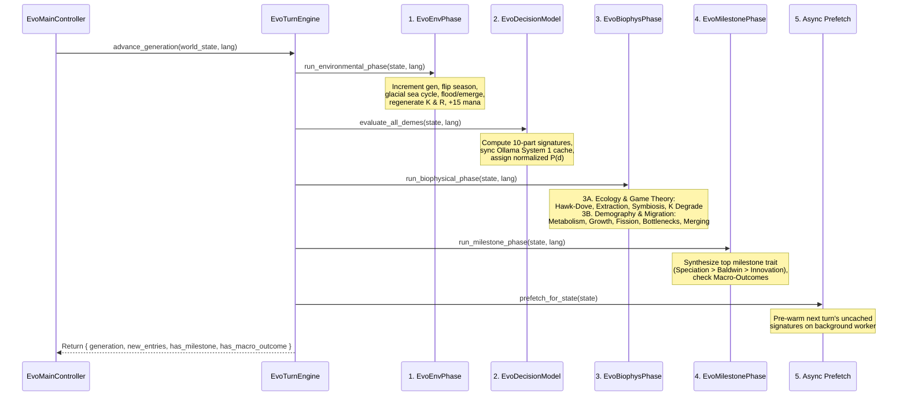
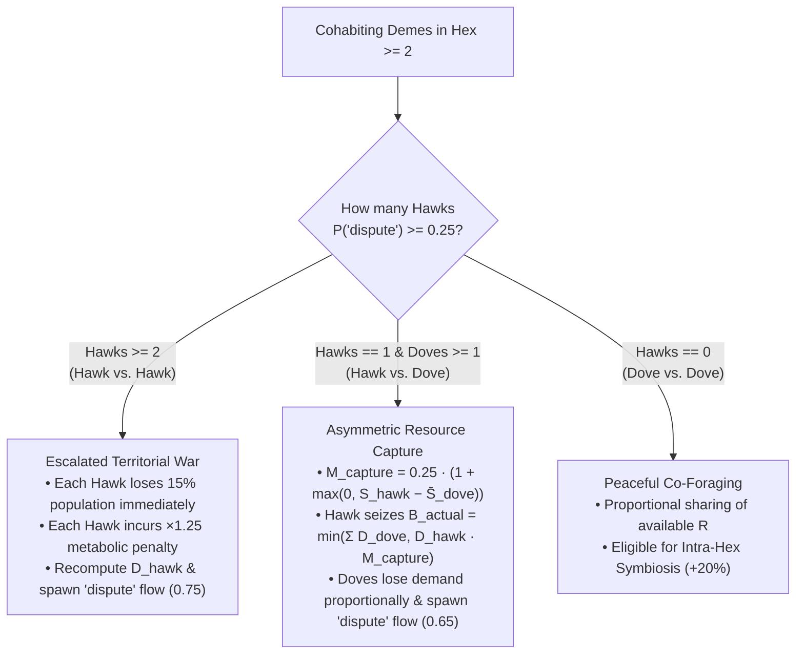

# Generational Loop & Biophysical Mechanics

At the heart of **Evolution** is `EvoTurnEngine.advance_generation(state, lang)`, which advances the simulation by one discrete generation (half-year seasonal step: `year = generation / 2 + 1`). Every generation executes a strictly ordered **5-stage pipeline** that translates probabilistic deme intentions into deterministic ecological, demographic, and phylogenetic outcomes.

---

## High-Level Execution Pipeline

---

## Stage 1 & 2: Environment & Cognitive Scoring

1. **Environmental Phase (`EvoEnvPhase.run_environmental_phase`)**:
   * Increments `state.generation += 1` and toggles `state.season` between `"wet_warm"` ($\gamma_{\text{season}} = 1.20$) and `"dry_cold"` ($\gamma_{\text{season}} = 0.75$).
   * Archives active `"exchange"` and `"cooperate"` flows from the previous turn into `state.disused_connections` (incrementing `age += 1` on older severed links) before clearing `state.active_flows`.
   * Applies glacial sea-level cycles (every 8 generations), coastal flooding/emergence, submerged deme relocation or drowning, passive $K$ recovery ($+5\%$ normal or $+0.5\%$ after a Tragedy of the Commons), and seasonal biomass $R$ regeneration.
   * Regenerates player Selective Pressure ("Mana") points: `state.selective_pressure_points += state.selective_pressure_regen_per_turn` (`+15` per generation).
2. **Cognitive Phase (`EvoDecisionModel.evaluate_all_demes`)**:
   * Evaluates every surviving deme and assigns a normalized probability distribution $P(d)$ across all eligible behavioral decisions (`last_decision_probabilities`) along with `last_dominant_decision_id`, `last_confidence`, and `last_justification`.

---

## Stage 3A: Ecology, Extraction & Evolutionary Game Theory (`EvoEcologyInteraction`)

Once every deme has its probability distribution $P(d)$ and effective 6-axis vector $\mathbf{v}_{\text{eff}}$, `EvoEcologyInteraction.run_resource_and_symbiosis_phase` resolves intra-hex and inter-hex ecological interactions in six sequential steps:

### Step 1: Initial Caloric Demand ($D_i$)
Each resident deme $i$ in a hexagon requests biomass proportional to its population $P_i$ and effective `extraction_efficiency`:

$$D_i = \max\Big(0.0,\ P_i \times 0.50 \times \big(1.0 + 0.60 \cdot v_{\text{eff}, i}.\text{extraction\_efficiency}\big)\Big)$$

### Step 2: Archetype Classification
Within each hex, cohabiting demes are classified by summing their decision probabilities per archetype (`get_archetype_prob`):

* **Hawk**: $P(\text{"dispute"}) \ge 0.25$
* **Dove**: $P(\text{"dispute"}) < 0.25$
* **Exchanger**: $P(\text{"exchange"}) \ge 0.20$

### Step 3: Hawk-Dove Territorial Conflict
When **2 or more demes cohabit the same hex** (`resident_demes.size() >= 2`):

* **Case A — Hawk vs. Hawk (`hawks.size() >= 2`)**:
  * Every Hawk suffers an immediate **$15\%$ demographic casualty loss**:
    $$P_{\text{hawk}} \leftarrow \max\big(1,\ \lfloor 0.85 \cdot P_{\text{hawk}} \rfloor\big)$$
  * Every Hawk is penalized with a **$\times 1.25$ metabolic expenditure multiplier** (`hawk_penalty_by_deme[hawk.id] = 1.25`) for the remainder of the turn.
  * Caloric demand $D_{\text{hawk}}$ is recomputed at the reduced population, and a `"dispute"` flow (`intensity = 0.75`) is created.
* **Case B — Hawk vs. Dove (`hawks.size() == 1` and `doves.size() >= 1`)**:
  * The lone Hawk intimidates cohabiting Doves and captures a share of their caloric demand, scaled by the difference between the Hawk's `social_cohesion` and the Doves' mean cohesion $\bar{S}_{\text{dove}}$:
    $$M_{\text{capture}} = 0.25 \times \Big(1.0 + \max\big(0.0,\ v_{\text{eff, hawk}}.\text{social\_cohesion} - \bar{S}_{\text{dove}}\big)\Big)$$
    $$B_{\text{actual}} = \min\left(\sum_{d \in \text{doves}} D_d,\ D_{\text{hawk}} \times M_{\text{capture}}\right)$$
  * The Hawk's demand increases by $+B_{\text{actual}}$, while each Dove's demand decreases proportionally by $B_{\text{actual}} \cdot (D_d / \sum D_{\text{doves}})$.

### Step 4: Biomass Extraction ($E_i$)
Total cell demand $D_{\text{total}} = \sum_i D_i$ is harvested against available hex resources $R_{\text{cell}}$:

$$E_{\text{total}} = \min(R_{\text{cell}},\ D_{\text{total}}), \qquad E_i = \begin{cases} E_{\text{total}} \cdot \dfrac{D_i}{D_{\text{total}}} & \text{if } D_{\text{total}} > 0 \\ 0.0 & \text{otherwise} \end{cases}$$

$$R_{\text{cell}} \leftarrow \max\big(0.0,\ \text{snapped}(R_{\text{cell}} - E_{\text{total}},\ 0.01)\big)$$

### Step 5: Reciprocal Symbiosis & Horizontal Cultural Transmission
Symbiosis operates both **intra-hex** (among cohabiting Exchangers with $P(\text{"exchange"}) \ge 0.20$) and **inter-hex** (between an Exchanger and any Exchanger in an adjacent neighbor hex):

1. **$+20\%$ Non-Zero-Sum Caloric Bonus**: Each participating Exchanger receives a one-time **$+20\%$ boost** to its extracted energy for the turn:
   $$E_i \leftarrow \text{snapped}(E_i \times 1.20,\ 0.0001)$$
2. **Active Trade Road Flow**: Spawns an `"exchange"` `HexEdgeFlow` (`intensity = 0.60` intra-hex, `0.55` inter-hex) rendered as a cobblestone trade road or wooden bridge with caravan carts.
3. **Horizontal Cultural Diffusion**: For every ordered pair `(donor, receiver)` of interacting Exchangers:
   * If `receiver` has biological cultural capacity (`enables_cultural_transmission == true`, i.e., `bio-encephalization` or `bio-social-instinct`),
   * And for any cultural tradition `tid` in `donor.cultural_trait_ids` not yet known by `receiver`:
     $$v_{\text{eff, receiver}}.\text{social\_cohesion} \ge \text{trait.vector.transmission\_threshold}$$
   * Then `receiver` immediately adopts `tid` into `receiver.cultural_trait_ids`, recomputes its effective vector $\mathbf{v}_{\text{eff}}$, and records a `"symbiosis"` entry in the Chronicle.

### Step 6: Carrying Capacity ($K$) Degradation, Tragedy of the Commons & Niche Construction
After extraction, the resident demes' combined ecological impact $\Sigma_{\text{eco}} = \sum_{i} v_{\text{eff}, i}.\text{ecological\_impact}$ modifies the hexagon's structural carrying capacity $K$:

* **Overexploitation & Habitat Degradation**:
  Triggered when extraction exceeds natural seasonal regeneration ($E_{\text{total}} > K_{\text{cell}} \cdot r_{\text{regen}}$ or $R_{\text{cell}} \le 0$ with $D_{\text{total}} > K_{\text{cell}} \cdot r_{\text{regen}}$) **AND** either $\Sigma_{\text{eco}} < -0.15$ or ($\exists i: P_i(\text{"overexploit"}) \ge 0.30 \land \Sigma_{\text{eco}} < -0.10$):
  $$K_{\text{degraded}} = \max\Big(10.0,\ \text{snapped}\big(K_{\text{cell}} \times (1.0 + 0.18 \cdot \Sigma_{\text{eco}}),\ 0.01\big)\Big)$$
  * **Tragedy of the Commons Milestone**: The first time a hexagon's degraded carrying capacity drops below **$60\%$ of $K_{\max}$**:
    $$K_{\text{degraded}} < 0.60 \times K_{\max}$$
    a `"tragedy_of_commons"` Chronicle entry is logged, and the hex's recovery rate on the following turn drops tenfold (from $5.0\%$ to $0.5\%$).
* **Positive Ecological Niche Construction**:
  Conversely, if degradation did not trigger, no resident deme is overexploiting ($P(\text{"overexploit"}) < 0.30$), and $\Sigma_{\text{eco}} > +0.10$ (e.g., demes practicing `cul-communal-conservation`), the population actively enriches its habitat:
  $$K_{\text{cell}} \leftarrow \text{clamp}\Big(\text{snapped}\big(K_{\text{cell}} \times (1.0 + 0.05 \cdot \Sigma_{\text{eco}}),\ 0.01\big),\ 10.0,\ K_{\max}\Big)$$

---

## Stage 3B: Demography, Storage, Migration & Bottlenecks (`EvoDemographyMigration`)

### Step 1: Metabolic Expenditure & Food Storage Buffering
Each deme expends energy $C_{\text{metabolic}}$ based on its population $P_i$, effective `metabolic_cost`, ambient thermal extremity $|T_{\text{cell}}|$ (mitigated by positive `spatial_mobility`), and any Hawk-Hawk combat penalty ($\text{hawk\_mult} \in \{1.0, 1.25\}$):

$$C_{\text{metabolic}} = P_i \times 0.42 \times \Big(1.0 + 0.55 \cdot v_{\text{eff}}.\text{metabolic\_cost} + 0.20 \cdot |T_{\text{cell}}| \cdot \max\big(0.0,\ 1.0 - \max(0.0, v_{\text{eff}}.\text{spatial\_mobility})\big)\Big) \times \text{hawk\_mult}$$

The raw net energy balance is $\Delta E = E_i - C_{\text{metabolic}}$. If the deme runs a caloric deficit ($\Delta E < 0.0$) but holds substantial stored reserves ($E_{\text{reserves}, t} > 0.30 \cdot P_i$), up to **$50\%$ of its prior reserves** buffers the deficit for demographic calculations:

$$\Delta E_{\text{eff}} = \begin{cases} \Delta E + \min(-\Delta E,\ 0.50 \cdot E_{\text{reserves}, t}) & \text{if } \Delta E < 0.0 \;\land\; E_{\text{reserves}, t} > 0.30 \cdot P_i \\ \Delta E & \text{otherwise} \end{cases}$$

$$E_{\text{reserves}, t+1} = \max\big(0.0,\ \text{snapped}(E_{\text{reserves}, t} + \Delta E,\ 0.01)\big)$$

### Step 2: Demographic Growth & $r/K$ Selection Modifiers
The base per-turn demographic growth rate $g_0$ is bounded between $-45\%$ and $+35\%$:

$$g_0 = \text{clamp}\left(\frac{\Delta E_{\text{eff}}}{\max(10.0,\ P_i)} \times 0.45,\ -0.45,\ +0.35\right)$$

Life-history traits scale $g_0$ before re-clamping to $[-0.45, +0.35]$:

* **`bio-r-strategy` (Prolific)**: $g = \text{clamp}(g_0 \times 1.35,\ -0.45,\ +0.35)$
* **`bio-k-strategy` (Longevity & Parental Care)**: $g = \text{clamp}(g_0 \times 0.75,\ -0.45,\ +0.35)$

$$P_{t+1} = \begin{cases} P_i - 1 & \text{if } \Delta E_{\text{eff}} < 0.0 \;\land\; \text{round}\big(P_i \cdot (1.0 + g)\big) \ge P_i \\ \text{round}\big(P_i \cdot (1.0 + g)\big) & \text{otherwise} \end{cases}$$

### Step 3: Baldwin & Cultural Innovation Counter Accumulation
* **Baldwin Counters (`baldwin_counters[dec_id]`)**: Every non-foraging decision (`archetype != "forage"`) with probability $P(\text{dec\_id}) \ge 0.35$ increments its integer counter by $+1$.
* **Cultural Innovation Counter (`innovation_counter`)**: If the deme has cultural capacity (`bio-encephalization` or `bio-social-instinct`), its innovation counter advances by:
  $$\Delta I = \big(P(\text{"innovate"}) + 0.35 \cdot P(\text{"cooperate"})\big) \times 0.45$$
  $$\text{innovation\_counter}_{t+1} = \min\big(2.0,\ \text{snapped}(\text{innovation\_counter}_t + \Delta I,\ 0.0001)\big)$$

### Step 4: Population Fission (Budding Migration)
When a deme with $P_i \ge 20$ exhibits intentional or emergency migration:

* **Migrant Cohort Size**: $\text{migrants} = \lfloor P_i \times P(\text{"migrate"}) \times 0.45 \rfloor$.
* **Trigger**: Requires $\text{migrants} \ge 10$, remaining parent population $P_i - \text{migrants} \ge 10$, and at least one of:
  1. $P(\text{"migrate"}) \ge 0.15$,
  2. `last_dominant_decision_id == "dec-selective-migration"`,
  3. Current hex is a `"coastal_shallows"` land bridge, or
  4. **Emergency Scarcity**: $R_{\text{cell}} < 0.20 \cdot P_i \;\land\; E_{\text{reserves}} < 0.35 \cdot P_i$.
* **Target Hex Scoring**: Passable neighboring hexes (`ncell.biome != "ocean"`, `ncell.altitude - 0.50 <= v_eff.spatial_mobility`, `ncell.deme_ids.size() < 3`, and—unless in emergency—no closely related kin deme with Jaccard trait divergence $< 0.25$) are ranked by highest per-deme resource share:
  $$\text{Score}(\text{ncell}) = \frac{R_{\text{ncell}}}{\text{ncell.deme\_ids.size()} + 1}$$
* **Fission Mechanics**: The parent deme sends `migrants` and a proportional share of `energy_reserves` (minus a **$15\%$ transit energy loss**, so the daughter receives $85\%$) into the top-ranked neighbor hex as a newly founded daughter deme (`<root>-m<gen>-<q>_<r>`), spawning a `"migration"` flow rendered as a stepping-stone expedition trail with a settler wagon.

### Step 5: Extinction & Demographic Bottleneck Cultural Loss
* **Minimum Viable Population Extinction**: Any deme whose population falls below **$10$ individuals** (`deme.population < 10`) goes extinct. It is removed from the world, spawns `ruins` on its hex, logs an `"extinction"` Chronicle entry, and—if no living demes of its `lineage_id` remain—marks `extinct_generation = state.generation` on its `LineageNode`.
* **Cultural Loss (Tasmanian Effect / Demographic Bottleneck)**: If a surviving non-newly-budded deme with cultural traditions suffers either:
  1. **Acute Collapse**: Losing $\ge 50\%$ of its turn-start population ($P_{\text{current}} \le 0.50 \cdot P_{\text{initial}}$), or
  2. **Sub-Critical Bottleneck**: Dropping below **$50$ individuals** ($P_{\text{current}} < 50$),
  the deme loses its most complex cultural tradition (the trait in `cultural_trait_ids` with the highest `transmission_threshold`) and logs a `"cultural_loss"` Chronicle entry.

### Step 6: Compatible Kin Merging & Isolation Tracking
* **Kin Merging**: If two demes of the **same `lineage_id`** cohabit the same hex and their Jaccard trait divergence is $< 0.25$, they fuse into a single consolidated settlement (summing `population` and `energy_reserves`, taking the union of traits, and computing population-weighted averages of `innovation_counter` and `baldwin_counters`).
* **Geographic Isolation Counter (`isolation_turns`)**: Reset to `0` if the deme is on its lineage's `founder_hex_id`, merged with kin this turn, or is adjacent via a passable hex to `founder_hex_id` while `founder_hex_id` is still occupied by the same lineage. Otherwise, `deme.isolation_turns += 1`.

---

## Stage 4: Evolutionary Milestones & Macro-Outcomes (`EvoMilestonePhase`)

At the end of each generation, `EvoMilestonePhase.run_milestone_phase` collects all eligible evolutionary milestone candidates across all demes, sorts them by strict priority (`0` $\to$ `1` $\to$ `2`), and synthesizes at most **one emergent trait per turn globally**:

| Priority | Milestone Type | Chronicle `event_type` | Exact Trigger Conditions | Evolutionary Consequence |
| :---: | :--- | :--- | :--- | :--- |
| **0 (Highest)** | **Allopatric Speciation** | `allopatric_speciation` | 1. `isolation_turns >= 10` 2. `< 3` emergent biological traits 3. Separated from `founder_hex_id` 4. Distinct biome (`cell.biome != founder_cell.biome`), novel bio trait, or Jaccard trait divergence $\ge 0.30$ | Synthesizes `Allopatric Divergence (<Biome>)` (`bio`), resets `isolation_turns = 0`, creates a new child `LineageNode` in `lineage_tree`, assigns a new species color from `SPECIATION_PALETTE`, and updates `deme.lineage_id`. |
| **1** | **The Baldwin Effect** *(Genetic Assimilation)* | `baldwin_trait` | 1. `< 3` emergent biological traits 2. Any non-foraging decision `dec_id` has `baldwin_counters[dec_id] >= 8` AND ($P(\text{dec\_id}) \ge 0.35$ or is dominant) | Synthesizes `Adaptive Homeostasis (<Biome>)` (`bio`), appends it to `biological_trait_ids`, and resets `baldwin_counters[dec_id] = 0`. |
| **2** | **Cumulative Cultural Innovation** | `cultural_innovation` | 1. `innovation_counter >= 1.0` 2. Has cultural capacity (`enables_cultural_transmission`) 3. `0` existing emergent cultural traits 4. Non-negative energy balance ($\Delta E \ge 0.0$) | Synthesizes `Cooperative Ecological Tradition (<Biome>)` (`cul`), appends it to `cultural_trait_ids`, and decrements `innovation_counter -= 1.0`. |

### Global Macro-Outcomes
Finally, `EvoMilestonePhase` evaluates whether the ecosystem has reached one of three overarching macro-outcomes (displayed in the top-center golden banner and optionally auto-pausing playback):

1. **Total Extinction (`total_extinction`)**: `state.demes.is_empty()` — all subpopulations have perished across the valley.
2. **Evolutionary Hegemony (`single_survivor`)**: After prior competitive or environmental extinctions eliminated rival lineages, a single lineage (or a single non-migrant deme at `generation >= 15`) remains as the sole survivor of the ecosystem.
3. **Ecological & Demographic Equilibrium (`ecological_equilibrium`)**: Reached when `state.generation >= 30` and the ecosystem completes **8 consecutive quiet generations** (`state.quiet_turns >= 8` — 4 full seasonal cycles) with zero migrations, zero chronicle crises/milestones, an unchanged set of living demes, and $\le 5\%$ per-turn population fluctuation across every deme.
