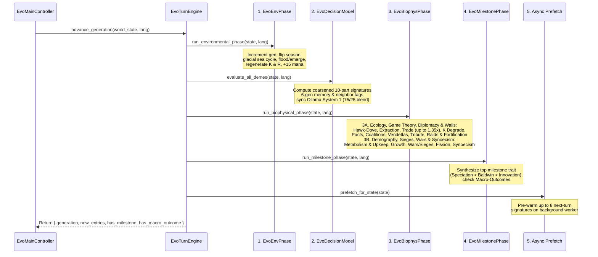
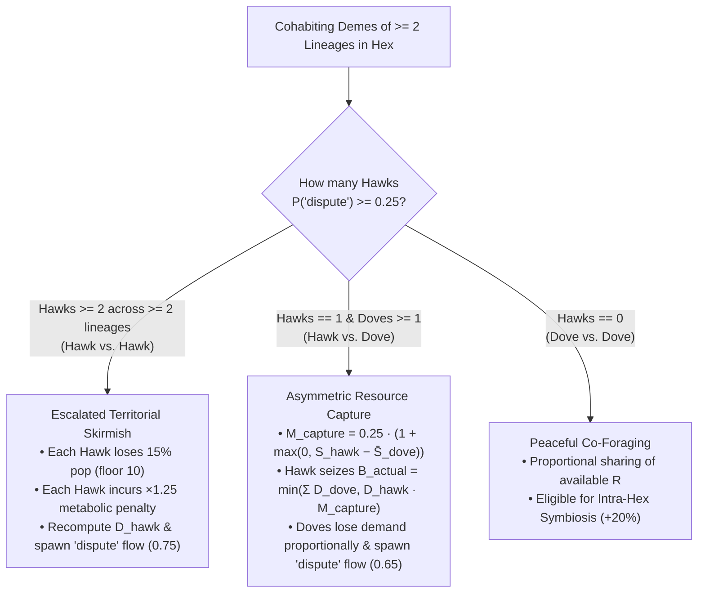

# Generational Loop & Biophysical Mechanics

At the heart of **Evolution** is `EvoTurnEngine.advance_generation(state, lang)`, which advances the simulation by one discrete generation (half-year seasonal step: `year = generation / 2 + 1`). Every generation executes a strictly ordered **5-stage pipeline** that translates probabilistic deme intentions into deterministic ecological, demographic, and phylogenetic outcomes.

---

## High-Level Execution Pipeline

---

## Stage 1 & 2: Environment & Cognitive Scoring

1. **Environmental Phase (`EvoEnvPhase.run_environmental_phase`)**:
   * Increments `state.generation += 1`, clears `state.recent_extinction_hexes`, and toggles `state.season` between `"wet_warm"` ($\gamma_{\text{season}} = 1.20$) and `"dry_cold"` ($\gamma_{\text{season}} = 0.75$).
   * Archives active `"exchange"`, `"cooperate"`, and `"pact"` flows from the previous turn into `state.disused_connections` (incrementing `age += 1` on older severed links) before clearing `state.active_flows`.
   * Applies glacial sea-level cycles (every 8 generations), coastal flooding/emergence, submerged deme relocation (`altitude <= 0.85` and `altitude - 0.50 <= v_eff.spatial_mobility`, with a $10\%$ transit population loss and `"migration"` flow) or drowning (`"extinction"` if no passable non-ocean refuge neighbor exists), passive $K$ recovery ($+5\%$ normal or $+0.5\%$ after a Tragedy of the Commons), and seasonal biomass $R$ regeneration.
   * Regenerates player Selective Pressure ("Mana") points: `state.selective_pressure_points += state.selective_pressure_regen_per_turn` (`+15` per generation).
2. **Cognitive Phase (`EvoDecisionModel.evaluate_all_demes`)**:
   * Evaluates every surviving deme via the Dual-Model System 1 Ollama engine (`/v1/systemone`) with its 6-generation historical memory digest and rich neighbor relational labels, blended (**$75\%$ live LLM / $25\%$ environmental & geopolitical pressures**), and assigns a normalized probability distribution $P(d)$ across all eligible behavioral decisions (`last_decision_probabilities`) along with `last_dominant_decision_id`, `last_confidence`, and `last_justification`.

---

## Stage 3A: Ecology, Extraction, Diplomacy, Raids & Fortifications (`EvoEcologyInteraction`)

Once every deme has its probability distribution $P(d)$ and effective 6-axis vector $\mathbf{v}_{\text{eff}}$, `EvoEcologyInteraction.run_resource_and_symbiosis_phase` resolves intra-hex and inter-hex ecological, diplomatic, and defensive interactions in nine sequential steps:

### Step 1: Initial Caloric Demand ($D_i$)
Each resident deme $i$ in a hexagon requests biomass proportional to its population $P_i$ and effective `extraction_efficiency`:

$$D_i = \max\Big(0.0,\ P_i \times 0.50 \times \big(1.0 + 0.60 \cdot v_{\text{eff}, i}.\text{extraction\_efficiency}\big)\Big)$$

### Step 2: Archetype Classification
Within each hex, cohabiting demes are classified by summing their decision probabilities per archetype (`get_archetype_prob`):

* **Hawk**: $P(\text{"dispute"}) \ge 0.25$
* **Dove**: $P(\text{"dispute"}) < 0.25$
* **Exchanger**: $P(\text{"exchange"}) \ge 0.20$

### Step 3: Hawk-Dove Territorial Conflict
When **2 or more demes of different lineages cohabit the same hex** (`resident_demes.size() >= 2` and `has_rival_lineages`):

* **Case A — Hawk vs. Hawk (`hawks.size() >= 2` and `has_rival_hawks`)**:
  * Every Hawk suffers an immediate **$15\%$ demographic casualty loss** (with a minimum floor of $10$ individuals so a single skirmish does not instantly wipe out a viable settlement):
    $$P_{\text{hawk}} \leftarrow \max\big(10,\ \lfloor 0.85 \cdot P_{\text{hawk}} \rfloor\big)$$
  * Every Hawk is penalized with a **$\times 1.25$ metabolic expenditure multiplier** (`hawk_penalty_by_deme[hawk.id] = 1.25`) for the remainder of the turn.
  * Caloric demand $D_{\text{hawk}}$ is recomputed at the reduced population, and a `"dispute"` flow (`intensity = 0.75`) is created.
* **Case B — Hawk vs. Dove (`hawks.size() == 1` and `doves.size() >= 1`)**:
  * The lone Hawk intimidates cohabiting Doves and captures a share of their caloric demand, scaled by the difference between the Hawk's `social_cohesion` and the Doves' mean cohesion $\bar{S}_{\text{dove}}$:
    $$M_{\text{capture}} = 0.25 \times \Big(1.0 + \max\big(0.0,\ v_{\text{eff, hawk}}.\text{social\_cohesion} - \bar{S}_{\text{dove}}\big)\Big)$$
    $$B_{\text{actual}} = \min\left(\sum_{d \in \text{doves}} D_d,\ D_{\text{hawk}} \times M_{\text{capture}}\right)$$
  * The Hawk's demand increases by $+B_{\text{actual}}$, while each Dove's demand decreases proportionally by $B_{\text{actual}} \cdot (D_d / \sum D_{\text{doves}})$.

### Step 4: Biomass Extraction ($E_i$)
Total cell demand $D_{\text{total}} = \sum_i D_i$ is harvested against available hex resources $R_{\text{cell}}$:

$$E_{\text{total}} = \min(R_{\text{cell}},\ D_{\text{total}}), \qquad E_i = \begin{cases} E_{\text{total}} \cdot \dfrac{D_i}{D_{\text{total}}} & \text{if } D_{\text{total}} > 0 \\ 0.0 & \text{otherwise} \end{cases}$$

$$R_{\text{cell}} \leftarrow \max\big(0.0,\ \text{snapped}(R_{\text{cell}} - E_{\text{total}},\ 0.01)\big)$$

### Step 5: Reciprocal Symbiosis, Complementary Inter-Biome/Cross-Cultural Trade & Horizontal Transmission
Symbiosis operates both **intra-hex** (among cohabiting Exchangers with $P(\text{"exchange"}) \ge 0.20$) and **inter-hex** (between an Exchanger and any Exchanger in an adjacent passable neighbor hex with `altitude <= 0.85`):

1. **Complementary Caloric Trade Surplus (`1.15x` to `1.35x`)**:
   * **Intra-Hex Symbiosis**: Each cohabiting Exchanger receives a one-time **$+20\%$ boost** ($E_i \leftarrow E_i \times 1.20$).
   * **Inter-Hex Complementary Trade**: When trading across neighboring hexes, the caloric multiplier rewards ecological and cultural complementarity:
     $$M_{\text{trade}} = 1.15 + \begin{cases} 0.12 & \text{if } \text{biome}_A \neq \text{biome}_B \\ 0.00 & \text{otherwise} \end{cases} + \begin{cases} 0.08 & \text{if } \text{cultural\_trait\_ids}_A \neq \text{cultural\_trait\_ids}_B \\ 0.00 & \text{otherwise} \end{cases}$$
     scaling extracted energy up to **$1.35\times$ (`+35%`)** when exchanging across distinct biomes ($+12\%$) and distinct cultural repertoires ($+8\%$).
2. **Active Trade Road Flow**: Spawns an `"exchange"` `HexEdgeFlow` (`intensity = 0.60` intra-hex, `0.55` inter-hex) rendered as a cobblestone trade road or wooden bridge with caravan carts.
3. **Horizontal Cultural Diffusion**: For every ordered pair `(donor, receiver)` of interacting Exchangers:
   * If `receiver` has biological cultural capacity (`enables_cultural_transmission == true`, i.e., `bio-encephalization` or `bio-social-instinct`),
   * And for any cultural tradition `tid` in `donor.cultural_trait_ids` not yet known by `receiver`:
     $$v_{\text{eff, receiver}}.\text{social\_cohesion} \ge \text{trait.vector.transmission\_threshold}$$
   * Then `receiver` immediately adopts `tid` into `receiver.cultural_trait_ids`, recomputes its effective vector $\mathbf{v}_{\text{eff}}$, and records a `"symbiosis"` entry in the Chronicle.

### Step 6: Carrying Capacity ($K$) Degradation, Tragedy of the Commons & Niche Construction
After extraction, the resident demes' combined ecological impact $\Sigma_{\text{eco}} = \sum_{i} v_{\text{eff}, i}.\text{ecological\_impact}$ modifies the hexagon's structural carrying capacity $K$:

* **Overexploitation & Habitat Degradation**:
  Triggered when extraction exceeds natural seasonal regeneration ($E_{\text{total}} > K_{\text{cell}} \cdot r_{\text{regen}}$ or $R_{\text{cell}} \le 0$ with $D_{\text{total}} > K_{\text{cell}} \cdot r_{\text{regen}}$) **AND** either $\Sigma_{\text{eco}} < -0.15$ or ($\exists i: P_i(\text{"overexploit"}) \ge 0.30 \land \Sigma_{\text{eco}} < -0.10$):
  $$K_{\text{degraded}} = \max\Big(10.0,\ \text{snapped}\big(K_{\text{cell}} \times (1.0 + 0.18 \cdot \Sigma_{\text{eco}}),\ 0.01\big)\Big)$$
  * **Tragedy of the Commons Milestone**: The first time a hexagon's degraded carrying capacity drops below **$60\%$ of $K_{\max}$**:
    $$K_{\text{degraded}} < 0.60 \times K_{\max}$$
    a `"tragedy_of_commons"` Chronicle entry is logged, and the hex's recovery rate on the following turn drops tenfold (from $5.0\%$ to $0.5\%$).
* **Positive Ecological Niche Construction**:
  Conversely, if degradation did not trigger, no resident deme is overexploiting ($P(\text{"overexploit"}) < 0.30$), and $\Sigma_{\text{eco}} > +0.10$ (e.g., demes practicing `cul-communal-conservation`), the population actively enriches its habitat:
  $$K_{\text{cell}} \leftarrow \text{clamp}\Big(\text{snapped}\big(K_{\text{cell}} \times (1.0 + 0.05 \cdot \Sigma_{\text{eco}}),\ 0.01\big),\ 10.0,\ K_{\max}\Big)$$

### Step 7: Alliance Pacts, Defensive Coalitions, Opportunistic Betrayals & Vendettas (`_run_pacts_and_betrayals`)
Next, `EvoEcologyInteraction` evaluates all cohabiting and adjacent passable (`altitude <= 0.85`, non-ocean) deme pairs `pair_key = "idA__idB"` tracked in `state.active_pacts`:

* **Multi-Turn Vendettas / Grudges (`active_pacts < 0`, `EvoTypes.is_vendetta_active`)**:
  * Negative values in `state.active_pacts[pair_key]` represent active hostility memory (set to `-4` turns after a betrayal, `-3` after a territorial conquest, and `-2` after a raid or repelled war).
  * Each turn, a negative vendetta counter increments by `+1` toward `0` (deleting the entry once it reaches `0`). While `prev_turns < 0`, the pair cannot form an Alliance Pact and appears as `vendetta` in cognitive neighbor briefings and the HUD Inspector.
* **Opportunistic Betrayal (`_execute_betrayal`)**:
  If a formal pact already exists (`prev_turns >= 2`) and one partner is under severe demographic or ecological stress (`energy_reserves < 42.0`, `last_energy_delta <= -6.0`, `R < 0.25 * P`, or hex crowding $> 0.72 \cdot K$) **AND** exhibits opportunistic or aggressive tendencies ($P(\text{"overexploit"}) + P(\text{"dispute"}) \ge 0.24$, `cul-warrior-expansion`, `strat-war`, or `social_cohesion < 0.35`)—and is not deterred by a heavily fortified partner (`victim.defense_tier >= 2` deters betrayal unless betrayer hostility exceeds cooperation $+ 0.15$)—the stressed partner breaks the pact in a surprise ambush:
  1. **Conserved Caloric Plunder**: Plunders $\text{loot}_{\text{desired}} = \text{clamp}(0.30 \cdot E_{\text{reserves, victim}} + 0.25 \cdot E_{\text{victim}},\ 10.0,\ 45.0)$ directly from the victim's `energy_reserves` and current-turn extracted energy $E_{\text{victim}}$, adding the exact stolen sum to the betrayer's reserves (capped at `220.0`).
  2. **Ambush Casualties**: Inflicts $\max(3,\ \text{round}(0.14 \cdot P_{\text{victim}}))$ casualties on the victim (floor `5`).
  3. **Deep Vendetta & Chronicle**: Sets `state.active_pacts[pair_key] = -4` (a 4-turn blood vendetta), records a severed link in `state.disused_connections`, spawns a crimson `"betrayal"` flow (`intensity = 1.0`), and logs a `"betrayal"` Chronicle entry.
* **Alliance Pact Formation, Defensive Coalitions & Mutual Aid**:
  * **Defensive Coalition Threshold**: Normally, pact formation requires $P(\text{"cooperate"}) + P(\text{"exchange"}) \ge 0.30$, $P(\text{"dispute"}) < 0.22$, and no `cul-warrior-expansion`. However, when either partner faces an adjacent non-allied warrior threat (`_has_adjacent_warrior_threat`), the required cooperation threshold drops to **`0.22`** (and two strongly cooperative demes $\ge 0.36$ can form a defensive pact even if carrying `cul-warrior-expansion`), incrementing `state.active_pacts[pair_key]` by $+1$.
  * **Formalization (`next_turns == 2`)**: When a pair reaches `2` consecutive cooperative turns (`EvoTypes.is_pact_active == true`), a `"pact"` Chronicle entry is recorded.
  * **$+15\%$ Mutual Caloric Bonus, Distress Aid & Shared Defense (`next_turns >= 2`)**: Each ally that did not already receive the symbiosis bonus receives a **$+15\%$ boost** to its extracted energy ($E_i \leftarrow E_i \times 1.15$). If one partner is in caloric distress while the other holds surplus reserves ($E_{\text{reserves}} > 60.0$), the surplus ally transfers $\min(14.0,\ (E_{\text{reserves}} - 50.0) \times 0.25)$ energy to the distressed partner. Spawns an emerald `"pact"` highway flow (`intensity = 0.80`) and provides up to **$+1.10$ shared military defense** (`compute_pact_defense_bonus`, where each cohabiting/adjacent ally contributes $0.25 \cdot \text{clamp}(P_{\text{ally}} / \max(20, P_{\text{victim}}), 0.4, 1.5) + 0.08 \cdot \text{ally.defense\_tier}$) against raids and invasions.

### Step 8: Cross-Border Plunder Raids & Tribute Appeasement (`_run_raids`)
Non-allied, non-close-kin cohabiting or adjacent demes (`altitude <= 0.85`) with raiding capability (`cul-warrior-expansion`, `strat-war`, $P(\text{"dispute"}) \ge 0.20$, or $P(\text{"overexploit"}) \ge 0.30$) and $P(\text{"dispute"}) + P(\text{"overexploit"}) \ge 0.28$ under environmental pressure attempt **Plunder Raids** (`_execute_raid_if_successful`) against targets with `defense_tier < 3` (**Tier 3 Castles are completely immune to minor plunder raids**):

* **Force Comparison**: The attacker's `raider_score` (scaled by population, $P(\text{"dispute"})$, `social_cohesion`, `spatial_mobility`, and `+0.35` for `cul-warrior-expansion`) is compared against the target's `defense_score`, which adds `DEFENSE_TIER_BONUS[defense_tier]` (`+0.45` at Lv.1, `+0.95` at Lv.2, `+1.55` at Lv.3) and `compute_pact_defense_bonus` (up to `+1.10`).
* **Tribute / Appeasement (`tribute`)**:
  If an under-fortified cooperative or mercantile settlement (`defense_tier < 2`, `energy_reserves >= 55.0`, and either $P(\text{"exchange"}) \ge 0.28$ or $(P(\text{"cooperate"}) + P(\text{"exchange"}) \ge 0.65 \land P(\text{"dispute"}) < 0.10)$) faces a superior raider (`raider_score > defense_score * 0.92`), it deters the raid through diplomatic tribute:
  1. **18% Reserve Tribute**: Transfers $\text{tribute} = \text{clamp}(0.18 \cdot E_{\text{reserves, target}},\ 10.0,\ 28.0)$ directly from the target's reserves to the raider (capped at `240.0`).
  2. **Zero Casualties & Temporary Truce**: Neither population suffers casualties, `state.active_pacts[pair_key]` is set to `1` (establishing a temporary truce and clearing any prior vendetta), a golden `"tribute"` caravan flow (`intensity = 0.75`) is spawned, and a `"tribute"` Chronicle entry is logged.
* **Successful Plunder Raid (`raider_score > defense_score * 0.75`)**:
  1. **Fortification Loot & Casualty Mitigation**: Perimeter defenses scale down both plundered calories (`loot_shield_mult`: `0.75x` at Lv.1 Palisade, `0.40x` at Lv.2 Stone Wall) and defender casualties (`cas_shield_mult`: `0.75x` at Lv.1, `0.50x` at Lv.2).
  2. **Conserved Loot Transfer**: Plunders $\text{loot}_{\text{desired}} = \text{clamp}\big((0.28 \cdot E_{\text{reserves, victim}} + 0.24 \cdot E_{\text{victim}}) \cdot \text{force\_ratio} \cdot \text{loot\_shield\_mult},\ 6.0,\ 42.0\big)$ from the victim's `energy_reserves` and extracted energy $E_{\text{victim}}$ and transfers the exact stolen calories to the raider (`<= 240.0`).
  3. **Skirmish Casualties, Vendetta & Visuals**: Raider loses $2.5\%$ population (`max 1`), defender loses $4.0\% \times \text{cas\_shield\_mult}$ (`max 1`), `state.active_pacts[pair_key]` is set to $\le -2$ (vendetta), an orange `"raid"` flow is spawned, and a `"raid"` Chronicle entry is logged.

### Step 9: Multi-Tier Defense Fortification (`_run_defense_fortification_phase`)
Settlements with `defense_tier < 3` that experience security pressure (facing an adjacent rival, an active vendetta, or practicing `dec-cooperate-store` / `cul-communal-conservation` / `cul-symbolic-storage` / `bio-k-strategy` with $P(\text{"cooperate"}) + P(\text{"dispute"}) \ge 0.20$) can upgrade their perimeter fortifications by one tier per turn:

| Tier | Fortification Name | Defense Bonus | Raid Protection | Requirements (`pop` / `reserves` / `hex R`) | Base Cost (`reserves` + `hex R`) | Upkeep / Turn |
| :---: | :--- | :---: | :--- | :---: | :---: | :---: |
| **Lv. 1** | **Palisade & Watchtower** | **`+0.45` (`+45%`)** | `-25%` raid loot & casualties (`0.75x`) | `pop >= 38`, `res >= 58`, `R >= 35` | `25.0` reserves + `15.0` hex $R$ | `1.5` energy |
| **Lv. 2** | **Stone Wall & Fort** | **`+0.95` (`+95%`)** | `-60%` raid loot (`0.40x`), `-50%` casualties (`0.50x`), betrayal deterrence | `pop >= 65`, `res >= 92`, `R >= 55` | `45.0` reserves + `25.0` hex $R$ | `3.0` energy |
| **Lv. 3** | **Castle / Fortified Citadel** | **`+1.55` (`+155%`)** | **Immune to minor plunder raids**, heavy siege attrition to attackers | `pop >= 100`, `res >= 130`, `R >= 75` | `65.0` reserves + `35.0` hex $R$ | `5.0` energy |

* **15% Conservation & Storage Discount (`* 0.85`)**: Demes carrying `cul-communal-conservation`, `cul-symbolic-storage`, or `bio-k-strategy` receive a **$15\%$ reduction** on required reserves, reserve cost, and hex biomass cost.
* **Allied Co-Financing**: If a deme has at least `req_res - 35.0` reserves, cohabiting or adjacent Pact allies holding `energy_reserves >= 80.0` automatically co-finance the shortfall (contributing up to $\min(30.0,\ E_{\text{reserves, ally}} - 55.0)$ per ally). Upgrading to Tier 2 or Tier 3 logs a `"fortify"` Chronicle entry.

---

## Stage 3B: Demography, Upkeep, Territorial Wars, Sieges & Synoecism (`EvoDemographyMigration`)

### Step 1: Metabolic Expenditure, Fortification Upkeep & Food Storage Buffering
Each deme expends energy $C_{\text{metabolic}}$ based on its population $P_i$, effective `metabolic_cost`, ambient thermal extremity $|T_{\text{cell}}|$ (mitigated by positive `spatial_mobility`), and any Hawk-Hawk combat penalty ($\text{hawk\_mult} \in \{1.0, 1.25\}$), plus per-turn **fortification maintenance upkeep** $C_{\text{upkeep}} \in \{0.0, 1.5, 3.0, 5.0\}$ for `defense_tier` `0..3`:

$$C_{\text{metabolic}} = P_i \times 0.42 \times \Big(1.0 + 0.55 \cdot v_{\text{eff}}.\text{metabolic\_cost} + 0.20 \cdot |T_{\text{cell}}| \cdot \max\big(0.0,\ 1.0 - \max(0.0, v_{\text{eff}}.\text{spatial\_mobility})\big)\Big) \times \text{hawk\_mult}$$

The raw net energy balance is $\Delta E = E_i - C_{\text{metabolic}} - C_{\text{upkeep}}$. If a fortified settlement exhausts its reserves ($E_{\text{reserves}, t+1} \le 0.0$) under severe starvation ($\Delta E < -8.0$), its unmaintained walls degrade by `defense_tier -= 1`. If the deme runs a caloric deficit ($\Delta E < 0.0$) but holds substantial stored reserves ($E_{\text{reserves}, t} > 0.30 \cdot P_i$), up to **$50\%$ of its prior reserves** buffers the deficit for demographic calculations:

$$\Delta E_{\text{eff}} = \begin{cases} \Delta E + \min(-\Delta E,\ 0.50 \cdot E_{\text{reserves}, t}) & \text{if } \Delta E < 0.0 \;\land\; E_{\text{reserves}, t} > 0.30 \cdot P_i \\ \Delta E & \text{otherwise} \end{cases}$$

$$E_{\text{reserves}, t+1} = \max\big(0.0,\ \text{snapped}(E_{\text{reserves}, t} + \Delta E,\ 0.01)\big)$$

### Step 2: Demographic Growth & $r/K$ Selection Modifiers
The base per-turn demographic growth rate $g_0$ is bounded between $-45\%$ and $+35\%$:

$$g_0 = \text{clamp}\left(\frac{\Delta E_{\text{eff}}}{\max(10.0,\ P_i)} \times 0.45,\ -0.45,\ +0.35\right)$$

Life-history traits scale $g_0$ before re-clamping to $[-0.45, +0.35]$:

* **`bio-r-strategy` (Prolific, Density-Dependent on Crowding $P_{\text{hex}} / K$)**:
  $$m_r = \begin{cases} 1.28 & \text{if } P_{\text{hex}} / K < 0.55 \\ 1.16 & \text{if } 0.55 \le P_{\text{hex}} / K < 0.65 \\ 1.05 & \text{if } P_{\text{hex}} / K \ge 0.65 \end{cases}, \qquad g = \text{clamp}(g_0 \times m_r,\ -0.45,\ +0.35)$$
* **`bio-k-strategy` (Longevity & Parental Care)**: $g = \text{clamp}(g_0 \times 0.88,\ -0.45,\ +0.35)$

$$P_{t+1} = \begin{cases} P_i - 1 & \text{if } \Delta E_{\text{eff}} < 0.0 \;\land\; \text{round}\big(P_i \cdot (1.0 + g)\big) \ge P_i \\ \text{round}\big(P_i \cdot (1.0 + g)\big) & \text{otherwise} \end{cases}$$

### Step 3: Baldwin & Cultural Innovation Counter Accumulation
* **Baldwin Counters (`baldwin_counters[dec_id]`)**: Every non-foraging decision (`archetype != "forage"`) with probability $P(\text{dec\_id}) \ge 0.35$ increments its integer counter by $+1$.
* **Cultural Innovation Counter (`innovation_counter`)**: If the deme has cultural capacity (`bio-encephalization` or `bio-social-instinct`), its innovation counter advances by:
  $$\Delta I = \big(P(\text{"innovate"}) + 0.35 \cdot P(\text{"cooperate"})\big) \times 0.45$$
  $$\text{innovation\_counter}_{t+1} = \min\big(2.0,\ \text{snapped}(\text{innovation\_counter}_t + \Delta I,\ 0.0001)\big)$$

### Step 4: Territorial Wars of Conquest, Fortified Sieges & Population Fission
When a deme with $P_i \ge 20$ evaluates expansion into neighboring hexes, passability (`is_hex_passable_for_deme`) requires **`ncell.biome != "ocean"`**, **`ncell.altitude <= 0.85`** (impassable mountain peaks above `0.85` block traversal), and `ncell.altitude - 0.50 <= mig_mobility`, where:

$$\text{mig\_mobility} = \text{clamp}\big(v_{\text{eff}}.\text{spatial\_mobility} + 0.25 \cdot P(\text{"migrate"}),\ -1.5,\ +1.5\big)$$

(elevated to at least `0.35` during emergency scarcity, on `coastal_shallows`, or for martial expanders).

1. **Territorial Wars of Conquest & Fortified Sieges (`_execute_territorial_invasion`)**:
   * **Trigger**: A martial expander (`cul-warrior-expansion`, `strat-war`, or $P(\text{"dispute"}) \ge 0.28$) with $P_i \ge 32$ and $P(\text{"dispute"}) + P(\text{"migrate"}) \ge 0.30$ (with hex crowding $\ge 0.28$ or $P(\text{"dispute"}) \ge 0.26$) prioritizes invading adjacent hexes occupied by non-allied rival demes (`_pick_rival_target_in_hex`).
   * **Warband, Flanking & Fortification Force Resolution**: The attacker commits a warband of $\text{warband\_pop} = \text{clamp}(\text{round}(0.48 \cdot P_i),\ 12,\ P_i - 14)$ warriors. Combat strength `_compute_combat_forces` weighs:
     * **Attacker Force (`att_force`)**: Warband population, `social_cohesion`, `spatial_mobility`, $P(\text{"dispute"})$, `cul-warrior-expansion`, and a **Flanking Bonus** (`+0.28` per allied/same-lineage deme with `pop >= 35` adjacent to the target hex, up to `+0.85`).
     * **Defender Force (`def_force`)**: Defender population, `social_cohesion`, high-ground altitude, `DEFENSE_TIER_BONUS[defender.defense_tier]` (`+0.45` Lv.1, `+0.95` Lv.2, `+1.55` Lv.3), and `compute_pact_defense_bonus` (up to `+1.10` from adjacent pact allies).
   * **Attacker Victory (`att_force >= def_force`)**: The warband seizes $38\%$ of the defender's `energy_reserves`, inflicts combat casualties on both sides, forces the surviving defender to retreat to an adjacent passable hex with `defense_tier = 0` (or eliminates it if trapped), establishes a conquered settlement (`<base_id>-w<gen>`) on the target hex inheriting `strategy_id`, `lineage_id`, and **captured fortifications (`max(0, defender.defense_tier - 1)`)**, sets a `-3` vendetta, spawns a red `"war"` invasion flow (`intensity = 1.0`), and logs a `"war"` victory Chronicle entry.
   * **Fortified Siege / Invasion Repelled (`att_force < def_force`)**:
     * **Heavy Siege Attrition**: The attacking warband suffers $(42\% + 6\% \cdot \text{def\_tier})$ casualties and retreats back to the attacker (`-15.0` energy reserves), while the defender suffers reduced casualties $(16\% - 2\% \cdot \text{def\_tier})$.
     * **Wall Repair vs. Siege Degradation**: If `defender.defense_tier >= 1`, an allied or unified defender holding `energy_reserves >= 10.0` spends `10.0` energy to repair and preserve its fortifications; otherwise, an isolated defender against a massive warband (`warband_pop >= 55%` of `defender.population`) suffers `defense_tier -= 1` wall damage.
     * **Chronicle & Siege Flow**: Strengthens the defender's formal pacts (`+1`), sets a `-2` vendetta with the attacker, spawns a crimson `"siege"` flow (`intensity = 0.90`, with siege engine props) when `def_tier >= 1` (or `"war"` when unfortified), and logs a `"siege"` (or `"war"`) Chronicle entry.
2. **Peaceful Population Fission (Budding Migration)**:
   * **Migrant Cohort Size**: $\text{migrants} = \lfloor P_i \times \max(P(\text{"migrate"}),\ 0.28 \text{ if emergency/shallows}) \times 0.45 \rfloor$.
   * **Trigger**: Requires $\text{migrants} \ge 10$, remaining parent population $P_i - \text{migrants} \ge 10$, and $P(\text{"migrate"}) \ge 0.15$, `dec-selective-migration`, `"coastal_shallows"`, or emergency scarcity ($R_{\text{cell}} < 0.20 \cdot P_i \land E_{\text{reserves}} < 0.35 \cdot P_i$).
   * **Fission Mechanics & Strategy Identity Inheritance**: The parent deme sends `migrants` and a proportional share of `energy_reserves` (minus a **$15\%$ transit energy loss**) into the top-ranked passable neighbor hex (`Score = R / (deme_ids.size() + 1)`) as a daughter deme (`<base_id>-m<gen>`), inheriting `daughter.lineage_id = deme.lineage_id` and **`daughter.strategy_id = deme.strategy_id`**, and spawning a `"migration"` flow.

### Step 5: Extinction & Demographic Bottleneck Cultural Loss
* **Minimum Viable Population Extinction**: Any deme whose population falls below **$10$ individuals** (`deme.population < 10`) goes extinct. It is removed from the world, spawns `ruins` on its hex, appends the hex to `state.recent_extinction_hexes`, logs an `"extinction"` Chronicle entry, and—if no living demes of its `lineage_id` remain—marks `extinct_generation = state.generation` on its `LineageNode`.
* **Cultural Loss (Tasmanian Effect / Demographic Bottleneck)**: If a surviving non-newly-budded deme with cultural traditions suffers either:
  1. **Acute Collapse**: Losing $\ge 50\%$ of its turn-start population ($P_{\text{current}} \le 0.50 \cdot P_{\text{initial}}$), or
  2. **Sub-Critical Bottleneck**: Dropping below **$50$ individuals** ($P_{\text{current}} < 50$),
  the deme loses its most complex cultural tradition (the trait in `cultural_trait_ids` with the highest `transmission_threshold`) and logs a `"cultural_loss"` Chronicle entry.

### Step 6: Compatible Kin Merging, City Unification (Synoecism) & Isolation Tracking
* **Compatible Kin Merging (Intra-Hex)**: If two demes of the **same `lineage_id`** cohabit the same hex and their Jaccard trait divergence is $< 0.25$, they fuse into a single consolidated settlement (summing `population` and `energy_reserves`, taking the union of traits, and computing population-weighted averages of `innovation_counter` and `baldwin_counters`).
* **City Unification / Synoecism (`merge`, Tier 5 Unified Metropolis)**:
  Long-standing allied settlements—even across **different lineages and founding strategies**—can unite into a single multi-lineage city (`_merge_deme_into(..., is_synoecism = true)` and `_run_adjacent_synoecism`):
  1. **Cohabiting Synoecism**: Two demes sharing the same hex with a deep formal alliance (`active_pacts >= 3`) unite immediately.
  2. **Adjacent-Hex Synoecism**: Two passable neighboring settlements (`distance == 1`) with `active_pacts >= 4` (or **`active_pacts >= 3` when either settlement is fortified `defense_tier >= 1` or faces an adjacent rival threat**), both having $P(\text{"cooperate"}) + P(\text{"exchange"}) \ge 0.30$ and combined population $\le 1.25 \times \max(K_{\max, 1}, K_{\max, 2})$, unite into the stronger/better-fortified host hexagon.
  3. **Urban & Cognitive Effects**:
     * Combines `population` and `energy_reserves` (capped at `280.0`), merges compatible biological and cultural traits, transfers all active pacts, increments `deme.merged_count += 1 + joiner.merged_count`, and records the partner's strategy emblem color in `deme.secondary_color` (rendered as a twin-pennant flagpole on the unified plaza).
     * Elevates shared fortifications (`defense_tier = min(3, max(2, combined_tier + 1))` when `population >= 90`) and expands the host hexagon's carrying capacity $K$ (`min(K_max * 1.35, K + 35.0)`).
     * Elevates the settlement to **Architectural Tier 5 (`V · Metropolis`)** when `merged_count >= 1` and (`population >= 220` or `defense_tier >= 3`), spawns a golden `"merge"` unification avenue flow (`intensity = 0.85`), and logs a `"merge"` Chronicle entry.
     * **Direct LLM Request Reduction**: Because two subpopulations consolidate into a single `Deme` instance, synoecism directly reduces the number of active LLM inference evaluations per generation—without counting as a competitive extinction for `single_survivor` hegemony.
* **Geographic Isolation Counter (`isolation_turns`)**: Reset to `0` if the deme is on its lineage's `founder_hex_id`, merged with kin or allies this turn, cohabits with another living deme of the same `lineage_id`, or is connected within **3 passable hex hops** (`_is_connected_to_founder`: `altitude <= 0.85` and `altitude - 0.50 <= v_eff.spatial_mobility`) to `founder_hex_id` **or to any hex occupied by a living peer deme of the same `lineage_id`**. Otherwise, `deme.isolation_turns += 1`.

---

## Stage 4: Evolutionary Milestones, Speciation Strategy Inheritance & Macro-Outcomes (`EvoMilestonePhase`)

At the end of each generation, `EvoMilestonePhase.run_milestone_phase` collects all eligible evolutionary milestone candidates across all demes, sorts them by strict priority (`0` $\to$ `1` $\to$ `2`), and synthesizes at most **one emergent trait per turn globally**:

| Priority | Milestone Type | Chronicle `event_type` | Exact Trigger Conditions | Evolutionary Consequence & Strategy Inheritance |
| :---: | :--- | :--- | :--- | :--- |
| **0 (Highest)** | **Allopatric Speciation** | `allopatric_speciation` | 1. `isolation_turns >= 10` 2. `< 3` emergent biological traits 3. Separated from `founder_hex_id` 4. Distinct biome (`cell.biome != founder_cell.biome`), novel bio trait, or Jaccard trait divergence $\ge 0.30$ | Synthesizes `Allopatric Divergence (<Biome>)` (`bio`), resets `isolation_turns = 0`, creates a new child `LineageNode` in `lineage_tree` with **`new_node.strategy_id = deme.strategy_id`** (plus `biological_trait_ids`, `cultural_trait_ids`, and `acquired_trait_ids`), assigns a new species color from `SPECIATION_PALETTE`, and updates `deme.lineage_id`. Even after speciating into a new lineage, the village retains its founding `strategy_id`. |
| **1** | **The Baldwin Effect** *(Genetic Assimilation)* | `baldwin_trait` | 1. `< 3` emergent biological traits 2. Any non-foraging decision `dec_id` has `baldwin_counters[dec_id] >= 8` AND ($P(\text{dec\_id}) \ge 0.35$ or is dominant) | Records `baldwin_decision_id = dec_id`, synthesizes `Adaptive Homeostasis (<Biome>)` (`bio`) with a 6-axis vector derived proportionally from the assimilated decision `dec_id`'s vector, appends it to `biological_trait_ids`, and resets `baldwin_counters[dec_id] = 0`. |
| **2** | **Cumulative Cultural Innovation** | `cultural_innovation` | 1. `innovation_counter >= 1.0` 2. Has cultural capacity (`enables_cultural_transmission`) 3. `< 2` existing emergent cultural traits 4. Non-negative energy balance ($\Delta E \ge 0.0$) | Synthesizes `Cooperative Ecological Tradition (<Biome>)` (`cul`), appends it to `cultural_trait_ids`, and decrements `innovation_counter -= 1.0`. |

### Strategy Lineage Continuity (`Deme.strategy_id` & `LineageNode.strategy_id`)
Across the entire generational lifecycle, every subpopulation and phylogenetic node maintains an unbroken link to its founding **Evolutionary Strategy** (`EvoTypes.StrategyDef` in `state.strategies_catalog`):

1. **Generation 0 Initialization (`EvoCatalog.apply_strategy_to_deme`)**: Assigns `state.strategy_a_id` to Founder A (`deme.strategy_id`, `lin.strategy_id`) and `state.strategy_b_id` to Founder B.
2. **Colonist Migration & Warband Conquest (`EvoDemographyMigration`)**: Every daughter deme budded via population fission (`-m<gen>`) or founded via territorial conquest (`-w<gen>`) inherits `daughter.strategy_id = deme.strategy_id`.
3. **Allopatric Speciation (`EvoMilestonePhase`)**: When an isolated colony diverges into a new species (`new_node := EvoTypes.LineageNode.new()`), `new_node.strategy_id = deme.strategy_id` is preserved alongside `deme.strategy_id`, allowing the HUD Valley Legend and Scroll Inspector to track which founding strategy (`Strategy A` vs. `Strategy B`) is winning the macro-evolutionary duel even after multiple speciation events.

### Global Macro-Outcomes
Finally, `EvoMilestonePhase` evaluates whether the ecosystem has reached one of three overarching macro-outcomes (displayed in the top-center golden banner and optionally auto-pausing playback):

1. **Total Extinction (`total_extinction`)**: `state.demes.is_empty()` — all subpopulations have perished across the valley.
2. **Evolutionary Hegemony (`single_survivor`)**: After prior competitive or environmental extinctions eliminated rival root lineages (`_get_root_lineage_id`), a single founding root lineage (including its speciated daughter lineages, or a single non-migrant deme at `generation >= 15`) remains as the sole survivor of the ecosystem.
3. **Ecological & Demographic Equilibrium (`ecological_equilibrium`)**: Reached when `state.generation >= 30` and the ecosystem completes **8 consecutive quiet generations** (`state.quiet_turns >= 8` — 4 full seasonal cycles) with zero migrations, zero chronicle crises/milestones, an unchanged set of living demes, and $\le 5\%$ per-turn population fluctuation across every deme.
