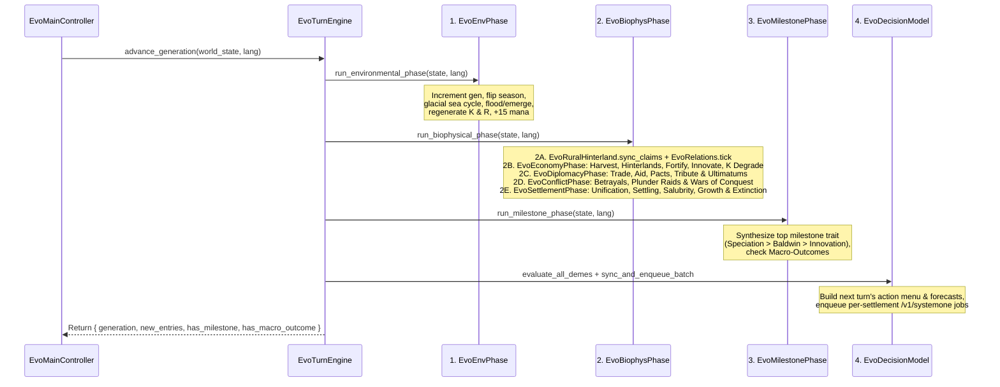

# Generational Loop & Biophysical Mechanics

At the heart of **Evolution** is `EvoTurnEngine.advance_generation(state, lang)`, which advances the simulation by one discrete generation (half-year seasonal step: `year = generation / 2 + 1`). Every generation executes a strictly ordered **5-stage pipeline** under the **1-Deme-Per-Hex Exclusivity invariant (`cell.deme_ids.size() <= 1`)**, resolving each settlement's concrete chosen action (`deme.chosen_action`) through deterministic ecological, diplomatic, military, and demographic laws (`EvoPayoffs`).

---

## High-Level Execution Pipeline

---

## Stage 1: Environmental Phase (`EvoEnvPhase`)

1. Increments `state.generation += 1`, clears `state.recent_extinction_hexes`, and toggles `state.season` between `"wet_warm"` ($\gamma_{\text{season}} = 1.20$) and `"dry_cold"` ($\gamma_{\text{season}} = 0.75$).
2. Ages existing severed roads in `state.disused_connections` (`age += 1`, pruning links with `age > 4`) and clears `state.active_flows`.
3. Applies glacial sea-level cycles (every 8 generations), coastal flooding/emergence, submerged settlement relocation to adjacent empty passable hexes (`10%` transit loss, `20%` reserve penalty, `"migration"` flow) or drowning (`"extinction"`), passive carrying capacity $K$ recovery (`+5%` normal or `+0.5%` after a Tragedy of the Commons), and seasonal biomass $R$ regeneration.
4. Regenerates player Selective Pressure ("Mana") points (`+15` per generation).

---

## Stage 2: Biophysical & Social Resolution (`EvoBiophysPhase`)

### 2A. Rural Hinterland Sync & Relation Aging (`EvoRuralHinterland.sync_claims` & `EvoRelations.tick`)
* **Tier Hinterland Quotas (`RURAL_QUOTA = [0, 0, 1, 2, 4]`)**: Tier II–IV settlements automatically claim up to `1`, `2`, or `4` adjacent uninhabited passable hexes (`altitude <= 0.85`), converting arid/tundra hexes into `"pasture"` (`pasture_pen` + `granary`) and fertile hexes into `"crops"` (`crop_field` + `windmill`).
* **Relation & Ultimatum Lifecycle (`EvoRelations.tick`)**:
  * If a neighbor issued a `demand_tribute` ultimatum on the previous turn and the target settlement did **not** choose `pay_tribute` this turn, `EvoRelations._refuse_tribute` immediately resolves a **punitive enforcement raid** against the refuser.
  * Increments active alliance pacts (`pact_turns += 1`), decrements active feuds (`feud_turns -= 1`) and truces (`truce_turns -= 1`), decays bilateral trust slightly toward `0`, and transitions any inactive friendly road from the previous turn into `state.disused_connections` (`age = 1`).

### 2B. Domestic Economy (`EvoEconomyPhase.resolve`)
1. **Wild + Rural Harvest (`EvoPayoffs.expected_income`)**:
   * Each settlement harvests wild food from its host hex (scaled by extraction efficiency, urban foraging factor `[1.0, 1.0, 1.0, 0.55, 0.30]`, `+10%` if `forage`, or `+35%` if `intensify`), plus `min(R_rural, 0.35 * pop) * 0.70` from each owned rural hinterland hex, multiplied by **`1.12x` (`+12%`)** if the settlement has at least one active alliance pact.
2. **Carrying Capacity ($K$) Degradation vs. Conservation**:
   * Choosing `intensify` permanently degrades host hex carrying capacity $K$ by **`-7%`** (`INTENSIFY_K_DROP = 0.07`). Dropping below **$60\%$ of $K_{\max}$** triggers a **Tragedy of the Commons (`"tragedy_of_commons"`)**, cutting natural $K$ recovery tenfold.
   * Choosing `forage` with positive ecological impact (`cul-communal-conservation`) gently enriches $K$ toward $K_{\max}$.
3. **Perimeter Fortifications (`fortify`) & Innovation (`innovate`)**:
   * **`fortify`**: Spends `[22, 40, 60]` food reserves (with a `15%` discount for `cul-communal-conservation` or `bio-k-strategy`) to upgrade `defense_tier` (`Lv.1 Palisade` `+35%` defense / `30%` loot shield $\to$ `Lv.2 Stone Wall` `+75%` defense / `60%` loot shield $\to$ `Lv.3 Castle` `+130%` defense / `80%` loot shield).
   * **`innovate`**: Advances `innovation_counter` by `EvoPayoffs.innovation_step(deme, state)` (`0.38` base, up to `0.58` with `bio-encephalization` and `cul-fire-processing`).

### 2C. Diplomacy & Exchange (`EvoDiplomacyPhase.resolve`)
* **Trade (`trade`)**:
  * **Mutual Trade** (both neighbors target each other with `trade`): Both earn `100%` of `EvoPayoffs.trade_gain` (`18%` base + `10%` complementary biome + `7%` distinct culture, up to `+35%` of harvest), `+0.20` bilateral trust, and bilateral horizontal cultural diffusion (`"symbiosis"`).
  * **Unilateral Trade Caravan**: The initiator earns `55%` of `trade_gain` (`EvoPayoffs.unreciprocated_trade_gain`), its partner earns `25%`, bilateral trust rises by `+0.12`, and cultural knowledge diffuses across the border.
* **Surplus Aid (`aid`)**: Transfers `clamp(0.18 * reserves, 10, 32)` food to the target neighbor, boosting bilateral trust by `+0.25`, global reputation by `+0.10`, and automatically sealing any pending alliance offer.
* **Alliance Pacts (`offer_pact`, `accept_pact`)**:
  * `accept_pact` (or mutual `offer_pact`, or `offer_pact` toward same-lineage kin or a neighbor with `trust >= 0.30`) immediately seals a formal alliance (`pact_turns = 1`, `trust +0.25`, `"pact"` flow and Chronicle entry). Otherwise, `offer_pact` registers an open proposal (`proposal_kind = "pact"`) for the target's next turn.
* **Tribute Coercion (`demand_tribute`, `pay_tribute`)**:
  * `demand_tribute` issues an explicit ultimatum (`proposal_kind = "tribute"`, `proposal_amount = clamp(0.22 * target.reserves, 10, 38)`).
  * Choosing `pay_tribute` transfers the demanded food with zero casualties and buys a **2-turn truce (`truce_turns = 2`)**.

### 2D. Conflict, Betrayal & Conquest (`EvoConflictPhase.resolve`)
1. **Opportunistic Betrayal (`betray`)**:
   * Breaks an active alliance (`pact_turns = 0`, `feud_turns = 4`), inflicts **`-0.50` global reputation** and `-0.70` bilateral trust, and launches a surprise attack (`+35%` combat power, halves defender wall bonus, `+25%` loot bonus).
2. **Plunder Raids (`raid`) & Hinterland Pillaging (`has_ruins = true`)**:
   * Resolves stochastic combat via `EvoPayoffs.raid_odds(att, def, state, false)`. On attacker victory, steals reserves (mitigated by defender `WALL_LOOT_SHIELD`), inflicts casualties, and **pillages one owned rural hinterland hex** (`+18.0` extra food, resets `owner_deme_id = ""`, `land_use = "wild"`, and marks `has_ruins = true`). On defender victory, logs a repelled `"siege"`.
3. **Wars of Conquest (`conquer`)**:
   * Dispatches `45%` of the attacker's population (`warband`) to seize the target hex (`EvoPayoffs.conquest_odds`).
   * **Attacker Victory**: Captures `50%` of defender reserves and seizes the hex. If the surviving defender (`population >= 10`) has an adjacent empty passable hex, it **retreats** there; otherwise it is **absorbed in place** (`1/3` assimilated), preserving `cell.deme_ids.size() <= 1`. A new warband settlement (`<base_id>-w<gen>`) occupies the conquered hex and inherits adjacent rural hinterlands up to its tier quota.

### 2E. Unification, Frontier Settling & Demography (`EvoSettlementPhase.resolve`)
1. **Unification (`unite` / `accept_union`)**:
   * When two allied towns (`pact_turns >= 3`, both `tier >= 2`) unite via `accept_union` or mutual `unite`:
     * **Same-Tier Cities (`tier_a == tier_b >= 2`)**: Form a **Continuous Multi-Hex Walled Union (`walled_union_id = "union-<a>-<b>"`, max 3 hexes)**, upgrading `defense_tier >= 1`, culling their shared internal perimeter wall, linking plazas via a golden `"merge"` boulevard, and pooling `+55%` population and `+25%` wall bonus in combat.
     * **Different-Tier Towns (`tier_a != tier_b`)**: The lower-tier settlement merges into the higher-tier host city (**Asymmetric Category Absorption**), expanding host $K$ by `+35` and converting the vacated hex into a cultivated rural hinterland (`"crops"` or `"pasture"`).
2. **Frontier Colonization (`settle`)**:
   * Sends `35%` of the parent settlement's population (`min 24`, requiring `population >= 80`) and proportional food reserves to found a new daughter camp (`<base_id>-m<gen>`) on the chosen empty passable hex.
3. **Metabolism, Urban Salubrity (`salubrity`), Growth & Epidemics (`"epidemic"`)**:
   * Deducts metabolic food need (`EvoPayoffs.food_need`, including wall upkeep `[0, 1.5, 3.0, 5.0]`), updates `salubrity`, applies demographic growth/decline (`r/K` life-history modifiers), triggers **Urban Epidemics (`22%` mortality)** when `salubrity < 0.35` and `population >= 130`, and records any extinction (`population < 10`, leaving stone ruins `has_ruins = true`).

---

## Stage 3 & 4: Milestones (`EvoMilestonePhase`) & Next-Turn Agency (`EvoDecisionModel`)

* **Stage 3 (`EvoMilestonePhase.run_milestone_phase`)**: Synthesizes at most one emergent evolutionary trait per turn globally (**Allopatric Speciation** $\to$ **Baldwin Effect** $\to$ **Cultural Innovation**) and checks global macro-outcomes (`total_extinction`, `single_survivor`, `ecological_equilibrium`).
* **Stage 4 (`EvoDecisionModel.evaluate_all_demes` & `sync_and_enqueue_batch`)**: Applies completed live Ollama `/v1/systemone` results for every surviving settlement and enqueues the next turn's per-settlement action menus on the background worker pool.
