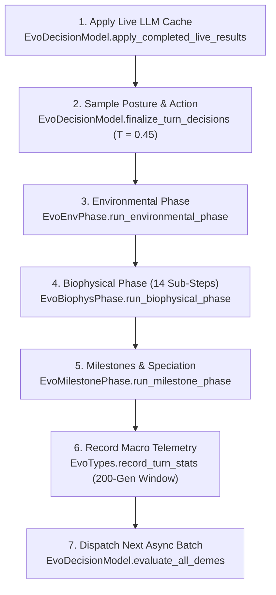

# Turn Execution & Generational Mechanics

Each click of **Step Generation** or simulation playback tick executes one atomic generation through [`EvoTurnEngine.advance_generation()`](https://github.com/arrase/Evolution/blob/main/src/engine/turn_engine.gd). All randomness routes through `state.rng`, producing reproducible histories for any fixed preset, strategy pair, and model response sequence.

---

## 1. Seven-Stage Turn Loop

`EvoTurnEngine.advance_generation(state, lang)` runs seven sequential phases every generation:

1. **Apply Live LLM Results**: Drains completed HTTP responses from `EvoOllamaClient` before any turn math runs so cached probability distributions are up to date.
2. **Finalize Posture & Decision**: Uses `state.rng` in sorted `deme_id` order to sample each living deme's rural `defense_posture` and generational `chosen_action`.
3. **Environmental Phase**: Increments `state.generation`, alternates seasons (`wet_warm` $\leftrightarrow$ `dry_cold`), prunes disused connections (`age > 2`), runs 8-turn glacial sea-level transitions & flood evacuations, regenerates tile $K$ and resources $R$, decays `ruin_turns`, and grants **`+15` selective pressure mana**.
4. **Biophysical Phase**: Resolves all `14` deterministic economic, diplomatic, military, demographic, health, and boundary sub-steps.
5. **Milestone Phase**: Evaluates allopatric speciation, Baldwin assimilation, and cultural innovation, then checks macro outcomes (`single_survivor`, `total_extinction`, `ecological_equilibrium`).
6. **Record Turn Stats**: Appends Strategy A vs. Strategy B population, food ratio, average salubrity, and rural hex counts into `state.stats_history` (capped at `STATS_HISTORY_LIMIT = 200`).
7. **Evaluate Next Demes**: Builds fresh `EvoSituationReport` briefs and dispatches async `/v1/systemone` jobs for the upcoming generation.

---

## 2. Biophysical Phase: Exact 14-Step Order

[`EvoBiophysPhase.run_biophysical_phase()`](https://github.com/arrase/Evolution/blob/main/src/engine/biophys_phase.gd) guarantees causal ordering across every living deme:

| Step | System Call | Effect |
| :---: | :--- | :--- |
| **1** | **Baldwin Counters** | Increments `deme.baldwin_counters[action_type]` by `+1` whenever `chosen_action["type"] != "forage"`. |
| **2** | `EvoEconomyPhase.harvest` | Updates rural hinterland claims, harvests urban + rural biomass with posture & pact multipliers, applies ecological impact / degradation, and resolves bilateral or one-way `trade` gains + cultural diffusion. |
| **3** | `EvoEconomyPhase.invest` | Executes urban `fortify` upgrades (Tier `0` $\to$ `3`) and `innovate` counter progress. |
| **4** | `EvoDiplomacyPhase.resolve` | Resolves `aid`, `offer_pact`/`accept_pact`, `demand_tribute`/`pay_tribute`, and `unite`/`accept_union` (triggering **Walled Unions** or **Absorption**). |
| **5** | `EvoConflictPhase.resolve` | Triggers punitive raids on unpaid expired tribute demands, then resolves `betray`, `raid`, and `conquer` in order. |
| **6** | `EvoSettlementPhase.remove_extinct` | Clears demes below `MIN_VIABLE_POP = 10`, releases rural tiles, and marks urban tiles with `3`-turn ruins (`ruin_turns = 3`). |
| **7** | `EvoSettlementPhase.resolve_settling` | Founds daughter colonies (`-m<gen>`) when a `settle` action clears strategy-scaled population and energy gates. |
| **8** | `EvoEconomyPhase.metabolize` | Deducts per-capita maintenance + wall upkeep, recomputes target salubrity, runs logistic births or `_famine`, and caps storage at `80 * districts + population`. |
| **9** | `EvoEpidemicSalubrity._run_epidemic_phase` | Propagates contagion across active pacts/contact flows, advances existing infections (`2` turns) and immunity (`6` turns), and triggers dense/unsanitary outbreaks. |
| **10** | `EvoSettlementPhase.remove_extinct` | Purges any deme felled by famine or epidemic attrition. |
| **11** | `EvoSettlementPhase.revalidate_walled_unions` | Runs BFS across multi-hex unions; splits disconnected urban districts into autonomous daughter settlements (`-w<gen>`). |
| **12** | `EvoRuralHinterland.enforce_rural_hinterland_quotas` | Releases ruined, flooded, disconnected, or over-quota rural tiles according to updated village tiers. |
| **13** | `EvoSettlementPhase.update_isolation` | Tracks geographic isolation turns (`isolation_turns`) for future allopatric speciation. |
| **14** | `EvoRelations.tick` | Advances `pact_turns`, decrements `feud_turns` and `truce_turns`, decays pair trust (`* 0.95`), and ages `disused_connections`. |

---

## 3. Economy, Rural Postures & Infrastructure

### Rural Defense Postures (`open_harvest`, `patrol_fields`, `mobilized_garrison`)

Every turn, each deme selects one strategic rural defense stance via `/v1/systemone`'s `posture` question (`EvoPayoffs`):

| Posture | Harvest Yield Multiplier | Rural Defense Mobilization | Crop Burn Shield | Field Rendering |
| :--- | :---: | :---: | :---: | :--- |
| **`open_harvest`** | `100%` (`1.00`) | `25%` (`0.25`) | `0%` (`0.00`) | Standard crops / pasture |
| **`patrol_fields`** | `90%` (`0.90`) | `55%` (`0.55`) | `65%` (`0.65`) | Crops / pasture + **rural watchtowers** |
| **`mobilized_garrison`** | `78%` (`0.78`) | `80%` (`0.80`) | `85%` (`0.85`) | Crops / pasture + **rural watchtowers** |

### Urban & Rural Harvest Mechanics

- **Urban Congestion Curve**: Urban extraction decays cleanly as settlements urbanize via `URBAN_FORAGE_MULT = [1.0, 1.0, 0.90, 0.65, 0.40]` indexed by Village Tier (`I`–`IV`). Cities increasingly depend on rural hinterlands and trade for surplus.
- **Home Demand & Bonuses**: Selecting `forage` grants `FORAGE_BONUS = +20%` (`0.20`); `intensify` yields `INTENSIFY_BONUS = +55%` (`0.55`) at the cost of degrading all urban district tiles by `INTENSIFY_K_LOSS = 7%` (`0.07`).
- **Rural Hinterland Quota & Ownership** (`EvoRuralHinterland`): Demes automatically claim highest-resource passable unowned neighbors around their urban perimeter up to tier quota `[0, 0, 1, 2, 4] + max(0, districts - 1)`. Tiles become `"pasture"` on `arid_steppe` / `tundra` and `"crops"` elsewhere.
- **Rural Yield Formula**: Each owned field contributes up to:
  $$\text{pop} \cdot \text{clamp}(0.24 + 0.16 \cdot \max(0, E),\ 0.24,\ 0.42) \cdot \text{biome\_mult} \cdot \text{posture\_mult}$$
  where `biome_mult = 0.85` when land use matches biome terrain, else `0.72`.
- **Pact & Eco Modifiers**: Combined urban + rural harvest multiplies by `1.0 + 0.12 * min(active_pacts, 3)` (`+12%` per active pact, capped at 3). Meanwhile, `ecological_impact < -0.10` during any non-`forage` turn erodes $K$ by `0.015 * |eco|`, triggering **Tragedy of the Commons** chronicles if $K < 0.60 K_{\max}$, whereas `ecological_impact > 0.20` restores `0.02 * eco * K_max`.

### Fortification Walls & Innovation

- **Fortifying (`fortify`)**: Requires meeting `FORTIFY_MIN_POP = [35, 65, 100]` and spending `FORTIFY_COST_RESERVES = [20, 40, 65]` plus `FORTIFY_COST_HEX = [12, 22, 32]` local resources (`0.80x` **`20%` discount** when holding `bio-k-strategy` or `cul-communal-conservation`). Walls advance from Tier `0` to Tier `3`, raising combat multipliers `WALL_DEFENSE = [0.0, 0.5, 1.0, 1.6]`, granary shields `WALL_LOOT_SHIELD = [0.0, 0.25, 0.5, 0.75]`, and maintenance `WALL_UPKEEP = [0.0, 1.5, 3.0, 5.0]`.
- **Innovating (`innovate`)**: Advances `innovation_counter` up to `2.0`:
  - With `bio-encephalization`: step $= 0.37 + 0.04 \cdot |\text{CulturalTraits}|$ (capped at `0.55`).
  - Without `bio-encephalization`: step $= 0.15 - (0.05 \text{ if warrior\_expansion}) + 0.03 \cdot |\text{CulturalTraits}|$, clamped to `[0.12, 0.30]`.

---

## 4. Diplomacy, Walled Unions & War

### Trade, Aid, Pacts & Tribute

- **Bilateral Trade (`trade`)**: Volume uses `0.18 * min(income_A, income_B)` multiplied by complementarity (`+0.40` different biome, `+0.20` different cultural traits) and barter bonuses (`1.45x` if both hold `cul-interdeme-barter`, `1.25x` if one holds it). Mutual trade pays `100%` (`+0.12` trust, `+0.03` rep); one-way trade pays `75%` if allied else `55%` (`+0.08` trust, `+0.02` rep) and triggers `EvoCulture.diffuse()`.
- **Aid (`aid`)**: Transfers `clamp(0.20 * E, 5, 20)` reserves from surplus partners (`>= 40` energy), lifting pair trust by `+0.25` and donor reputation by `+0.05`.
- **Tribute & Expiring Ultimatums (`demand_tribute` / `pay_tribute`)**: Demands `clamp(0.25 * target_E, 8, 40)`. Paying transfers energy and locks a `TRUCE_AFTER_TRIBUTE = 3`-turn truce (`+0.05` trust); ignoring a demand until the proposal expires inflicts `feud_turns >= 2`, `-0.20` trust, and triggers an immediate **punitive raid** if the creditor is within strike distance and target walls are below Tier `3`.

### Walled Unions vs. Absorption (`unite` / `accept_union`)

Adjacent allies with `pact_turns >= 3` can propose and ratify union (`EvoSettlementPhase.unite`):

- **Walled Union**: If **both** demes are Village Tier `>= 2` and combined districts $\le 3$ (`MAX_URBAN_HEXES`), they merge into one continuous multi-hex settlement (`urban_hex_ids` holds up to `3` adjacent districts, `defense_tier = max(2, tier_A, tier_B)`), preserving both urban cores.
- **Absorption**: Otherwise, the joining village is absorbed into the host deme, granting the vacated tile `+20.0` K restoration (up to `1.25 * K_max`) and converting vacated land into rural territory when within quota.

### Combat: Betrayals, Border Raids & Conquest

Combat power uses Lanchester-inspired exponent **`COMBAT_EXPONENT = 2.5`** alongside adjacent allied flanking (`ALLY_SUPPORT_SHARE = 0.22`):

- **Betrayal (`betray`)**: Only legal against an active pact ally (`pact_turns > 0`). Catches defenders off guard (`SURPRISE_MOBILIZATION = 0.22`, `0.25x` wall loot shield, `0` rural crop shield), sets `feud_turns = 8`, lowers pair trust by `-1.0` and attacker reputation by `-0.50`, and severs trade connections into `state.disused_connections`.
- **Raid (`raid`)**: Commits `45%` of population and imposes `FEUD_AFTER_RAID = 4`. Can target adjacent urban neighbors (`dist == 1`) **or** perform **distance-2 border field raids** (`border_only`) against unshielded enemy rural hexes (also used automatically when raiding across frontiers against Tier 3 castles). Winning field pillage steals `min(R * 0.32, 26) * (1 - crop_shield)` and scorches unprotected crops into **`3`-turn ruins** (`ruin_turns = 3`).
- **Conquest (`conquer`)**: Commits `55%` of troops against `CONQUEST_MOBILIZATION = 0.65` defender mobilization (`FEUD_AFTER_WAR = 6`). Capturing a single-hex rival either forces a retreat into an empty passable neighbor or absorbs `1/3` of survivors (`-1` wall tier on captured fort); defeating a multi-hex union detaches only the frontier urban district unless it was their final remaining district.

---

## 5. Metabolism, Colonization, Salubrity & Epidemics

### Colonization (`settle`)

Demes holding `energy_reserves` and `population` above their life-history floor may colonize empty passable hexes `1–3` hops away (`2` hops baseline, `3` hops when `spatial_mobility >= 0.45`):

| Biology | Min Population | Min Reserves | Migrating Cohort |
| :--- | :---: | :---: | :---: |
| **`bio-r-strategy`** | `65` | `32.0` | `34%` of parent pop |
| **Default** | `105` | `55.0` | `30%` of parent pop |
| **`bio-k-strategy`** | `145` | `75.0` | `24%` of parent pop |

Colonized daughter demes carry `-m<gen>` IDs and trigger **allopatric speciation** once isolated outside parental lineage contact for `10` turns.

### Metabolism, Births & Famine

- **Maintenance Need**:
  $$\text{food\_need} = \text{pop} \cdot 0.42 \cdot \big(1 + 0.55 \cdot F + 0.20 \cdot |T| \cdot \max(0, 1 - \max(0, M))\big) + \text{WALL\_UPKEEP}[\text{tier}]$$
- **Logistic Population Growth**: When reserves stay $\ge 0$ above a `0.35 * need` safety buffer, births scale from density $d = \text{pop} / \max(40, K_{\text{eff}})$ (where $K_{\text{eff}}$ counts urban $K$ plus `0.55 * K` per rural hex), multiplied by **`0.35 + 0.65 * salubrity`**:
  - `bio-r-strategy`: $0.16 \cdot \max(0.15,\ 1 - 0.55 d)$
  - Default: $0.115 \cdot \max(0.25,\ 1 - 0.35 d)$
  - `bio-k-strategy`: $0.095 \cdot \max(0.35,\ 1 - 0.20 d)$
  Each birth costs `BIRTH_COST = 2.0` reserves, with storage capped at `80 * districts + population`.
- **Famine**: Negative post-need reserves kill `min(ceil(-E / 1.2), ceil(pop * 0.25))` people, zero reserves, and degrade fortification walls by `-1` tier if deaths exceed `pop / 8`.

### Salubrity, Outbreaks & Contagion (`EvoEpidemicSalubrity`)

Each settlement smoothly updates `salubrity` (`lerp(..., 0.45)`) toward a sanitation-adjusted density target:

$$\text{target\_sal} = \text{clamp}\!\left(1.12 - 0.48 \cdot \max\!\left(0,\ \frac{\text{pop}}{K_{\text{eff}}} + 0.12 \cdot \max(0, \text{tier} - 2) - 0.60\right) + \text{sanitation},\ 0.05,\ 1.0\right)$$

where $\text{sanitation} = (+0.20 \text{ if } \texttt{cul-communal-conservation}) + (+0.14 \text{ if } \texttt{bio-k-strategy}) - 0.06 \cdot \max(0, H) \cdot \max(0, T)$.

- **Primary Outbreak**: Whenever `salubrity < 0.38` and `pop >= 130` (and neither infected nor immune), infection probability is `clamp((0.38 - salubrity) * 2.5, 0, 0.85)`, inflicting `15%` initial mortality (min `10`) for `infection_turns = 2`.
- **Contagion Spread**: Active infections jump across pacts or trade/cooperate/raid/war contact flows to partners with `salubrity < 0.70` and `pop >= 40` (non-immune), inflicting `8%` shock mortality (min `5`).
- **Active Attrition & Recovery**: Infected settlements lose `6%` population per turn (min `4`) until `infection_turns` reaches `0`, conferring **`immunity_turns = 6`** and a **`+0.25` salubrity boost** upon recovery.
