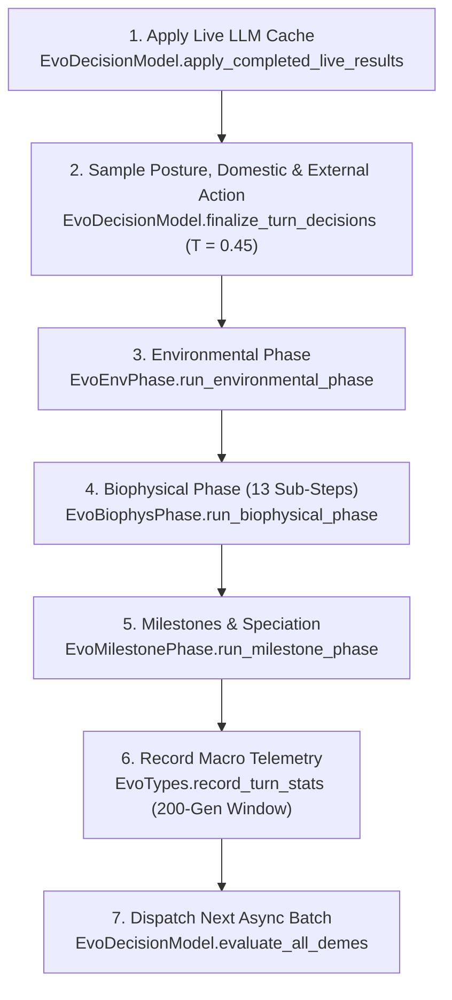

# Turn Execution & Generational Mechanics

Each click of **Step Generation** or simulation playback tick executes one atomic generation through [`EvoTurnEngine.advance_generation()`](https://github.com/arrase/Evolution/blob/main/src/engine/turn_engine.gd). All three presets (`preset-rift-savanna`, `preset-darwin-archipelago`, `preset-finite-island`) use **`map_radius = 5` (`91` cells)** and initialize **1v1 (`1` founding community per strategy: `1` Slot A, `1` Slot B, `2` distinct lineages; `95` population and `120.0` food reserves each)** with a `17`-action `decisions_catalog`. Founders start outside urban adjacency and territorial border range so Generation 0 begins free of premature Turn-0 diplomacy or raids until communities grow, claim fields, or colonize into contact. All randomness routes through `state.rng` for reproducible histories.

---

## 1. Seven-Stage Turn Loop

`EvoTurnEngine.advance_generation(state, lang)` runs seven sequential phases every generation:

1. **Apply Live LLM Results**: Drains completed HTTP responses from `EvoOllamaClient` before any turn math runs so cached probability distributions are up to date.
2. **Finalize Decisions**: Uses `state.rng` in sorted `deme_id` order to sample each living deme's `defense_posture`, `domestic_action`, and external `chosen_action`.
3. **Environmental Phase**: Increments `state.generation`, alternates seasons (`wet_warm` $\leftrightarrow$ `dry_cold`), ages/prunes `disused_connections` (`age > 2`), runs 8-turn glacial sea-level transitions & flood evacuations, regenerates tile $K$ and resources $R$, decays `ruin_turns`, and grants **`+15` selective pressure mana**.
4. **Biophysical Phase**: Updates Baldwin counters and resolves all `13` deterministic economic, diplomatic, military, demographic, health, and boundary sub-steps.
5. **Milestone Phase**: Evaluates allopatric speciation, Baldwin assimilation, and cultural innovation, then checks macro outcomes (`single_survivor`, `total_extinction`, `ecological_equilibrium`).
6. **Record Turn Stats**: Appends Strategy A vs. Strategy B population, food ratio, average salubrity, and rural hex counts into `state.stats_history` (capped at `STATS_HISTORY_LIMIT = 200`).
7. **Evaluate Next Demes**: Builds fresh `EvoSituationReport` briefs and dispatches async 3-question `/v1/systemone` jobs for the upcoming generation.

---

## 2. Biophysical Phase: Baldwin Pre-Pass & Exact 13-Step Order

[`EvoBiophysPhase.run_biophysical_phase()`](https://github.com/arrase/Evolution/blob/main/src/engine/biophys_phase.gd) first increments `deme.baldwin_counters` by `+1` for `domestic_action != "forage"` and for external `chosen_action["type"]` (when not `"none"`, `"forage"`, or equal to `domestic_action`), then executes `13` sequential sub-steps:

| Step | System Call | Effect |
| :---: | :--- | :--- |
| **1** | `EvoEconomyPhase.harvest` | Updates rural hinterland claims, harvests urban + rural biomass with posture & pact multipliers, applies ecological impact / degradation, resolves mutual or unilateral `trade` + passive tariffs + cultural diffusion, and returns `income_by_deme`. |
| **2** | `EvoDiplomacyPhase.resolve` | Resolves `aid`, `offer_pact`/`accept_pact`, `demand_tribute`/`pay_tribute`, and `unite`/`accept_union` before self-investments so diplomatic transfers and unions settle first. |
| **3** | `EvoEconomyPhase.invest` | Executes `fortify` upgrades (Tier `0` $\to$ `3`) and paid `innovate` counter progress (`16.0` food). |
| **4** | `EvoConflictPhase.resolve` | Triggers punitive raids on unpaid expired tribute demands, then resolves `betray`, `raid`, and `conquer` in order. |
| **5** | `EvoSettlementPhase.remove_extinct` | Clears demes below `MIN_VIABLE_POP = 10`, releases rural tiles, and marks urban tiles with `3`-turn ruins (`ruin_turns = 3`). |
| **6** | `EvoSettlementPhase.resolve_settling` | Founds daughter colonies (`-m<gen>`) when a `settle` action clears strategy-scaled population and energy gates. |
| **7** | `EvoEconomyPhase.metabolize` | Deducts maintenance + wall upkeep, updates salubrity, runs logistic births or `_famine`, applies `12%` surplus spoilage above `1.6 * food_need`, and caps storage at `80 * districts + population`. |
| **8** | `EvoEpidemicSalubrity._run_epidemic_phase` | Propagates contagion across active pacts/contact flows, advances infections (`2` turns) and immunity (`6` turns), and triggers dense/unsanitary outbreaks. |
| **9** | `EvoSettlementPhase.remove_extinct` | Purges any deme felled by famine or epidemic attrition. |
| **10** | `EvoSettlementPhase.revalidate_walled_unions` | Runs BFS across multi-hex unions; splits disconnected urban districts into allied sister settlements (`-m<gen>`). |
| **11** | `EvoRuralHinterland.enforce_rural_hinterland_quotas` | Releases ruined, flooded, disconnected, or over-quota rural tiles according to updated village tiers. |
| **12** | `EvoSettlementPhase.update_isolation` | Tracks geographic isolation turns (`isolation_turns`) for future allopatric speciation. |
| **13** | `EvoRelations.tick` | Advances `pact_turns`, decrements `feud_turns` and `truce_turns`, decays pair trust (`move_toward(0, 0.03)`), expires unanswered proposals, and ages `disused_connections`. |

---

## 3. Economy, Rural Postures, Paid Innovation & Spoilage

### Rural Defense Postures (`open_harvest`, `patrol_fields`, `mobilized_garrison`)

Every turn, each deme selects one rural defense stance via `/v1/systemone`'s `posture` question (`EvoPayoffs`):

| Posture | Harvest Yield Multiplier | Rural Defense Mobilization | Crop Burn Shield | Field Rendering |
| :--- | :---: | :---: | :---: | :--- |
| **`open_harvest`** | `100%` (`1.00`) | `22%` (`0.22`) | `0%` (`0.00`) | Standard crops / pasture |
| **`patrol_fields`** | `90%` (`0.90`) | `42%` (`0.42`) | `50%` (`0.50`) | Crops / pasture + **rural watchtowers** |
| **`mobilized_garrison`** | `78%` (`0.78`) | `65%` (`0.65`) | `80%` (`0.80`) | Crops / pasture + **rural watchtowers** |

### Urban & Rural Harvest Mechanics

- **Urban Congestion Curve**: Urban extraction scales with Village Tier (`I`–`IV`) via `URBAN_FORAGE_MULT = [1.0, 1.0, 0.90, 0.65, 0.40]`. Cities increasingly depend on rural hinterlands and trade for surplus.
- **Domestic Focus Modifiers**: `forage` grants `FORAGE_BONUS = +5%` (`0.05`) and `+1%` urban $K$ recovery; `intensify` yields `INTENSIFY_BONUS = +45%` (`0.45`) while degrading urban district tiles by `INTENSIFY_K_LOSS = 7%` (`0.07`).
- **Rural Hinterland Quota & Yield** (`EvoRuralHinterland`): Demes claim highest-resource passable unowned neighbors around their urban perimeter up to tier quota `[0, 0, 1, 2, 4] + max(0, districts - 1)`. Each field contributes up to:
  $$\text{pop} \cdot \text{clamp}(0.24 + 0.16 \cdot \max(0, E),\ 0.24,\ 0.42) \cdot \text{biome\_mult} \cdot \text{posture\_mult}$$
  where `biome_mult = 0.85` when land use (`crops` / `pasture`) matches biome terrain, else `0.72`.
- **Pact & Eco Modifiers**: Combined urban + rural harvest multiplies by `1.0 + 0.04 * min(active_pacts, 3)` (`+4%` per active pact, capped at 3). When `ecological_impact < -0.10` on non-`forage` turns, exploited tiles erode by `0.015 * |eco|` (logging **Tragedy of the Commons** if $K < 0.60 K_{\max}$); `ecological_impact > 0.20` restores `0.02 * eco * K_max`.

### Fortification Walls & Paid Innovation

- **Fortifying (`fortify`)**: Requires `FORTIFY_MIN_POP = [35, 65, 100]` and spends `FORTIFY_COST_RESERVES = [20, 40, 65]` plus `FORTIFY_COST_HEX = [12, 22, 32]` local resources (`0.80x` **`20%` discount** with `bio-k-strategy` or `cul-communal-conservation`). Advances Tier `0` $\to$ `3`, raising `WALL_DEFENSE = [0.0, 0.35, 0.75, 1.25]`, `WALL_LOOT_SHIELD = [0.0, 0.25, 0.50, 0.75]`, and `WALL_UPKEEP = [0.0, 1.5, 3.0, 5.0]`.
- **Paid Innovation (`innovate`)**: `EvoPayoffs.can_innovate()` requires cultural capacity, `< 3` emergent cultural traits (`MAX_EMERGENT_CULTURAL = 3`), and `energy_reserves >= INNOVATE_COST_RESERVES = 16.0`. Investing deducts **`16.0`** food reserves and advances `innovation_counter` (capped at `2.0`) by:
  - With `bio-encephalization`: step $= \min(0.55,\ 0.37 + 0.04 \cdot |\text{CulturalTraits}|)$.
  - Without `bio-encephalization`: step $= \text{clamp}(0.15 - (0.05 \text{ if } \texttt{cul-warrior-expansion}) + 0.03 \cdot |\text{CulturalTraits}|,\ 0.12,\ 0.30)$.

---

## 4. Diplomacy, Daughter Camp Emancipation & War

### Trade, Tariffs, Aid, 2-Turn Pacts & Tribute

All diplomatic and military actions require physical contact (`has_social_contact`): **urban adjacency** (`passable_hop_distance <= 1`) OR **shared territorial borders** (`has_territorial_contact` where a settlement's urban perimeter touches the other's owned rural field or their cultivated fields touch). Unclaimed wilderness gaps keep communities isolated at Generation 0 until borders expand to meet.

- **Trade (`trade`, `TRADE_SHARE = 0.28`)**: Volume `0.28 * min(income_A, income_B)` scales by complementarity (`+0.35` different biome, `+0.20` different cultural traits, `+0.20` if $|E_A - E_B| \ge 45$), barter bonuses (`1.45x` both hold `cul-interdeme-barter`, `1.25x` one holds it), `1.30x` active pact bonus, and hop efficiency (`1.0` at hop $\le 1$, `0.88` at `2`, `0.78` at $\ge 3$).
  - **Mutual trade** pays `100%` to both (`+0.12` trust, `+0.03` rep).
  - **Unreciprocated trade** pays `80%` (allied) or `65%` (unallied) to the initiator (`+0.08` trust, `+0.02` rep), grants the passive partner **`EvoPayoffs.passive_trade_tariff(gain) = round(gain * 0.25)`** food, and triggers `EvoCulture.diffuse()`.
- **Aid (`aid`)**: Transfers `clamp(0.20 * E, 5, 20)` from donors with `reserves >= 35.0` to neighbors below `85%` storage cap (`+0.25` trust, `+0.05` rep), and immediately seals any open `pact` offer from the recipient.
- **2-Turn Pacts (`offer_pact` / `accept_pact`)**: Single-sided `offer_pact` never seals unilaterally on the same turn—it posts a 2-turn proposal (`accept_pact`, mutual `offer_pact`, `aid`, or `trade` seals it). `offer_pact` is allowed even during active feuds and clears `feud_turns = 0` when sealed.
- **Tribute & Expiring Ultimatums (`demand_tribute` / `pay_tribute`)**: Demands `clamp(0.25 * target_E, 8, 40)`. Paying locks a `TRUCE_AFTER_TRIBUTE = 3`-turn truce (`+0.05` trust); letting the ultimatum expire inflicts `feud_turns >= 2`, `-0.20` trust, and triggers an immediate **punitive raid** if within `has_social_contact` range and target walls are below Tier `3`.

### Walled Unions vs. Absorption (`unite` / `accept_union`)

Adjacent allies (`min_urban_distance == 1`) with `pact_turns >= 3` and no pending proposal can propose and ratify union (`EvoSettlementPhase.unite`):

- **Walled Union**: If **both** demes are Village Tier $\ge 2$ and combined districts $\le 3$ (`MAX_URBAN_HEXES`), they fuse into one multi-hex settlement (`defense_tier = max(2, tier_A, tier_B)`), preserving both urban cores.
- **Absorption**: Otherwise, the smaller partner is absorbed into the host (`+20.0` $K$ restoration up to `1.25 * K_max`), converting the vacated hex to rural territory if within quota.

### Combat: Betrayals, Border Raids & Conquest (`COMBAT_EXPONENT = 1.60`)

Combat win odds use Lanchester exponent **`COMBAT_EXPONENT = 1.60`** alongside adjacent allied support (`ALLY_SUPPORT_SHARE = 0.22`):

- **Betrayal (`betray`)**: Legal against an active pact ally (`pact_turns > 0`, `truce_turns == 0`). Uses `SURPRISE_MOBILIZATION = 0.20`, `0.25x` wall loot shield, and `0` crop shield; sets `feud_turns = 8`, `-1.0` trust, `-0.50` rep, and severs trade connections into `disused_connections`.
- **Raid (`raid`)**: Requires `has_social_contact` (urban adjacency `passable_hop_distance <= 1` or `has_territorial_contact` shared borders). Commits `RAID_TROOP_SHARE = 50%` against `POSTURE_RURAL_MOBILIZATION` (`0.22 / 0.42 / 0.65`) and imposes `FEUD_AFTER_RAID = 4`. Contact raids within `dist <= 2` (with walls `< 3`) loot granaries (`0.75x` at `dist == 2`) and pillage/scorch fields; **distance-3 territorial contact** (`has_territorial_contact` with `dist > 2`) or Tier 3 castles restrict raids to `border_only` field pillage (`granary_loot = 0`).
- **Conquest (`conquer`)**: Requires both `has_social_contact` (urban adjacency or shared territorial border) **and** `passable_hop_distance <= 2` (`can_reach_for_conquest`), committing `CONQUEST_TROOP_SHARE = 55%` against `CONQUEST_MOBILIZATION = 0.58` (`FEUD_AFTER_WAR = 6`). Capturing a single-hex rival forces a retreat to an empty passable neighbor or absorbs `1/3` of survivors (`-1` wall tier on captured fort); defeating a multi-hex city detaches only the frontier urban district.

---

## 5. Metabolism, Colonization, Salubrity & Epidemics

### Colonization & Daughter Camp Emancipation (`settle`)

Demes clearing life-history thresholds may colonize empty passable hexes `1–3` hops away (`2` hops baseline, `3` hops when `spatial_mobility >= 0.45`):

| Biology | Min Population | Min Reserves | Migrating Cohort |
| :--- | :---: | :---: | :---: |
| **`bio-r-strategy`** | `65` | `32.0` | `34%` of parent pop |
| **Default** | `105` | `55.0` | `30%` of parent pop |
| **`bio-k-strategy`** | `145` | `75.0` | `24%` of parent pop |

`EvoSettlementPhase.found_camp()` gives newborn daughter camps (`-m<gen>`) **`trust = 0.55`**, **`pact_turns = 1`**, and **`truce_turns = 3`**. Instead of eternal lineage immunity, daughter camps emancipate once those initial pact and truce timers expire and act as independent settlements; geographic isolation outside parental contact for `10` turns triggers **allopatric speciation**.

### Metabolism, Births, Famine & Surplus Spoilage

- **Maintenance Need**:
  $$\text{food\_need} = \text{pop} \cdot 0.42 \cdot \big(1 + 0.55 \cdot F + 0.20 \cdot |T| \cdot \max(0, 1 - \max(0, M))\big) + \text{WALL\_UPKEEP}[\text{tier}]$$
- **Logistic Population Growth**: Above a `0.35 * need` safety buffer, births scale from density $d = \text{pop} / \max(40, K_{\text{eff}})$ (urban $K$ plus `0.55 * K` per rural hex), multiplied by **`0.35 + 0.65 * salubrity`**:
  - `bio-r-strategy`: $0.16 \cdot \max(0.15,\ 1 - 0.55 d)$
  - Default: $0.115 \cdot \max(0.25,\ 1 - 0.35 d)$
  - `bio-k-strategy`: $0.095 \cdot \max(0.35,\ 1 - 0.20 d)$
  Each birth costs `BIRTH_COST = 2.0` reserves.
- **Famine**: Negative post-need reserves kill `min(ceil(-E / 1.2), ceil(pop * 0.25))` people, zero reserves, and degrade walls by `-1` tier if deaths exceed `pop / 8`.
- **Surplus Spoilage**: After maintenance and births, reserves above `SPOILAGE_BUFFER_TURNS * food_need` (`1.6 * food_need`) lose **`SPOILAGE_RATE = 12%`** on the excess only; reserves `<= 1.6 * food_need` suffer `0%` spoilage, and final reserves cap at `80 * districts + population`.

### Salubrity, Outbreaks & Contagion (`EvoEpidemicSalubrity`)

Each settlement smoothly updates `salubrity` (`lerp(..., 0.45)`) toward:

$$\text{target\_sal} = \text{clamp}\!\left(1.12 - 0.48 \cdot \max\!\left(0,\ \frac{\text{pop}}{K_{\text{eff}}} + 0.12 \cdot \max(0, \text{tier} - 2) - 0.60\right) + \text{sanitation},\ 0.05,\ 1.0\right)$$

where $\text{sanitation} = (+0.20 \text{ if } \texttt{cul-communal-conservation}) + (+0.14 \text{ if } \texttt{bio-k-strategy}) - 0.06 \cdot \max(0, H) \cdot \max(0, T)$. Outbreaks trigger below `salubrity < 0.38` with `pop >= 130` (`infection_turns = 2`), spread across pacts/contact flows when partner `salubrity < 0.70` and `pop >= 40`, and grant **`immunity_turns = 6`** plus **`+0.25` salubrity** upon recovery.
