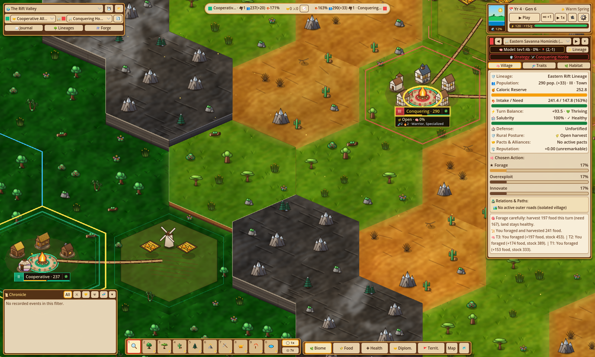
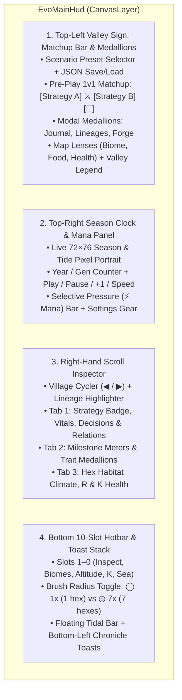
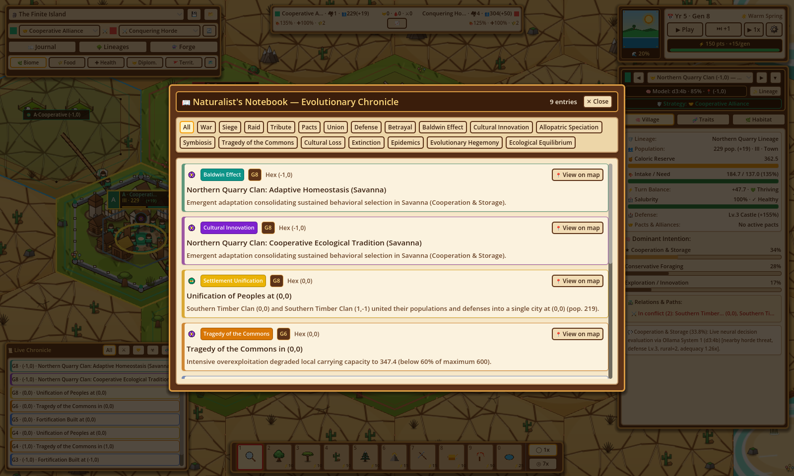
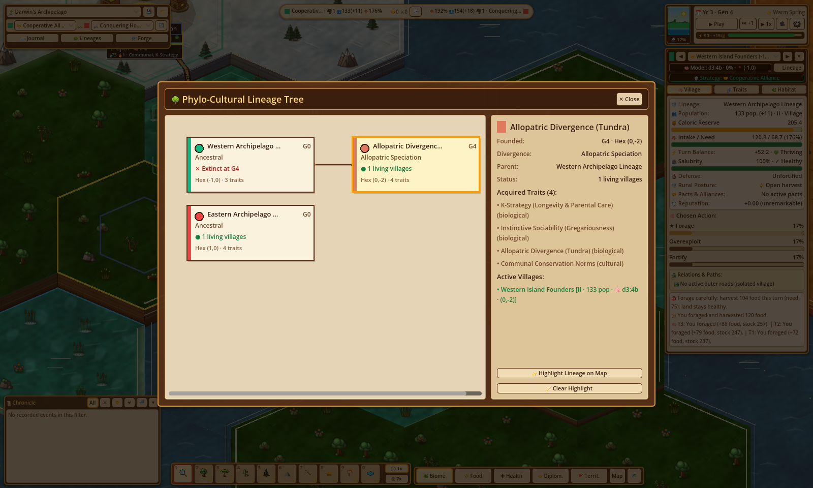
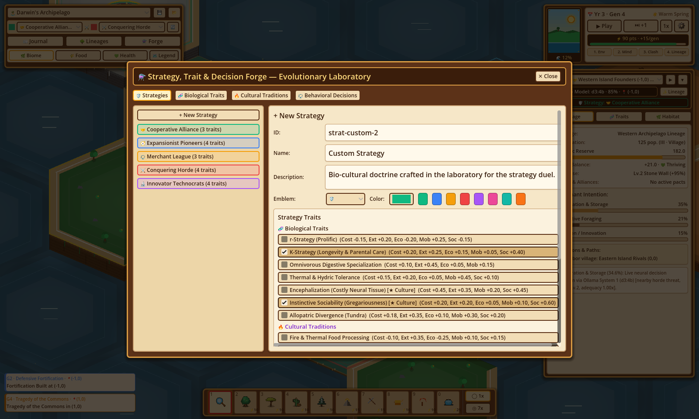

# HUD, Analytical Modals & God-Mode Tools

**Evolution** presents its complex biophysical and phylogenetic simulation through a warm, handcrafted pixel-art user interface (`EvoMainHud`, `EvoUiStyle`) inspired by classic naturalist field journals and cozy tabletop dioramas.

---

## HUD Layout & Panels (`EvoMainHud`)

The main interface is organized into four non-intrusive peripheral docks that leave the central 2.5D hexagonal valley unobstructed:

### 1. Top-Left Valley Sign, Pre-Play Strategy Matchup, Lenses & Valley Legend (`EvoHudTopBar`)
* **Row 1 — Scenario & State Persistence**:
  * **Preset Dropdown**: Switch immediately between *The Rift and the Savanna* (`preset-rift-savanna`), *Darwin's Archipelago* (`preset-darwin-archipelago`), and *The Finite Island* (`preset-finite-island`).
  * **Export (`💾`) & Import (`📂`) World State**: Serializes or restores the complete `WorldState` (cells, demes, custom strategies/traits/decisions, `strategy_a_id`, `strategy_b_id`, lineage tree, and chronicle history) to/from `user://evolution_world_state.json`.
* **Row 2 — Pre-Play 1v1 Strategy Matchup Selector (`[Strategy A] ⚔️ [Strategy B] [🔄]`)**:
  * **Strategy A & Strategy B Dropdowns**: Choose any of the **5 Base Archetypal Strategies** (`strat-cooperation` 🤝, `strat-expansion` 🧭, `strat-trade` ⚖️, `strat-war` ⚔️, `strat-innovation` 🔬) or any custom user-forged strategy (`origin = "user"` loaded from `~/.config/Evolution/user_catalog.json`) for Slot A (`state.strategy_a_id`) and Slot B (`state.strategy_b_id`).
  * **Live Generation 0 Reconfiguration**: While the simulation is at **Generation 0 (`state.generation == 0`)**, changing either dropdown immediately applies the chosen strategy to the corresponding founding lineage and deme via `EvoCatalog.apply_strategy_to_deme` and re-evaluates initial decision probabilities.
  * **Reset Duel Button (`🔄` — `hud_matchup_reset`)**: Resets the active preset back to Generation 0 at any time with the currently selected `Strategy A ⚔️ Strategy B` matchup (`Reset duel at Generation 0 with the selected strategies`).
* **Row 3 — Analytical Modal Medallions**:
  * **`📖 Journal / Diario`**: Opens the *Naturalist's Notebook* (`EvoNotebookModal`).
  * **`🌳 Lineages / Linajes`**: Opens the *Phylo-Cultural Lineage Tree* (`EvoTreeModal`).
  * **`⚗️ Forge / Forja`**: Opens the *Strategy, Trait & Decision Forge* (`EvoLabModal`).
* **Row 4 — Map Lenses & Valley Legend**:
  * **`🌿 Biome / Bioma`**: Renders authentic biome pixel textures, subtly shifting toward ochre/brown when a hexagon's carrying capacity $K$ is degraded.
  * **`🌾 Food / Alimento`**: Visualizes current biomass ratio $R / K_{\max}$ across 50 quantized bands along a barren-brown (`#8c583a`) $\to$ amber (`#eab308`) $\to$ lush-green (`#65f06c`) gradient.
  * **`💚 Health / Salud`**: Visualizes structural habitat integrity $K / K_{\max}$:
    * **Healthy ($\ge 85\%$ $K_{\max}$)**: Emerald mint (`#6ee7b7`).
    * **Stressed ($60\%\text{–}84\%$ $K_{\max}$)**: Amber (`#fbbf24`) with a dashed orange perimeter border (`#f59e0b`).
    * **Collapsed ($< 60\%$ $K_{\max}$ — Tragedy of the Commons)**: Coral red (`#f87171`) with a thick dashed crimson border (`#ef4444`).
  * **`🗺️ Legend / Leyenda`**: Toggles the floating *Valley Legend* card detailing the live **Strategy Duel Counter (`legend_strategies`)** (showing each active strategy's color swatch, emblem icon, name, living village count, and total population), all 7 biome swatches, the 4 architectural village tiers (`I–IV`), and the 3 inter-village path symbols (`🛣️`, `⚔️`, `🧭`).

### 2. Top-Right Season Clock, Playback & Settings Popup
* **Dynamic Season & Tide Portrait (`SeasonTidePortrait`)**: A custom-drawn $72 \times 76$ pixel-art vignette displaying a radiant sun over green hills during `wet_warm` ($\gamma = 1.20$), a crescent moon with falling snow over slate hills during `dry_cold` ($\gamma = 0.75$), and a live water-level gauge (`🌊 %d%%`) tracking global `sea_level`.
* **Time & Playback Controls**:
  * Displays `📅 Year X · Gen Y` (`year = generation / 2 + 1`) and the active season name.
  * **`▶ Play` / `⏸ Pause`** (<kbd>Space</kbd>), **`⏭ +1`** (single-generation step), and **`1x` (`1.50s/gen`) / `2x` (`0.30s/gen`)** speed toggle.
* **Selective Pressure ("Mana") Bar**: Tracks available intervention points (`⚡ 30 pts` initial, `+15/gen` passive regeneration).
* **Settings, Cognitive Engine & Camera Popup (`⚙️`)**:
  * **Cognitive Engines Diagnostic Card**: Live count of villages assigned to Primary (`d3:4b`) and Secondary (`tev1:4b`) System 1 models, active `num_ctx`, and mean confidence `%`.
  * **Model & Context Configuration**: Dropdown selectors for Primary and Secondary Ollama decision models, free-text `num_ctx` input (persisted to `~/.config/Evolution/settings.json`), and a manual model refresh button (`🔄`).
  * **Simulation Rules & Language**: Switch UI language (`ES` / `EN`), toggle `Auto-pause on milestones` (`auto_pause_on_milestone`), `Unlimited Mana` (`unlimited_pressure_mode`), and `Free Sandbox` (`free_sandbox_mode` — bypasses thermodynamic cost enforcement).
  * **Camera Presets**: One-click pitch presets (`32°`, `48°`, `68°`), yaw orbit buttons (`↺ -18°`, `↻ +18°`), and `🎯 Reset`.

---

## Visual Strategy Identification on the 2.5D Map & HUD

Every village's founding **Evolutionary Strategy** (`deme.strategy_id`) is immediately recognizable across the 2.5D isometric valley and HUD without opening a modal:

1. **Floating Village Billboards (`EvoWorldOverlayRenderer.draw_village_billboard`)**: Each settlement displays a compact overhead dark-wood pill featuring a **strategy-colored emblem shield (`shield_c`)** with the strategy's icon/color on the left and the village's current population count (`sub_text`) on the right, plus a golden selection arrow when inspected.
2. **Strategy-Colored Ground Rings & Plazas (`EvoPropFloraRenderer.draw_village_plaza`)**: Each settlement's circular stone plaza is framed by a ground ring and status border tinted with its strategy/lineage identity and vital health (`thriving`, `stable`, `struggling`, `starving`).
3. **Plaza Banners & Villager Tunics (`EvoPixelArtGen.get_villager_texture`)**: Orbiting villagers and road travelers dynamically recolor their pixel-art tunics (`villager_idle`, `villager_walk1`, `villager_walk2`) and settlement banners to match `deme.color` (inherited from the founding `StrategyDef.color`, or diverged from `SPECIATION_PALETTE` upon allopatric speciation while retaining `deme.strategy_id`).
4. **Inspector Strategy Badge (`insp_strategy`)**: The Right-Hand Scroll Inspector displays the selected village's founding strategy emblem, localized strategy name, and color swatch right alongside its lineage and population telemetry.
5. **Valley Legend Strategy Duel Counter (`legend_strategies`)**: Opening `🗺️ Legend` displays a live head-to-head breakdown of the active **Strategy Duel**, tallying active settlements and total population per competing strategy across the map.

---

## Right-Hand Scroll Inspector (`EvoHudInspectorPanel`)

The collapsible parchment Scroll Inspector on the right side of the screen provides deep, zero-information-loss telemetry on any selected village or hexagon:

* **Inspector Header**:
  * **Village Cycler (`◀` / `▶` & Dropdown)**: Lists all living demes sorted by population descending (`<vital_heart> [i/N] <Name> (q,r)`), allowing instant cycling across every settlement in the valley (and automatically focusing the camera on the chosen village).
  * **Model Badge & Lineage Map Highlight (`✨ Lineage`)**: Shows the deme's assigned System 1 model (`d3:4b` or `tev1:4b`), confidence `%`, axial coordinates, and a toggle button that dims unrelated villages on the 2.5D map while projecting a pulsing vertical light beam over all settlements of the active lineage.

=== "Tab 1: 🧠 Village (`Aldea`)"

    * **Vitals & Strategy Card**:
      * **Strategy (`insp_strategy`) & Lineage**: Displays the village's founding **Evolutionary Strategy badge** (`<icon> <Strategy Name>`), species lineage name, headcount, and architectural tier (`I · Camp` $<50$, `II · Hamlet` $50\text{–}149$, `III · Village` $150\text{–}399$, `IV · Citadel` $400+$).
      * **Caloric Reserves (`🍯`)**: Progress bar tracking stored `energy_reserves`.
      * **Turn Energy Delta (`⚡`)**: Net caloric balance $\Delta E$ from the last turn and vital status badge (`💚 Thriving` $\Delta E \ge +10$, `💙 Stable` $\Delta E \ge 0$, `💛 Struggling` reserves $> 40$, `❤️‍🩹 Starving` reserves $\le 40$).
    * **Dominant Intention (`🧠`)**: Displays the top 3 behavioral decisions from `last_decision_probabilities` as horizontal probability bars, marking the dominant intention with a gold star (`★`).
    * **Relations & Paths (`🛣️`)**: Exhaustive listing of active cooperation/trade routes (`🛣️`), territorial disputes (`⚔️`), migratory expeditions (`🧭`), severed/disused roads (`🚧` with turn age), cohabiting demes in the same hex (`🤝`), and neighboring villages (`🏘️`).
    * **Naturalist's Note (`💬`)**: Contextual behavioral justification generated by the cognitive engine.

=== "Tab 2: 🧬 Traits (`Rasgos`)"

    * **Evolutionary Milestone Progress Meters**:
      * **Genetic Assimilation (Baldwin)**: Tracks `max(baldwin_counters)` toward the `8 gen` threshold (`#0d9488`).
      * **Cultural Innovation**: Tracks `innovation_counter` ($0\text{–}100\%$) toward synthesizing a new cultural tradition (`#7e22ce`).
      * **Allopatric Isolation**: Tracks `isolation_turns` toward the `10 gen` speciation threshold (`#1d4ed8`).
    * **Active Trait & Tradition Medallions**: Interactive badges for every biological (`🧬`) and cultural (`🔥`) trait carried by the deme, with hover tooltips displaying its full 6-axis biophysical vector, plus a direct shortcut to open the **Trait & Decision Forge**.

=== "Tab 3: 🌿 Habitat (`Hábitat`)"

    * Automatically activates when left-clicking an uninhabited hex in `Inspect` mode.
    * Displays the biome icon, localized biome name, axial coordinates `(q, r)`, **Temperature (`🌡️`)**, **Humidity (`💧`)**, **Altitude (`⛰️`)**, **Available Biomass (`🌾 R / K`)**, and color-coded **Ecological Health (`💚 K / Kmax`)**.

---

## Interactive Analytical Modals

### 1. Naturalist's Notebook — Evolutionary Chronicle (`EvoNotebookModal`)

* **8 Category Filters**: Filter historical events by `All`, `Baldwin Effect (baldwin_trait)`, `Cultural Innovation (cultural_innovation)`, `Allopatric Speciation (allopatric_speciation)`, `Symbiosis (symbiosis)`, `Tragedy of the Commons (tragedy_of_commons)`, `Cultural Loss (cultural_loss)`, or `Extinction (extinction)`.
* **Causal Event Cards**: Displays up to 100 reverse-chronological entries color-coded by event type, including the generation badge (`G%d`), hex coordinate, headline, and full causal narrative.
* **One-Click Map Jump (`📍 View on map`)**: Clicking any Chronicle entry closes the modal, selects the target hexagon and deme, and smoothly pans the 2.5D camera directly to the site of the milestone.

---

### 2. Phylo-Cultural Lineage Tree (`EvoTreeModal`)

* **Hierarchical Phylogenetic Canvas**: Automatically lays out root and child `LineageNode` cards left-to-right by evolutionary depth and connects parent-child divergences with cubic Bézier curves. Supports click-and-drag panning across large evolutionary trees.
* **Live Species & Strategy Telemetry**: Each card displays the lineage's color emblem, inherited `strategy_id` badge, species name, founding generation (`G%d`), divergence mechanism (*Initial*, *Allopatric Speciation*, *Baldwin Assimilation*, *Cultural Schism*), founder hex, acquired trait count, and live status (`● N living villages` in green or `✕ Extinct at G%d` in red).
* **Map Lineage Highlighting (`✨ Highlight Lineage on Map`)**: Selecting any lineage node populates the right-hand detail sidebar (showing all acquired traits and active villages with their population and model tags) and lets you project pulsing lineage light beams across the 2.5D world map.

---

### 3. Strategy, Trait & Decision Forge — Evolutionary Laboratory (`EvoLabModal`)

* **4 Catalog Tabs**:
  1. **`🧬 Biological Traits` (`biological`)**: Inspect, modify, or craft heritable biological adaptations (`bio-*`).
  2. **`🔥 Cultural Traditions` (`cultural`)**: Inspect, modify, or craft socially transmitted traditions (`cul-*`).
  3. **`⚖️ Behavioral Decisions` (`decision`)**: Inspect, modify, or craft collective behavioral archetypes (`dec-*`).
  4. **`🛡️ Strategies` (`lab_tab_strat`)**: Create, edit, and preview custom **Evolutionary Strategies** (`EvoTypes.StrategyDef`) for 1v1 duels.
* **`🛡️ Strategies` Builder & Duel Slot Assignment**:
  * **Emblem (`lab_strat_icon`) & Color (`lab_strat_color`) Pickers**: Choose a visual shield emblem (e.g., `🤝`, `🧭`, `⚖️`, `⚔️`, `🔬`, `🛡️`, `🌿`, `👑`) and hex color swatch for the strategy.
  * **Compatible Trait Checkboxes (`lab_strat_traits`)**: Select any combination of biological (`bio-*`) and cultural (`cul-*`) traits from the catalog. The builder automatically enforces mutual exclusion between `bio-r-strategy` and `bio-k-strategy` and requires at least one cultural-capacity biological trait (`bio-encephalization` or `bio-social-instinct`) before cultural traditions can be active.
  * **Combined Biophysical Footprint Preview (`lab_strat_vector`)**: Live 6-axis readout computed via `EvoCatalog.compute_strategy_vector(strategy, state.traits_catalog)` showing the strategy's aggregate `metabolic_cost`, `extraction_efficiency`, `ecological_impact`, `spatial_mobility`, `social_cohesion`, and `transmission_threshold`.
  * **Save & Assign to Duel (`💾 Save Strategy`, `Set as Strategy A`, `Set as Strategy B`)**: Saves the custom strategy (`strat-custom-*`, `origin = "user"`) into `state.strategies_catalog`, persists all user-created strategies, traits, and decisions to **`~/.config/Evolution/user_catalog.json`** via `EvoUserSettings.save_user_catalog(state)`, and lets you assign the strategy directly to **Slot A (`lab_use_strat_a`)** or **Slot B (`lab_use_strat_b`)**.
* **Interactive 6-Axis Vector Sliders & Live Thermodynamic Balance Meter** (for Traits & Decisions):
  * Fine-tune `metabolic_cost`, `extraction_efficiency`, `ecological_impact`, `spatial_mobility`, `social_cohesion` ($[-1.0, +1.0]$), and `transmission_threshold` ($[0.0, +1.0]$).
  * Continuously computes positive advantages $A^+$, actual cost $C_{\text{curr}}$, and required cost $C_{\text{req}} = \max(0, 0.5 \cdot (A^+ - 0.60))$, with one-click **`⚖️ Auto-Balance Vector`**, **`💾 Save to Catalog`** (persisted to `~/.config/Evolution/user_catalog.json`), and **`💉 Inject into Selected Village`**.

---

## God-Mode Hotbar & Selective Pressure Brushes (`EvoHudHotbarDock`)

The bottom dock provides **10 hotbar slots** (<kbd>1</kbd>–<kbd>9</kbd>, <kbd>0</kbd>) paired with a **Brush Radius Toggle** (`◯ 1x` single hex vs. `◎ 7x` center hex + 6 neighbors):

| Slot & Key | Tool Name (EN / ES) | Internal ID & Sub-Mode | Cost | Exact Biophysical Effect on Target Hexagons |
| :---: | :--- | :--- | :---: | :--- |
| **1** (<kbd>1</kbd>) | **Naturalist's Loupe** *Lupa del Naturalista* | `inspect` | `0` | Selects villages or hexes for inspection; left-drag pans the camera. |
| **2** (<kbd>2</kbd>) | **Jungle Seeds** *Semillas de Selva* | `set_biome` `tropical_forest` | `⚡10` | Converts hexes to `tropical_forest` ($T=+0.45$, $H=0.85$, alt clamped to $[0.28, 0.65]$ and $\ge \text{sea\_level}+0.05$, restores terrestrial $K_{\max} \ge 220\text{–}300$, $K \ge 220$, $R \ge 180$). |
| **3** (<kbd>3</kbd>) | **Savanna Seeds** *Semillas de Sabana* | `set_biome` `savanna` | `⚡10` | Converts hexes to `savanna` ($T=+0.50$, $H=0.40$, alt $[0.28, 0.65]$, restores terrestrial $K$ and $R$ minimums). |
| **4** (<kbd>4</kbd>) | **Desert Dust** *Polvo del Desierto* | `set_biome` `arid_steppe` | `⚡10` | Converts hexes to `arid_steppe` ($T=+0.65$, $H=0.20$, alt $[0.30, 0.70]$, induces arid cooperation/migration pressure). |
| **5** (<kbd>5</kbd>) | **Boreal Crystal** *Cristal Boreal* | `set_biome` `tundra` | `⚡10` | Converts hexes to sub-zero `tundra` ($T=-0.55$, $H=0.35$, alt $[0.35, 0.74]$, imposes thermal metabolic stress). |
| **6** (<kbd>6</kbd>) | **Peak Chisel** *Cincel de Cumbre* | `adjust_altitude` `raise` (`+0.18`) | `⚡15` | Raises hex `altitude` by $+0.18$ (clamped $[0, 1]$). Emerges `ocean` hexes ($\ge \text{sea\_level}$) into `coastal_shallows` ($<0.25$) or `savanna`; uplifts hexes $\ge 0.78$ into `high_mountain` ($T \le -0.30$). |
| **7** (<kbd>7</kbd>) | **Valley Pickaxe** *Pico de Valle* | `adjust_altitude` `lower` (`-0.18`) | `⚡15` | Lowers hex `altitude` by $-0.18$. Submerges hexes below `sea_level` into `ocean` (displacing or drowning resident demes); lowers `high_mountain` ($<0.78$) into passable `savanna` or `arid_steppe`. |
| **8** (<kbd>8</kbd>) | **Golden Watering Can** *Regadera Dorada* | `adjust_carrying_capacity` `enrich` (`+25%`) | `⚡10` | Multiplies hex carrying capacity $K$ by $\times 1.25$ (up to $K_{\max}$) and boosts current biomass $R$ by $\ge +25\%$. |
| **9** (<kbd>9</kbd>) | **Drought Sickle** *Hoz de Sequía* | `adjust_carrying_capacity` `deplete` (`-25%`) | `⚡10` | Multiplies hex carrying capacity $K$ and current biomass $R$ by $\times 0.75$ (clamped $\ge 10.0$). |
| **10** (<kbd>0</kbd>) | **Tidal Conch** *Caracola de Mareas* | `sea_level` + Sub-Bar | `⚡25` / `⚡10` | Opens the **Tidal Sub-Options Bar**: adjust global `sea_level` by **$+5\%$ (`+0.05`)** or **$-5\%$ (`-0.05`)** (`⚡25`, clamped $[0.0, 0.50]$), or equip brush sub-modes for `coastal_shallows`, `ocean`, and `high_mountain` (`⚡10`). |
