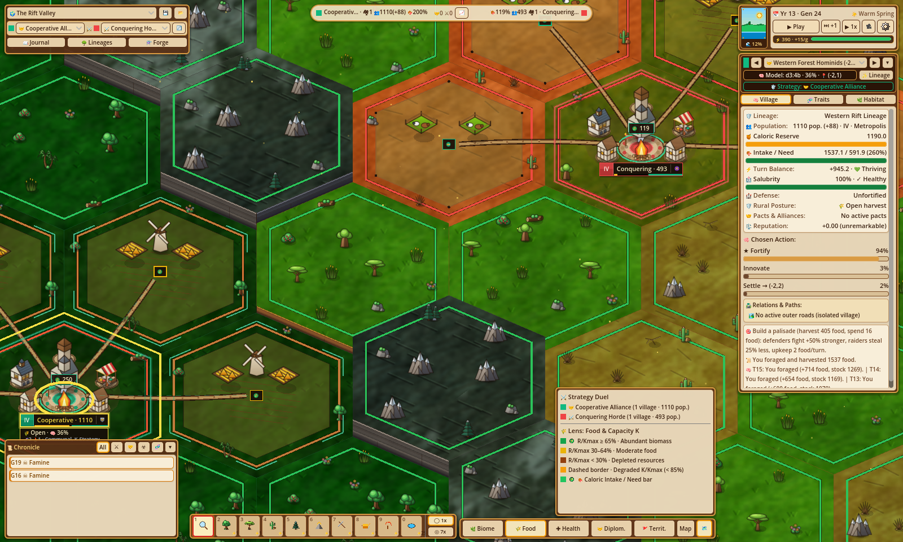
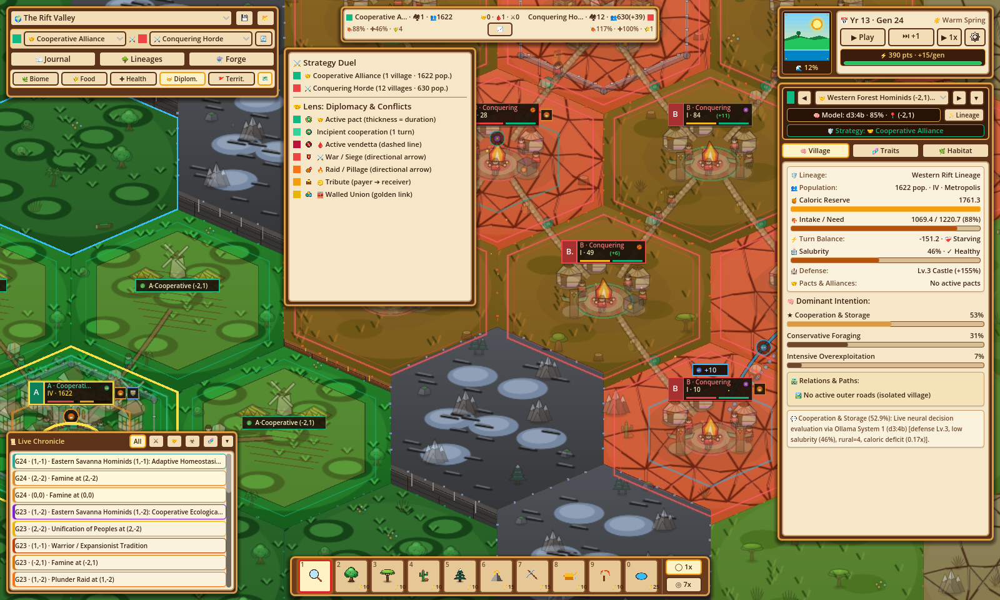
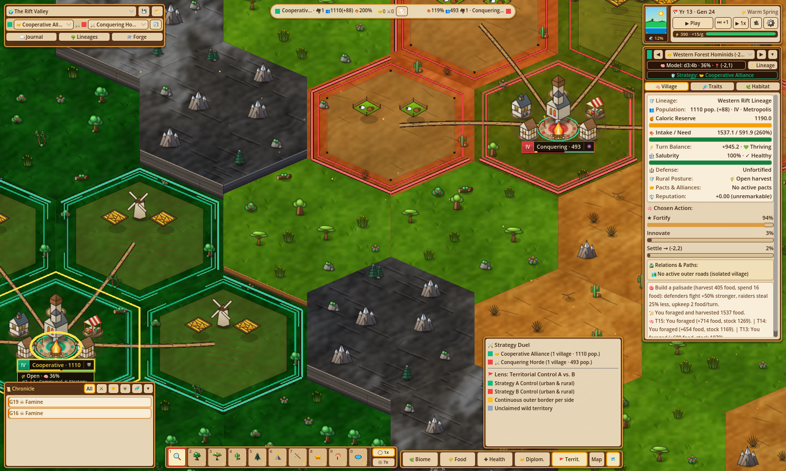
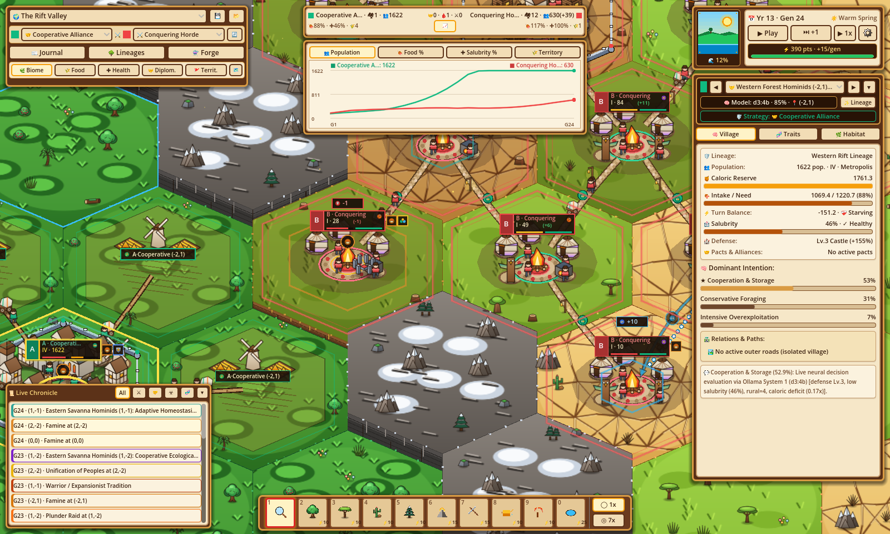
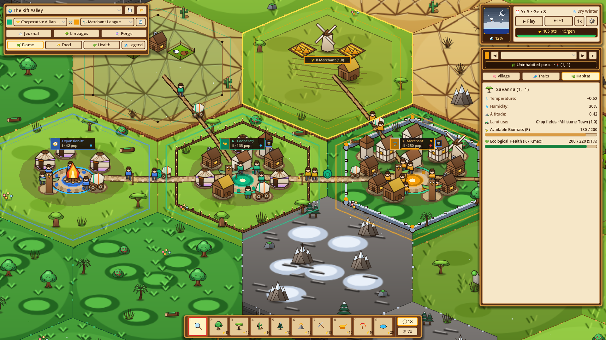

# UI, Tools & Controls

**Evolution** presents a tactile wood-and-parchment cartographic HUD (`1600×960` reference desktop layout) paired with 5 analytical map lenses, a collapsible live macro telemetry drawer, a bottom-left live chronicle feed, 10 god-mode terrain brushes, and three deep analytical modals.

---

## 1. HUD Architecture & On-Screen Panels

1. **Top-Left Valley Sign & Medallions (`EvoHudTopBar`)**:
   - **World Preset Dropdown**: Instant generation of `Rift Savanna`, `Darwin's Archipelago`, or `Finite Island`, alongside **Export/Import JSON** snapshot buttons and **Reset**.
   - **Strategy A vs. Strategy B Selector**: Assigns competing starting archetypes (`strat-cooperation`, `strat-expansion`, `strat-trade`, `strat-war`, `strat-innovation`, or custom Forge creations).
   - **Suite Buttons**: Direct access to **🔬 Forge**, **🌿 Phylogeny**, and **📖 Chronicle**.
   - **5-Lens Bar & Map Fit**: One-click switches for `Biome`, `Food`, `Health`, `Diplomacy`, and `Territory`, plus **`Map`** (`F` full-valley framing) and **`🗺️` Legend** toggle.
2. **Top-Center Stats Strip & History Chart (`EvoHudStatsStrip`)**:
   - Displays head-to-head **Strategy A vs. Strategy B** telemetry across Population, Food Ratio, Average Salubrity, and Owned Rural Hexes.
   - Tapping **`📈`** expands the **History Chart Drawer** plotting Strategy A vs. Strategy B trajectories up to `200` generations (`STATS_HISTORY_LIMIT = 200`).
3. **Top-Right Season/Tide Dial & Playback Clock**:
   - **Procedural `SeasonTidePortrait`**: Draws live sunlight (`wet_warm`) vs. moonlit snowfall (`dry_cold`) above a dynamic waterline reflecting planetary `sea_level` (`%`).
   - **Playback Controls**: Play/Pause (**Space**), manual **Step Generation**, speed cycler (**`0.5x`**, **`1x`**, **`3x`** corresponding to `4.0 s`, `2.0 s`, and `0.6 s` turn intervals), Settings gear (**`⚙`**), and the **`⚡` Selective Pressure Mana** meter (`+15/turn`).
4. **Right Docked 3-Tab Inspector (`EvoHudInspectorPanel`)**:
   - **`🏘️ Village`**: Identity badges (faction slot, lineage, vital status: `Thriving`, `Stable`, `Struggling`, `Starving`, `Extinct`), active rural **Defense Posture** (`open_harvest`, `patrol_fields`, `mobilized_garrison`) and posture distribution, **`Intake / Need`** caloric ledger, **`Walled Union (%d united districts)`** counter on multi-hex unions, **`Infected (Nt)` / `Immune (Nt)`** epidemic state, top-3 **`Chosen Action`** probability bars (`★`), clickable **`Relations & Paths`** partner cards, **`🎯 Forecast`**, **`📜 Last outcome`**, and **`🧠 Memory (last 3)`** episodic log.
   - **`🧬 Traits`**: Active biological traits (up to 3 emergent) and cultural traditions (up to 3 emergent), with exact clamped 6-axis vector totals.
   - **`🌿 Habitat`**: Biome climate (`T`, `H`, altitude, $K/K_{\max}$, seasonal regen), remaining biomass $R$, land use (`wild`, `crops`, `pasture`, rural owner), and `ruin_turns` decay timer.
5. **Bottom-Left Live Chronicle Feed (`EvoHudBannersToasts`)**:
   - Collapsible real-time event log (`▾`/`▸`) displaying up to `30` recent chronicle cards (`G<gen> · (<q,r>) · <Title>`), color-coded by event type and filtered across `5` category pills (`all`, `war`, `diplomacy`, `health`, `evolution`). Clicking any entry centers the camera directly onto that hex.
6. **Bottom-Center 10-Slot Hotbar & Brush Switcher (`EvoHudHotbarDock`)**:
   - Keys `1`–`9` & `0` plus `1x` (single tile) / `7x` (radius-2 ring) area selector and a dynamic contextual sub-bar above the dock (including `high_mountain`, `coastal_shallows`, `ocean`, and `sea_level` raise/lower actions).

---

## 2. Five Analytical Map Lenses (`Tab` to Cycle)

| Lens | Analytical Purpose |
| :--- | :--- |
| **`biome`** | Standard terrain visualization with 2.5D hex columns, biome props, roads, fort walls, and settlements (`assets/img/screenshot_rift_savanna.png`). |
| **`food`** | Overlays harvestable biomass $R$, carrying capacity degradation below `60%` $K_{\max}$, and rural agricultural/pasture productivity. |
| **`health`** | Highlights deme `salubrity` levels (`[0.05..1.0]`), active epidemic contagion pulses, and post-recovery immunity shields. |
| **`diplomacy`** | Maps bilateral trust hues, active pacts, tribute truces, active feuds, and geodesic trade/war corridors between urban centers. |
| **`territory`** | Outlines consolidated urban districts, Walled Union cores, and outer borders of owned `crops` and `pasture` hinterlands cleanly without internal seam noise. |

  

    <h3>Food Lens (Finite Island)</h3>
    
    
Visualizes carrying capacity bottlenecks and remaining forageable biomass across urban cores and arid steppes.

  

  

    <h3>Diplomacy Lens</h3>
    
    
Reveals trust polarity, pacts, active truces/feuds, and cross-frontier diplomatic &amp; trade connections.

  

  

    <h3>Territory Lens</h3>
    
    
Renders continuous faction territory perimeters linking fortified urban centers with rural fields and pastures.

  

---

## 3. Macro Telemetry & Settlement Tiers

*Expanding the top-center `📈` chart drawer overlays Strategy A vs. Strategy B trajectories across `Population`, `Food Ratio`, `Avg Salubrity`, and `Rural Hexes` over a rolling 200-generation window.*

*Village Tiers (`I`–`IV`), stone perimeter fortifications, rural `crops` / `pasture` hinterlands, and defensive patrol watchtowers rendered directly onto the hex terrain (reference shot from an earlier 3-lens HUD build).*

---

## 4. Analytical Modals & Settings

### Bio-Cultural Forge (`EvoLabModal`, 3 Tabs)

> *Note: The current Forge on `HEAD` streamlines editing into **3 tabs**: **`🛡️ Strategies`**, **`🧬 Biological Traits`**, and **`🔥 Cultural Traditions`**—replacing legacy decision editing with editable natural-language **Strategy `Doctrine`** prompts (`screenshot_lab_modal.png` reflects commit `728a9de` before the 4th Decisions tab was retired).*

- **`🛡️ Strategies`**: Configure emblem icon, clade color, compatible biological/cultural trait checkboxes, live 6-axis preview, Strategy **Doctrine** (`TextEdit` passed to Ollama), and Strategy A/B matchup assignment.
- **`🧬 Biological Traits` & `🔥 Cultural Traditions`**: Tune 6 continuous vector sliders (`[-1.0, +1.0]`, threshold `[0.0, 1.0]`) against the live thermodynamic `BASE_BUDGET = 0.60` balance bar, toggle `enables_cultural_transmission`, **Auto-Balance**, save to `~/.config/Evolution/user_catalog.json`, or **💉 Inject into Village** on the map.

### Evolutionary Chronicle (`EvoNotebookModal`, 19 Filters)

Searchable longitudinal log supporting **19 event filter pills**: `all`, `war`, `siege`, `raid`, `tribute`, `pact`, `merge`, `fortify`, `betrayal`, `baldwin_trait`, `cultural_innovation`, `allopatric_speciation`, `symbiosis`, `tragedy_of_commons`, `cultural_loss`, `extinction`, `epidemic`, `single_survivor`, and `ecological_equilibrium`. Each entry links directly to the hex where the milestone occurred.

### Phylogeny Tree (`EvoTreeModal`)

Pannable ancestral diagram showing root clades, extinction generations, acquired trait milestones, and branching **`allopatric_speciation`** daughter clades colorized across `SPECIATION_PALETTE`. Clicking **Highlight Clade** illuminates every living settlement descended from that branch across the terrain.

### Settings Popup (`EvoHudSettingsModals`)

- **Model Selection & Diagnostics**: Independent **`Primary Model` (Slot A)** and **`Secondary Model` (Slot B)** selectors filtered by Ollama's `"decision"` `/api/tags` capability, with a diagnostic counter and refresh button (`settings.json` stores `primary_model` and `secondary_model`; no manual `num_ctx` override).
- **Language**: Instant **`ES` / `EN`** switch updating HUD chrome, Chronicle templates, tooltips, and catalogs.
- **Simulation Modes**: **`Auto-pause on milestones`**, **`Unlimited Energy`** (free selective pressure brushes), and **`Free Sandbox`** (relaxes thermodynamic auto-balancing in the Forge).
- **Camera Presets**: Quick pitch buttons (`32°`, `48°`, `68°`), `Map` full-valley framing, and `🎯 Reset`.

---

## 5. God-Mode Hotbar (`1`–`9` & `0`) & Shortcuts

Selecting a brush (`1x` or `7x` radius) spends Selective Pressure (`⚡` mana) in standard mode:

| Key | Tool Slot | Effect & Cost (`EvoTurnEngine`) |
| :---: | :--- | :--- |
| **`1`** | `inspect` | Inspect hex cells and settlements without spending mana (`⚡0`). Allows left-drag camera panning. |
| **`2`–`5`** | `set_biome` | Paint `tropical_forest`, `savanna`, `arid_steppe`, or `tundra` (`high_mountain`, `coastal_shallows`, `ocean` via sub-bar) (`⚡10`). Resets tile to healthy (`K = 90% Kmax`, `R = 85% K`) and clamps altitude to biome bounds & `>= sea_level + 0.02`. |
| **`6`** | `adjust_altitude` (Raise) | Raise tile elevation by **`+0.18`** (`⚡15`), creating ridges or raising reefs out of the sea. |
| **`7`** | `adjust_altitude` (Lower) | Lower tile elevation by **`-0.18`** (`⚡15`), carving valley passes or flooding coastal land. |
| **`8`** | `adjust_carrying_capacity` (Enrich) | Enrich local carrying capacity $K$ by **`+25%`** (`⚡10`). |
| **`9`** | `adjust_carrying_capacity` (Deplete) | Deplete local carrying capacity $K$ by **`-25%`** (`⚡10`). |
| **`0`** | `sea_level` | Reveals contextual `+5%` / `-5%` global `sea_level` adjustment buttons (`±0.05`, `⚡25`). |

### Complete Keyboard & Mouse Reference

- **Movement**: `W`/`A`/`S`/`D`, Arrow keys, Middle-drag, or Left-drag in `Inspect` mode (`MAX_PAN_RADIUS = 3800.0`).
- **Pitch Tilt**: Right-drag, `Shift`/`Alt + Left-drag` (`28°`–`75°`, default `48°`), or `R` (`+8°`).
- **Zoom**: Mouse wheel toward cursor or `+` / `-` (`0.12×`–`3.00×`, default `0.82×`).
- **View Framing**: `F` fits full map (`6235.38 × 4178.0` world span); `Home` resets pan (`-175, 26`), zoom (`0.82`), and pitch (`48°`).
- **Flow & Lenses**: `Space` plays/pauses; `Tab` cycles all 5 map lenses; `Escape` closes active modals or returns active brush to `Inspect`.
