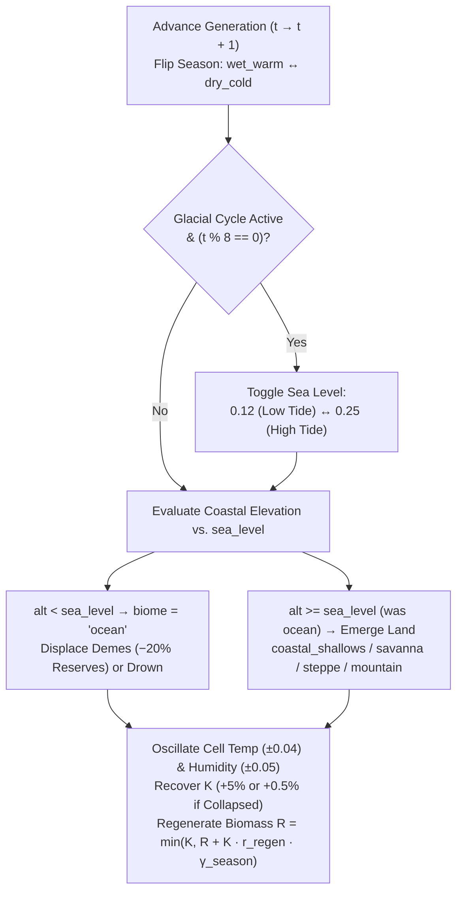
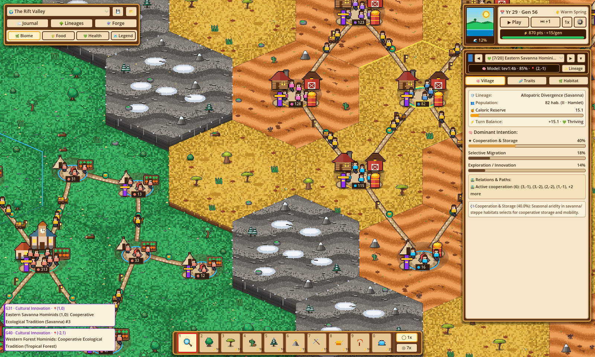
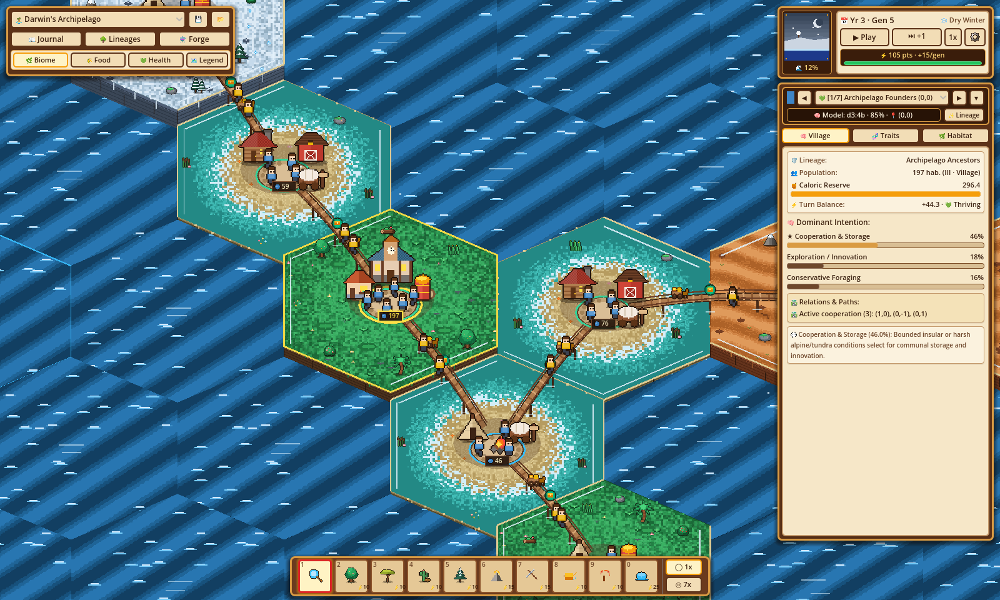
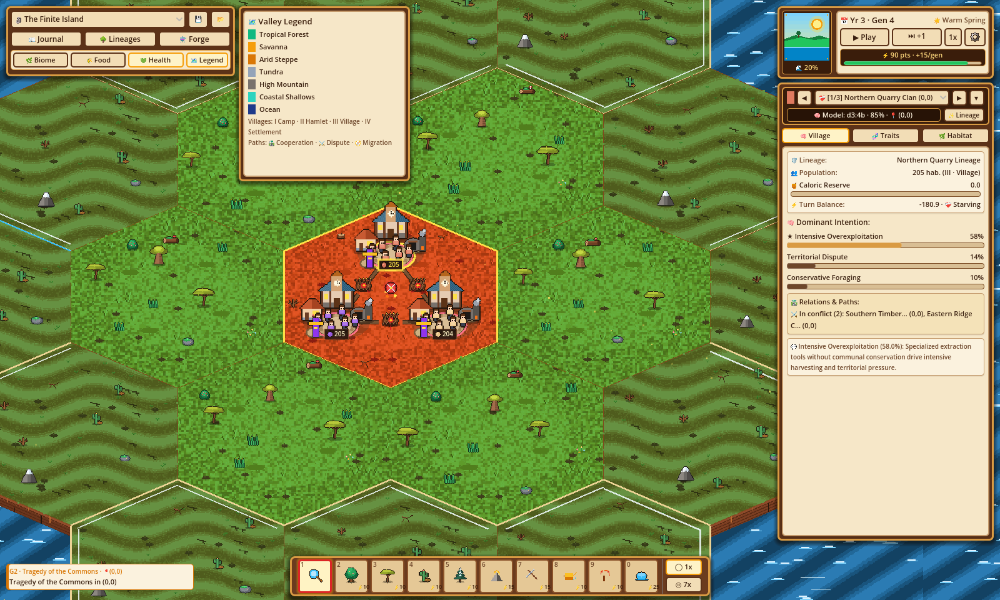

# Worlds, Biomes & Scientific Presets

**Evolution** models spatial ecology across an axial hexagonal grid (`HexMath`, `EvoTypes.HexCell`) where elevation, temperature, humidity, seasonal oscillations, and glacial sea-level cycles govern local carrying capacity ($K$), available biomass ($R$), and movement barriers.

Rather than relying on random unstructured noise, the simulator ships with three **Scientific World Presets** (`EvoPresets`) designed to test foundational hypotheses in evolutionary biology, human paleoecology, biogeography, and evolutionary game theory.

---

## Hexagonal Grid Geometry (`HexMath`)

Every world is a pointy-top hexagonal spiral centered at axial coordinate $(q, r) = (0, 0)$ with cube constraint $s = -q - r$ ($q + r + s = 0$).

### Coordinate System & Spiral Generation

* **Hex Cell Identifier**: Stored as `"%d,%d" % [q, r]` (e.g., `"0,0"`, `"-2,1"`, `"2,-1"`).
* **Spiral Generation (`HexMath.generate_hex_spiral(radius)`)**: Iterates over $q \in [-R, +R]$ and $r \in [\max(-R, -q - R), \min(R, -q + R)]$. The total number of hexagonal cells for map radius $R$ is:
  $$N_{\text{cells}}(R) = 1 + 3R(R + 1)$$
  * $R = 4$ (*The Finite Island*): **$61$ hexagons**
  * $R = 5$ (*The Rift Valley* & *Darwin's Archipelago*): **$91$ hexagons**
* **Axial Distance (`HexMath.hex_distance`)**:
  $$d\big((q_1, r_1), (q_2, r_2)\big) = \left\lfloor \frac{|q_1 - q_2| + |r_1 - r_2| + |(-q_1 - r_1) - (-q_2 - r_2)|}{2} \right\rfloor$$
* **6 Axial Neighbor Directions (`HexMath.DIRECTIONS`)**:
  $$\big[(+1, 0),\ (+1, -1),\ (0, -1),\ (-1, 0),\ (-1, +1),\ (0, +1)\big]$$
* **Pointy-Top World Plane Projection (`HexMath.axial_to_world`, $\text{HEX\_SIZE} = 240.0$)**:
  $$x = 240.0 \cdot \sqrt{3} \cdot (q + 0.5r), \qquad y = 240.0 \cdot 1.5 \cdot r$$
* **Multi-Village Sector Offsets (`HexMath.compute_village_sector_offset`)**: Up to **3 demes** can cohabit a single hex cell simultaneously. When multiple demes occupy the same hex, their plazas are arranged symmetrically around the hex center:
  * **1 Deme**: Center $(0, 0)$ at scale $1.00\times$.
  * **2 Demes**: Opposite diagonal offsets $(\mp 0.45 \cdot \text{HEX\_SIZE},\ \mp 0.14 \cdot \text{HEX\_SIZE})$ at scale $0.86\times$.
  * **3 Demes**: Radial triad at angles $\big[-90^\circ,\ +32.4^\circ,\ +147.6^\circ\big]$ and radius $0.48\text{–}0.52 \cdot \text{HEX\_SIZE}$ at scale $0.78\times$.

---

## The 7 Biomes & Climate Defaults

Each `HexCell` stores its active `biome`, `temperature` ($[-1.0, +1.0]$), `humidity` ($[0.0, +1.0]$), `altitude` ($[0.0, +1.0]$), current biomass `current_resources` ($R$), current `carrying_capacity` ($K$), undamaged ceiling `carrying_capacity_max` ($K_{\max}$), and `seasonal_regen_rate` ($r_{\text{regen}}$).

The baseline biophysical parameters defined in `EvoTypes.BIOME_CLIMATE_DEFAULTS` are:

| Biome ID | Display Name (EN / ES) | Temp ($T$) | Humidity ($H$) | Altitude Range (`min`–`max`) | Seasonal Regen ($r_{\text{regen}}$) | Base $K_{\max}$ | Ecological Role & Flora Props |
| :--- | :--- | :---: | :---: | :---: | :---: | :---: | :--- |
| `tropical_forest` | **Tropical Forest** / *Bosque Tropical* | `+0.45` | `0.85` | `0.28 – 0.65` | `0.28` | `600.0` | High-biomass, high-regeneration sanctuary that favors conservative foraging (`dec-conservative-forage`). |
| `savanna` | **Savanna** / *Sabana* | `+0.50` | `0.40` | `0.28 – 0.65` | `0.18` | `420.0` | Intermediate seasonal mosaic; rewards food storage, cooperation, and selective migration during dry cycles. |
| `arid_steppe` | **Arid Steppe** / *Estepa Árida* | `+0.65` | `0.20` | `0.30 – 0.70` | `0.12` | `280.0` | Water-stressed scrubland with slow biomass replenishment and high vulnerability to overexploitation. |
| `tundra` | **Tundra** / *Tundra* | `-0.55` | `0.35` | `0.35 – 0.74` | `0.10` | `240.0` | Sub-zero boreal habitat; imposes steep thermal metabolic costs unless buffered by high `spatial_mobility` / `bio-thermal-tolerance`. |
| `high_mountain` | **High Mountain** / *Alta Montaña* | `-0.40` | `0.25` | `0.78 – 0.98` | `0.08` | `140.0` | Tectonic barrier ridge. Traversable only when $(\text{altitude} - 0.50) \le v_{\text{eff}}.\text{spatial\_mobility}$. |
| `coastal_shallows` | **Coastal Shallows** / *Bajíos Costeros* | `+0.20` | `0.70` | `0.14 – 0.24` | `0.20` | `260.0` | Intertidal land bridges (`alt = 0.18` in Darwin's Archipelago) that periodically emerge and flood with sea-level changes. |
| `ocean` | **Ocean** / *Océano* | `+0.10` | `0.90` | `0.02 – 0.08` | `0.02` | `50.0` | Deep marine barrier ($R = 0.0$). Impassable to terrestrial demes; submergence displaces or extinguishes resident populations. |

### Passability & Barrier Traversal Formula

Whether a deme can migrate into or maintain genetic contact across an adjacent hexagon `ncell` is governed by `EvoDemographyMigration.is_hex_passable_for_deme(ncell, spatial_mobility)`:

$$\text{Passable}(\text{ncell}, v_{\text{eff}}) \iff \text{ncell.biome} \neq \text{"ocean"} \;\land\; (\text{ncell.altitude} - 0.50) \le v_{\text{eff}}.\text{spatial\_mobility}$$

!!! info "Tectonic Ridges as Selective Barriers"
    In **The Rift Valley**, the central mountain ridge (`q == 0, r != 0`) has `altitude = 0.88`, requiring $v_{\text{eff}}.\text{spatial\_mobility} \ge 0.38$ to cross directly—forcing populations without `bio-thermal-tolerance` or `dec-selective-migration` to either funnel through the central valley pass at `(0, 0)` (`altitude = 0.52`) or evolve in geographic isolation.

---

## Dynamic Environmental Cycles (`EvoEnvPhase`)

At the start of every generation (`EvoEnvPhase.run_environmental_phase`), the physical world evolves through four deterministic environmental mechanisms:

### 1. Seasonal Oscillation (`wet_warm` $\leftrightarrow$ `dry_cold`)
Every generation alternates between **Warm Spring (`wet_warm`)** and **Dry Winter (`dry_cold`)**:

* **Seasonal Biomass Multiplier ($\gamma_{\text{season}}$)**:
  $$\gamma_{\text{season}} = \begin{cases} 1.20 & \text{if } \text{season} = \text{"wet\_warm"} \\ 0.75 & \text{if } \text{season} = \text{"dry\_cold"} \end{cases}$$
* **Thermal & Hydric Drift**: Every non-ocean hex shifts by $\Delta T = \pm 0.04$ (clamped to $[-1.0, +1.0]$) and $\Delta H = \pm 0.05$ (clamped to $[0.0, +1.0]$).

### 2. Glacial Sea-Level Cycles & Land Bridges
When `state.glacial_sea_level_cycle == true` (active by default in `preset-darwin-archipelago`), global sea level oscillates every **8 generations**:

$$\text{sea\_level}(t) = \begin{cases} 0.12 \ (\text{Low Tide — Land Bridges Exposed}) & \text{if } (t / 8) \bmod 2 == 0 \\ 0.25 \ (\text{High Tide — Land Bridges Submerged}) & \text{if } (t / 8) \bmod 2 == 1 \end{cases}$$

* **Generations `1–7`**: `sea_level = 0.12` — coastal shallows (`altitude = 0.18`) remain passable land bridges.
* **Generations `8–15`**: `sea_level = 0.25` — coastal shallows flood into `ocean`, isolating island populations for 8 consecutive turns.
* **Generations `16–23`**: `sea_level = 0.12` — land bridges re-emerge as `coastal_shallows` with $K_{\max} = \max(160.0, K_{\max})$, $K = \max(\text{round}(0.88 \cdot K_{\max}), K)$, and $R = \max(R, \text{round}(0.35 \cdot K))$.

### 3. Coastal Submergence & Deme Relocation
Whenever a hex's `altitude` falls below `state.sea_level` (via glacial cycles or God-mode altitude/sea-level tools), it converts to `"ocean"` and any resident demes must evacuate immediately:

1. The engine scans all 6 adjacent neighbor hexes for valid refuges (`ncell.biome != "ocean"`, `ncell.deme_ids.size() < 3`, and `ncell.altitude <= 0.85`), sorted by highest `current_resources` ($R$).
2. **Emergency Relocation**: If a refuge exists, the deme relocates to the best neighbor, suffers a **$20\%$ energy reserve penalty** ($E_{\text{reserves}} \leftarrow 0.80 \cdot E_{\text{reserves}}$), and generates a `"migration"` flow.
3. **Submergence Extinction**: If all surrounding hexes are ocean, impassable peaks, or full ($3$ demes), the deme drowns—recording an `"extinction"` entry in the Chronicle and leaving behind sunken `ruins`.

### 4. Passive Carrying Capacity ($K$) & Biomass ($R$) Regeneration
Each non-ocean cell recovers its carrying capacity $K$ toward $K_{\max}$ and replenishes available food $R$:

$$r_{\text{recovery}} = \begin{cases} 0.005 \ (0.5\%\text{/turn}) & \text{if cell suffered Tragedy of the Commons at } t-1 \text{ or } R_t \le 0 \\ 0.050 \ (5.0\%\text{/turn}) & \text{otherwise} \end{cases}$$

$$K_{t+1} = \text{clamp}\Big(K_t + r_{\text{recovery}} \cdot (K_{\max} - K_t),\ 10.0,\ K_{\max}\Big)$$

$$R_{t+1} = \min\Big(K_{t+1},\ R_t + K_{t+1} \cdot r_{\text{regen}} \cdot \gamma_{\text{season}}\Big)$$

---

## Deep-Dive: The 3 Scientific World Presets

### 1. The Rift Valley (`preset-rift-savanna`)

> **Scientific Hypothesis**: *East Side Story / Tectonic Savanna Hypothesis* — How tectonic uplift and eastern rain-shadow aridification split an ancestral hominid lineage into conservative western forest foragers and cooperative, innovative eastern savanna populations.

* **Map Geometry**: Radius $R = 5$ (**$91$ hexes**), `sea_level = 0.12`, `glacial_sea_level_cycle = false`.
* **Topographic Partition**:
  | Region | Axial Condition | Biome | Temp | Humidity | Altitude | Initial $R$ | Initial $K$ | $K_{\max}$ | Regen $r_{\text{regen}}$ |
  | :--- | :--- | :--- | :---: | :---: | :---: | :---: | :---: | :---: | :---: |
  | **Western Basin** | $q < 0$ (40 hexes) | `tropical_forest` | `+0.45` | `0.85` | `0.35` | `560.0` | `600.0` | `650.0` | `0.30` |
  | **Central Pass** | $q = 0, r = 0$ (1 hex) | `savanna` | `+0.25` | `0.45` | `0.52` | `240.0` | `280.0` | `320.0` | `0.18` |
  | **Tectonic Ridge** | $q = 0, r \neq 0$ (10 hexes) | `high_mountain` | `-0.35` | `0.25` | `0.88` | `70.0` | `108.0` | `120.0` | `0.08` |
  | **Eastern Mosaic (Odd)** | $q > 0,\ |q+r| \bmod 2 = 1$ | `savanna` | `+0.60` | `0.30` | `0.42` | `260.0` | `335.0` | `380.0` | `0.16` |
  | **Eastern Mosaic (Even)** | $q > 0,\ |q+r| \bmod 2 = 0$ | `arid_steppe` | `+0.60` | `0.30` | `0.42` | `260.0` | `335.0` | `380.0` | `0.16` |
* **Founding Lineage & Initial Subpopulations**:
  * **Lineage**: `lineage-rift-ancestral` (*Rift Hominids* / *Homínidos del Rift*, color `#E07A5F`, founder hex `-2,1`), equipped with `bio-k-strategy` and `bio-social-instinct`.
  * **`deme-rift-west` (*Western Forest Hominids*)**: Spawned at `(-2, 1)` in lush `tropical_forest` (`pop = 140`, `reserves = 180.0`, `model = d3:4b`). High biomass adequacy keeps them anchored in `dec-conservative-forage`.
  * **`deme-rift-east` (*Eastern Savanna Hominids*)**: Spawned at `(2, -1)` in drying `arid_steppe`/`savanna` (`pop = 140`, `reserves = 180.0`, `model = tev1:4b`). Lower humidity (`0.30`) and seasonal scarcity drive `dec-cooperate-store`, `dec-selective-migration`, and `dec-explore-innovate`, triggering **Baldwin genetic assimilation** (`baldwin_counters >= 8`), **Cumulative Cultural Innovation**, and **Allopatric Speciation**.

---

### 2. Darwin's Archipelago (`preset-darwin-archipelago`)

> **Scientific Hypothesis**: *Insular Biogeography & Allopatric Speciation* — How glacial eustatic sea-level oscillations alternately connect volcanic islands via temporary land bridges (`coastal_shallows`) and isolate colonizing founder populations across contrasting thermal niches.

* **Map Geometry**: Radius $R = 5$ (**$91$ hexes**), `sea_level = 0.12`, `glacial_sea_level_cycle = true` (toggles `0.12` $\leftrightarrow$ `0.25` every 8 generations).
* **Archipelago Layout**:
  | Island / Feature | Hex Coordinates | Biome | Temp | Humidity | Altitude | Initial $R$ | Initial $K$ | $K_{\max}$ | Regen $r_{\text{regen}}$ |
  | :--- | :--- | :--- | :---: | :---: | :---: | :---: | :---: | :---: | :---: |
  | **Central Founder Island** | `0,0` (1 hex) | `tropical_forest` | `+0.20` | `0.75` | `0.40` | `320.0` | `395.0` | `450.0` | `0.24` |
  | **3 Tidal Land Bridges** | `0,-1`, `0,1`, `1,0` (3 hexes) | `coastal_shallows` | `+0.15` | `0.65` | `0.18` | `200.0` | `230.0` | `260.0` | `0.22` |
  | **Northern Boreal Island** | `0,-2`, `0,-3` (2 hexes) | `tundra` | `-0.55` | `0.40` | `0.55` | `360.0` | `380.0` | `420.0` | `0.24` |
  | **Southern Tropical Island** | `0,2`, `0,3` (2 hexes) | `tropical_forest` | `+0.55` | `0.85` | `0.45` | `420.0` | `450.0` | `500.0` | `0.28` |
  | **Eastern Xeric Island** | `2,0`, `3,0` (2 hexes) | `arid_steppe` | `+0.65` | `0.25` | `0.45` | `330.0` | `360.0` | `400.0` | `0.22` |
  | **Surrounding Deep Sea** | Remaining 81 hexes | `ocean` | `+0.10` | `0.90` | `0.05` | `0.0` | `20.0` | `60.0` | `0.05` |
* **Founding Lineage & Initial Deme**:
  * **Lineage**: `lineage-darwin-ancestral` (*Archipelago Ancestors*, color `#3D85C6`, founder hex `0,0`).
  * **`deme-darwin-founder` (*Archipelago Founders*)**: Spawned at `(0, 0)` with `population = 220`, `energy_reserves = 300.0`, `model = d3:4b`, and biological traits `["bio-r-strategy", "bio-thermal-tolerance", "bio-social-instinct"]`.
* **Evolutionary Dynamics**:
  * During **Generations 1–7** (low tide, `sea_level = 0.12`), the `land_bridge_colonize` heuristic branch and high fecundity (`bio-r-strategy`) propel budding daughter demes across `(0,-1)`, `(0,1)`, and `(1,0)` onto the outer Tundra, Tropical Forest, and Arid Steppe islands.
  * At **Generation 8**, `sea_level` rises to `0.25`, submerging the 3 land bridges (`altitude = 0.18 < 0.25`) into `ocean`. Any deme still standing on a bridge flees onto an adjacent island or drowns, and the outer island colonies accumulate `isolation_turns` until reaching $\ge 10$ turns and diverging via **Allopatric Speciation** into distinct species with new colors from `SPECIATION_PALETTE`.

---

### 3. The Finite Island (`preset-finite-island`)

> **Scientific Hypothesis**: *The Tragedy of the Commons & Cultural Stewardship* — How competing tool-equipped clans sharing a bounded island ecosystem either exhaust their carrying capacity $K$ through intensive overexploitation and Hawk-Dove conflict, or stabilize via Communal Conservation Norms and Reciprocal Symbiosis.

* **Map Geometry**: Radius $R = 4$ (**$61$ hexes**), `sea_level = 0.20`, `glacial_sea_level_cycle = false`.
* **Concentric Island Rings** (by axial distance $d = \text{hex\_distance}(0, 0, q, r)$):
  | Ring | Distance $d$ | Biome | Temp | Humidity | Altitude | Initial $R$ | Initial $K$ | $K_{\max}$ | Regen $r_{\text{regen}}$ |
  | :--- | :---: | :--- | :---: | :---: | :---: | :---: | :---: | :---: | :---: |
  | **Fertile Core** | $d \le 1$ (7 hexes) | `savanna` | `+0.30` | `0.55` | `0.42` | `580.0` | `600.0` | `600.0` | `0.08` |
  | **Coastal Perimeter** | $d = 2$ (12 hexes) | `arid_steppe` | `+0.45` | `0.30` | `0.48` | `200.0` | `250.0` | `280.0` | `0.08` |
  | **Abyssal Ocean** | $d \ge 3$ (42 hexes) | `ocean` | `+0.15` | `0.90` | `0.05` | `0.0` | `20.0` | `60.0` | `0.05` |
* **3 Competing Lineages & Clans** (all initially cohabiting the central hex `"0,0"`):
  Every clan starts with `population = 320` ($960$ total inhabitants in hex `0,0`!), `energy_reserves = 400.0`, `last_energy_delta = -10.0`, biological traits `["bio-encephalization", "bio-k-strategy"]`, and cultural tradition `["cul-extraction-tools"]`:
  | Deme ID | Clan Name (EN / ES) | Lineage ID | Color | Assigned Model |
  | :--- | :--- | :--- | :---: | :---: |
  | `deme-island-1` | **Northern Quarry Clan** / *Clan de la Cantera Norte* | `lineage-island-1` | `#E07A5F` | `d3:4b` |
  | `deme-island-2` | **Southern Timber Clan** / *Clan Maderero del Sur* | `lineage-island-2` | `#F2CC8F` | `tev1:4b` |
  | `deme-island-3` | **Eastern Ridge Clan** / *Clan de la Cresta Oriental* | `lineage-island-3` | `#9B5DE5` | `d3:4b` |
* **Evolutionary Dynamics**:
  * Because all three clans possess `cul-extraction-tools` (`extraction_efficiency = +0.65`, `ecological_impact = -0.25`) without `cul-communal-conservation`, the `tech_overexploit` behavioral profile dominates (`dec-intensive-overexploit` + `dec-territorial-dispute`).
  * Combined extraction rapidly exceeds the low natural regeneration rate ($r_{\text{regen}} = 0.08$), degrading $K$ by $18\% \cdot \sum v_{\text{eff}}.\text{ecological\_impact}$ per turn until $K < 0.60 \cdot K_{\max}$ triggers the **Tragedy of the Commons**, forcing demographic collapse, cultural loss of `cul-extraction-tools`, or player intervention via the **Trait & Decision Forge** (injecting `cul-communal-conservation`).
