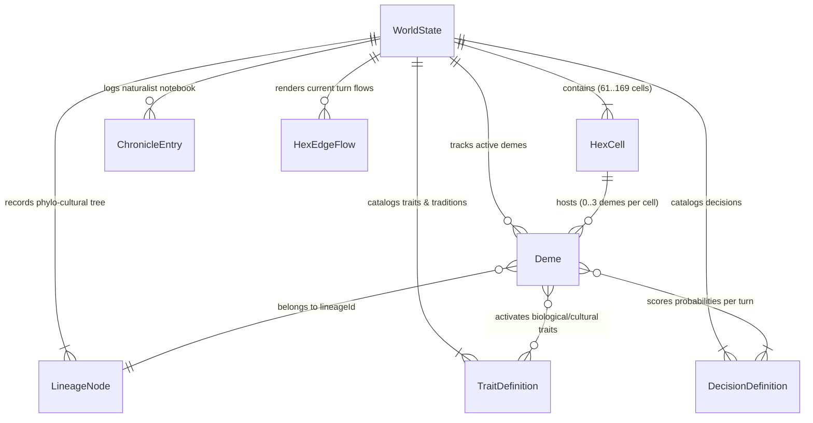

# Phase 1 Data Model: Simulador Evolutivo y Socio-Cultural de Poblaciones (Evolution)

**Feature**: `001-evo-population-sim`
**Date**: 2026-11-03
**Spec**: [spec.md](./spec.md)

## 1. Diagrama de Entidades y Relaciones

---

## 2. Entidades Principales y Restricciones de Validación

### 2.1. `BiophysicalVector` (Vector Biofísico de 6 Ejes — `FR-007`, `SC-005`)

Representa el impacto físico, metabólico y ecológico de cualquier Rasgo Biológico, Tradición Cultural o Decisión Conductual.

| Campo | Tipo | Rango / Restricción | Descripción |
| :--- | :--- | :--- | :--- |
| `metabolicCost` | `number` | `[-1.0, 1.0]` | Coste calórico por individuo/turno (`> 0` incrementa gasto; `< 0` ahorra energía). |
| `extractionEfficiency` | `number` | `[-1.0, 1.0]` | Modificador de extracción de biomasa/recursos del hexágono. |
| `ecologicalImpact` | `number` | `[-1.0, 1.0]` | Impacto sobre la capacidad de carga $K$ de la celda (`< 0` degrada $K$; `> 0` regenera/conserva $K$). |
| `spatialMobility` | `number` | `[-1.0, 1.0]` | Capacidad para cruzar barreras topográficas/climáticas y reducir coste de migración. |
| `socialCohesion` | `number` | `[-1.0, 1.0]` | Ventaja cooperativa interna y capacidad defensiva/competitiva en disputas inter-deme. |
| `transmissionThreshold` | `number` | `[0.0, 1.0]` | Exigencia social/cognitiva para mantener o difundir el elemento (y facilidad de innovación). |

**Regla de Validación Termodinámica (`FR-007`, `SC-005`)**:
Para todo elemento creado o editado con `freeSandboxMode === false`:
$$\text{positiveAdvantages} = \max(0, \text{extractionEfficiency}) + \max(0, \text{spatialMobility}) + \max(0, \text{socialCohesion})$$
$$\text{compensatoryCost} = \text{metabolicCost} - \min(0, \text{ecologicalImpact})$$
Si $\text{positiveAdvantages} > 0.60$, debe cumplirse:
$$\text{compensatoryCost} \ge 0.50 \times (\text{positiveAdvantages} - 0.60)$$
Si no se cumple, el validador incrementa automáticamente `metabolicCost` hasta satisfacer la igualdad (acotado a `1.0`).

---

### 2.2. `TraitDefinition` (Rasgo Biológico o Tradición Cultural — `FR-007`, `FR-008`, `FR-012`)

| Campo | Tipo | Restricción | Descripción |
| :--- | :--- | :--- | :--- |
| `id` | `string` | Único, no vacío (`^[a-z0-9-]+$`) | Identificador canónico del rasgo o tradición. |
| `name` | `string` | `1..60` caracteres | Nombre legible para el jugador y para los prompts de IA. |
| `category` | `'biological' \| 'cultural'` | Requerido | Categoría: heredado genéticamente (`biological`) o aprendido socialmente (`cultural`). |
| `semanticDescriptor` | `string` | `10..300` caracteres | Descripción semántica de su función adaptativa evaluada por `d3:4b`. |
| `affinityCondition` | `string` | `5..200` caracteres | Contexto ambiental o social donde este rasgo favorece ciertas decisiones. |
| `mutuallyExclusiveWith` | `string[]` | Array de `TraitDefinition.id` | IDs de rasgos incompatibles (ej. `bio-r-strategy` vs. `bio-k-strategy`). |
| `enablesCulturalTransmission` | `boolean` | Requerido | Si es `true` (ej. *Encefalización*, *Sociabilidad Instintiva*), habilita al *deme* para adquirir y conservar tradiciones culturales (`FR-008`). |
| `biophysicalVector` | `BiophysicalVector` | Válido según §2.1 | Modificadores biofísicos permanentes mientras el rasgo esté activo en el *deme*. |
| `origin` | `'base' \| 'user' \| 'emergent'` | Requerido | Origen del rasgo (catálogo base, creado por usuario o sintetizado en hito por `gemma4:e4b-it-qat`). |
| `freeSandboxMode` | `boolean` | Requerido | Indica si fue guardado omitiendo explícitamente la restricción termodinámica. |

---

### 2.3. `DecisionDefinition` (Decisión Conductual — `FR-006`, `FR-007`, `FR-008`)

| Campo | Tipo | Restricción | Descripción |
| :--- | :--- | :--- | :--- |
| `id` | `string` | Único, no vacío (`^[a-z0-9-]+$`) | Identificador canónico de la decisión. |
| `name` | `string` | `1..60` caracteres | Nombre legible en el Inspector Cognitivo. |
| `archetype` | `'forage' \| 'overexploit' \| 'migrate' \| 'cooperate' \| 'exchange' \| 'dispute' \| 'innovate' \| 'custom'` | Requerido | Arquetipo funcional que determina qué regla espacial/inter-deme activa en la Fase 3. |
| `semanticDescriptor` | `string` | `10..300` caracteres | Criterio semántico enviado a `d3:4b` en `questions.decision.criteria[id]`. |
| `requiredTraitIds` | `string[]` | Array de `TraitDefinition.id` | Si no está vacío, el *deme* debe poseer al menos uno de estos rasgos para que la decisión sea elegible. |
| `biophysicalVector` | `BiophysicalVector` | Válido según §2.1 | Efecto biofísico aplicado proporcionalmente al peso $P_i$ asignado por `d3:4b` en ese turno. |
| `origin` | `'base' \| 'user'` | Requerido | Origen de la decisión. |
| `freeSandboxMode` | `boolean` | Requerido | Indica si omite la restricción termodinámica. |

---

### 2.4. `HexCell` (Celda Hexagonal — `FR-001`, `FR-002`)

| Campo | Tipo | Restricción | Descripción |
| :--- | :--- | :--- | :--- |
| `id` | `string` | Formato `"${q},${r}"` | Clave única axial de la celda. |
| `q` | `number` | Entero $\in [-R, R]$ | Coordenada axial $q$. |
| `r` | `number` | Entero $\in [-R, R]$ | Coordenada axial $r$ ($s = -q - r$). |
| `biome` | `BiomeType` | `'tropical_forest' \| 'savanna' \| 'arid_steppe' \| 'tundra' \| 'high_mountain' \| 'coastal_shallows' \| 'ocean'` | Bioma actual del hexágono. |
| `temperature` | `number` | `[-1.0, 1.0]` | Temperatura base normalizada (`-1.0` glacial, `0.0` templada, `1.0` tórrida). |
| `humidity` | `number` | `[0.0, 1.0]` | Humedad disponible (`0.0` hiperárido, `1.0` saturado/selvático). |
| `altitude` | `number` | `[0.0, 1.0]` | Altitud topográfica (`< seaLevel` sumergido; `>= 0.85` alta montaña). |
| `currentResources` | `number` | `[0, carryingCapacityMax * 1.5]` | Biomasa/energía extraíble en el turno actual. |
| `carryingCapacity` | `number` | `[10, carryingCapacityMax]` | Capacidad de carga actual ($K$), que se degrada por sobreexplotación y se regenera por turno. |
| `carryingCapacityMax` | `number` | `[50, 2000]` | Capacidad de carga máxima base ($K_{\max}$) del bioma. |
| `seasonalRegenRate` | `number` | `[0.02, 0.50]` | Fracción de $K$ que se regenera como biomasa en cada turno. |
| `demeIds` | `string[]` | Longitud `0..3` | IDs de los *demes* presentes en este hexágono (máximo 3 por celda). |

---

### 2.5. `Deme` (Subpoblación Local — `FR-003`, `FR-004`, `FR-013`)

| Campo | Tipo | Restricción | Descripción |
| :--- | :--- | :--- | :--- |
| `id` | `string` | Único, no vacío | Identificador del *deme*. |
| `name` | `string` | `1..60` caracteres | Nombre descriptivo del *deme* (ej. `"Linaje Austral - Sabana (2,-1)"`). |
| `lineageId` | `string` | Referencia a `LineageNode.id` | Identificador de la especie/linaje en el Árbol Filo-Cultural. |
| `color` | `string` | Color Hex (`^#[0-9A-Fa-f]{6}$`) | Color distintivo para renderizar su clúster y vectores de flujo en el mapa. |
| `hexId` | `string` | Referencia a `HexCell.id` | Hexágono donde reside actualmente. |
| `population` | `number` | Entero $\ge 10$ (si $< 10 \implies$ extinto) | Individuos representados en la subpoblación. |
| `energyReserves` | `number` | `>= 0` | Reservas calóricas acumuladas del *deme*. |
| `lastEnergyDelta` | `number` | Número real | Balance energético neto ($\text{extraído} - \text{gasto metabólico}$) del último turno. |
| `biologicalTraitIds` | `string[]` | IDs de `TraitDefinition` (`biological`) | Rasgos biológicos activos en este *deme*. |
| `culturalTraitIds` | `string[]` | IDs de `TraitDefinition` (`cultural`) | Tradiciones culturales activas en este *deme*. |
| `baldwinCounters` | `Record<string, number>` | Enteros $\ge 0$ por `decisionId` | Turnos acumulados usando una decisión adaptativa ($P_i \ge 0.35$) bajo presión. Dispara Efecto Baldwin al llegar a `8`. |
| `innovationCounter` | `number` | `[0.0, 2.0]` | Acumulador de inversión en *Exploración / Innovación*. Dispara nueva tradición cultural al llegar a `1.0`. |
| `isolationTurns` | `number` | Entero $\ge 0$ | Turnos consecutivos sin flujo migratorio ni fusión con otros *demes* de su mismo `lineageId`. Dispara especiación al llegar a `10` con divergencia $\ge 30\%$. |
| `lastDecisionProbabilities` | `Record<string, number>` | $\sum P_i = 1.0$, cada $P_i \in [0, 1]$ | Última distribución de probabilidades calculada por `d3:4b`. |
| `lastDominantDecisionId` | `string` | Referencia a `DecisionDefinition.id` | Decisión con mayor probabilidad en el último turno. |
| `lastJustification` | `string` | No vacío | Resumen de los factores contextuales y rasgos que determinaron la puntuación del turno (`SC-003`). |

---

## 2.6. `SupportedLocale`, `LineageNode`, `ChronicleEntry`, `HexEdgeFlow` y `WorldState`

- **`SupportedLocale`**:
  - `'en' | 'es' | 'zh' | 'fr' | 'de' | 'pt' | 'ja' | 'ru'` (por defecto `'en'` — English).

- **`LineageNode`**:
  - `id: string`
  - `parentId: string | null` (raíz ancestral tiene `null`)
  - `name: string`
  - `color: string`
  - `foundedGeneration: number`
  - `extinctGeneration: number | null`
  - `founderHexId: string`
  - `acquiredTraitIds: string[]`
  - `divergenceReason: 'initial' | 'allopatric_speciation' | 'cultural_schism' | 'baldwin_assimilation'`

- **`ChronicleEntry`**:
  - `id: string`
  - `generation: number`
  - `type: 'baldwin_trait' | 'cultural_innovation' | 'allopatric_speciation' | 'cultural_loss' | 'extinction' | 'tragedy_of_commons' | 'symbiosis' | 'single_survivor' | 'ecological_equilibrium'`
  - `title: string`
  - `body: string` (crónica naturalista redactada por `gemma4:e4b-it-qat` o plantilla determinista en eventos de colapso y desenlaces macro-evolutivos)
  - `demeId: string`
  - `lineageId: string`
  - `hexId: string`

- **`HexEdgeFlow`**:
  - `fromHexId: string`
  - `toHexId: string`
  - `demeId: string`
  - `color: string`
  - `type: 'migration' | 'exchange' | 'dispute'`
  - `intensity: number` (`[0.05, 1.0]`)

- **`WorldState`**:
  - `presetId: string`
  - `generation: number` (entero $\ge 0$)
  - `season: 'wet_warm' | 'dry_cold'`
  - `seaLevel: number` (`[0.0, 0.50]`, umbral de altitud por debajo del cual `coastal_shallows` se inunda como `ocean`)
  - `selectivePressurePoints: number` (entero $\ge 0$)
  - `selectivePressureRegenPerTurn: number` (por defecto `15`)
  - `unlimitedPressureMode: boolean`
  - `autoPauseOnMilestone: boolean` (por defecto `false` en todos los presets)
  - `quietTurns?: number` (entero $\ge 0$, por defecto `0`; generaciones consecutivas en estabilidad estacionaria sin migraciones, extinciones ni nuevos hitos)
  - `mapRadius: number` (`4..7`)
  - `cells: Record<string, HexCell>`
  - `demes: Record<string, Deme>`
  - `traitsCatalog: Record<string, TraitDefinition>`
  - `decisionsCatalog: Record<string, DecisionDefinition>`
  - `lineageTree: Record<string, LineageNode>`
  - `chronicle: ChronicleEntry[]`
  - `currentTurnFlows: HexEdgeFlow[]`

- **`PresetScenario`**:
  - `id: string` (`'preset-rift-savanna' | 'preset-darwin-archipelago' | 'preset-finite-island'`)
  - `name: string` (`1..80` caracteres)
  - `description: string`
  - `scientificHypothesis: string`
  - `glacialSeaLevelCycle: boolean`
  - `createInitialWorld: () => WorldState`

---

## 3. Catálogo Base Inicial (`FR-008`)

### 3.1. Las 7 Decisiones Base (`DecisionDefinition`)

| `id` | `name` | `archetype` | `metabolicCost` | `extractionEfficiency` | `ecologicalImpact` | `spatialMobility` | `socialCohesion` | `transmissionThreshold` | Requisitos |
| :--- | :--- | :--- | :---: | :---: | :---: | :---: | :---: | :---: | :--- |
| `dec-conservative-forage` | Forrajeo Conservador | `forage` | `0.10` | `0.35` | `0.10` | `0.00` | `0.05` | `0.05` | Ninguno |
| `dec-intensive-overexploit` | Sobreexplotación Intensiva | `overexploit` | `0.25` | `0.85` | `-0.65` | `0.00` | `-0.10` | `0.10` | Ninguno |
| `dec-selective-migration` | Migración Selectiva | `migrate` | `0.30` | `0.15` | `0.15` | `0.75` | `0.05` | `0.10` | Ninguno |
| `dec-cooperate-store` | Cooperación y Almacenamiento | `cooperate` | `0.25` | `0.45` | `0.15` | `-0.10` | `0.65` | `0.35` | Ninguno |
| `dec-exchange-symbiosis` | Intercambio / Simbiosis | `exchange` | `0.35` | `0.50` | `0.20` | `0.20` | `0.60` | `0.45` | `bio-encephalization` o `bio-social-instinct` |
| `dec-territorial-dispute` | Disputa Territorial | `dispute` | `0.55` | `0.40` | `-0.30` | `0.25` | `0.55` | `0.20` | Ninguno |
| `dec-explore-innovate` | Exploración / Innovación | `innovate` | `0.50` | `0.15` | `0.00` | `0.40` | `0.35` | `0.65` | Ninguno |

### 3.2. Los 6 Rasgos Biológicos Base (`TraitDefinition` — `category: 'biological'`)

| `id` | `name` | Exclusión Mutua | Cultura (`enablesCulturalTransmission`) | Vector `(met, ext, eco, mob, soc, thr)` |
| :--- | :--- | :--- | :---: | :--- |
| `bio-r-strategy` | Estrategia r (Prolífica) | `bio-k-strategy` | `false` | `(-0.15, 0.20, -0.20, 0.25, -0.15, 0.05)` |
| `bio-k-strategy` | Estrategia K (Longeva / Inversión Parental) | `bio-r-strategy` | `false` | `(0.20, 0.25, 0.15, 0.05, 0.40, 0.30)` |
| `bio-digestive-spec` | Especialización Digestiva Omnívora | — | `false` | `(0.10, 0.45, 0.05, 0.15, 0.00, 0.10)` |
| `bio-thermal-tolerance` | Tolerancia Térmica e Hídrica | — | `false` | `(0.15, 0.20, 0.05, 0.45, 0.10, 0.10)` |
| `bio-encephalization` | Encefalización (Tejido Costoso) | — | `true` | `(0.45, 0.35, 0.00, 0.20, 0.45, 0.60)` |
| `bio-social-instinct` | Sociabilidad Instintiva (Gregarismo) | — | `true` | `(0.20, 0.20, 0.05, 0.10, 0.60, 0.45)` |

### 3.3. Las 5 Tradiciones Culturales Base (`TraitDefinition` — `category: 'cultural'`)

| `id` | `name` | Vector `(met, ext, eco, mob, soc, thr)` |
| :--- | :--- | :--- |
| `cul-fire-processing` | Fuego y Procesado de Alimentos | `(-0.10, 0.35, -0.25, 0.10, 0.15, 0.40)` |
| `cul-extraction-tools` | Herramientas de Extracción | `(0.25, 0.65, -0.25, 0.10, 0.20, 0.50)` |
| `cul-communal-conservation` | Normas de Conservación Comunal | `(0.15, 0.25, 0.55, 0.00, 0.50, 0.55)` |
| `cul-interdeme-barter` | Redes de Trueque Inter-Deme | `(0.35, 0.40, 0.15, 0.30, 0.50, 0.60)` |
| `cul-warrior-expansion` | Tradición Guerrera / Expansionista | `(0.45, 0.30, -0.35, 0.45, 0.60, 0.45)` |

---

## 4. Transiciones de Estado y Reglas de Ciclo de Vida

1. **Creación / Fisión (`Deme`)**: Un `Deme` se instancia al cargar un `PresetScenario` o durante la Fase 3 cuando la población migrante ($P_{\text{actual}} \times P_{\text{migrate}} \ge 10$) se desplaza a una `HexCell` vecina transitable que tenga $< 3$ *demes* (o donde exista un *deme* del mismo `lineageId` con divergencia de Jaccard $< 0.10$, en cuyo caso se fusiona directamente).
2. **Cuello de Botella Cultural**: Si al finalizar la Fase 3 un `Deme` vivo ($\ge 10$ individuos) ha perdido $\ge 50\%$ de su población respecto al inicio del turno o queda con `population < 50`, y posee al menos una tradición en `culturalTraitIds`, se elimina la tradición con mayor `transmissionThreshold` y se añade una `ChronicleEntry` de tipo `'cultural_loss'`.
3. **Extinción (`Deme` y `LineageNode`)**: Si `population < 10`, el `Deme` se elimina de `WorldState.demes` y de `HexCell.demeIds`, añadiendo una `ChronicleEntry` de tipo `'extinction'`. Si ningún otro `Deme` activo referencia ese `lineageId`, se marca `LineageNode.extinctGeneration = worldState.generation`.
4. **Desenlaces Macro-Evolutivos (`total_extinction`, `single_survivor`, `ecological_equilibrium`)**:
   - **Extinción Total**: Cuando `Object.keys(worldState.demes).length === 0`, el `Auto-Play` pasa a `'paused'`.
   - **Superviviente Único / Hegemonía (`single_survivor`)**: Si al cierre del turno existe al menos una `'extinction'` previa en `chronicle`, aún no se ha registrado una entrada `'single_survivor'`, y queda un único `Deme` vivo (`Object.keys(demes).length === 1`) o un único `lineageId` vivo tras haberse extinguido al menos otro linaje de `lineageTree`, se registra una `ChronicleEntry` de tipo `'single_survivor'` y se pausa el `Auto-Play`.
   - **Equilibrio Ecológico y Demográfico (`ecological_equilibrium`)**: Si durante `quietTurns >= 8` generaciones consecutivas (con `generation >= 30`) no se producen fisiones migratorias, extinciones, colapsos ni nuevos hitos evolutivos/culturales y las poblaciones oscilan de forma estacionaria ($\le 10\%$ de variación por turno), se registra una `ChronicleEntry` de tipo `'ecological_equilibrium'` y se pausa el `Auto-Play`.
